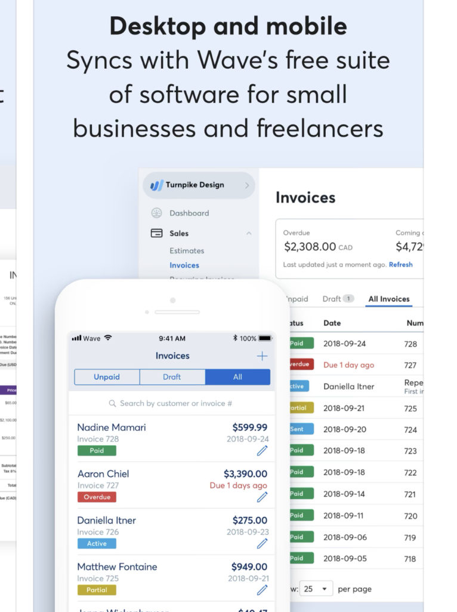
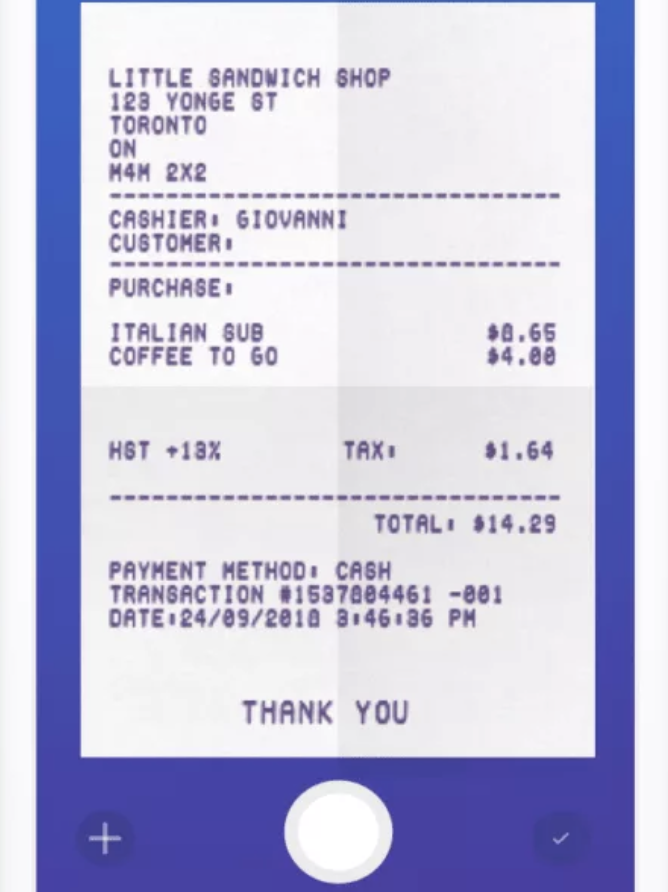
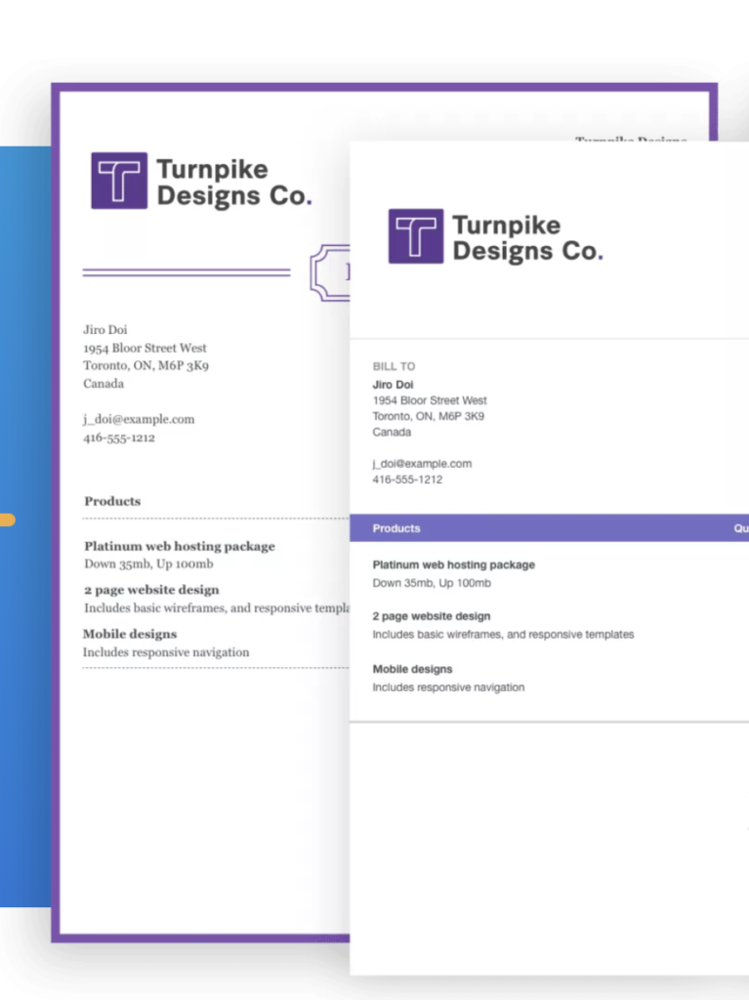
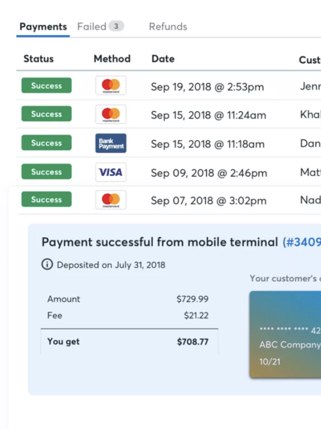
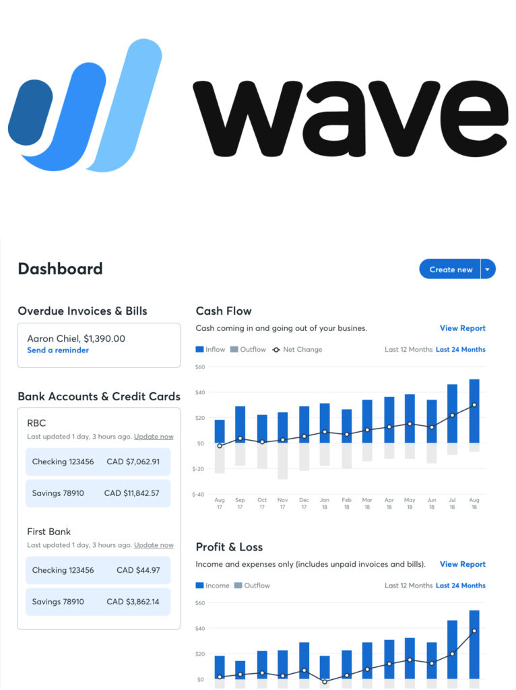
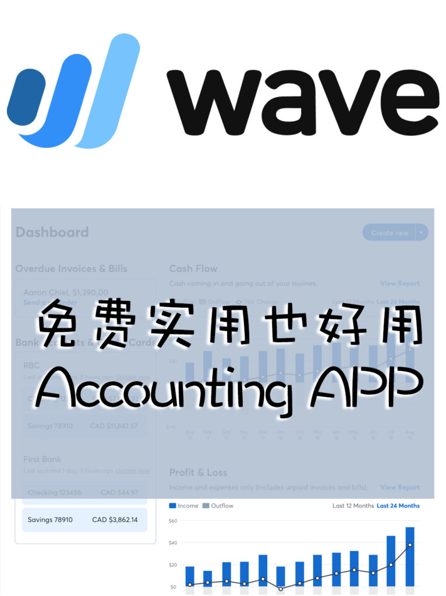

<!-- 2026年11月更新模块：直接粘贴在 YAML 头部 --- 下方 -->

  

    2026年11月最新校准
    <strong style="color: #141413; font-size: 16px;">⚠️ 重大收费变动：Wave 免费版已取消“自动导银行流水”与“拍照扫收据”！2026 记账软件选型校准</strong>
  

  

    本文写于 2021 年 1 月。在被税务巨头 H&R Block 收购后，Wave 对其免费策略进行了重大收缩。截至 <strong>2026 年 11 月</strong>，下文图 5 提到的“免费拍照扫收据 App”以及“免费自动同步银行流水”均已移入付费墙，注册前请务必看清以下 3 点最新实况：
  

  <ul style="margin: 0 0 12px 0; padding-left: 20px;">
    <li style="margin-bottom: 6px;"><strong>1. Wave 2026 最新双层计费标准（Starter $0 vs. Pro 付费版）：</strong>
       • <strong>Starter 免费版（$0/月）：</strong>依然支持无限制发送电子发票（Invoicing）与基础手动记账出报表；但<strong>不再支持自动连接五大行商业卡同步流水（须每月手动下载上传银行 CSV 账单）</strong>，且不含收据拍照自动识别；
       • <strong>Pro 专业版（$19 USD/月，加拿大区约 $25 CAD/月）：</strong>只有升级 Pro 版（或单独按 $11 CAD/月购买收据插件），才能解锁<strong>自动同步银行流水（Auto Bank Feeds）、无限制手机拍照 OCR 识别收据（Wave Receipts）以及发票逾期自动发信催款</strong>功能。此外，免费版线上刷卡手续费已调整为 <strong>2.9% + $0.60/笔</strong>（Pro 版享 2.9% + $0.30/笔优惠）。
    </li>
    <li style="margin-bottom: 6px;"><strong>2. 2026 什么时候继续用 Wave？什么时候直接上 QuickBooks / Synder？</strong>
       • <strong>每月仅几笔大额账单的独立顾问/设计工作室：</strong>用 <strong>Wave Starter（$0）</strong> 手动记账完全够用；若需将“提案 → 签具有法律效力的电子合同 → 自动扣定金与分期款”串成闭环，推荐搭配本站团队实测的 <a href="https://www.dubsado.com/?c=qilin21" target="_blank" rel="sponsored noopener" style="color: #8A2520; font-weight: 600;">Dubsado</a>；
       • <strong>有高频收支或运营电商独立站的公司：</strong>既然 Wave Pro 现已收费 $25 CAD/月，强烈建议直接选用北美 CPA 会计师最通用的 <strong>QuickBooks Online（加拿大基础版 EasyStart $30 CAD/月起）</strong> 或 <strong>Xero</strong>。如果你开有 <a href="https://shopify.pxf.io/c/5878481/3323859/13624" target="_blank" rel="sponsored noopener" style="color: #8A2520; font-weight: 600;">Shopify</a> / Stripe 网店，务必搭配 <a href="https://synder.com/" target="_blank" rel="sponsored noopener" style="color: #8A2520; font-weight: 600;">Synder</a>（Wave 无法原生精细拆解跨省电商订单的通道手续费与各省 GST/PST/HST 税码，而 Synder + QBO/Xero 可实现 100% 零差错自动对账）。
    </li>
    <li style="margin-bottom: 0;"><strong>3. CRA 电子收据 6 年留存合规提醒：</strong>无论用哪款软件拍照存收据，只要扫描件清晰完整记录了商家 GST 税号、日期与明细，依据 <strong>CRA IC05-1R1 规范</strong>即具备与纸质原件同等的法定效力（须自报税年度结束起在云端保留满 <strong>6 年</strong>）。</li>
  </ul>
  

    💡 财税工具箱：前往本站 <a href="/tools/" style="color: #141413; font-weight: 600; text-decoration: underline;">《北美创业工具箱（含 Synder / Dubsado / Gusto）》</a>。
  

* 
* 
* 
* 
* 
* 

能在一众accounting app中胜出，免费这一条是具有压倒性的优势的。但Wave能在这个竞争激烈的市场上始终占有一席之地，也绝不是免费就能hold得住的。人们常常会拿它Quickbooks相比，后者的确更加专业，但问题就在于它太过专业，所以才是专业会计的最爱。

图1 对大多数微企业主和自由职业者来说，Wave的功能不仅足够而且表现不俗——发Invoice，收账，收据，报税，财务报表等等，都能搞定。有桌面和手机app，方便实用。

图3 Wave的invoice界面清爽，虽然选择和自定义选项都不多，但只要不想太花哨也足够用了。有定时发送invoice的功能，同时可以设置自动提醒，在due date之前、当天，或者overdue了之后，Wave都可以自动发信提醒。

图4 Wave自己有payment solutions，收信用卡和电子支票。收费基本就是标准的2.9%+30c（AE贵一点，3.4%+30c）。用户可以设置Bank Payments优先，只有1%的charge，如果客户刚好选了这个，就能节省一点点营运开支。

图5 现在都网上购物，基本用不上收据。偶尔有的时候，wave还有一个receipts app，扫一下基本上能够自动录入所有的有用信息，你可以review一下，然后通过，就不用每个月手动录入所有的经营开支了。
