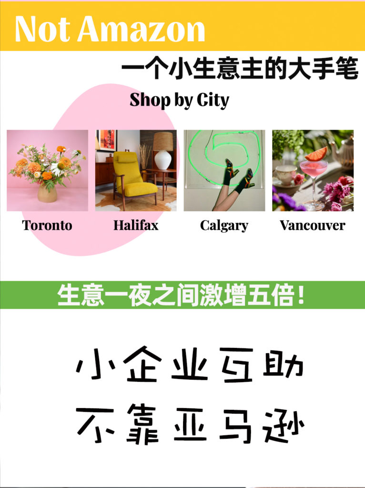
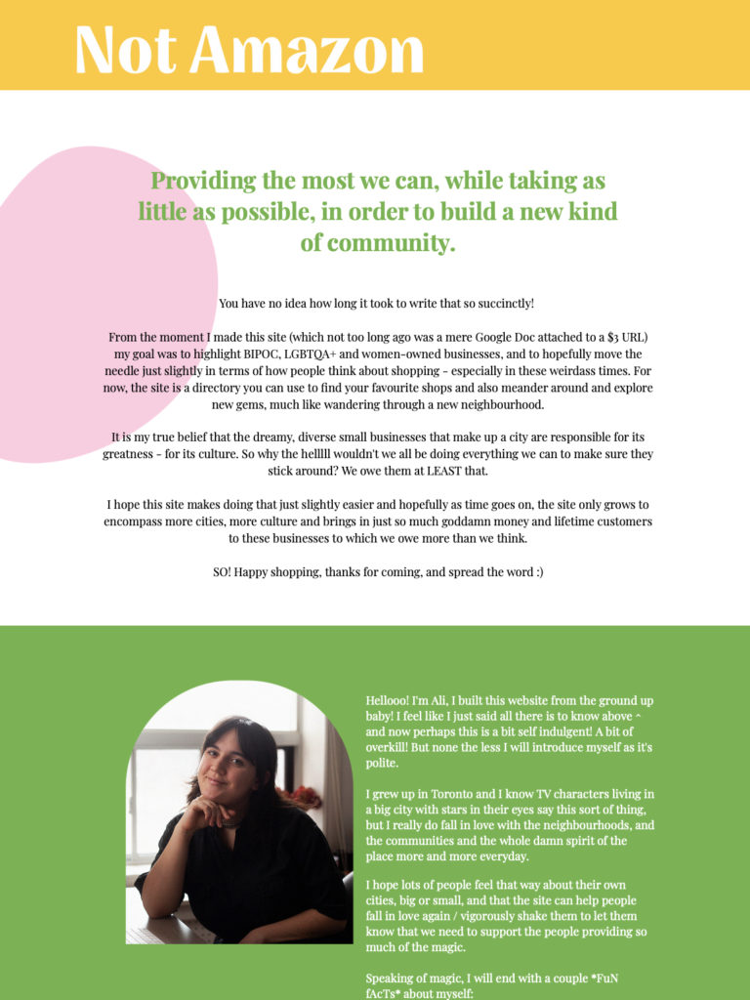
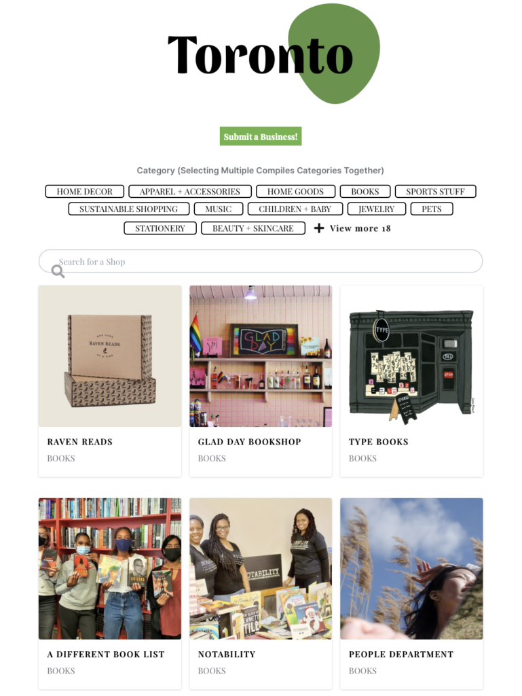
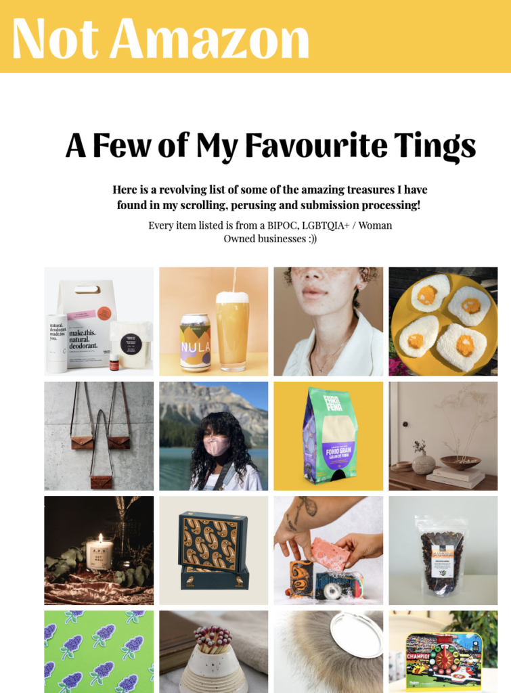
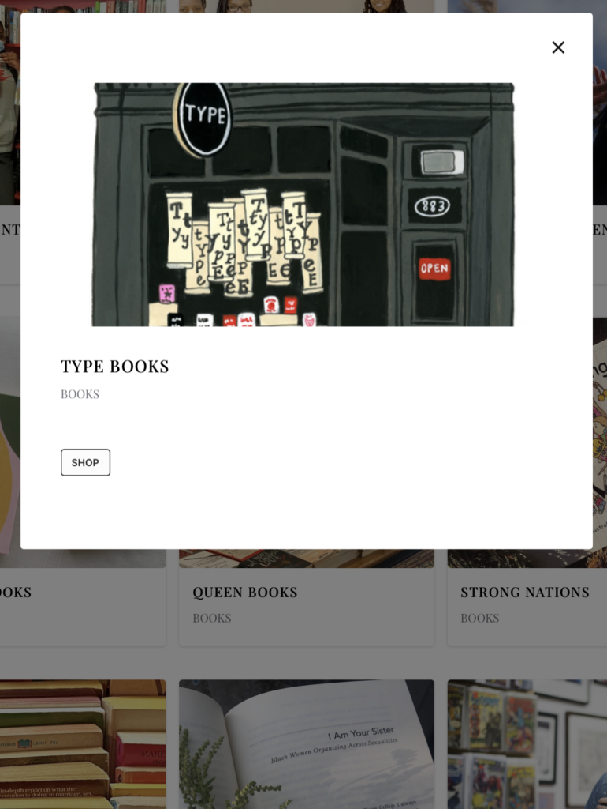
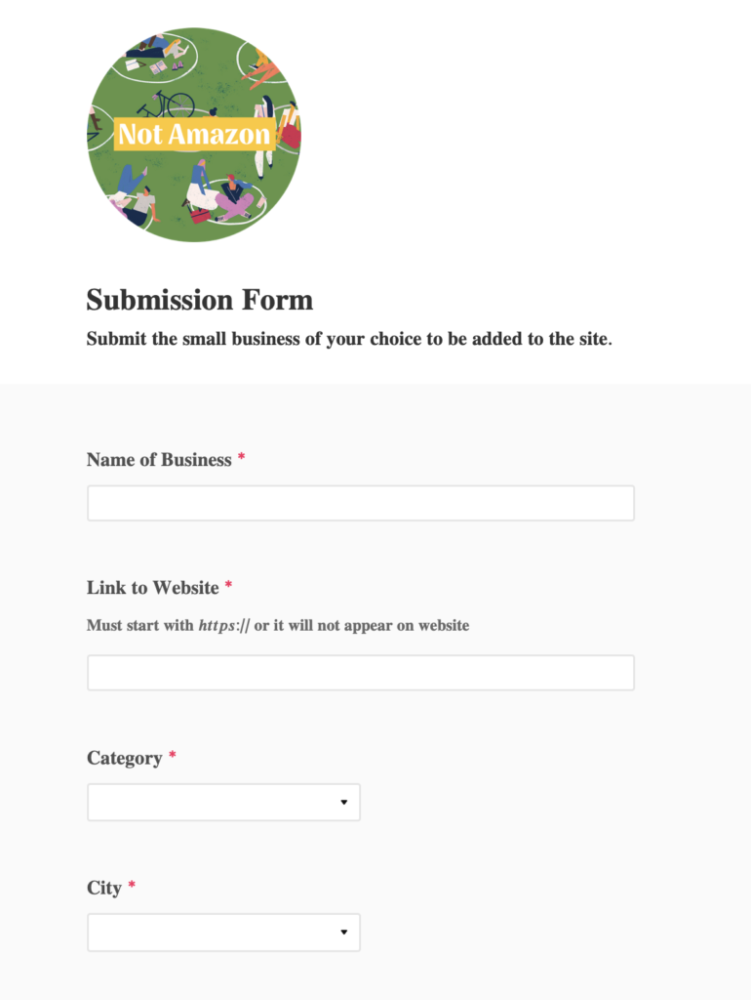

<!-- 2026年11月更新模块：直接粘贴在 YAML 头部 --- 下方 -->

  

    2026年11月最新校准
    <strong style="color: #141413; font-size: 16px;">Not-Amazon.ca 后续复盘：2026 加拿大独立小店靠什么真正实现“联手反击”？</strong>
  

  

    本文记录于 2021 年 2 月。当时多伦多社媒人 Ali Haberstroh 花 $2.99 买下域名创办的草根本地小店名录 <em>Not-Amazon.ca</em>，在疫情封城期间曾创下两周 35 万访问量的佳话。但时隔五年，到了 <strong>2026 年 11 月</strong>，这个案例给了我们更深刻的商业启示与全新的替代渠道：
  

  <ul style="margin: 0 0 12px 0; padding-left: 20px;">
    <li style="margin-bottom: 6px;"><strong>1. 为什么纯静态公益名录难以持久？（Not-Amazon.ca 现状）：</strong>由于该网站完全依赖发起人下班后手动审核 Excel 表格、缺乏可持续的商业造血模式且无法在站内直接搜索商品结账，随着线下解封，Not-Amazon.ca 已停止常态化更新维护。这证明<strong>“支持本地小店（Shop Local）”不能只靠情怀黄页，必须缩短买家的搜索与结账摩擦力</strong>。</li>
    <li style="margin-bottom: 6px;"><strong>2. 2026 真正帮独立小店抢回亚马逊流量的两大数字武器：</strong>
       • <strong>Shopify Shop App（自带本地搜索与一键复购）：</strong>只要你用 <a href="https://shopify.pxf.io/c/5878481/3323859/13624" target="_blank" rel="sponsored noopener" style="color: #8A2520; font-weight: 600;">Shopify</a> 开店并免费开启 Shop 渠道，你的商品就会直接进入全北美数千万消费者手机里的 <strong>Shop App 本地探索名录（Shop Local Filter）</strong>，买家无需跳出即可用 Shop Pay 一键下单；
       • <strong>Shopify Collective（独立小店交叉带货同盟）：</strong>2026 年加拿大本地独立站不再单打独斗——卖手工咖啡豆的温哥华网店，可以通过 Shopify Collective 零库存一键代发本地陶艺师的手工马克杯，订单自动分账，真正把社区联合做成了商业闭环。
    </li>
    <li style="margin-bottom: 0;"><strong>3. 2026 大温本地品牌必进的高信任名录与渠道：</strong>在加美关税摩擦背景下，加拿大消费者对“Buy Canadian / Support Local”热情高涨。大温本地商家可免费登记素里市政府的 <strong>Invest Surrey 本地供应商目录</strong>、通过 <strong>MarketSpread</strong> 申请入驻温哥华农夫市集（VFM），或进驻对本地新锐品牌极友好的社区精品超市（如 <strong>Choices Markets、Nesters Market、Stong's Market、Famous Foods</strong>）。</li>
  </ul>

多一个小生意主Ali为了帮助当地其他小生意，用2.99美元买了域名[N](http://Not-Amazon.ca)[ot-Amazon.ca](http://Not-Amazon.ca)，把各个小企业、小店主分城市、分类别列在上面，可以链接到小企业自己的网站，吸引更多消费者。

加入的企业有一张图片，一个网站链接和一个分类。数据显示，有些小企业加入后在线订单增长5倍之多。

目前，网站涵盖了加拿大的多伦多、温哥华、卡尔加里、哈利法克斯四个城市，近万家小企业，浏览量近百万。如果你的小生意在这四个城市里，也可以提交申请加入其中。

让小企业被更多人看到，[N](http://Not-Amazon.ca)[ot-Amazon.ca](http://Not-Amazon.ca)做到了。

* 
* 
* 
* 热门推荐的小企业
* 单个企业的页面
* 提交加入的页面

图一：Not-Amazon.ca创办人Ali

图二：城市分页面

图三：热门推荐的小企业

图四：单个企业的页面

图五：提交加入的页面
