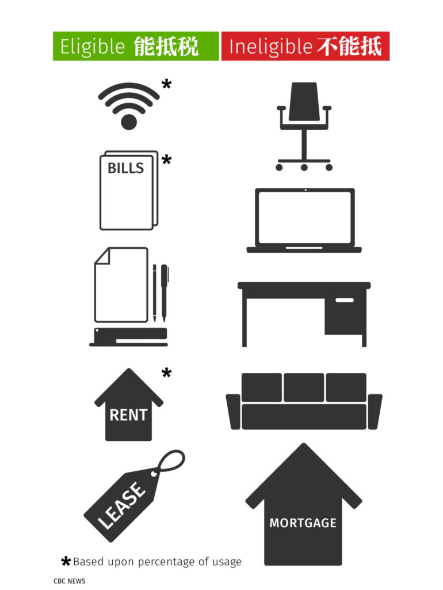

<!-- 2026年11月更新模块：直接粘贴在 YAML 头部 --- 下方 -->

  

    2026年11月最新政策校准
    <strong style="color: #141413; font-size: 16px;">居家办公（Home Office）三大避坑铁律：保住自住房免税权 & 有限公司报销规范</strong>
  

  

    在家创业（Business-use-of-home）是加拿大小生意最核心的固定抵税项之一。在 <strong>2026 年</strong>申报居家创业开支时，除了按下文方法计算面积比例外，请务必守住以下 3 条红线：
  

  <ul style="margin: 0 0 12px 0; padding-left: 20px;">
    <li style="margin-bottom: 6px;"><strong>1. 严禁计提房屋折旧（CCA），保住自住房免税权（PRE）：</strong>如果你在自己名下的自住房（Principal Residence）里办公，<strong>千万不要对房屋建筑物本身申报资产折旧（CCA）</strong>，且商业用途面积应控制在总面积的 50% 以内（不做永久性商业结构改建）。一旦申报了房屋折旧，未来卖房时该部分房产将<strong>丧失“自住房资本增值 100% 免税（Principal Residence Exemption）”资格</strong>，因小失大！</li>
    <li style="margin-bottom: 6px;"><strong>2. 按揭只能抵扣“利息”，绝不能抵扣“本金”：</strong>下文第 4 点提到的按揭开支，CRA 仅允许将<strong>按揭贷款利息（Mortgage Interest）</strong>纳入居家办公基数按面积比例折算，每月偿还的<strong>按揭本金（Principal）严禁抵税</strong>（租房创业则可将全部房租纳入基数按比例折算）。</li>
    <li style="margin-bottom: 0;"><strong>3. 独资自雇（T2125）vs. 有限公司（T2）的操作差异：</strong>下文填写的 T2125 表适用于自雇（Sole Proprietorship）。如果你注册的是<strong>有限公司（Corporation）</strong>，操作方式是：每月/每年按面积比例算出居家办公应分摊的水电气、地税、按揭利息或房租总额后，以<strong>“股东垫付费用报销（Shareholder Expense Reimbursement）”</strong>的形式由公司账户转账给个人——这样公司可 100% 税前扣除，而你个人收到的这笔报销款完全免税！</li>
  </ul>
  

    💡 保险防雷提醒：普通家庭房屋保险（Home Insurance）通常拒赔商业存货损毁或客户上门滑倒，居家创业若有存货或访客，请务必加挂商业扩展险或投保商业综合责任险（CGL）。
  

从小到大，听过无数车库创业成功的例子。在家里创业是加拿大很多小生意人的选择，[加拿大税务局](https://www.canada.ca/en/services/taxes.html)也有特别好的减税策略，在税务网站有专门的页面讲解[Business–use–of–home expenses](https://www.canada.ca/en/revenue-agency/services/tax/businesses/topics/daycare-your-home/deducting-your-business-expenses/business-use-home-expenses.html)，每年我们都会认真填写[T2125](https://www.canada.ca/en/revenue-agency/services/forms-publications/forms/t2125.html)这个部分，这里详细讲讲。

  1. 不会所有家里创业的生意都有资格减税，只有把你的住所作为主要经营场地，或者用住所内工作空间来赚取业务收入，定期用来和客户、顾客或患者会面，才能申请减免。如果你还在其他地方开展业务，或者只是有时候在家处理相关业务，都不符合资格。

  2. 你在税表其他地方已经减免的开支不能重复填写到T2125居家创业减免项目内。
  3. 报税时要说明做生意用到住所的比例，可以以房间数量作为比例，也可以按照使用面积作为比例，除以住所总数或房屋面积总数。可以选哪种比例更大。
  4. 计算居家创业减免会计算你的部分家庭开支，包括用电用水、天然气、电话、网络、卫生清洁材料、家庭保险费（居家创业有专门的保险，以后详细讲解）。如果你有按揭开支，可以算上按揭贷款利息、地税、房屋维修费用和房屋保险费，如果有物业管理费，也能加到里面。如果你是租的住所，把租金加在里面。
  5. 算出上述的总额，然后按照使用比例，拿得出的就是可以减免的开支。
  6. 如果你在外经营业务，家里有个办公室每周有几个白天用来开展业务，其余时间私人用途，那你需要把工作时间加在一起，如果一周三天，每天8小时，那就是24个小时，去除以一周的168小时，得出的比例就你这个办公室使用的比例是14.28%，再乘以你办公室所占整个房子的比例，最终结果就是可以减免开支的比例。
  7. 最后提醒，你如果收入没有超过扣除额，那可以把结余转到下一年使用。

* 
* 
