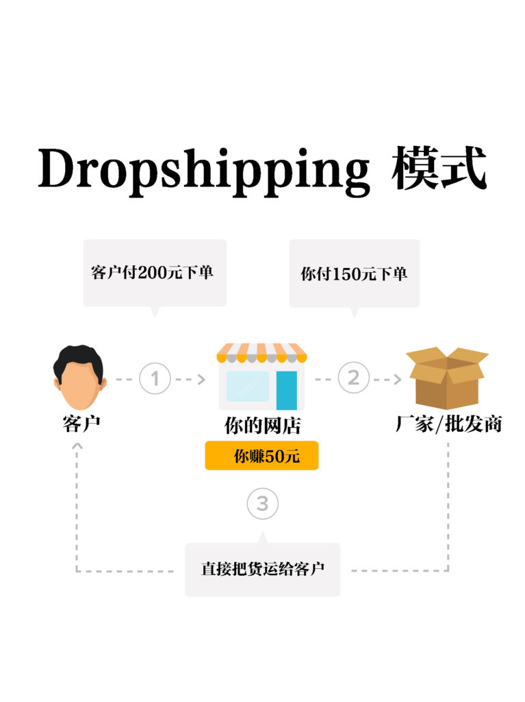
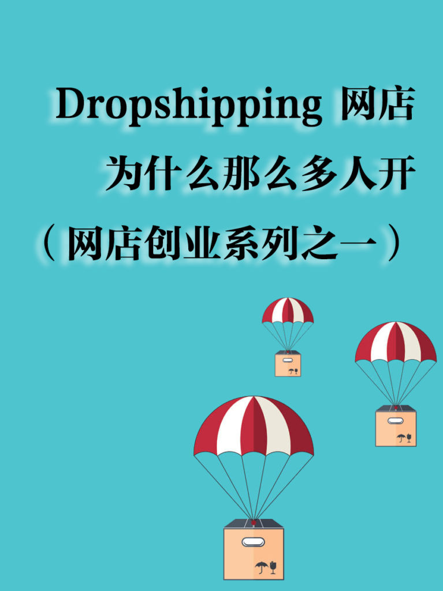

<!-- 2026年11月更新模块：直接粘贴在 YAML 头部 --- 下方 -->

  

    2026年11月最新校准
    <strong style="color: #141413; font-size: 16px;">告别“跨境廉价铺货”，2026 北美 Dropshipping 的三大新主流</strong>
  

  

    本文初写于 2021 年。五年后的今天，随着<strong>美国正式取消 $800 小额免税额（De Minimis）</strong>以及海关对跨境直邮小包全面征收关税与报关手续费，早年“从亚洲批发网站搬运几美元廉价小商品、单件免税直邮北美”的粗放倒卖模式已无法跑通。
  

  
<strong>在 2026 年的北美市场，真正赚钱的零库存代发（Dropshipping）已全面进化为以下 3 种合规形态：</strong>

  <ul style="margin: 0 0 12px 0; padding-left: 20px;">
    <li style="margin-bottom: 6px;"><strong>本土按需印制（Local POD）：</strong>通过 <a href="https://shopify.pxf.io/c/5878481/3323859/13624" target="_blank" rel="sponsored noopener" style="color: #8A2520; font-weight: 600;">Shopify</a> 搭配 Printify，开启美加本地路由（Local Routing）。买家下单后直接由美国或加拿大本土工厂印制并在 2–5 天内发货，100% 规避跨境关税与清关延误。</li>
    <li style="margin-bottom: 6px;"><strong>北美品牌互供分销（Shopify Collective）：</strong>Shopify 现已向美加全体合规商家免费开放 Collective 网络（取消了早年 5 万美元销售额门槛），允许你直接零库存代发其他北美成熟独立站品牌的正品好货，享受 20%–40% 的零售毛利。</li>
    <li style="margin-bottom: 0;"><strong>测款后转边境 3PL 拼单：</strong>前端用一件代发零风险测试市场反应，一旦跑出爆款，立刻改为批量海运至美加本地 3PL 海外仓（按出厂批发成本价申报关税），将综合履约成本砍掉一半以上。</li>
  </ul>
  

    💡 延伸工具：想测算 2026 跨境直邮与本地集货的关税差额？请访问本站 <a href="/resources/#calc-section" style="color: #141413; font-weight: 600; text-decoration: underline;">《北美创业合规导航与关税速算器》</a>。
  

就算不是因为疫情，开网店在北美也注定一样火。每天都有很多人在 [Etsy](https://www.etsy.com)、[Ebay](https://www.ebay.com)、[Amazon](https://www.amazon.com)、[Shopify](https://www.shopify.com)上开店创业。开过网店的人都知道，最难的部分是前期成本和物流，仓储库存复杂昂贵，要想赚取利润又有竞争力、有良好的客户体验，非常难。今天要将的网店模式Dropshipping就是解决痛点的一种模式。

这几年 Dropshipping 很火，几乎成了新一轮快速创业致富的潮流，不少创业者每月盈收高达数万或数十万美元。去年[BBC报道](https://www.bbc.com/news/technology-53759932)说，最牛的 Dropshipping 一年能赚百万美元。而英国运动品牌 [GymShark](https://gymshark.com) 用 Dropshipping+网红的模式做成一个5亿美元的生意。

* 
* 

Dropshipping是什么？

Dropshipping，中文翻译为”转运配送“或者”直运“，是网店老板在自己的网店接到客户订单，然后向厂商或批发商那里下单，让厂商或批发商直接发货给客户，自己赚取差价，无需物流和仓库。

目前北美有30%的网店是 Dropshipping 网店，很多时候你在网上买东西，可能意识不到自己是从一家Dropshipping模式的网店买了物品。

Dropshipping 模式出现在上个世纪末，这两年这种简单又投资小的模式特别受到初创小生意人的欢迎，毕竟钱和精力都只要花在促销和拉客户就行。

也就是说，只要你选对合适的商品，适好适合的平台，包装好网店的品味和风格，就可以做成drop shipping模式。

社交媒体上到处都是”我如何如何在1天内赚数千“、”我每月在xx平台上赚1万“的视频和帖子。听到这些，对于很多人来说，这样为啥还要花大量时间申请贷款、租场地开实体店铺呢？

美国一个叫 Tom Cormier 的化学工程师2017年在 [Ebay](https://www.ebay.com) 开了 Dropshipping 网店，第二天就卖了一个11美元的iPhone手机壳，赚了1美元，随后他每月能赚5000美元。目前，Cormier 创办的[Dropshipping University](https://dropshippinguniversity.com)已经有上万前来学习小生意人。

听起来很美好，但你跳进 Dropshipping 网店之前，一定要先了解其[Dropshipping优缺点](https://aswebuild.com/business/2021/04/23/开dropshipping网店系列之二：优劣有哪些？/)。
