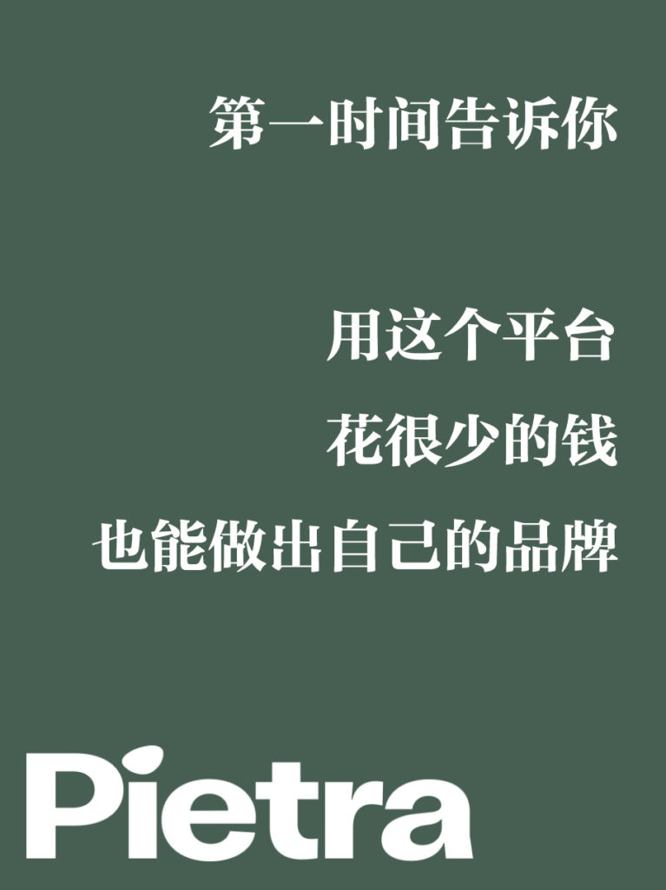
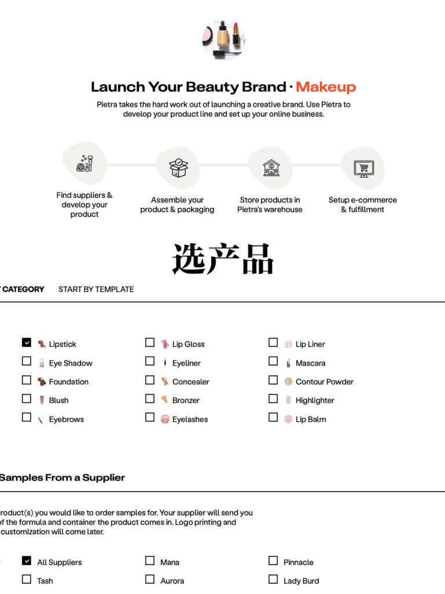
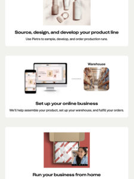
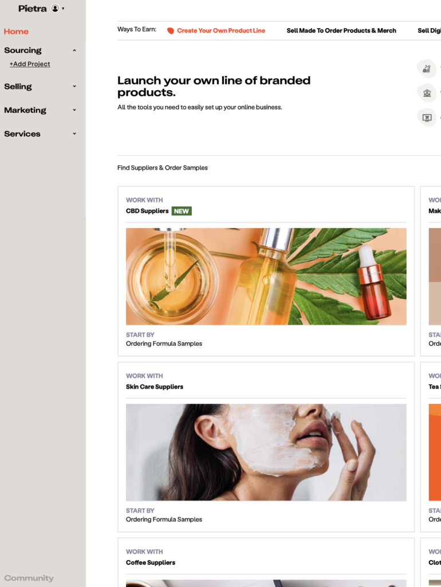
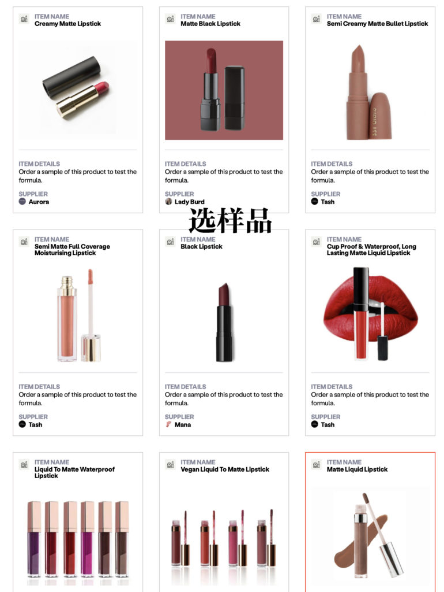
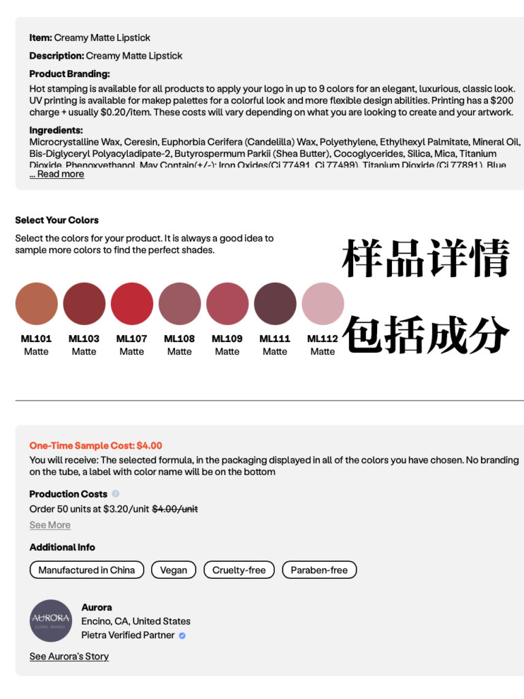
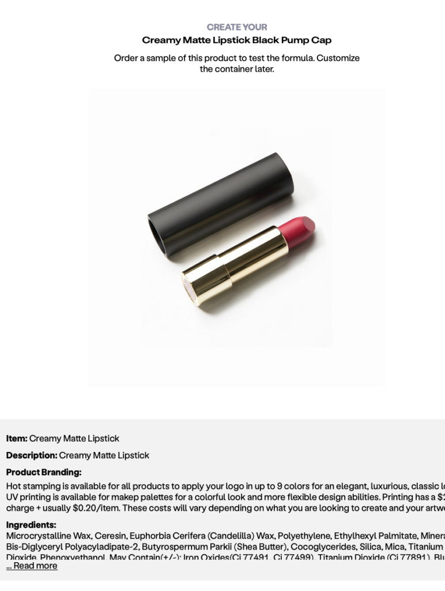
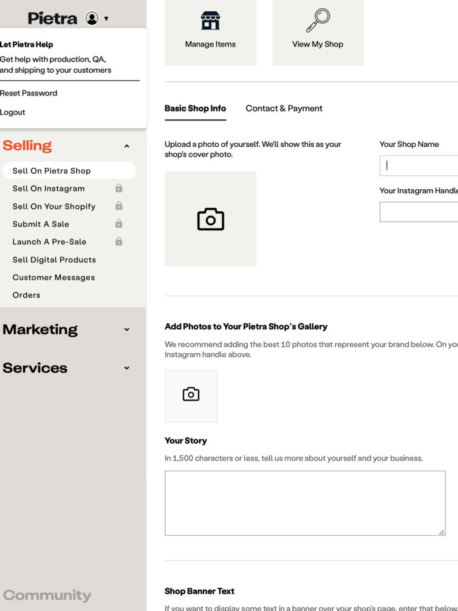
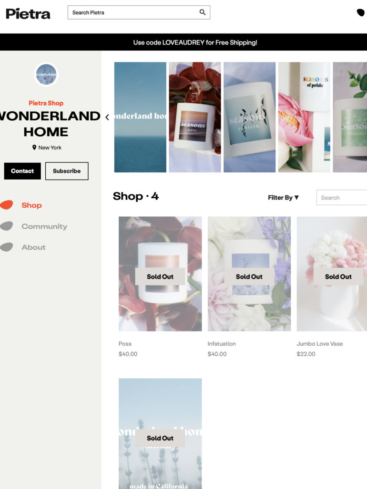
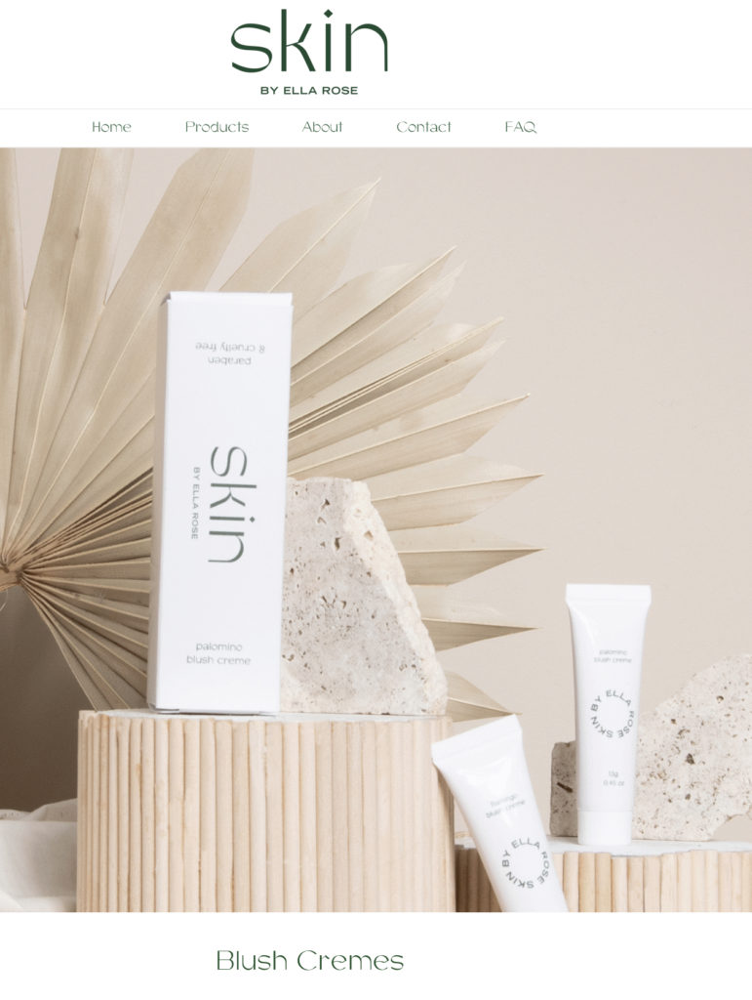

<!-- 2026年11月更新模块：直接粘贴在 YAML 头部 --- 下方 -->

  

    2026年11月最新校准
    <strong style="color: #141413; font-size: 16px;">Pietra 五年演进：已从“免费内测平台”转为付费 AI 供应链会员制 & 2026 轻资产平替方案</strong>
  

  

    本文写于 2021 年 4 月 Pietra 刚上线公测之时。五年后的今天（<strong>2026 年 11 月</strong>），Pietra 已成长为集 AI 产品设计、全球工厂寻源与 3PL 仓储履约于一体的成熟平台，但其收费模式与使用门槛已发生重大变化：
  

  <ul style="margin: 0 0 12px 0; padding-left: 20px;">
    <li style="margin-bottom: 6px;"><strong>1. 2026 最新收费标准（不再是完全免费注册使用）：</strong>Pietra 现实行付费会员制（提供 7 天免费试用）：
       • <strong>Pietra Essentials 基础版（$29 USD/月）：</strong>包含 Pietra AI 商业助手、AI Content Studio（产品图与广告生成）、Pietra Pulse 竞品监控，以及对接 <strong>1,500+ 家认证代工厂与供应商</strong>；
       • <strong>Pietra Business 进阶版（$239 USD/月）：</strong>解锁全部 <strong>40,000+ 家全球工厂与包装供应商</strong>，且其 3PL 仓储与代发费率享 35% 折扣（另在 Shopify 应用商店提供 $10/月的独立插件 <em>Pietra: AI Product Designer</em> 用于生成 3D 包装渲染与工艺单）。
    </li>
    <li style="margin-bottom: 6px;"><strong>2. 2026 关税与起订量（MOQ）防坑提醒：</strong>虽然 Pietra 汇聚了大量优质美妆、首饰与服饰代工厂，但定制自有品牌（Private Label）通常仍有最小起订量（MOQ）与打样费要求。在 2026 年美国取消 $800 免税额及加美关税摩擦背景下，在 Pietra 选厂时务必优先筛选<strong>美国或加拿大本土制造工厂</strong>，或直接将大货发入其北美本土 3PL 仓库（按出厂批发价申报关税），切忌从亚洲工厂单件直邮北美买家。</li>
    <li style="margin-bottom: 0;"><strong>3. 零月租、零起订量的平替起步方案（Shopify + Printify）：</strong>如果你刚起步，不想每月额外付平台会员费、也不想压第一批工厂定制库存，更稳妥的路径是直接用 <a href="https://shopify.pxf.io/c/5878481/3323859/13624" target="_blank" rel="sponsored noopener" style="color: #8A2520; font-weight: 600;">Shopify</a> 搭配免费注册的 <a href="https://printify.com/" target="_blank" rel="sponsored noopener" style="color: #8A2520; font-weight: 600;">Printify</a>（1 件起印、美加本地工厂代发），先零风险测出爆款设计，等月销稳定过百单后再用 Pietra 找工厂定制专属私模与包装。</li>
  </ul>

每个人都梦想有一个自己的品牌，可以是未来的 Apple、Tesla，可以是未来的LV或资生堂。但是做一个品牌谈何容易，需要影响力、需要生产线、需要大量的资金。

最近一个美国的创新公司上周刚刚推出了平台 [Pietra](https://www.pietrastudio.com)，口号是打造自己的产品线，帮助每个拥有品牌梦的人创建自己的品牌。

每个人都能免费注册 [Pietra](https://www.pietrastudio.com)，想好自己想要做的产品。注册很简单，只要提供email地址，电话号码都是可选项。

登录后台把供应商分门别类，有美妆、蜡烛、护肤、茶、首饰、咖啡、服装、香水、巧克力、护发、美甲、身体护理、鞋、糖果等，还有些类别还在增加中，例如女鞋、苏打水、运动饮料、健身、酒、瓷器、眼镜、手包、厨具、帽子等。

* 
* Pietra上选品
* Pietra开店步骤
* Pietra上货源的种类
* Pietra上选样品
* Pietra上样品的成分和详情
* Pietra上的一个口红货源
* Pietra店铺后台

每个类别中有详细的产品分类，你可以订购样品去了解产品的质量和感受。

在经历开发和确定产品后，你可以创建一个品牌项目，然后在 Pietra 自己的店铺或者 Instagram、Shopify 或者自己的网站进行销售。

在 Pietra，物流、支付、客服都帮你解决了，甚至还有市场营销工具，包括折扣、电子邮件订阅发送、邮寄清单和数据分析。

如果需要做数字广告、平面设计师、摄影师、生意顾问，甚至注册公司都能在后台找到帮助。如果花上99美元，Pietra还有专门的人帮你指导每一步的实施。

更好的是，Pietra 在 [Discord 还有个社群](https://discord.com/invite/tnMW4mX)，可以互相交流心得。

* Pietra上开的网店
* 用Pietra的自创网店

该平台还在测试版本，但已经有300多个品牌已经建立生产线，其中一个 Instagram 小网红 [Ella Rose McFadin](https://www.instagram.com/ellaarose/?hl=en) 创立的护肤品牌两分钟内就销售一空。

Pietra 还有15000个人在开始做品牌。你也可以能成为第一批尝鲜成功的人，做个自己的品牌，是不是很有吸引力。
