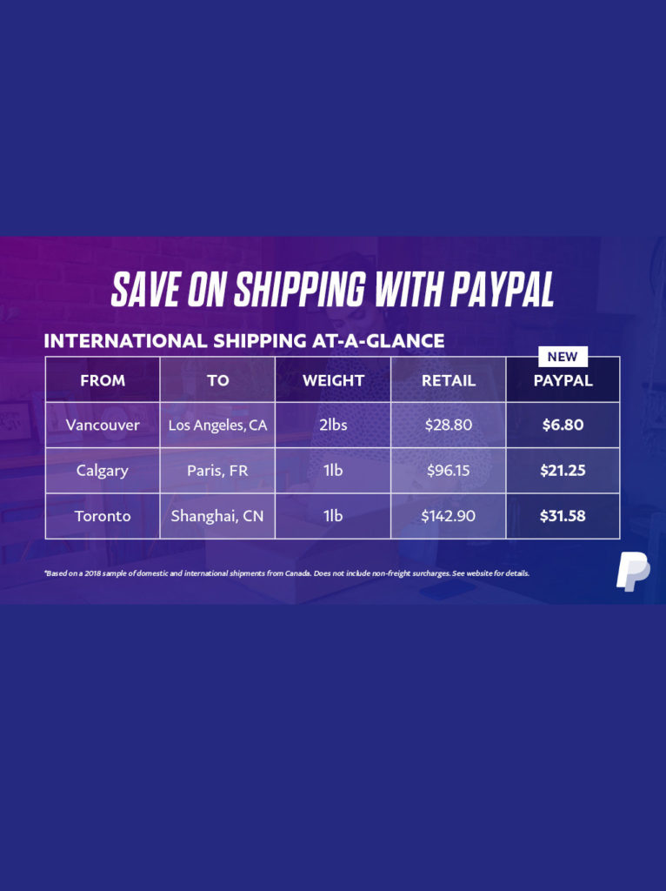
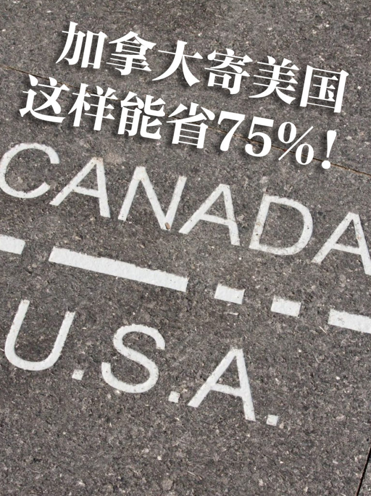

<!-- 2026年11月更新模块：直接粘贴在 YAML 头部 --- 下方 -->

  

    2026年11月最新政策校准
    <strong style="color: #141413; font-size: 16px;">重大变革：美国 $800 免税额（De Minimis）已暂停，2026 加拿大发美国必知的 DDP 与 3PL 新规！</strong>
  

  

    本文写于 2021 年。当时加拿大卖家使用 Chit Chats 或 Stallion Express 把包裹拉过美加边境交由 USPS 派送，核心依赖的是美国 Section 321 项下的<strong>“$800 美元小额免税（De Minimis）”</strong>政策。但在 <strong>2026 年 11 月</strong>，跨境发美规则已发生颠覆性改变，发货前请务必核对以下 4 条新规：
  

  <ul style="margin: 0 0 12px 0; padding-left: 20px;">
    <li style="margin-bottom: 6px;"><strong>1. 美国 $800 小额免税已全面暂停（强制预付关税 DDP）：</strong>自 2025 年 8 月 29 日起，美国正式暂停对全球所有国家包裹的 $800 免税豁免（2026 年 6 月联邦公报设为无限期暂停，同年 8 月美国国际贸易法院维持该决定）。如今无论是通过 <strong>Chit Chats、Stallion Express、DYK Post 还是 Canada Post</strong> 寄往美国的电商小包，<strong>必须在过境前预付关税（DDP, Delivered Duty Paid）</strong>，且打单时必须准确填写 <strong>10 位美国 HTS 海关编码</strong>与<strong>商品真实原产制造国（Country of Origin）</strong>。</li>
    <li style="margin-bottom: 6px;"><strong>2. 严禁把“中国制造”虚报为“加拿大原产”：</strong>美国海关（CBP）严格按商品制造地而非发货地计征关税。若你在加拿大销售的商品原产自中国，过境入美时仍需按中国原产税率缴纳附加税；只有真正在加拿大本土生产制造、符合 <strong>CUSMA（美墨加协定）原产地规则</strong>的商品，才能通过商业清关通道申领优惠税率（注：Canada Post 普通邮政小包通道目前不支持直接申报 CUSMA 免税，本土制造商品请走 Chit Chats / Stallion 的商业报关专线或商业快递）。</li>
    <li style="margin-bottom: 6px;"><strong>3. 2026 最省钱的两大破局方案（边境 3PL 成本价报关 + 本地路由 POD）：</strong>
       • <strong>美加边境 3PL 集货仓（如 Stallion 水牛城仓 / 华盛顿州 Blaine 仓）：</strong>不要再按“$100 零售价”单件直邮交税！将货物整批运至美国边境 3PL 海外仓，按<strong>出厂批发成本价（Cost Value，如 $20）</strong>统一报关入境，再由美国仓内直接发 USPS，合法省下 70%–80% 的关税基数与单票报关费；
       • <strong>零库存本地印制（Printify Local Routing）：</strong>若做定制服饰家居，直接在 <a href="https://shopify.pxf.io/c/5878481/3323859/13624" target="_blank" rel="sponsored noopener" style="color: #8A2520; font-weight: 600;">Shopify</a> 接入 <a href="https://printify.com/" target="_blank" rel="sponsored noopener" style="color: #8A2520; font-weight: 600;">Printify</a> 并开启本地路由——美国买家的订单自动由美国本土工厂印制并发 USPS，彻底绕开跨国清关！
    </li>
    <li style="margin-bottom: 0;"><strong>4. 结账页税费透明配置：</strong>请在 Shopify 后台开启 <em>Duties and Import Taxes at Checkout</em>，让美国买家在结账时一并支付或看清预估关税，避免包裹被拒收。</li>
  </ul>
  

    💡 在线算账：前往本站 <a href="/resources/#calc-section" style="color: #141413; font-weight: 600; text-decoration: underline;">《北美创业合规导航 · 2026 跨境发美直邮 vs. 3PL 关税速算器》</a> 测算你的月度省钱空间。
  

很多在加拿大的电商小伙伴都困扰于运费抬高的问题，尤其相比美国的运费，加拿大简直就是贵得离谱。那么如果你在加拿大卖货到美国，最便宜的选择有哪些呢？今天来推荐几个：

  1. 一种做法是把包裹运到美国边境，然后用美国的 USPS 运到你的客户手里，这样几乎可以省四分之三的运费。几乎加拿大每个边境省份都会有专门的公司做这个业务。收取很低的费用。一个咖啡杯通过 Canada post 要17.68元，花5-6天寄到，通过这类公司，只要5-6元，2-4天就到。在安省、卑诗省、阿尔伯塔省和魁北克省，[Chit Chats express](https://chitchats.com/en) 是个好选择，温哥华、列治文、本拿比、素里、兰利、高贵林港都有寄货点。在阿尔伯塔省的卡尔加里，[DYK Post](https://www2.dykpost.com) 是个好选择。安省 Markham 的[Stallion Express](https://stallionexpress.ca) 以及 Mississauga 的 [CrossborderPicks](https://www.crossborderpickups.ca) 价格更低。

Save on international shipping with PayPal (CNW Group/PayPal Canada) 

     **要注意的一点是，如果你运多批物品，务必要每批有单独的标签，以免出错。**

  1. [Paypal canada](https://www.paypal.com/ca/business/shipping/net-parcel) 是另一种选择，该公司和 [netParcel](https://netparcel.com/home.action) 合作推出加拿大境内和国际运货服务，号称节省75%的费用。从温哥华寄到洛杉矶，两磅中的货物一般要28.8，他家只要6.8。听起来很吸引人。还有追踪包裹、出货快、容易从 Esty、shopify、Ebay 中导入订单等好处。个人觉得最大的好处是 Paypal 是大公司更可信、客服也更好些。
  2. 加拿大有各种网上提供这类寄送美国的服务，价格也都不错，服务评价的反馈可能会有天壤之别，可以先寄个不太重要的物件开始，了解一下其服务情况是否符合你的期望值。下面是部分：

<https://www.freightcom.com>

[ShipVista](http://ShipVista.com)[.com](http://ShipVista.com)

<https://www.sparxlogistics.ca>

<https://www.crossborderpickups.ca>

https://stallionexpress.ca
