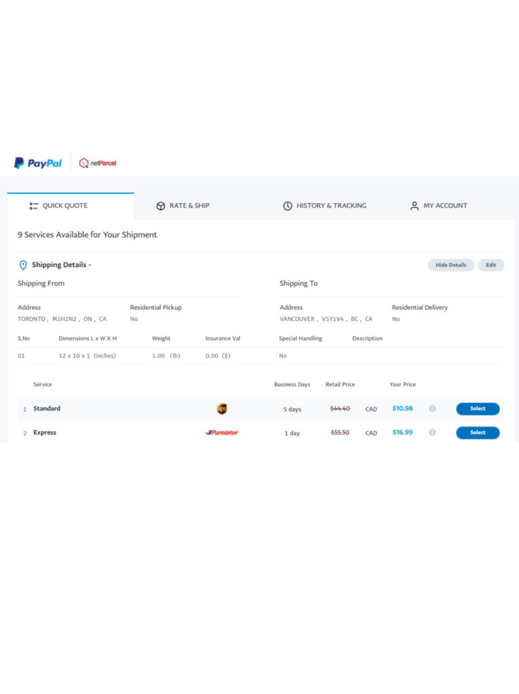

<!-- 2026年11月更新模块：直接粘贴在 YAML 头部 --- 下方 -->

  

    2026年11月最新政策校准
    <strong style="color: #141413; font-size: 16px;">告别单靠 Canada Post！2026 加拿大境内低价快递新主力（Chit Chats Select / Dragonfly / UniUni）</strong>
  

  

    本文写于 2021 年。在经历了 <strong>2024 年 11 月与 2025 年 9–11 月 Canada Post（加拿大邮政）两次全国大罢工</strong>，以及 2026 年传统商业快递大幅上调燃油附加费（如 Purolator 燃油附加费一度高达 36%–50%）之后，加拿大境内电商物流格局已彻底改写：
  

  <ul style="margin: 0 0 12px 0; padding-left: 20px;">
    <li style="margin-bottom: 6px;"><strong>1. 重要更正（Chit Chats 境内发货已不再依赖 Canada Post）：</strong>下文提到“Chit Chats 在加拿大境内代理的是 Canada Post”。到了 2026 年，<strong>Chit Chats Select</strong> 与 <strong>Stallion Express</strong> 的加拿大境内专线已全面对接 <strong>Intelcom | Dragonfly（原亚马逊御用尾程快递，现覆盖全加 96% 地址，支持一周 7 天派送）、UniUni、FleetOptics 与 ICS</strong> 等独立电商快递网！不仅完全不受邮政罢工影响，大温、大多伦多等核心城市圈小包运费更可低至 <strong>$5–$8 加元</strong>（比邮政柜台便宜 30%–50%）。</li>
    <li style="margin-bottom: 6px;"><strong>2. 使用新兴电商快递（Select / Dragonfly / UniUni）的 2 条铁律：</strong>① 这类独立商业快递<strong>无法投递邮政信箱（PO Box）与极偏远乡村（Rural LCD Routes）</strong>——发大城市用新兴快递省钱，发 PO Box 和偏远地区则保留 Canada Post 兜底；② 必须在结账页面提醒买家填好<strong>公寓楼门禁号（Buzzer Code）与手机号</strong>（填在 Address Line 2），确保快递员能顺利入楼妥投。</li>
    <li style="margin-bottom: 6px;"><strong>3. 3–5 公斤重货的隐藏省钱王牌（Canada Post Flat Rate Box）：</strong>如果你寄送的是蜂蜜、罐头、五金或厚重冬装（5 公斤以内），加拿大邮政局里售价约 <strong>$20–$35 加元的一口价定额纸箱（Flat Rate Box，只要塞得进去、不超过 5kg，全加任意省份一口价且免收燃油与偏远附加费）</strong>，往往比任何商业快递按重量计费都便宜。</li>
    <li style="margin-bottom: 0;"><strong>4. 聚合比价工具升级：</strong>除了下文提到的 Freightcom（现主推旗下深度集成 <a href="https://shopify.pxf.io/c/5878481/3323859/13624" target="_blank" rel="sponsored noopener" style="color: #8A2520; font-weight: 600;">Shopify</a> 的 <strong>ClickShip</strong> 插件）、eShipper 和 PayPal 合作的 netParcel 外，Shopify 商家也可直接用后台自带的 <strong>Shopify Shipping</strong> 一键对比 UPS、Purolator 与 Canada Post 的协议底价。</li>
  </ul>

很多人问起加拿大境内邮寄如何省钱，这确实是困扰所有创业者的问题。在加拿大包裹运费低于7加元是不可能的，这些公司不在乎你包裹只有20克重或1磅，经手过程是一样的。

加拿大相比美国运费贵只有一个原因，那就是人太少！

事实证明，直接去找 [Canada Post](https://www.canadapost-postescanada.ca/cpc/en)、[UPS](https://www.ups.com/ca/en/Home.page)、[Fedex](https://www.fedex.com/en-ca/home.html)、[DHL](https://www.dhl.com/ca-en/home.html)这些大公司拿到的运费是最贵的。我们尝试过[Canada Post business](https://www.canadapost-postescanada.ca/cpc/en/business/small-business.page)账户，价格便宜10%左右（一年中有一次抽筋了似的给了个免费邮寄的机会，见图，刚好没有要寄的）。在所有这些大公司 business 账户中 [UPS](https://www.ups.com/ca/en/services/small-business.page) 和 [FedEx](https://www.fedex.com/en-ca/small-business.html)优惠相对多些。

所以：

  1. 要找代理公司。

    如果你在大多伦多地区，可以尝试 [Stallion Express](https://stallionexpress.ca)（这家代理 [Canpar](https://www.canpar.com/en/home.htm) 和 [Landmark](https://track.landmarkglobal.com) ），也可以找 [Chit chats](https://chitchats.com/en)（代理Canada Post）。还有 [eShipper](https://www.eshipper.com)（代理UPS/Fedex/DHL/[Purolator](https://www.purolator.com/en)）我们在加拿大寄美国的选择中提到过的公司其实也都做加拿大境内代理，价格会便宜些。

[Chit chats](https://chitchats.com) 很多省都有，[以节省运费把包裹运到美国而闻名](https://aswebuild.com/business/2021/05/11/加拿大发货到美国，这样做运费能省四分之三！/)，几乎可以省四分之三的运费。而在加拿大境内邮寄，这家也是一个省钱的好选择。要注意，你需要送到他们的寄货点，他们和 Canada Post 的合约中不允许转售，所有会在你的包裹上重新打印一份”真“的标签。而 eShipper 就不一样，通过他们打印的标签你可以到任何一个 UPS 点寄货。有些寄货点收一个包裹要收25分。

 best shipping rates in canada

    还有[netparcel](https://netparcel.com/home.action)、[freightcom](https://www.freightcom.com)等等，不一一列了。

  1. [Paypal canada](https://www.paypal.com/ca/business/shipping/net-parcel)。是的，他们和netParcel、UPS、[Canada Post](https://www.paypal.com/ca/business/shipping/canada-post)等都有合作，能省不少费用。

     加拿大境内邮寄价格便宜不多，需要货比三家，考虑你的需求。

    很多做生意的喜欢用代理或 Paypal 找 UPS 寄货，因为有免费上门取货的服务。
