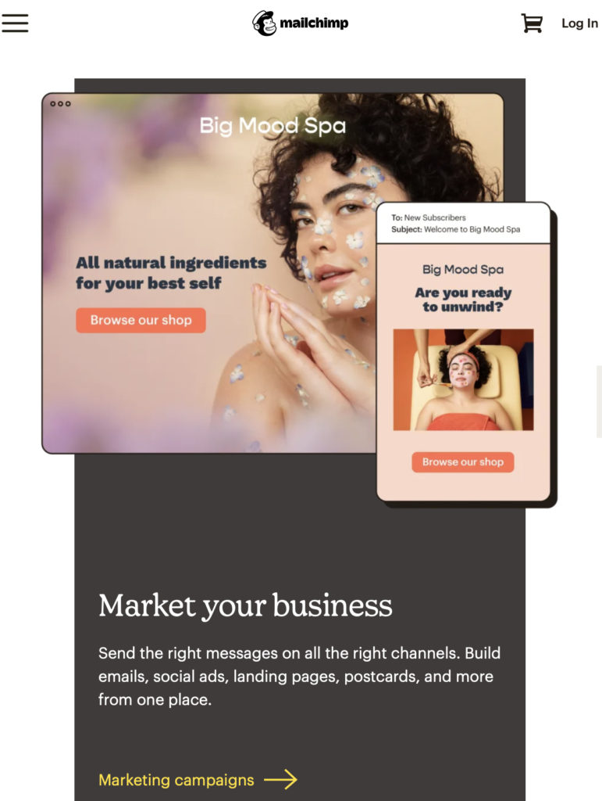
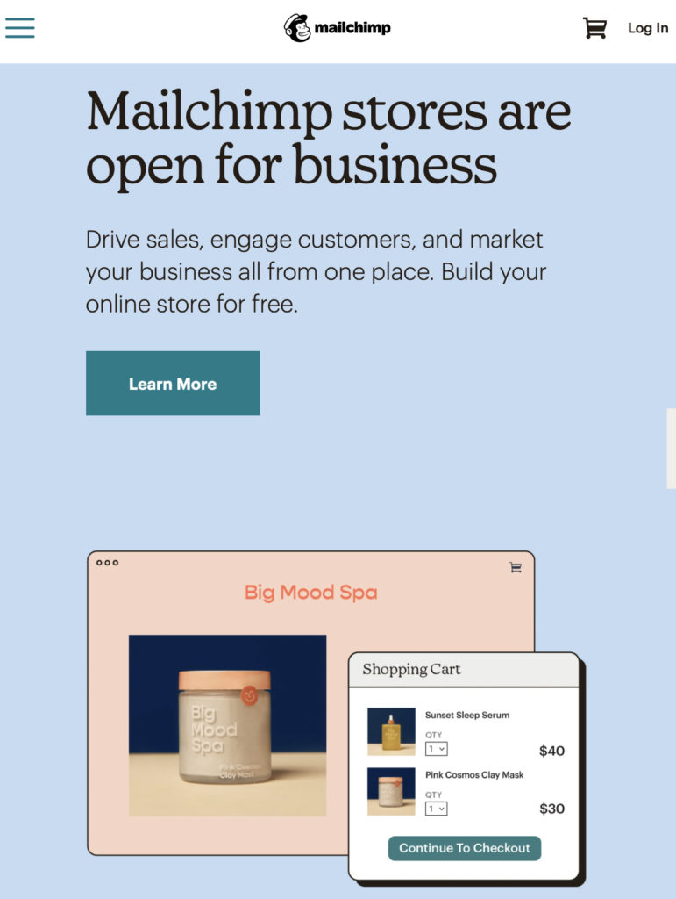
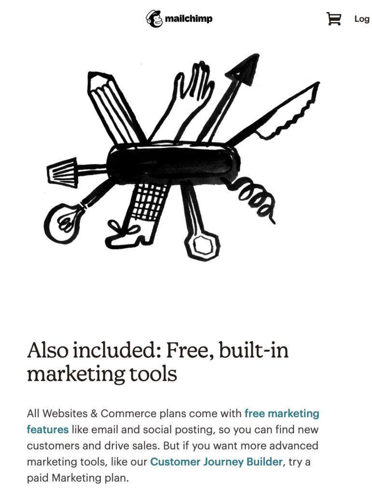
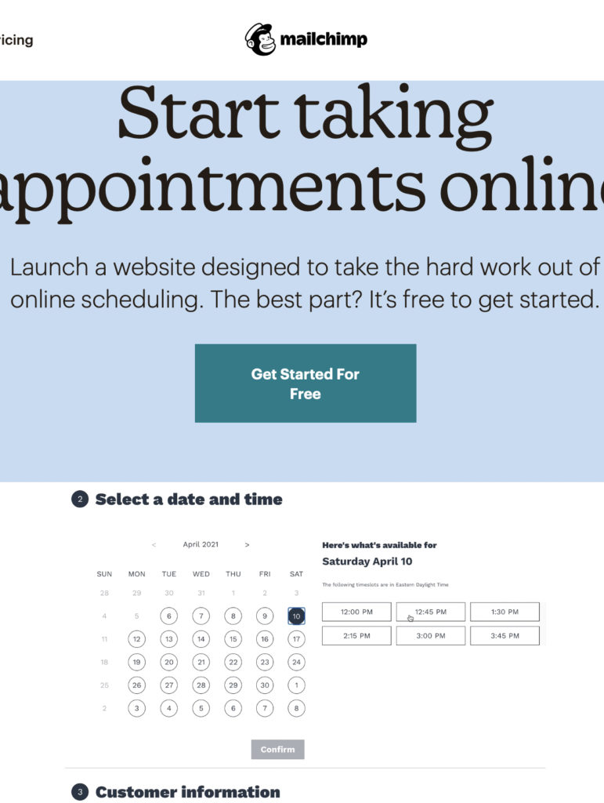
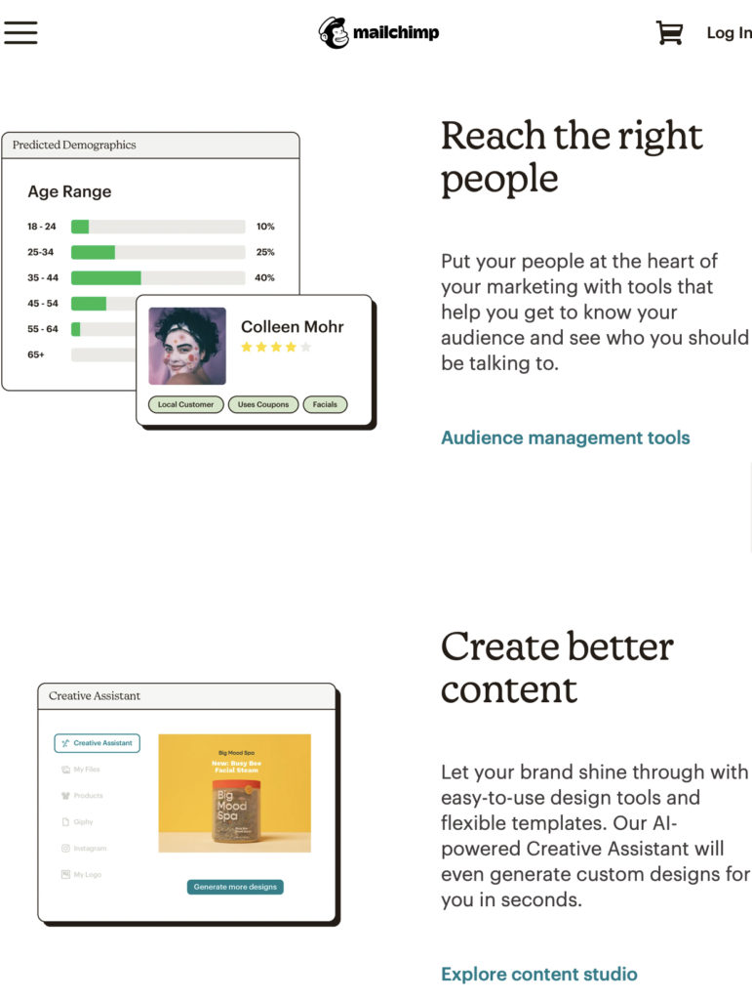
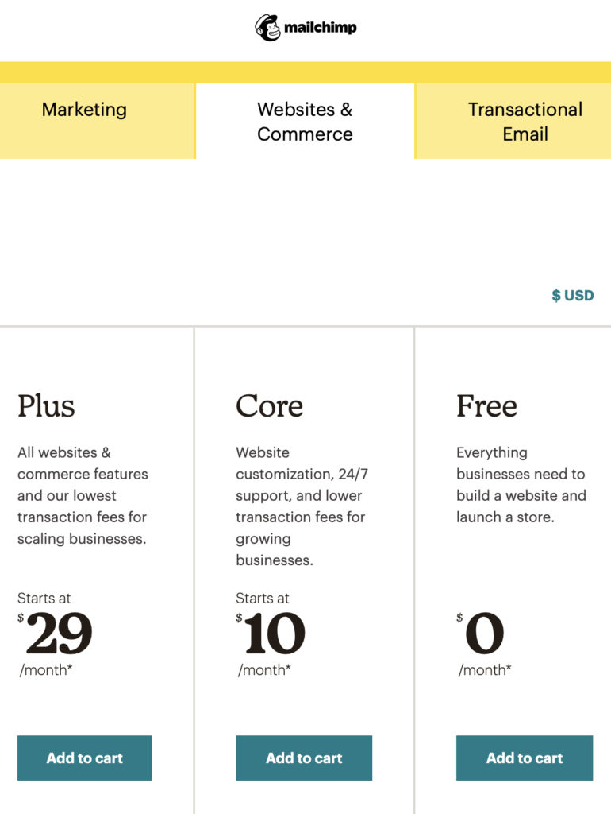

<!-- 2026年11月更新模块：直接粘贴在 YAML 头部 --- 下方 -->

  

    2026年11月最新校准
    <strong style="color: #141413; font-size: 16px;">重大变动：Mailchimp 独立网店业务已关停，2026 免费版大幅缩水与最新平替方案！</strong>
  

  

    本文写于 2021 年 5 月 Mailchimp 刚试水独立网店业务之时。但此后随着财税巨头 Intuit 以 120 亿美元收购 Mailchimp 并与 Shopify 达成官方直连合作，该业务线发生了重大战略收缩。截至 <strong>2026 年 11 月</strong>，选型前请务必了解以下 3 点现状：
  

  <ul style="margin: 0 0 12px 0; padding-left: 20px;">
    <li style="margin-bottom: 6px;"><strong>1. Mailchimp Stores（独立网店）已正式下线退场：</strong>下文提到的 Mailchimp 免费网店及 Core/Plus 电商套餐（原链接 `mailchimp.com/features/online-store/`）早已停止运营。Mailchimp 放弃了自建电商平台，全面退回“通过插件接入第三方网店做邮件营销”的定位（仅保留基础单页 Landing Page 与简易预约功能）。</li>
    <li style="margin-bottom: 6px;"><strong>2. 2026 年 Mailchimp 免费版额度已严重缩水：</strong>截至 2026 年，Mailchimp 的 Free 免费套餐上限已从早年的 2,000 人大幅砍至<strong>仅限 250 个联系人、每月最多发 500 封邮件（单日上限 250 封）</strong>，且免费版已<strong>彻底取消自动化工作流（Customer Journeys）与定时发信功能</strong>（旧版 Classic Automation Builder 也已于 2025 年 6 月停用）。</li>
    <li style="margin-bottom: 0;"><strong>3. 2026 开网店与做预约的黄金替代组合：</strong>
       • <strong>做实物/数字电商网店：</strong>直接使用 <a href="https://shopify.pxf.io/c/5878481/3323859/13624" target="_blank" rel="sponsored noopener" style="color: #8A2520; font-weight: 600;">Shopify</a>（自带免费 <strong>Shopify Email 每月前 10,000 封免费</strong>，或搭配 <strong>Klaviyo</strong> 跑自动化弃单挽回流）；若追求超低成本自建站，可选用 <a href="https://www.hostinger.com/" target="_blank" rel="sponsored noopener" style="color: #8A2520; font-weight: 600;">Hostinger</a> 或 <a href="https://www.bluehost.com/" target="_blank" rel="sponsored noopener" style="color: #8A2520; font-weight: 600;">Bluehost</a> 一键部署 WordPress + WooCommerce；
       • <strong>做服务预约与自动收款：</strong>专业咨询与创意服务推荐用 <a href="https://www.dubsado.com/?c=qilin21" target="_blank" rel="sponsored noopener" style="color: #8A2520; font-weight: 600;">Dubsado</a>（从预约、签合同到收定金一站闭环）或开源排期工具 <strong>Cal.com</strong>。
    </li>
  </ul>
  

    💡 工具选型对比：前往本站 <a href="/tools/" style="color: #141413; font-weight: 600; text-decoration: underline;">《北美创业工具箱（2026 实测 17 款软件栈）》</a>。
  

这个网店平台预计会很火爆，很符合当前营销**+** 网店的最新模式。

最新数据显示，开网店是**70%** 以上北美小生意的选择。这就是为什么众多公司想挤入其中，提供网店平台。最近，营销大拿[**Mailchimp**](https://mailchimp.com) 涉足网店平台业务，**5** 月**18** 日向美国和英国的中小企业客户开放。

以前是各种网店平台需要集成 **Mailchimp** 的功能，现在他家自己就可以开店了，又是一个强劲的对手，也是我们网店创业者的福音。多个选择意味着更好的服务。

**[Mailchimp网店平台](https://mailchimp.com/features/online-store/)** 的[免费网店套餐](https://mailchimp.com/pricing/commerce/compare-plans/)**(1** 个管理员**)** 包括创建无限数量的网页、可上架无限数量的商品前**30** 天电子邮件支持，无限流量、**SEO** 工具、访客分析工具、**ssl** 认证，还集成**200** 多万涨的 Unsplash 免费图片可供使用，以及集成200多个app的能力。

* Mailchimp 网店平台
* Mailchimp 网店
* Mailchimp 网店平台集成
* Mailchimp 网店预约功能
* 
* Mailchimp 网店平台价格

这里还包括一个特别好的免费功能，就是网上预约服务，方便以服务为商品的客户，可以管理客户、建立良好互动的能力。

如果自己已经有了域名，需要绑定的话就不能用免费套餐，需要每个月**10** 美元的 [**Core** 套餐](https://mailchimp.com/pricing/commerce/compare-plans/)**(3** 个管理员**)** 或者每月**29** 美元的 [**Plus** 套餐](https://mailchimp.com/pricing/commerce/compare-plans/)（**5** 个管理员）。

付费套餐最大区别是提供电子邮件和在线**Chat** 的支持，并且少收**transction fee** 。免费收**2%** ，**Core** 收**1.5%** ，**Plus** 收**0.5%** 。

**Mailchimp** 的网店支付都是通过 [Stripe](https://stripe.com)（注意了，根据国家不同，Stripe还要收一笔中间费）处理，支持PayPal以及各种主要信用卡

如果你是非营利机构，还有15%的折扣优惠。
