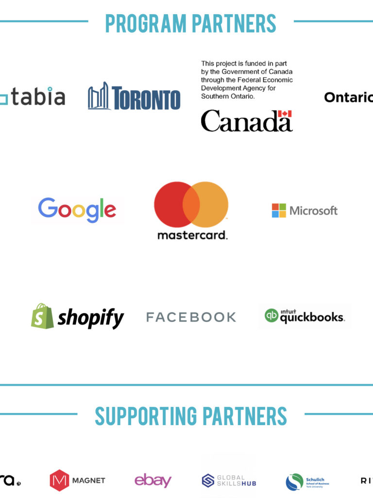

<!-- 2026年11月更新模块：直接粘贴在 YAML 头部 --- 下方 -->

  

    2026年11月最新政策校准
    <strong style="color: #141413; font-size: 16px;">重要通知：Digital Main St. 的 shopHERE 免费建站与 $2,500 补贴通道已关停！2026 替代方案一览</strong>
  

  

    本文发布于 2021 年疫情扶持期。随着联邦与安省政府专项拨款周期结束，下文介绍的 <strong>Digital Main Street 旗下 `shopHERE` 免费代建网店计划（以及安省 $2,500 Digital Transformation Grant 数字化转型赠款）已于 2024 年正式关闭申请通道</strong>（文末的原注册链接现已停用，官网仅保留免费录播网课与数字自测表）。
  

  
<strong>在 2026 年 11 月，安省及全加拿大小企业主想要极低成本建站并申领政府扶持，请改走以下 3 条现行通道：</strong>

  <ul style="margin: 0 0 12px 0; padding-left: 20px;">
    <li style="margin-bottom: 6px;"><strong>1. 用 Shopify Magic AI 2 小时自助建站（无需再等实习生排期几周）：</strong>早年参加 shopHERE 需要排队等待大学生志愿者配合搭建基础模板。到了 2026 年，直接通过 <a href="https://shopify.pxf.io/c/5878481/3323859/13624" target="_blank" rel="sponsored noopener" style="color: #8A2520; font-weight: 600;">Shopify 新店专属扶持通道</a> 开启试用，利用内置的 <strong>Shopify Magic 与 Sidekick AI 助手</strong>，输入你的品牌定位即可在 1–2 小时内自动生成全套网店排版与地道英文产品文案。</li>
    <li style="margin-bottom: 6px;"><strong>2. 2026 现行有效的三大政府扶持与补贴替代项：</strong>
       • <strong>安省 Starter Company Plus 计划：</strong>由安省政府资助、通过各地 Small Business Enterprise Centres (SBEC) 运营，面向安省初创与扩建期小企业提供<strong>最高 $5,000 加元无偿赠款（Grant）+ 一对一导师辅导</strong>；
       • <strong>联邦 CanExport SMEs 出海补贴：</strong>若你的网店计划拓展美国或海外市场，联邦政府可无偿报销 <strong>50% 的跨境数字营销、SEO 与海外商标注册费（单项目补贴 $10,000–$50,000 加元）</strong>；
       • <strong>2026.09 电脑与软硬件 100% 当年抵税新政：</strong>自 2026 年 9 月 15 日起，企业新购置的商业电脑与特定数字化办公设备享<strong>当年 100% 一次性全额税前抵扣（Immediate Expensing）</strong>，建站与软件所付的 5% GST/13% HST 更可向 CRA 申领 <strong>100% ITC 进项税现金退回</strong>。
    </li>
    <li style="margin-bottom: 0;"><strong>3. 文末 QuickBooks Online 价格校准：</strong>旧版 QBO Self-Employed 已整合升级，2026 年加拿大 QBO 标准起步价为 <strong>EasyStart $30 CAD/月起</strong>（搭配 <a href="https://synder.com/" target="_blank" rel="sponsored noopener" style="color: #8A2520; font-weight: 600;">Synder</a> 可全自动同步 Shopify 每笔订单的跨省 HST/GST 税项与通道手续费）。</li>
  </ul>
  

    💡 政策与查税总库：访问本站 <a href="/resources/" style="color: #141413; font-weight: 600; text-decoration: underline;">《北美创业合规与实战导航（含加拿大各省销售税自测器）》</a>。
  

[Digital Main St.](https://digitalmainstreet.ca) 的 [shopHERE](https://digitalmainstreet.ca/fr/shophere/) 为独立小企业和艺术家免费打造网店。

这个项目由加拿大联邦政府和安大略省政府支持，加上一些企业的赞助，为安省的小企业和艺术家提供网络销售的渠道。

申请须知：

1⃣️ 全职雇员≤ 10人（餐厅的话≤25人）

2⃣️ 必须是在安省注册的企业

3⃣️ 可以是企业，也可以是艺术家

4⃣️ 可以是家庭作坊，也可以是商业地址的

项目提供：

* Digital Main St. shopHERE
* 
* shopHERE 合作伙伴

1对1 的搭建网店的支持

管理网店的培训

免费.ca域名

Facebook 和 Google 的广告 credits

额外90天免费试用 shopify

Quickbooks Online 或者 Self-Employed 首六个月70%折扣。

[点击这里注册吧！](https://programs.digitalmainstreet.ca/shophere-signup)
