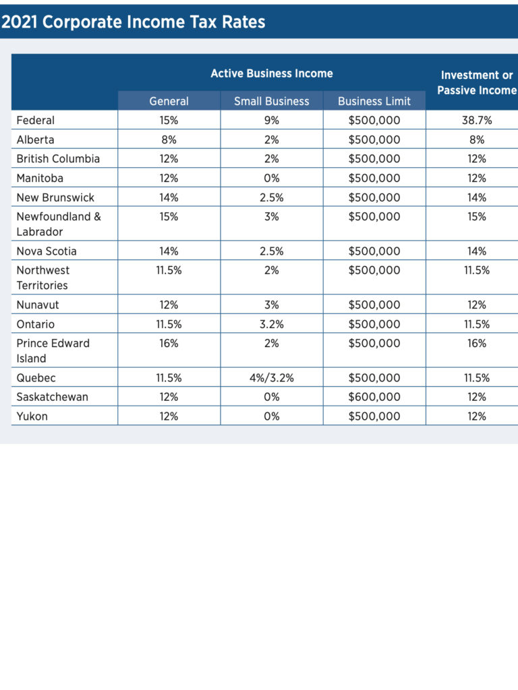
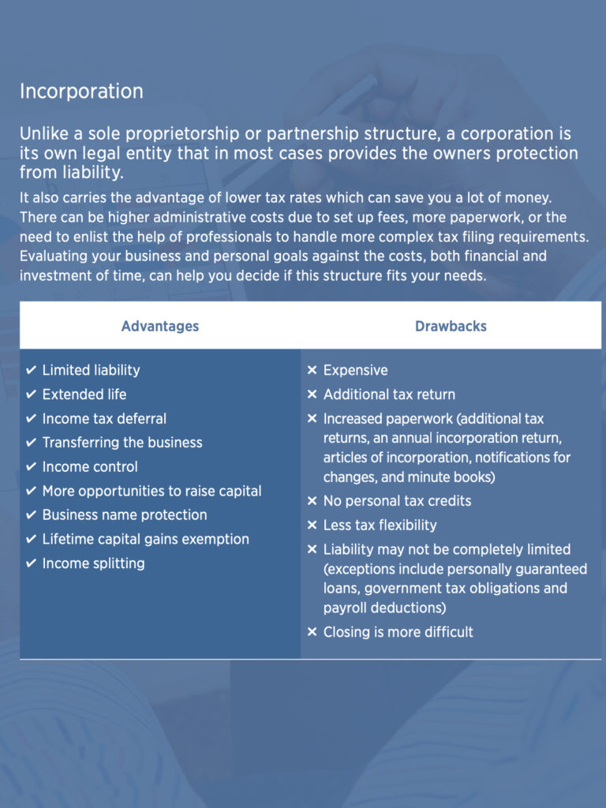

<!-- 2026年11月更新模块：直接粘贴在 YAML 头部 --- 下方 -->

  

    2026年11月最新政策校准
    <strong style="color: #141413; font-size: 16px;">2026 有限公司重大红利与防雷：LCGE 免税额暴涨至 $127.5 万、严禁随意给家人分红（TOSI）与 T2 电子报税新规</strong>
  

  

    本文写于 2021 年 6 月。五年后的今天（<strong>2026 年 11 月</strong>），在加拿大注册有限公司（CCPC）的税务红利进一步放大，但同时下文第 5 点也存在一处极易触发 CRA 稽查的税务陷阱，请务必按以下最新标准核对：
  

  <ul style="margin: 0 0 12px 0; padding-left: 20px;">
    <li style="margin-bottom: 6px;"><strong>1. 第 4 点重磅升级（2026 终生资本收益豁免额 LCGE 已涨至 $1,275,000 加元）：</strong>下文提到的 2021 年免税额为 89.2 万加元。自 2024 年 6 月上调至 125 万并恢复通胀指数化调整后，<strong>2026 税年出售合格小企业股份（QSBC Shares）的免税额度已高达 $1,275,000 加元/人（对应 $637,500 应税资本增值抵扣额）</strong>！按 BC 省最高税率算，单人卖公司即可合法省下超 $34 万加元税款（前提：交割时公司 90% 以上资产须用于加拿大主动经营业务，切勿在运营公司账上囤积过多被动理财或房产）。</li>
    <li style="margin-bottom: 6px;"><strong>2. ⚠️ 第 5 点紧急防雷（切勿随便把家人加为股东发股息！）：</strong>下文第 5 点提到“把配偶和子女加为股东支付股息减税”，这在现行 <strong>TOSI（Tax on Split Income 分摊所得税）</strong> 法规下极其危险！如果家人没有在公司每周平均真实工作满 <strong>20 小时以上</strong>（或年满 25 岁且在非服务型公司持股 ≥10%，或企业主本人已满 65 岁给配偶分红），给家人发的股息会被 CRA 直接按<strong>最高个人边际税率（BC 省高达 53.5%）</strong>惩罚性征税！给家人分摊收入最稳妥的方式是：雇佣家人做真实岗位，用 <a href="https://www.jibble.io/" target="_blank" rel="sponsored noopener" style="color: #8A2520; font-weight: 600;">Jibble</a> 留存工时打卡记录，并通过 <a href="https://gusto.com/" target="_blank" rel="sponsored noopener" style="color: #8A2520; font-weight: 600;">Gusto</a> 发放合理的 T4 工资。</li>
    <li style="margin-bottom: 6px;"><strong>3. 第 2 点更新（11% 低税率扩围 + 2026 设备当年 100% 抵扣）：</strong>BC 省 CCPC 前 50 万加元主动营业利润综合税率仍为 <strong>11%（联邦 9% + BC 省 2%）</strong>，且联邦已将享受该低税率的企业应税资本上限从 1,500 万大幅放宽至 <strong>5,000 万加元</strong>；同时自 2026 年 9 月 15 日起，公司新购商业电脑与生产设备享<strong>当年 100% 一次性全额税前抵扣</strong>。</li>
    <li style="margin-bottom: 0;"><strong>4. 2026 维护合规底线（ISC 透明度名册 + T2 强制电子申报）：</strong>联邦公司官网在线直申仅需约 <strong>$214–$216 加元</strong>（文中旧版 `ic.gc.ca` 链接已迁至 `ised-isde.canada.ca`）。注册后每年须按时在线提交年报（联邦年费仅 $12）与 <strong>ISC 重大控制人名册</strong>；且哪怕公司当年 $0 收入，也<strong>必须 100% 通过认证软件或 CPA 电子申报 T2 税表</strong>（邮寄纸质 T2 直接罚款 $1,000）。</li>
  </ul>
  

    💡 延伸指南：前往本站 <a href="/resources/#sec-tax" style="color: #141413; font-weight: 600; text-decoration: underline;">《北美创业合规与实战导航》</a> 查看 $216 联邦公司直申入口与 20 大抵税清单。
  

任何生意，最重要的是最大程度赚取税后收入。在加拿大，创业更是要找到方法最大程度减少税收负担，最大程度赚钱。[成立一家有限公司](https://www.ic.gc.ca/eic/site/cd-dgc.nsf/eng/cs06642.html)可以做到这一点。

当你的企业收入超过个人开支所需的收入，想要把利润投入进行扩张，或者想要出售生意，是时候[注册成立一家有限公司](https://www.canada.ca/en/services/business/start/register-with-gov/register-corp.html)。

* 加拿大CCPC优惠税率
* 加拿大成立有限公司优缺点
* 

好处是：

  1. **有限责任（Limited liability）。**

加拿大税务局认为公司是法律实体，大多数情况下企业所有者免责，个人资产受保护。不像独资及合伙企业，个人会面临债务或诉讼的可能。

2.**较低税率。**

根据你的生意业务以及所在加拿大哪个省份或地区，可以获得不同的低税收。当然，需要专业人士帮助处理更复杂的纳税申报，一定也产生更高的管理成本。

你可以估算一下你的业务和收入，看看是否适合。

独资及合伙企业的创业者需要缴纳高的个人所得税税率，而有限公司的联邦税是15%，加拿大人控制的私人公司（[CCPC](https://www.canada.ca/en/revenue-agency/services/tax/businesses/topics/corporations/corporation-tax-rates.html)）还有小企业抵税政策，前50万收入联邦税率可以低至9%，卑诗加省税也就11%，具体税率看图。

3\. **所得税延后。**

你可以选择把收入留在公司里，到需要的时候拿出来再缴个人所得税。盈余可以投资回企业，或者做其他投资。

4\. **终身资本收益豁免（[Lifetime capital gains exemption](https://www.canada.ca/en/revenue-agency/services/tax/individuals/topics/about-your-tax-return/tax-return/completing-a-tax-return/deductions-credits-expenses/line-25400-capital-gains-deduction/what-deduction-limit.html)）。**

当你想把企业卖掉获利，LCGE 能让你不用为出售的全部或部分利润纳税，比如你公司卖了92万5000加元，没有LCGE，要缴税47万5,000，而有LCGE后，你可以扣除资本利得税（2021年免税额度是89万2218加元），只需要缴纳1万6391加元的税。LCGE是终身累积，再过几年就能免税百万了。

有很多人专门为此注册有限公司。

5\. **分散收入（Income splitting）。**

如果你开的是有限公司，你可以把配偶和子女加为股东（不用在公司成立时就加上，全年可以修改），你可以向家人支付股息，减少你的税收。

6\. **会计年度灵活。**

有限公司可以选定自己的会计年度，可以选在一年中最空闲的时候，可以把年终奖留在下一个会计年度等等。

7\. **企业名字受法律保护。**

8\. **更多企业融资机会。**
