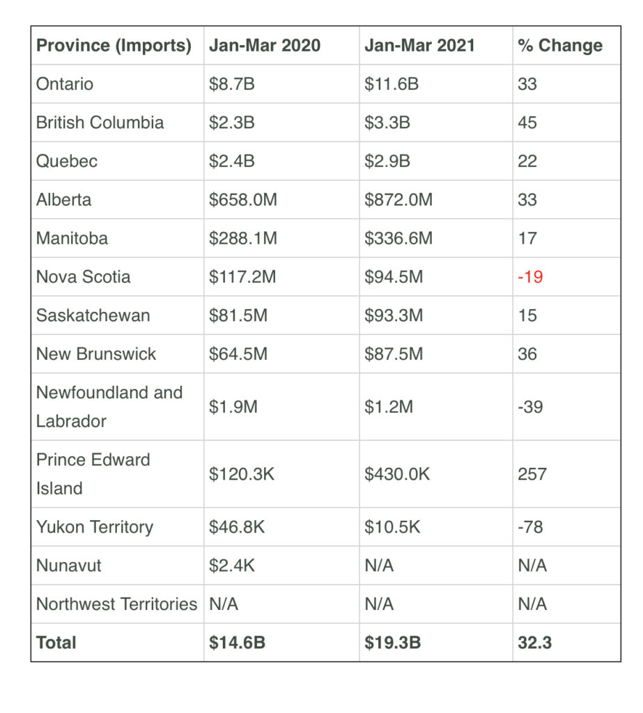
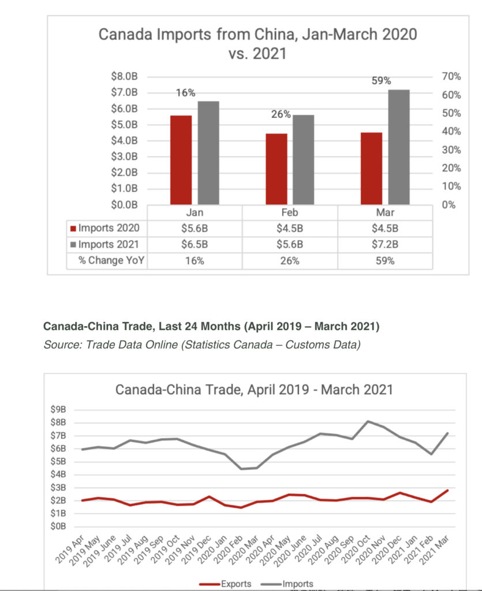
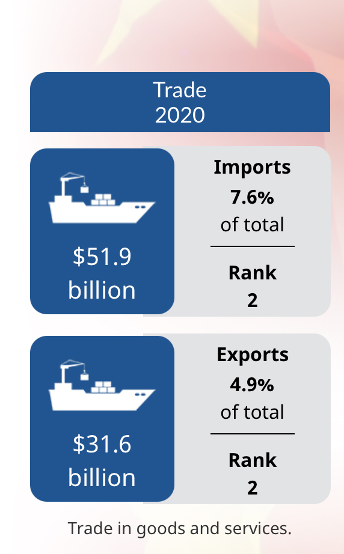
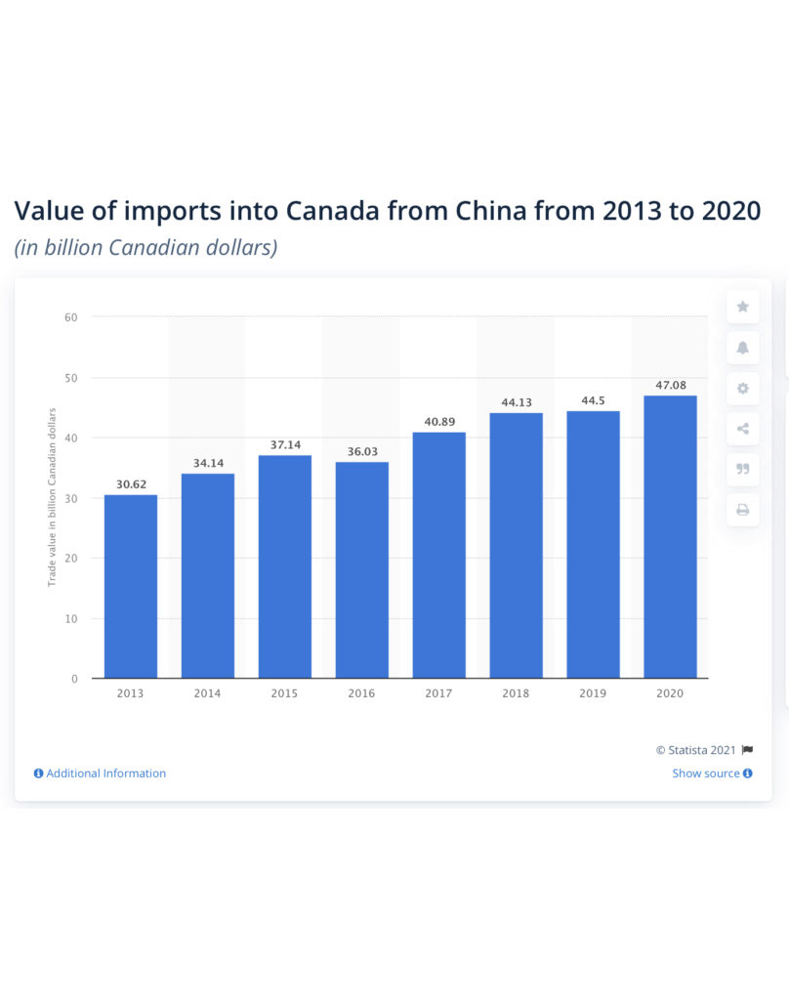

<!-- 2026年11月更新模块：直接粘贴在 YAML 头部 --- 下方 -->

  

    2026年11月最新政策校准
    <strong style="color: #141413; font-size: 16px;">告别疫情防疫品与通货内卷：2026 从中国进口加拿大的“红榜与黑榜”</strong>
  

  

    下文统计的是 2020–2021 年疫情期间的进口数据（当时口罩等防疫纺织品激增 370%）。时隔五年，在 <strong>2026 年 11 月</strong>的加拿大市场，从中国进口选品的风向与合规门槛已发生根本性逆转：
  

  <ul style="margin: 0 0 12px 0; padding-left: 20px;">
    <li style="margin-bottom: 6px;"><strong>❌ 2026 谨慎触碰的“高关税与禁限黑榜”：</strong>
       • <strong>钢铁、铝制品及金属衍生品：</strong>含中国熔铸钢铁或冶炼铝的产品现面临 <strong>25%–50% 附加税（Surtax）</strong>，且清关时必须提供钢厂材质证书（Mill Test Certificate）；
       • <strong>违规塑料制品：</strong>2026 年 1 月 30 日加拿大联邦上诉法院维持禁塑令有效，叠加 BC 省规管，严禁进口泡沫塑料盒（Styrofoam）、含炭黑塑料盒（Carbon-black plastic）及可氧化降解塑料袋；
       • <strong>电动汽车（EV）：</strong>2026 年 3 月 1 日起虽取消了 100% 附加税，但已纳入《进口管制清单》，无联邦配额许可证（Import Permit）将被海关直接拒收。
    </li>
    <li style="margin-bottom: 0;"><strong>✅ 2026 利润丰厚的“高溢价进口红榜”：</strong>
       • <strong>合规环保餐饮包材：</strong>替代禁用塑料的<strong>耐高温 PP5 号注塑餐盒（BPA-Free）、纸浆模塑餐具与定制牛皮纸开窗包装</strong>，在大温及全加餐饮B2B市场需求极旺；
       • <strong>高颜值自有品牌（Private Label）宠物、户外与家居收纳：</strong>避开廉价白牌通货，在国内代工定制后换上地道的北美极简视觉与英法双语包装，通过 <a href="https://shopify.pxf.io/c/5878481/3323859/13624" target="_blank" rel="sponsored noopener" style="color: #8A2520; font-weight: 600;">Shopify</a> 独立站或本地精品渠道销售，毛利率可达 60%+；
       • <strong>带北美安规认证的智能小家电：</strong>进口带电产品必须确认国内工厂具备 <strong>CSA、cUL 或 cETL</strong> 加拿大认可安规认证标志，严禁仅带中国 3C 或欧洲 CE 认证的电器盲目入境。
    </li>
  </ul>
  

    💡 延伸阅读：查看本站 <a href="/resources/#sec-customs" style="color: #141413; font-weight: 600; text-decoration: underline;">《北美创业合规与实战导航》</a>，一键使用 Canada Tariff Finder 核查你的选品税率。
  

从中国进口加拿大的金额最近几年不断上升，从2016年的376.6亿加元到2020年的495.5亿加元，今年前五个月已经有243.2亿加元，按照这个趋势今年很可能会达到580亿加元。

安大略省从中国进口额度每月接近38亿加元，卑诗省和阿尔伯塔省每月都在10亿加元以上。今年爱德华王子岛从中国进口猛增257%，卑诗省进口量增加45%，全国最高，其次是新不伦瑞克省、安省和阿省。

* 
* 
* 
* 

今年以来，加拿大从中国进口增加最多的是包括口罩在内的纺织材料制成品2.42亿美元（增370%），其次是手机，达10.7亿美元（增54.9%），电脑15亿（增48.3%），开关设备5.6亿（增37.2%），玩具2.69亿（增24.7%）。

从2020年的数据来看，电器、电子设备进口量最多，有136.2亿之多，其次是机械、锅炉及核反应堆，有116.4亿加元，相对较多的还有家具、照明及建筑预制件（34亿），玩具、游戏及运动设备（26.7亿），塑料（26.1亿），纺织品、套装及旧衣服（25.4亿），非针织或钩织物及衣服配件（19.1亿），钢铁（18.8亿），铁路及有轨电车以外的车辆（18.5亿），服装、针织及钩织物（13.4亿）、光学、医疗仪器、照片等（11.5亿）、橡胶（10.3亿）。

其余进口的还有铝、鞋子、有机化学品、普通金属、餐具器皿、皮革制品、旅行用品、纸板纸浆、玻璃、木材木炭、陶瓷、鱼类海鲜、珍珠、宝石、硬币、石材、石膏、水密、头饰、医学产品、蔬菜、水果、绳索、麻线、肥皂、蜡烛、免费、化妆品、盥洗用品、精油、香水、谷物、种子、雨伞、地毯、钟表等等。

全加拿大有2109家做中国进口生意的公司，其中卑诗省有222家，安大略省有923家，魁北克省476家，阿省115家。

如果你想做进口生意，CBSA 的网站 [www.cbsa-asfc.gc.ca/import](http://www.cbsa-asfc.gc.ca/import) 提供专门适用于中小企业的有用工具，其中包括 [_Importing: A Step-by-Step Guide (_ 进口: 简明指南 _)_](http://www.cbsa-asfc.gc.ca/import/guide-eng.html)
