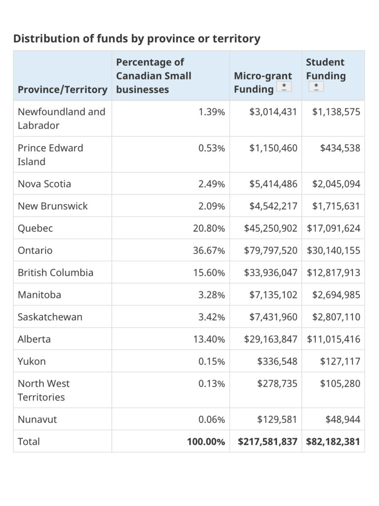
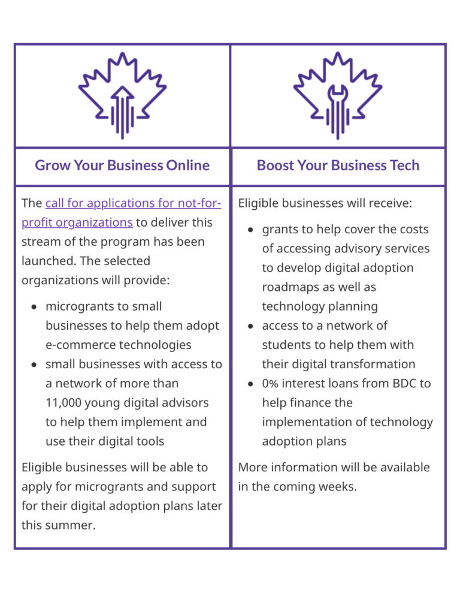

<!-- 2026年11月更新模块：直接粘贴在 YAML 头部 --- 下方 -->

  

    2026年11月最新政策校准
    <strong style="color: #141413; font-size: 16px;">重要通知：CDAP 计划已彻底关停！2026 年由 BDC LIFT（5亿加元）与 100% 税前抵扣新政全面接替</strong>
  

  

    本文发布于 2021 年 7 月联邦政府刚宣布 CDAP 计划之时。请注意：<strong>加拿大数字采纳计划（CDAP，包括第一部分 $2,400 建站微额赠款与第二部分 $15,000 Boost 咨询补贴及 BDC 无息贷款）早已于 2024 年 2 月停止接收新申请，并于 2025 年 3 月 31 日彻底关停结项</strong>（文中旧版 `ic.gc.ca` 链接已失效）。
  

  
<strong>在 2026 年 11 月，加拿大中小企业推进数字化、电商与 AI 转型，请直接申请以下 4 项最新接替政策：</strong>

  <ul style="margin: 0 0 12px 0; padding-left: 20px;">
    <li style="margin-bottom: 6px;"><strong>1. 官方接替计划 BDC LIFT（2026 年 4 月全新推出）：</strong>为填补 CDAP 关停后的空白，加拿大商业发展银行（BDC）于 2026 年 4 月正式启动总额 <strong>5 亿加元的 BDC LIFT 计划</strong>，专门支持中小企业进行数字化改造、AI 工作流落地与生产力升级（提供 $2.5 万–$500 万加元专项融资与专家顾问支持）；此外 BDC 还提供最高 <strong>$35 万加元的小企业线上贷款（其中 $10 万以下免抵押）</strong>。</li>
    <li style="margin-bottom: 6px;"><strong>2. 2026.09“生产力超级抵扣”新政（软硬件当年 100% 全额抵税）：</strong>自 <strong>2026 年 9 月 15 日</strong>起，加拿大财政部正式实施永久性即时抵扣新政——企业新购置的商业电脑、服务器与生产力设备（Class 50 / Class 8）可在<strong>购入当年直接享受 100% 一次性全额税前抵扣（Immediate Expensing）</strong>，且购买 SaaS 软件（如 <a href="https://shopify.pxf.io/c/5878481/3323859/13624" target="_blank" rel="sponsored noopener" style="color: #8A2520; font-weight: 600;">Shopify</a>、<a href="https://clickup.com/?fp_ref=lin31" target="_blank" rel="sponsored noopener" style="color: #8A2520; font-weight: 600;">ClickUp</a>、<a href="https://www.dubsado.com/?c=qilin21" target="_blank" rel="sponsored noopener" style="color: #8A2520; font-weight: 600;">Dubsado</a>）不仅 100% 税前抵扣，所付 5% GST 更可全额申领 ITC 退回。</li>
    <li style="margin-bottom: 6px;"><strong>3. 员工 AI 与数字化技能培训报销 80%（BC ETG & 联邦 WRRP）：</strong>在 BC 省，企业组织员工学习数字化软件、电商运营或 AI 工具，可通过 <strong>B.C. Employer Training Grant (ETG) 固定报销 80% 的培训费（每人每年最高补贴 $10,000 加元）</strong>；或申请 2026 联邦关税救济包中的 <strong>WRRP 计划（零规模门槛，每人最高 $1,000 重训补贴）</strong>。</li>
    <li style="margin-bottom: 0;"><strong>4. 技术研发与跨境电商补贴（NRC IRAP & CanExport）：</strong>开发自研 AI/软件产品可申领 <strong>NRC IRAP</strong> 研发工资补贴；拓展美国及海外线上市场可申领 <strong>CanExport SMEs（报销 50% 出海营销费，最高 $50,000 加元）</strong>。</li>
  </ul>
  

    💡 完整资金池索引：前往本站 <a href="/resources/#sec-grants" style="color: #141413; font-weight: 600; text-decoration: underline;">《北美创业合规导航 · 2026 政府扶持资金与贷款专区》</a>。
  

作为加拿大联邦在2021年预算案中宣布的拨款40亿加元帮助本国中小企业数字化，称为 [Canada Digital Adoption Program's](https://www.ic.gc.ca/eic/site/152.nsf/eng/home) (CDAP)。

CDAP 包括两个部分，用赠款、无息贷款和学生辅助的组合。

第一个部分是 [Grow Your Business Online funding](https://www.ic.gc.ca/eic/site/152.nsf/eng/00002.html)，未来4年内投入14亿，通过全国各机构来支持小企业实现电子商务、网上店面等数字技术，帮助其实施电子商务战略。目前加拿大政府官网上正在召集商业或企业支持机构、研究创新中心、商业孵化器、非营利机构等申请加入。为此，7月15日东部时间12：30 [Innovation, Science and Economic Development Canada](https://www.ic.gc.ca/eic/site/icgc.nsf/eng/home)（ ISED）官员开会，说明计划和申请流程等问题。

* 加拿大数字化各省拨款分配
* 加拿大CDAP计划两阶段

想要参加会议的构可以写电子邮件给[digitaladoption-adoptionnumerique@ised-isde.gc.ca](mailto:digitaladoption-adoptionnumerique@ised-isde.gc.ca).

这些申请机构以非营利机构为主，需要能招募、培训并指导学生们去帮助中小企业数字化，运营成本由政府出，申请截止日期是8月6日。

加拿大会给那些参加的企业提供技能、培训和咨询服务，会有2万8000多人得到培训和工作机会，去帮助全国中小企业。

而届时会有9万个小企业可以拿到小额赠款（每家最多2400加元）去完善数字或支付技术，还能得到专业辅导。同时还给1万1200个学生提供培训和收入（每人最多7300加元），作为小企业数字顾问。

第二个部分是26亿加元的无息贷款，能帮助小企业提高数字技术。

未来几周政府会公布更详细的细节。
