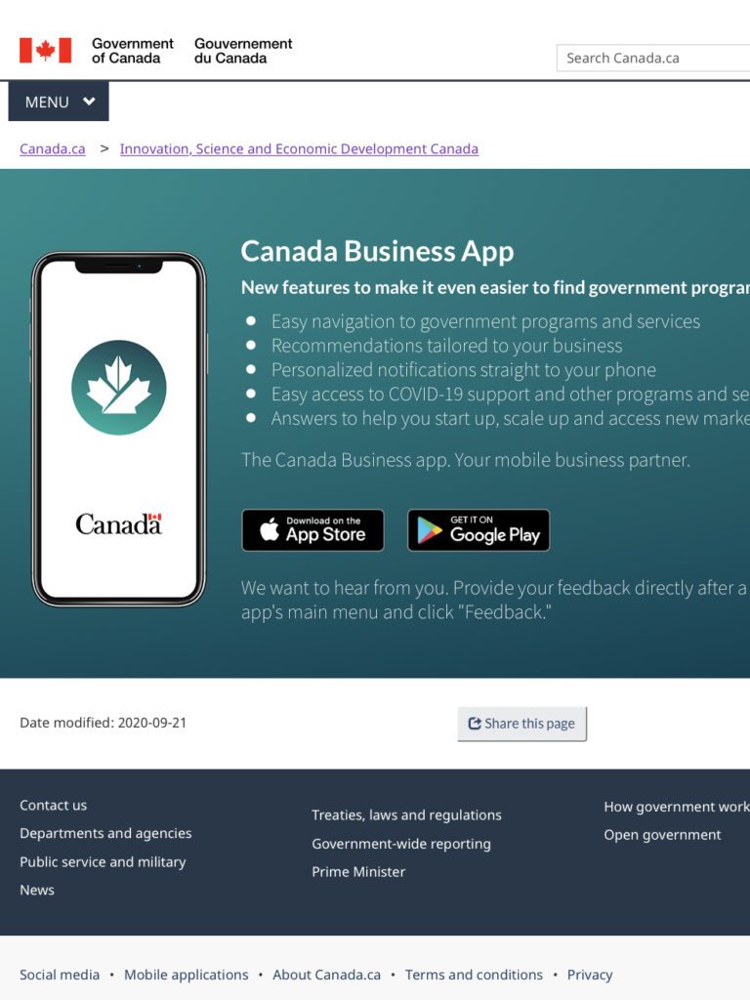
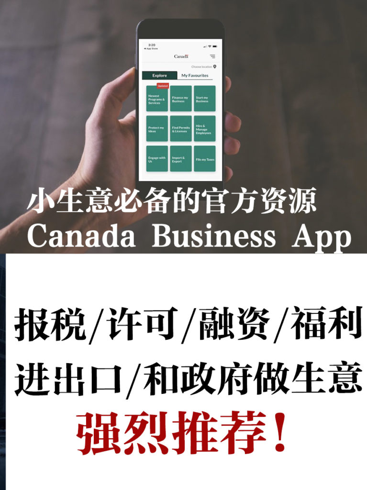
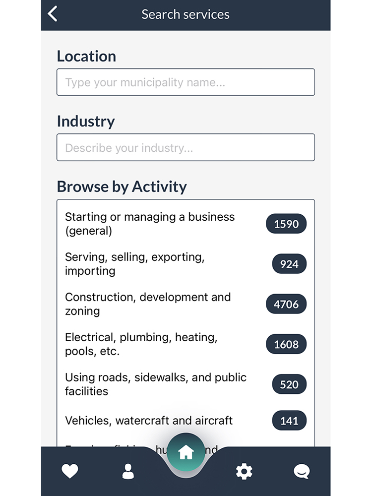
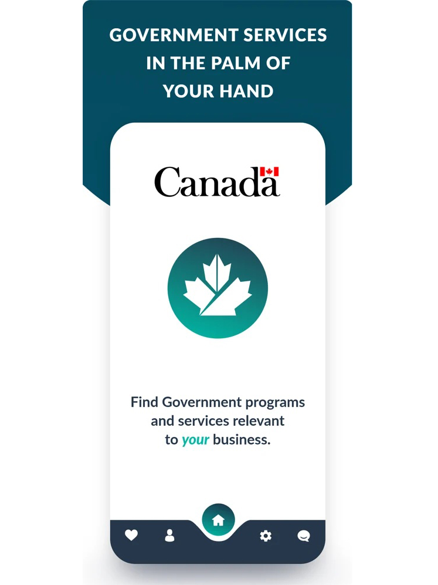
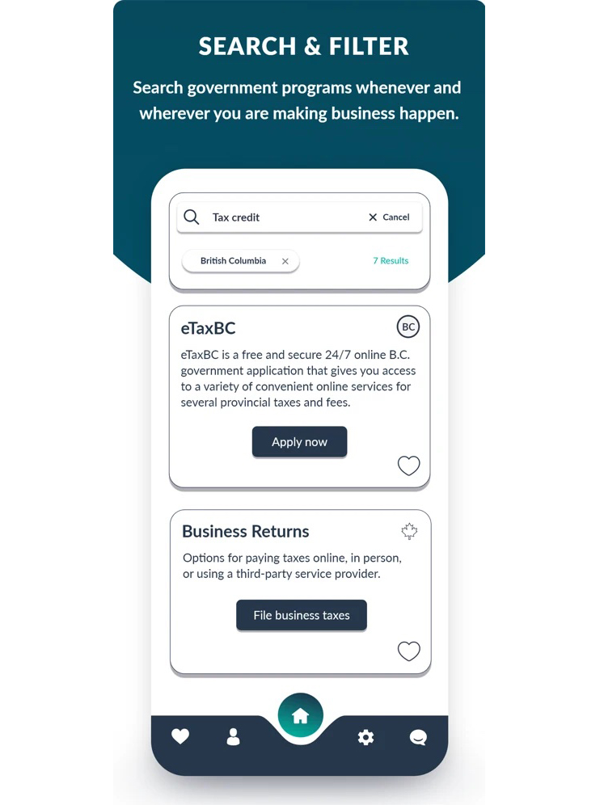
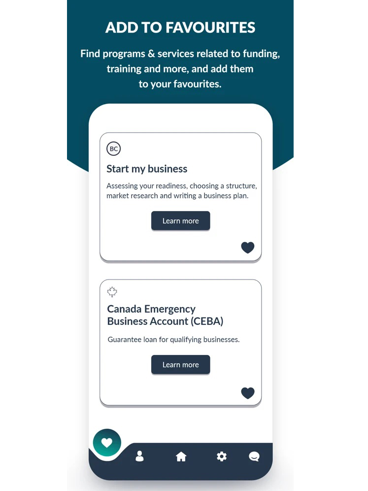
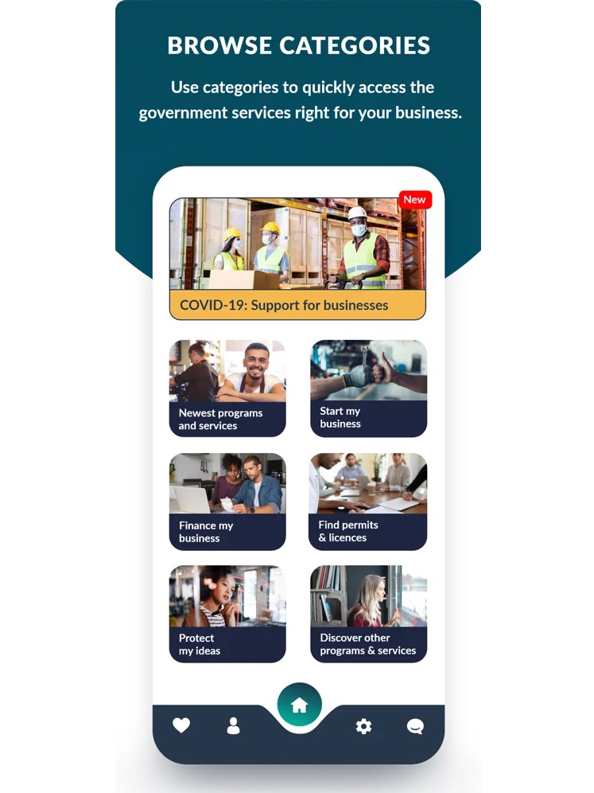
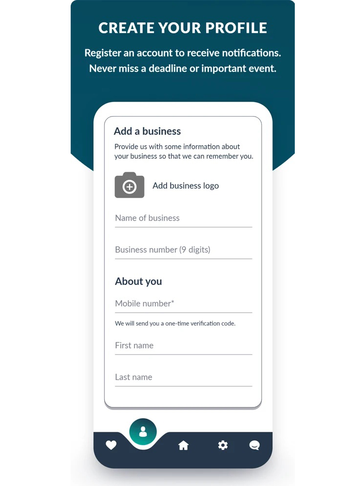
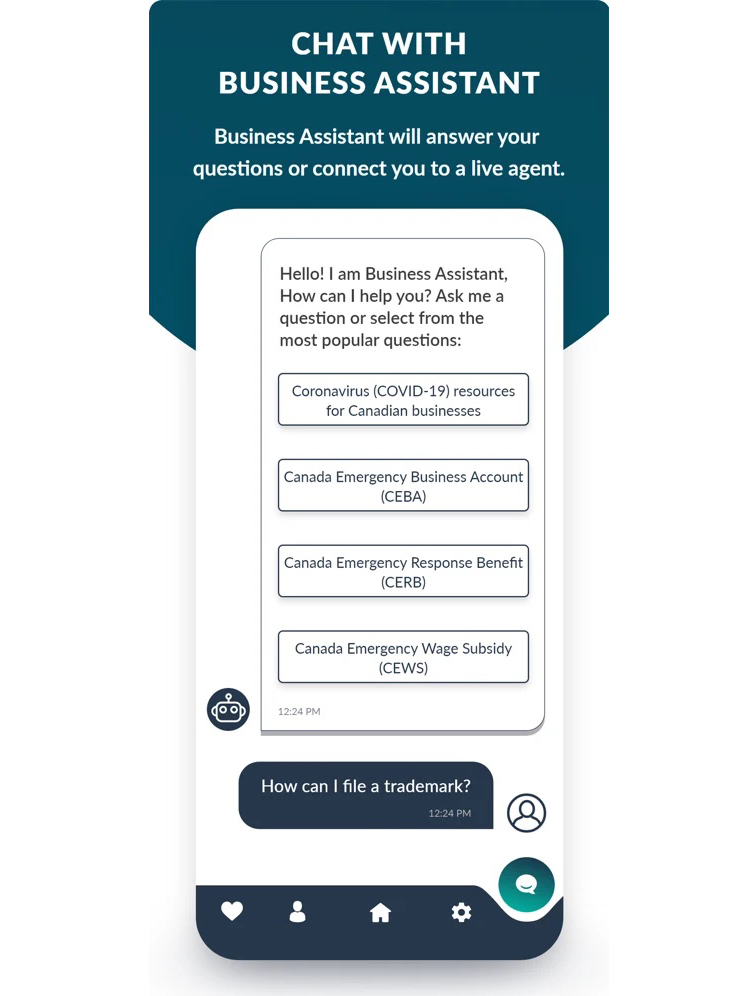

<!-- 2026年11月更新模块：直接粘贴在 YAML 头部 --- 下方 -->

  

    2026年11月最新校准
    <strong style="color: #141413; font-size: 16px;">官方链接更新：旧版 `ic.gc.ca` 已迁至新门户，2026 用它在 30 秒内筛出最新政府补贴！</strong>
  

  

    本文写于 2021 年 7 月。截至 <strong>2026 年 11 月</strong>，加拿大联邦创新、科学和经济发展部（ISED）旗下的这款官方工具依然在持续维护更新，但文中的旧版网址与重点扶持项目已全面换代：
  

  <ul style="margin: 0 0 12px 0; padding-left: 20px;">
    <li style="margin-bottom: 6px;"><strong>1. 官方下载与电脑端匹配器新入口（旧版 `ic.gc.ca` 链接已停用）：</strong>
       • <strong>手机端 App 官方主页：</strong>现已统一迁移至 <a href="https://ised-isde.canada.ca/site/ised/en/canada-business-app" target="_blank" rel="noopener" style="color: #8A2520; font-weight: 600;">canada.ca/business-app</a>（支持 iOS 与 Android 免费下载并开启补贴截止日推送）；
       • <strong>电脑网页端核心引擎（Business Benefits Finder）：</strong>如果你习惯在电脑上查资料，无需下载手机 App，直接访问其底层同源的联邦官方匹配器 <strong>Business Benefits Finder（`innovation.ised-isde.canada.ca`）</strong>，通过下拉填空勾选你的省份（如 BC 省）、行业与资金用途，30 秒即可生成专属的联邦+省级政府补助与贷款清单。
    </li>
    <li style="margin-bottom: 0;"><strong>2. 2026 年在系统里最值得重点勾选收藏的 4 类当红资金池：</strong>下文图片中的“疫情支持项目”与“CDAP 数字化赠款”早已关停。2026 年 11 月登录系统，请重点开启以下 4 类提醒：① <strong>2026 联邦关税应对资金池（WRRP 员工保留重训补贴 / BDC Pivot to Grow / PacifiCan RTRI）</strong>；② <strong>BDC LIFT（2026 年 4 月新推出的 5 亿加元中小企业数字化与 AI 转型专项）</strong>；③ <strong>青年与女性无抵押创业贷款（Futurpreneur 最高 $7.5 万 / WEOC $5 万 / BC 省 WeBC 最高 $15 万）</strong>；④ <strong>CanExport SMEs（报销 50% 出海营销与海外商标费）与 BC ETG（报销 80% 员工技能培训费）</strong>。</li>
  </ul>
  

    💡 中文一站式索引：我们已为你把上述核心政府资金、牌照查询（BizPaL）与商标检索（CIPO）全部整理在本站 <a href="/resources/#sec-grants" style="color: #141413; font-weight: 600; text-decoration: underline;">《北美创业合规与实战导航》</a> 中。
  

最近发现一个非常好用的加拿大政府app，是加拿大联邦政府创新、科学和经济发展部 ([ISED](https://www.ic.gc.ca/eic/site/icgc.nsf/eng/home))专为小生意人提供帮助的手机应用 APP，苹果和安卓系统都能下载，名字是[CANADA BUSINESS APP](https://www.ic.gc.ca/eic/site/icgc.nsf/eng/h_07670.html)，目前已经有35000多人在使用，你下载了吗？

本以为是个新的app，没想到2019年6月就有了，当时不太引人注意，直到疫情开始，大家发现app好用，因此下载量飙升，app也升级到新版本，里面加入了15000多个加拿大和省市三级政府的服务项目。

这个app目的是把小企业需要的资源整合在一起，让大家可以简单访问和操作。有些项目每个月都甚至每周都在发布，这里的更新速度已经算是非常好的。

[CANADA BUSINESS APP](https://www.ic.gc.ca/eic/site/icgc.nsf/eng/h_07670.html) 有各种信息推送功能，可以根据你的生意类型和阶段分类查看，可以收藏你喜欢的服务项目，也可以查找你想要的服务内容。

* [CANADA BUSINESS APP](https://www.ic.gc.ca/eic/site/icgc.nsf/eng/h_07670.html)下载
* 
* [CANADA BUSINESS APP](https://www.ic.gc.ca/eic/site/icgc.nsf/eng/h_07670.html)申请许可证
* 
* 
* 
* 
* 
* 

内容有七大类：疫情下对生意的支持项目、最新项目和服务、被忽视人群项目（包括女性、青年、偏远地区创业人员）、初创企业、融资、许可和执照、保护你的生意点子等。

大类下还有很多小分类，有公司取名、注册有限公司、怎么拿到许可证、进口、出口、报税、退税、雇人、和政府做生意的机会等等，非常实用。

如果愿意分享地理位置，这个app能更准确给出你所在省份和城市的服务内容。

App还有虚拟助手，可以问问题，还能有专人和你在线回答。

App用手机号码注册，添加你的生意名称、logo和business number，还有你的名字和email地址。

已经下载并开始使用，有兴趣的也可以去下载一个，有什么感想我们一起交流。
