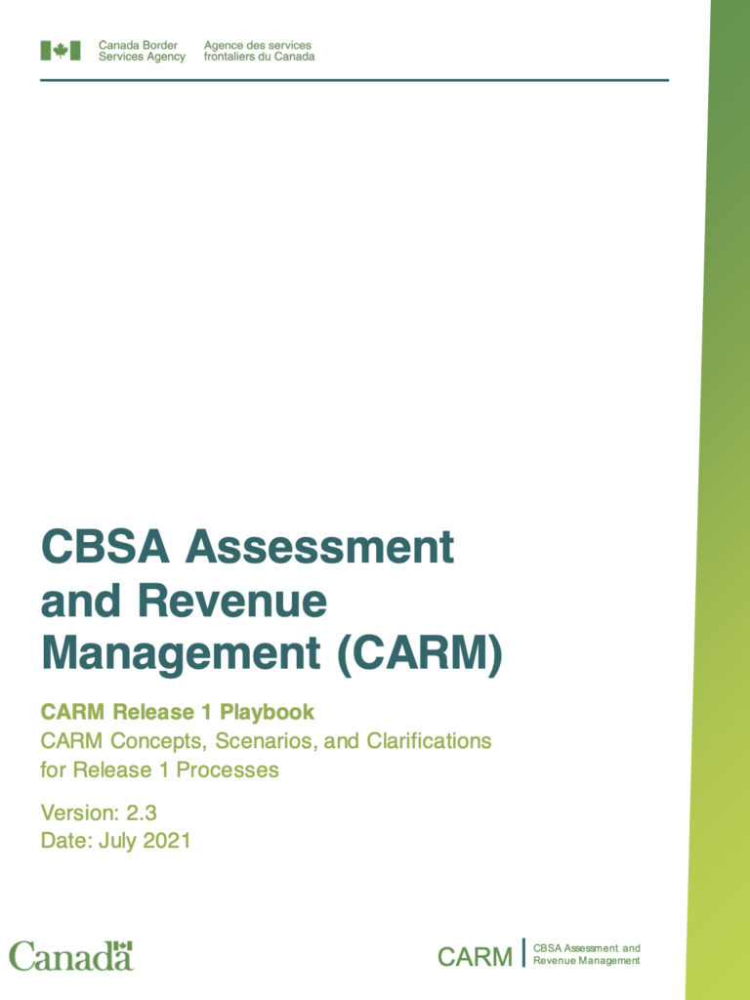
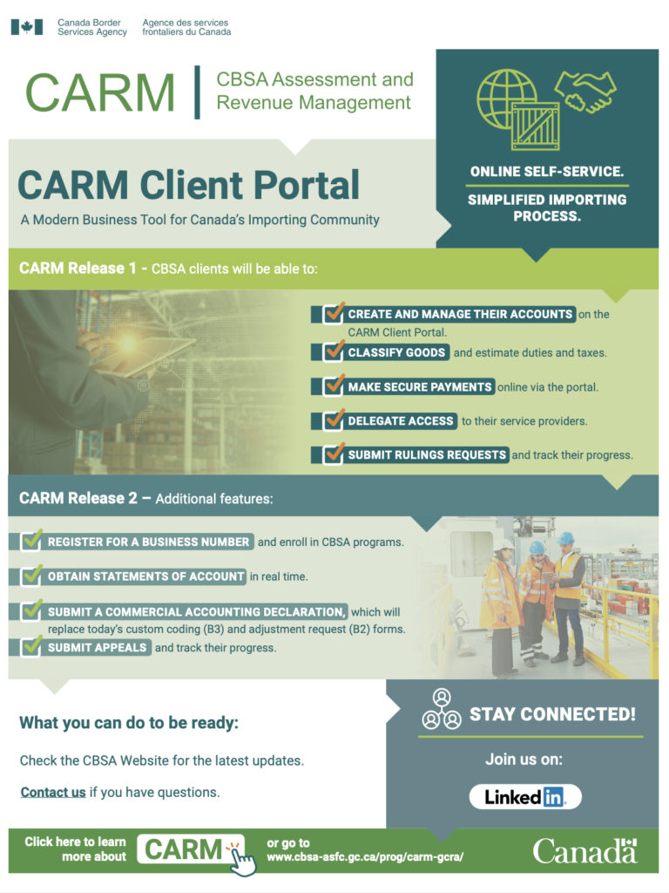
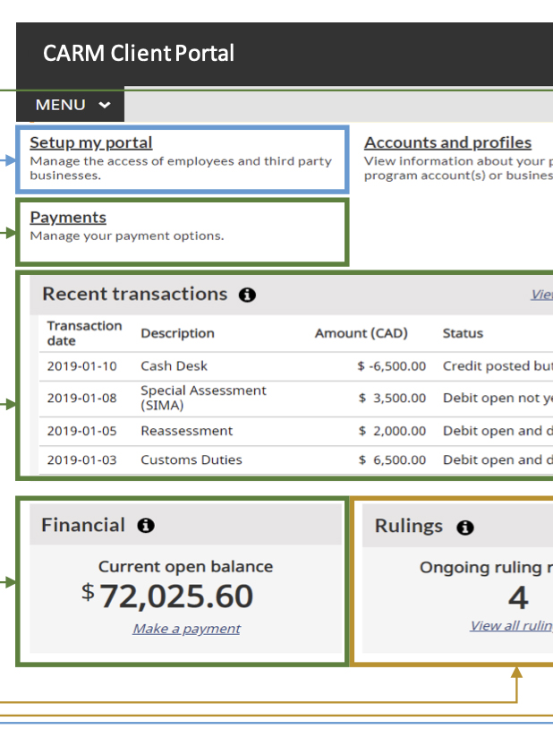
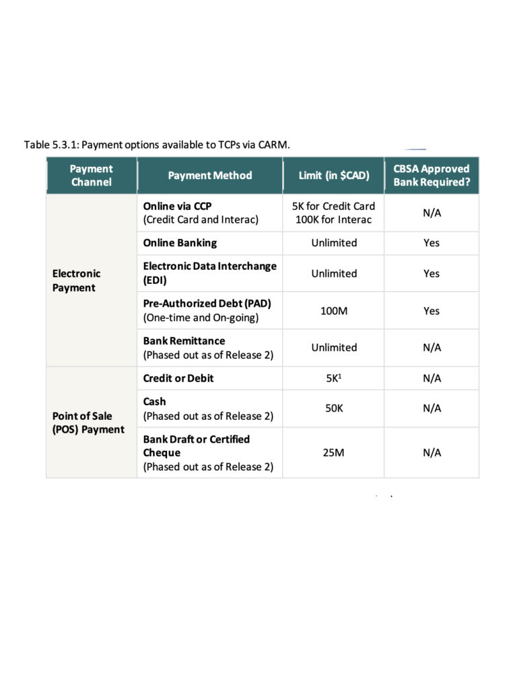

<!-- 2026年11月更新模块：直接粘贴在 YAML 头部 --- 下方 -->

  

    2026年11月最新政策校准
    <strong style="color: #141413; font-size: 16px;">CARM 现已 100% 强制执行！2026 进口商必做的 4 步通关配置清单</strong>
  

  

    本文写于 2021 年 8 月 CARM 第一阶段刚内测之时。截至 <strong>2026 年 11 月</strong>，CARM 第二阶段早已于 2024 年 10 月正式上线，<strong>RPP 财务担保宽限期已于 2025 年 5 月 20 日结束，报关行借用自身 BN15 代客清关的过渡通道也已于 2025 年 12 月 31 日彻底关闭（逾期滞纳金与利息已于 2026 年 1 月 31 日恢复计收）</strong>。
  

  
<strong>今天在加拿大进口任何商业货物，必须按以下 4 步跑通 CARM 闭环：</strong>

  <ol style="margin: 0 0 12px 0; padding-left: 20px;">
    <li style="margin-bottom: 6px;"><strong>注册并绑定 RM0001：</strong>使用 GCKey 或网银 Sign-In Partner 登录 <a href="https://ccp-pcc.cbsa-asfc.cloud-nuage.canada.ca/" target="_blank" rel="noopener" style="color: #8A2520; font-weight: 600;">CARM Client Portal</a>，绑定公司的 9 位 BN 号与 15 位进出口账户（如 123456789RM0001）。</li>
    <li style="margin-bottom: 6px;"><strong>审批报关行授权（Delegation of Authority）：</strong>在门户的 <em>Manage Business Relationships</em> 中找到你的报关行（Customs Broker），授予其 <strong>Business Management / Program Management</strong> 权限，否则报关行无法为你提交电子 CAD 申报单。</li>
    <li style="margin-bottom: 6px;"><strong>配置 RPP 财务担保（Financial Security）：</strong>若要享受“货到先放行、次月按账单统一付税”，必须在 CARM 内配置财务担保——按系统核算的应付税费峰值 50% 购买<strong>电子海关担保（Surety Bond，最低保额门槛为 $5,000 加元，由保险/担保公司通过 API 实时推送到 CARM）</strong>，或在门户内充值等额现金保证金。</li>
    <li style="margin-bottom: 0;"><strong>按统一账单周期（SOA）在线自动扣款：</strong>每月 18 日生成月度对账单（Statement of Account），须在月底前 10 个工作日内通过网银或 Pre-Authorized Debit（PAD）结清，避免触发海关滞纳罚息。</li>
  </ol>

[CARM 客户平台系统，全称 CBSA Assessment and Revenue Management](https://www.cbsa-asfc.gc.ca/prog/carm-gcra/menu-eng.html)，是[加拿大边境服务局CBSA](https://www.cbsa-asfc.gc.ca/menu-eng.html)为了简化进口货物流程的一个最重要的客户自助工具，算是加拿大这些年努力的一个成果。

[CARM平台系统可以用两种方式登录](https://ccp-pcc.cbsa-asfc.cloud-nuage.canada.ca/en/auth/login)，一是[加拿大政府使用的网络账户系统工具 GCKey](https://clegc-gckey.gc.ca/)，另一种是第三方银行在线账户，类似加拿大税务局登录的系统。

CARM 平台的目的是改变进口到加拿大的货物关税和税收征收方式，流程现代化，更简化。好处是6个：

1⃣️ 简化整体进口程序；

2⃣️ 提供现代化进口服务界面；

3⃣️ 进口商可以自助访问自己的信息；

4⃣️ 降低进口到加拿大的成本；

5⃣️ 提高遵守贸易规则的一致性；

6⃣️ 清晰的可见的进口时间线。

CARM客户平台系统分阶段实现各个功能。

* [CARM客户平台系统使用手册(2021年7月版本)](https://ccp-pcc.cbsa-asfc.cloud-nuage.canada.ca/en/assets/pdfs/onboarding/en/CARM%20R1%20Playbook%20-%20July%202021.pdf)
* ARM客户平台系统功能
* ARM客户平台系统界面
* ARM客户平台系统内电子支付选项

今年5月25日开通的是第一部分：The Accounts Receivable Ledger (ARL) ，应收款账自助服务。

CARM客户平台可供进口商、报关行以及贸易顾问使用。

已经可以：

1⃣️ 创建和管理自己的账户；

2⃣️ 分类货物并估算关税和其他税收；

3⃣️ 通过平台进行在线安全支付；

4⃣️ 选择报关服务提供商；

5⃣️ 网上产看交易、对账单；

6⃣️ 提交裁决并跟踪其进度等等。

明年春季，CARM客户平台系统会开通第二部分，主要是增加和完善各种功能。

届时可以用你的商业号码BN注册并参加加拿大边境服务局的项目。

还主要包括：

1⃣️ 实施获取对账单；

2⃣️ 可以更改、调整电子商业会计报表，取代现在custom coding (B3) 和adjustment request (B2) 表格；

3⃣️ 提交上诉并跟踪其进度；

4⃣️ 支付清关放行简化；

5⃣️ 新的核销选项；

6⃣️ 进口前怎么做准备等等。

第二部分更重要的是增加了沟通的功能，保证了更多的参与度。

该系统有详细的使用手册和指导可以供查询：

[CARM客户平台系统登录界面](https://ccp-pcc.cbsa-asfc.cloud-nuage.canada.ca/en/auth/login)

[CARM客户平台系统进口商使用手册](https://ccp-pcc.cbsa-asfc.cloud-nuage.canada.ca/en/assets/pdfs/onboarding/en/CARM_Client_Portal_Onboarding_Guide_Importers_April_2021.pdf)

[CARM客户平台系统使用手册(2021年7月版本)](https://ccp-pcc.cbsa-asfc.cloud-nuage.canada.ca/en/assets/pdfs/onboarding/en/CARM%20R1%20Playbook%20-%20July%202021.pdf)
