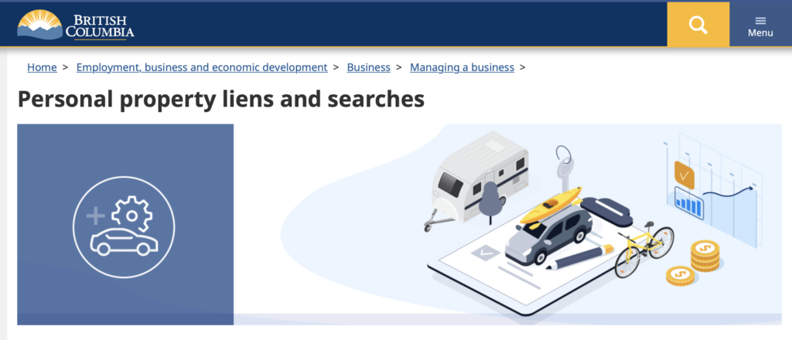

<!-- 2026年11月更新模块：直接粘贴在 YAML 头部 --- 下方 -->

  

    2026年11月最新政策校准
    <strong style="color: #141413; font-size: 16px;">2026 尽职调查（Due Diligence）保命清单：补齐 4 张法定清结证明与 GST44 免税选举</strong>
  

  

    下文文末列出的 8 项尽调清单非常关键。结合 <strong>2026 年加拿大与 BC 省最新法条</strong>，在支付交割尾款前，你的律师和会计师必须额外锁死以下 <strong>4 道法定防火墙</strong>（漏掉任何一项，前任老板的欠款都会合法转移到你头上）：
  

  <ul style="margin: 0 0 12px 0; padding-left: 20px;">
    <li style="margin-bottom: 6px;"><strong>1. 清单第 6 项升级（WorkSafeBC 第 51 条连带追责清结信）：</strong>依据 BC 省《工伤赔偿法》Section 51，在交割前<strong>必须向 WorkSafeBC 索取卖家的 Clearance Letter（合规清结信）</strong>。若卖家欠缴保费而你未查验即付款交割，WorkSafeBC 有权依法直接向你（买方）强制追讨前任老板拖欠的全部保费与罚金！</li>
    <li style="margin-bottom: 6px;"><strong>2. 清单第 2 项升级（BC 省 PST 清税证明 FIN 443 + GST44 免税表）：</strong>① 在 BC 省收购生意资产，必须要求卖家向省财政厅申领 <strong>PST Clearance Certificate（Form FIN 443）</strong>，否则买方须对卖家历史漏缴的 7% PST 承担个人连带责任；② 买卖双方均为 GST 注册商且转让全部或实质上全部（90%+）商业资产时，必须在交割日联合签署并提交 <strong>CRA Form GST44（Section 167 Election）</strong>，即可合法<strong>免除整店买卖价格 5% 的联邦 GST</strong>，省下数万刀现金流垫资！</li>
    <li style="margin-bottom: 6px;"><strong>3. 清单第 8 项重中之重（Commercial Lease 商业租约 5 大死穴）：</strong>严查租约中是否藏有 <strong>Demolition Clause（拆迁无偿赶人条款）</strong>、<strong>Unlimited Personal Guarantee（个人无限连带担保）</strong>、<strong>Restoration Clause（退租强制砸墙还原毛坯）</strong>，以及过去 3 年真实的 NNN 物业管理费与地税账单。</li>
    <li style="margin-bottom: 0;"><strong>4. 严禁轻信“现金收入未入账”的口头说辞：</strong>卖家常宣称“报税表上虽然微利，但每天有很多现金/个人 E-transfer 没入账”。在 2026 年 CRA 大数据稽查与银行信审下，<strong>凡是未能体现在 T2 税表、GST 申报表与商业银行流水（QuickBooks / Synder 对账单）上的收入，尽调时一律按 $0 计价</strong>！</li>
  </ul>
  

    💡 查册直达：本站 <a href="/resources/#sec-buy" style="color: #141413; font-weight: 600; text-decoration: underline;">《北美创业合规导航》</a> 已内置最新有效的 BC PPR 动产抵押官方查册入口。
  

找到你想购买的企业后，就是Due Diligence阶段，需要进行尽可能全面的调查。

根据公司的规模、时间表和买卖双方的期望不同，这个阶段时长会有很大差异，从1个月到1年不等。

想要又快又好，就需要会计师、律师和商业服务等专业人员都尽早加入其中。

早期要和这些专业人士建立信任的方法最好是使用保密协议或者预付款的方式。

通常，买卖双方同时会和多方接触，为了时间和资源的合理使用，双方应单独建立谈判协议的最佳替代方案[Best Alternative to a Negotiated Agreement](https://corporatefinanceinstitute.com/resources/knowledge/deals/what-is-batna/) (BATNA)。

提醒一下：这个阶段，所有的时间表、进度和期待值都要有详细记录。

在调查阶段结束时，双方应该有个明确的卖出价格、时间表和期待值。

[加拿大个人财产安全登记处网页 Personal Property Security Registry](https://www2.gov.bc.ca/gov/content/employment-business/business/managing-a-business/bc-registry-services-personal-property-registry)

最后给需要调查的清单：1.到个人财产安全登记处[Personal Property Security Registry](https://www2.gov.bc.ca/gov/content/employment-business/business/managing-a-business/bc-registry-services/personal-property-registry)去确定将要购买的企业有没有任何留置权(魁北克市the Register of Personal and Movable Real Rights) ；

2.检查企业是否已缴纳所有税款；

3.查登记文件，确保建筑物和车辆归卖房所有；

4.确保该公司不是依据[银行法Bank Act第427](https://laws-lois.justice.gc.ca/eng/regulations/SOR-92-301/FullText.html)条进行担保；

5.检查有没有未解决的诉讼、人权投诉或破产申请；

6.联系[加拿大各省Workers Compensation Board劳工赔偿局](https://www.ccohs.ca/oshanswers/information/wcb_canada.html)确保卖家信誉良好；

7.联系市政府确定该公司是否拥有合适的许可证以及当前的物业是否可以许可的；

8.检查一些公司文档：

> 公司注册文件
>
> 公司会议记录
>
> 合同
>
> 库存清单
>
> 经审计的财务报表
