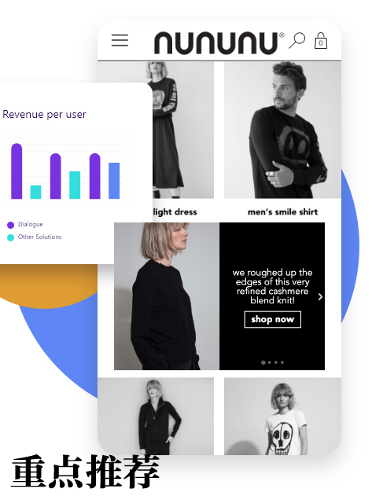
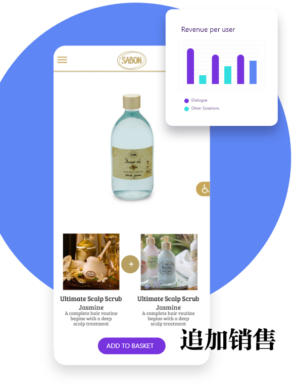
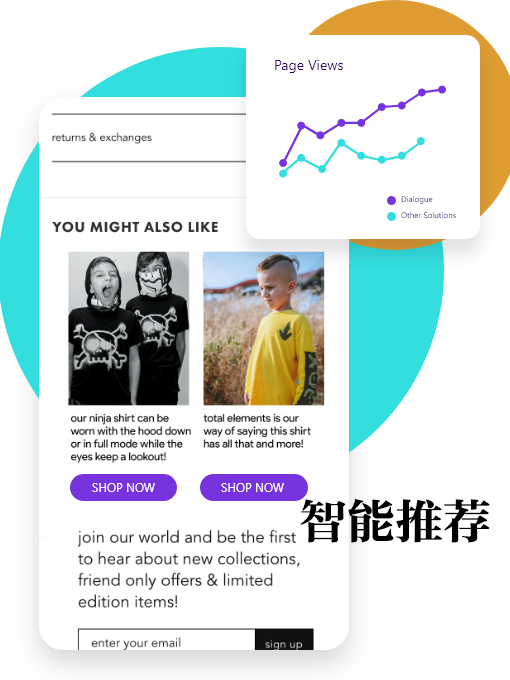

<!-- 2026年11月更新模块：直接粘贴在 YAML 头部 --- 下方 -->

  

    2026年11月最新校准
    <strong style="color: #141413; font-size: 16px;">Dialogue AI 2026 新定价 & Shopify 结账页扩展示范（Checkout Extensibility）新规</strong>
  

  

    本文发布于 2021 年。截至 <strong>2026 年 11 月</strong>，这款应用在 <a href="https://shopify.pxf.io/c/5878481/3323859/13624" target="_blank" rel="sponsored noopener" style="color: #8A2520; font-weight: 600;">Shopify</a> 应用商店已升级更名为 <strong>Dialogue - Personalization & CRO</strong>。在 2026 年部署 AI 个性化推荐与交叉销售（Cross-sell）时，请重点注意以下 3 项规则与价格变化：
  

  <ul style="margin: 0 0 12px 0; padding-left: 20px;">
    <li style="margin-bottom: 6px;"><strong>1. 2026 最新按单量阶梯定价：</strong>下文提到的旧版按营收收费已改为按月订单量计费——开发测试店免费；<strong>月订单 100 单以内为 $19 USD/月</strong>；<strong>500 单以内为 $59 USD/月</strong>；<strong>1,000 单以内为 $99 USD/月</strong>（均含无限制 A/B 测试、可购物短视频 Shoppable Reels 模块与智能捆绑推荐）。</li>
    <li style="margin-bottom: 6px;"><strong>2. Shopify 结账页新规（Checkout Extensibility 权限区分）：</strong>下文提到“在结账时推广相关产品”，需注意 Shopify 现已全面废除旧版 `checkout.liquid` 并强制执行 <strong>Checkout Extensibility</strong> 安全架构——目前<strong>仅月费 $2,300+ 的 Shopify Plus 企业店铺</strong>被允许在结账表单页面（Checkout Page）内直接嵌入加购组件；而<strong>普通 Basic / Grow 套餐商家</strong>，应将 AI 追加销售配置在<strong>侧边购物车抽屉（In-Cart Drawer）</strong>以及<strong>付款完成后的黄金一秒页（Post-Purchase One-Click Upsell）</strong>，同样可提升 15%–25% 客单价！</li>
    <li style="margin-bottom: 0;"><strong>3. 起步期 0 成本官方平替（Shopify Search & Discovery）：</strong>如果你的新店月订单尚不足 50 单，无需一开始就付费买第三方 AI 推荐插件——可直接安装 Shopify 官方出品、<strong>100% 免费的 Shopify Search & Discovery 应用</strong>，即可免费配置商品页“经常一起购买（Complementary Products）”与关联推荐，等跑出稳定流量后再升级 Dialogue 做深度 A/B 测试。</li>
  </ul>

越来越多的电商用**Shopify** 开网店，用**[Shopify](https://www.shopify.ca)** 的一大好处就是内置集成了很多**app** 应用程序，让电商的活变得轻松。年底节假日越来越近，抓住网店的每个机会去进行促销变得至关重要。

当上网购物者来到你的网站时，你能确认有多少比例把这些访问者变成客户呢？

吸引更多客户、改善购物体验、最大程度实现销售、暗示或强势最大化销售机会，就需要用好这些无缝协作的**app** 应用。我们这几天来集中介绍其中必不可少的**7** 个。

今天介绍第一个：**[Dialogue AI Personalization](https://nowdialogue.com)**

这个应用程序来自**Dialogue** 公司，用名叫 Journey.Al™ 的**AI** 智能算法分析用户，并显示用户最想看的内容，增加留在网页的时间，从而大大提高转化率。

每个上网购物者都是不同的，也不会想要看到完全同样的网站版本。

**Dialogue AI Personalization** 属于完美集成**Shopify** 网店的那种，用高级个性化算法和转换工具让你赚得更多。工具无需懂得代码，适合中小型电商企业增加销售额。

当客户查看你的网站，基于其浏览历史和个人阅读习惯，会看到个性化产品的推荐和更深度的内容。

这个工具还能通过购物车页面以及结账时推广相关的产品来增加交叉销售以及追加销售。L'occitane、KIKO-MILANO、nununu等网站使用后转化率立即提高35%。

工具能自动为网站的畅销产品、高利润产品创建横幅。

更牛的是，如果你的产品售罄，工具就暂时不会去推销。

* 
* 
* 
* 

大多数情况，购物者会在**10-20** 秒内离开网站，但用这个工具，可以对特定产品创建一个内容补充，用类似 Instagram Story的形式，放在网店任何位置，会非常吸引注意力，创造更久的网页停留时间以及更多的网站浏览数量，从而增加转化机会。

这个工具集成很容易，点击不到三下就能完成，选择工具中✨ Auto Branding，**Dialogue** 就会扫描网站并自动把网站的颜色和字体加到设计中。

**Dialogue AI Personalization** 可以自定义模板设计和选项，更换字体、颜色、按钮、贴纸等各种功能。

据使用过的电商反映，这个工具非常好用，中英文网站都能用，能设置各国货币，网页加载速度极快。网站变得特别专业，停留时间和销量都有翻番的记录，客服支持也很好。

如果你月收入不到**5000** 美元，这个工具免费使用，但以上功能还是有很大缺失的。要用以上基本功能月费需要**15** 美元，如果你月收入**12** 万美元以上，就需要更高级别的，月费从**120** 美元起。

**Dialogue AI Personalization** 提供**14** 天免费使用，有兴趣的同学可以试试，看看网站的engagement time、AOV和转化率有没有变化。
