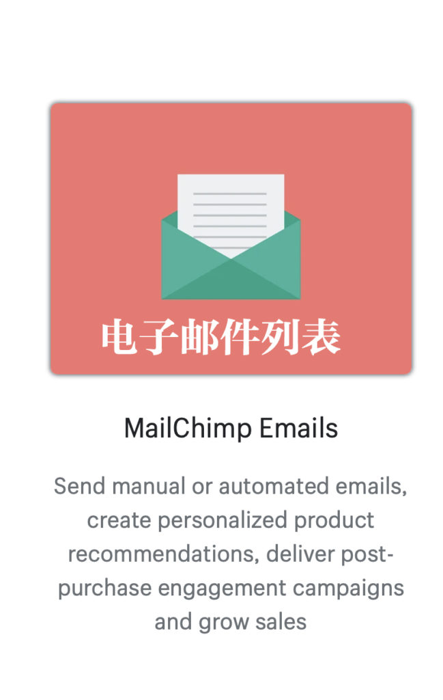
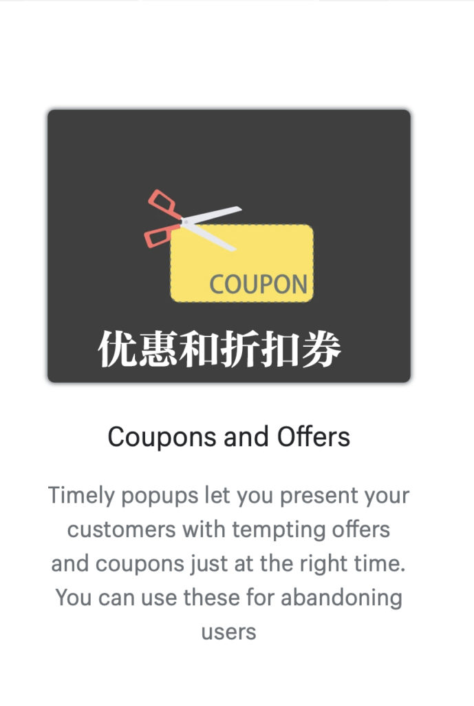
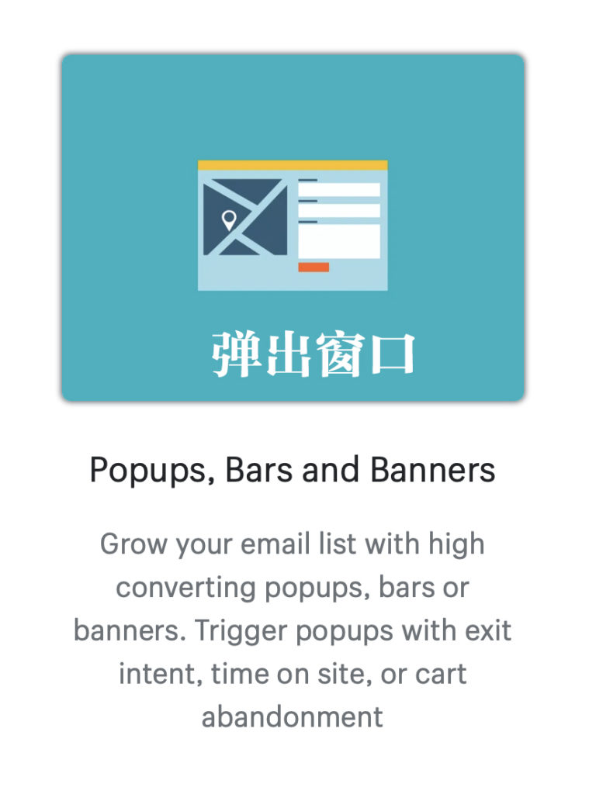

<!-- 2026年11月更新模块：直接粘贴在 YAML 头部 --- 下方 -->

  

    2026年11月最新校准
    <strong style="color: #141413; font-size: 16px;">2026 电商邮件表单选型：区分官方插件、Klaviyo 弃单王牌与加拿大 CASL 合规防线</strong>
  

  

    本文发布于 2021 年 10 月 Mailchimp 重返 Shopify 之时（后 Mailchimp 被 Intuit 收购）。站在 <strong>2026 年 11 月</strong>的时间节点，为 <a href="https://shopify.pxf.io/c/5878481/3323859/13624" target="_blank" rel="sponsored noopener" style="color: #8A2520; font-weight: 600;">Shopify</a> 独立站配置弹窗表单与邮件营销系统，请务必理清以下 3 个核心实操建议：
  

  <ul style="margin: 0 0 12px 0; padding-left: 20px;">
    <li style="margin-bottom: 6px;"><strong>1. 厘清两款同名插件（官方直连 vs. 第三方 Mailmunch）：</strong>如果你确定使用 Mailchimp，请直接在 Shopify 应用商店安装官方直连应用 <strong>Mailchimp: Email & SMS</strong>（官方已自带弹窗表单功能），无需再额外安装第三方的 Mailmunch 中间件，以免双重收费或导致客户标签同步延迟。</li>
    <li style="margin-bottom: 6px;"><strong>2. 2026 北美独立站更主流的两大替代方案：</strong>
       • <strong>零预算起步首选（Shopify Forms + Shopify Email）：</strong>Shopify 官方现已推出原生的 <strong>Shopify Forms（完全免费，支持退出意图弹窗与折扣码自动发放）</strong> 搭配 <strong>Shopify Email（每月前 10,000 封邮件完全免费）</strong>，对新手极其友好；
       • <strong>高转化进阶首选（Klaviyo）：</strong>由于 Klaviyo 与 Shopify 的底层订单、加购行为数据打通远比 Mailchimp 深入，2026 年绝大多数年销十万美金以上的北美 DTC 品牌均已迁移至 <strong>Klaviyo</strong>（250 个活跃档案及内置高转化弹窗内免费），用其跑通“Welcome 欢迎序列 + 48 小时三阶弃单挽回流”。
    </li>
    <li style="margin-bottom: 0;"><strong>3. 2026 邮件弹窗与发信 2 条生死线（CASL + DMARC）：</strong>① 根据<strong>《加拿大反垃圾邮件法》（CASL）</strong>，弹窗收集邮箱时严禁默认勾选订阅框，必须由用户主动提交（Express Consent），且每封邮件底部必须保留一键退订（Unsubscribe）与真实商业通信地址；② 必须使用企业自定义域名邮箱（如 <a href="https://referworkspace.app.goo.gl/8jXP" target="_blank" rel="sponsored noopener" style="color: #8A2520; font-weight: 600;">Google Workspace</a>）并在 DNS 中配齐 <strong>SPF、DKIM 与 DMARC</strong> 三重验证，否则发出的优惠券邮件会被 Gmail 和 Outlook 直接拦截拒收！</li>
  </ul>
  

    💡 延伸指南：前往本站 <a href="/resources/#sec-ecom" style="color: #141413; font-weight: 600; text-decoration: underline;">《北美创业合规导航》</a> 与 <a href="/tools/" style="color: #141413; font-weight: 600; text-decoration: underline;">《创业工具箱》</a> 查看完整私域配置指南。
  

2021年10月：[Mailchimp 今天宣布和Shopify合作，直接把Mailchimp的账户和Shopify店面连接](https://mailchimp.com/mailchimp-and-shopify-launch-direct-integration/?ref=newsroom)起来，无需第三方工具或手动数据传输。

2年前这两家曾经不欢而散，一度下架，数万新用户全靠[ShopSync](https://shopsync.io/)连接到网店，如今 Mailchimp 买下 ShopSync 团队，还终于和 Shopify 成为合作伙伴。

有这个合作，下面的工具将如虎添翼。

继续说第二个在节日促销必不可少的 [**Shopify**](https://www.shopify.com)[应用**——** Mailchimp Forms。](https://apps.shopify.com/mailchimp-forms)

在北美，电子邮件营销依然是最主要的营销渠道之一，因此邮件列表的功能是电商网站最强大的工具之一。

每个电商的网站最想要收集的就是购物访问者的电子邮件。光有邮件列表工具，如果没有人真正注册订阅，那也不会起到任何作用。

在假日购物季，更多人会来到你的网站上浏览或购物，就有机会扩大邮件列表的数量，而更多人注册，你就有更多几乎吸引人到网站上，这就意味着更良性的循坏。

[Mailchimp Forms 是Mailmunch 公司的一个应用，是**Shopify** 建站者最爱之一。](https://apps.shopify.com/mailchimp-forms)大家应该很熟悉 [Mailchimp](https://mailchimp.com)，这个几乎处于电子邮件营销的多年垄断性角色，有着成熟的技术和完整的功能。

Mailchimp Forms 工具能把 Mailchimp 和电商网站集成在一起，有三大主要功能：

1⃣️ 电子邮件管理

手动或自动发送电子邮件，创建个性化产品推荐，在客户购买后用活动和促销吸引回来购物，增加销售量。

2⃣️ 优惠券和打折

在网站上用弹出窗口，在最合适的时机出现在访问者眼前，展示诱人的优惠代码和折扣，同时收集访问者的电子邮件地址。

3⃣️ 增加邮件注册订阅

用高转换率的弹出窗口、栏目或横幅来增加你的电子邮件列表。在用户想要退出网站、放弃购物车等时刻触发，吸引用户注册。

Mailchimp Forms 工具业无需任何代码就能使用，可以创建很有设计感的MailChimp 表单，你可以定期通过电子邮件向订阅注册的用户发动最新产品、最新优惠的信息。

* 
* 
* 
* 

使用Mailchimp Forms工具前提是开一个MailChimp 帐户，创建一个邮件列表。

这个工具自带不少专业设计的模版，不只是设计好看，重要的是设计成最大化转化率。你可以进一步自定义表单来和你的网店相匹配。

工具可以在网店特定页面选择现实表单，客户针对性更强。

有些人可能会害怕太多干扰影响用户浏览体验，你可以在他们即将退出网站时显示，Mailchimp Forms工具有个进入或退出网站的监测技术，在最适合的时候出现优惠、折扣或注册信息。

工具还有很好的数据分析功能，能分析网站哪些网页、哪些产品或哪些Mailchimp 表单带来最大的转换，给你改进和决策的数据，甚至因此你可以调整网店客户的策略。

其实在wordpress这类架构的网站上也有MailChimp Forms 工具，应该说绝大多数网站都能用上MailChimp的这些功能。只是有些更易用些。
