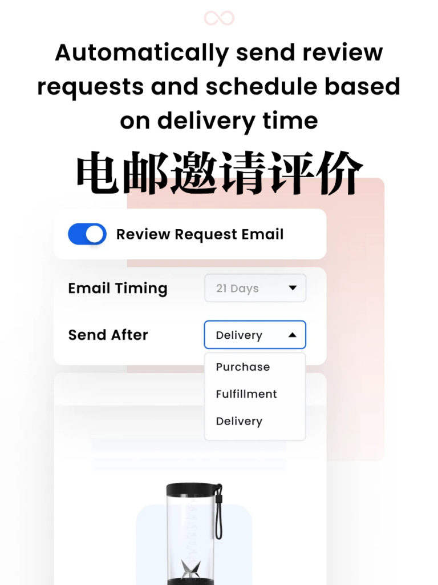
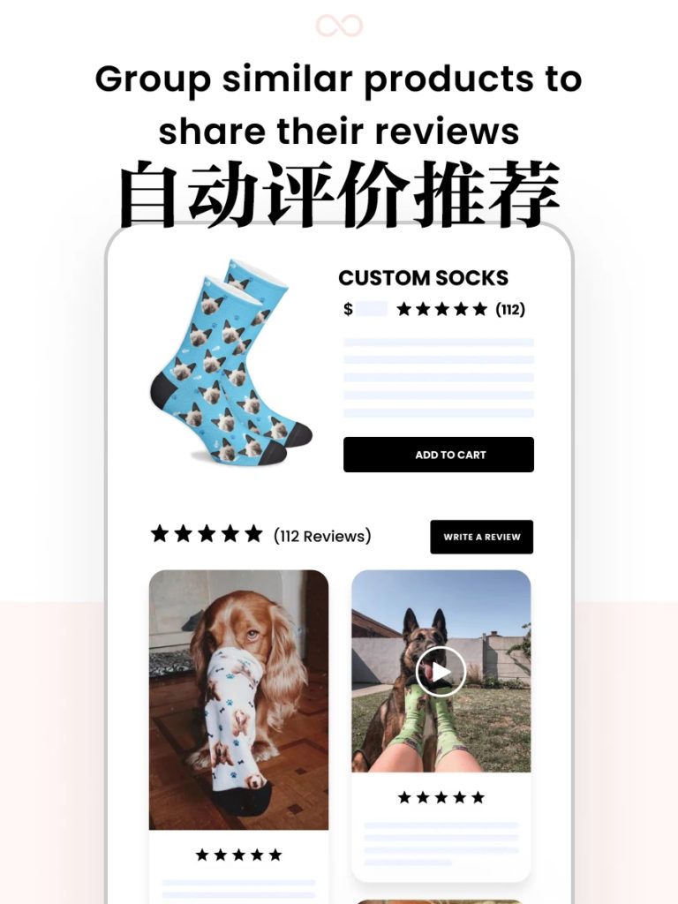
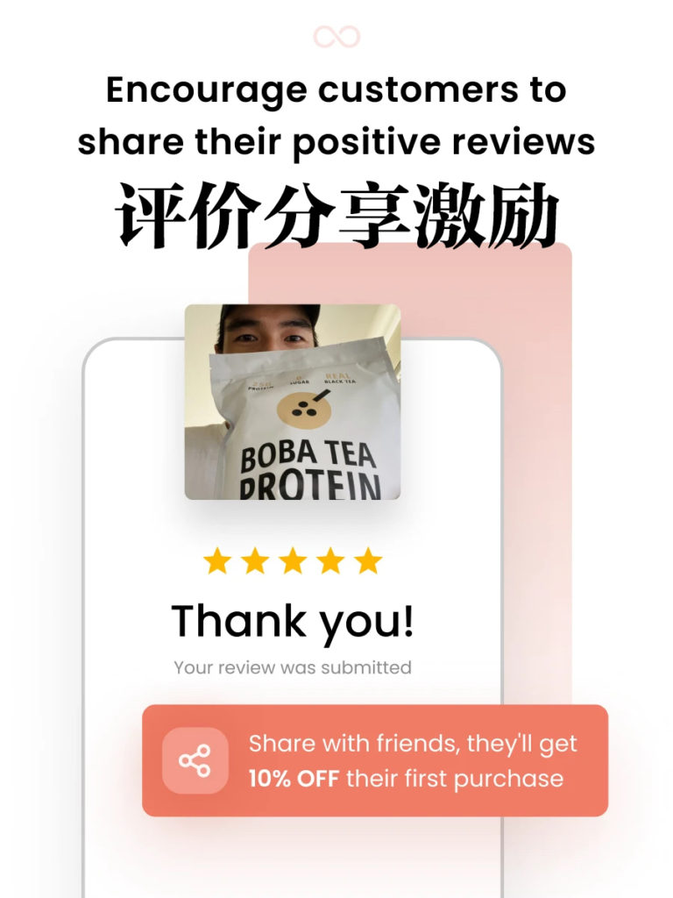

<!-- 2026年11月更新模块：直接粘贴在 YAML 头部 --- 下方 -->

  

    2026年11月最新校准
    <strong style="color: #141413; font-size: 16px;">Loox 2026 价格大改版（小心按单计费超支！）& 北美有奖晒单合规红线</strong>
  

  

    本文写于 2021 年。截至 <strong>2026 年 11 月</strong>，Loox 依然是 <a href="https://shopify.pxf.io/c/5878481/3323859/13624" target="_blank" rel="sponsored noopener" style="color: #8A2520; font-weight: 600;">Shopify</a> 生态中视觉颜值最高的图文/视频晒单插件，但其<strong>计费模式已彻底改版</strong>，且北美监管机构对“折扣换评价”出台了严厉新规，安装前必看以下 3 点：
  

  <ul style="margin: 0 0 12px 0; padding-left: 20px;">
    <li style="margin-bottom: 6px;"><strong>1. 2026 最新价格校准（旧版 $29.99 套餐已下线，小心按单叠加费）：</strong>
       • <strong>Beginner 入门版（$0/月，开启 Referrals 转介绍则为 $9.99/月）：</strong>限每月 100 笔订单以内的新店试水；
       • <strong>Convert 成长版（$49.99 USD/月起）：</strong>已取代早年的 $29.99/$39.99 套餐。解锁视频评价、Google Shopping 同步与 Klaviyo 集成。<strong>但务必注意其“按单阶梯加收”机制：</strong>$49.99 仅包含每月前 300 笔订单，<strong>超出后每增加 300 单自动加收 $40–$50 USD</strong>（如月销 1,500 单时月费高达 $249.99）！
       • <strong>Unlimited 无限版（$299.99 USD/月封顶）：</strong>若你的店铺月订单超过 1,800 单，直接选 Unlimited 反比 Convert 便宜。
    </li>
    <li style="margin-bottom: 6px;"><strong>2. 高性价比平替方案（Judge.me）：</strong>如果你处于控本起步阶段，不想承受按订单量膨胀的账单，2026 年 Shopify 上安装量第一的平替是 <strong>Judge.me</strong>（提供永久免费版，Awesome 全功能版仅固定 <strong>$15 USD/月</strong>，不限订单量且无超额附加费）。重颜值画廊选 Loox，重性价比与规模选 Judge.me。</li>
    <li style="margin-bottom: 0;"><strong>3. 北美 FTC 与加拿大竞争局“有奖晒单”合规铁律：</strong>根据美国 FTC《打击虚假评论最终规则》（16 CFR Part 465，违者单次最高罚 $51,744 USD）及加拿大《竞争法》反漂绿/反虚假背书新规，使用 Loox 发放“晒图/视频送下次购物折扣券”完全合法，但<strong>必须严守两条红线：① 严禁将折扣券与“必须给五星好评”挂钩（中差评带图同样必须发券）；② 评价组件需保留“Incentivized Review（激励性评价）”合规标识，且严禁在后台手动隐藏真实消费者的非恶意低星评价！</strong></li>
  </ul>

当一个潜在客户在看你的电商网站，犹豫是不是购买，这是最常见出现的状况。而这种情况下，两样东西最可能让他下定决心。

一个是客户的好评，一个是精美呈现的产品图片。这是所有电商网站都必须具备的两个功能，尤其是节假日旺季。

L[oox Product Reviews and Photos](https://apps.shopify.com/loox)就是其中佼佼者。目前有10多万 [Shopify](https://www.shopify.com)及 [Shopify Plus 商户](https://www.shopify.com/plus)使用这个工具，口碑极好！

[电商评价传播Loox Product](https://loox.app)总是以一种简单而美观的方式，为你汇总了客户好评和精美产品图片。百分百匹配手机等移动设备。

当客户购买了商品后，会收到一份自动发出的电子邮件，要求评价。这个工具还会用折扣券等方式吸引客户在评价中添加照片或视频。

这就启动了最良性的循环，未来的客户会看过此前客户的真实照片和评价，属于视觉上的“可靠社交证明”，激励其购买，这属于高效的病毒式传播。

Loox Product 工具还有推荐折扣的功能，吸引更多买家。并能通过社交媒体和[google shopping](https://shopping.google.com)推广你的网店。

该工具无需代码，配置和管理简单，并用cdn加速，完全不减缓你网店的速度，等你网页完全加载后才可以加载。

* 
* 
* 
* 
* 
* 

Loox Product 提供英语、中文等17种语言，能从任何来源导入评价。还有Inline SEO功能，让你客户的评论出现在谷歌搜索结果上。

这个工具的开发者挺贴心，专门提供一个[网店demo给你看实际的效果](https://loox-demo-store.myshopify.com/)。

工具很容易和其他app集成，包括 [Klaviyo](https://www.klaviyo.com)、[Google Shopping](https://shopping.google.com)、[Facebook tab & pixel](https://www.facebook.com/business/help/742478679120153?id=1205376682832142)、[Omnisend](https://www.omnisend.com)、[Loyalty Apps](https://apps.shopify.com/loyaltylion?utm_source=blog&utm_medium=loox&utm_campaign=integration)和 [Flow](https://help.shopify.com/en/manual/shopify-plus/flow)等。

[Loox Product 月费从9.99美元起](https://loox.app/pricing)，每个月能发100个评价电子邮件，最多500个订单。每个月发300个评价电子邮件就要月费29.99美元。而Referrals推荐功能要另加5元。

这是Shopify最火的付费工具之一，从使用的客户反馈看，花钱是值得。

Loox Product 目前为止只适用 Shopify 网店，如果用wordpress等建站的电商并不适用。
