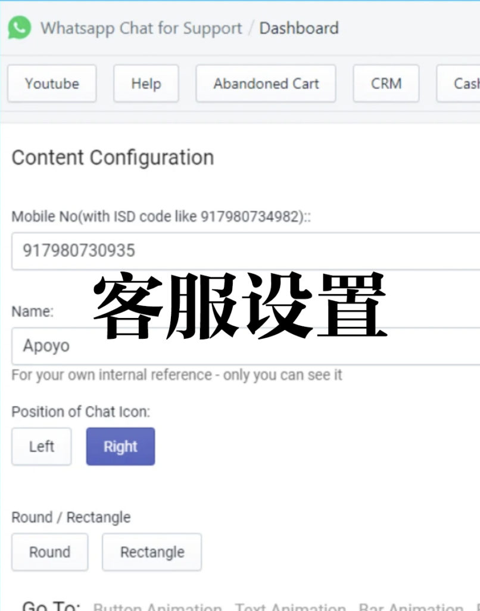
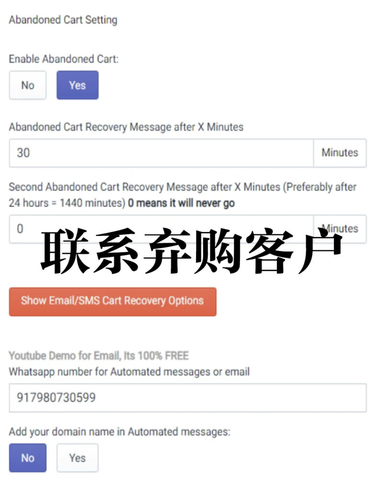
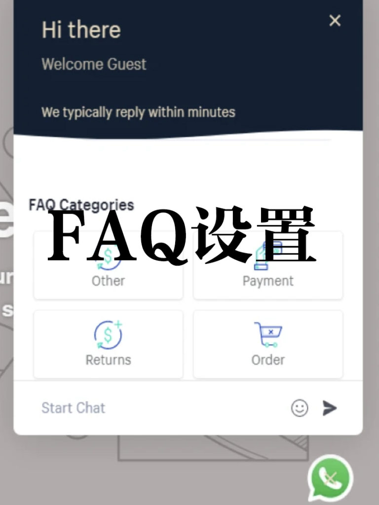
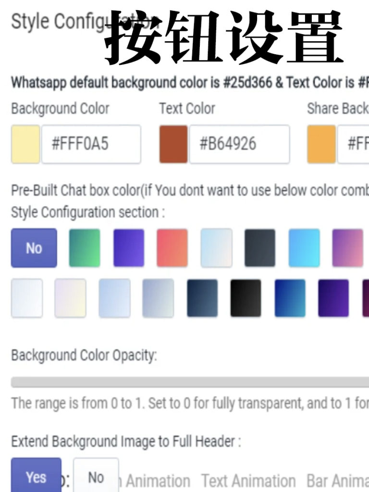
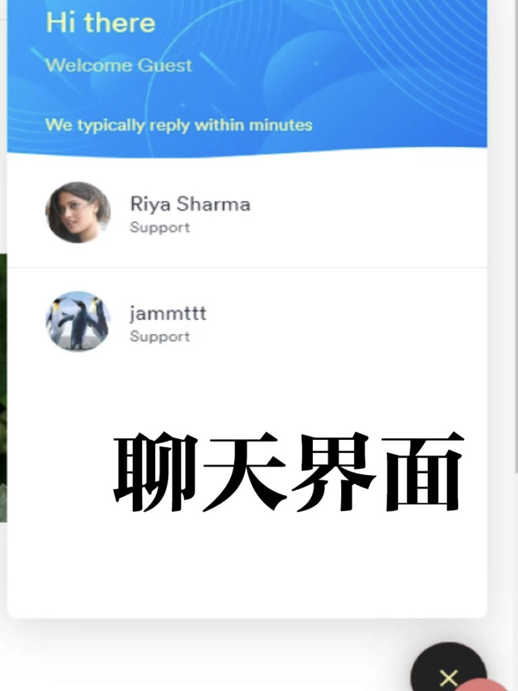
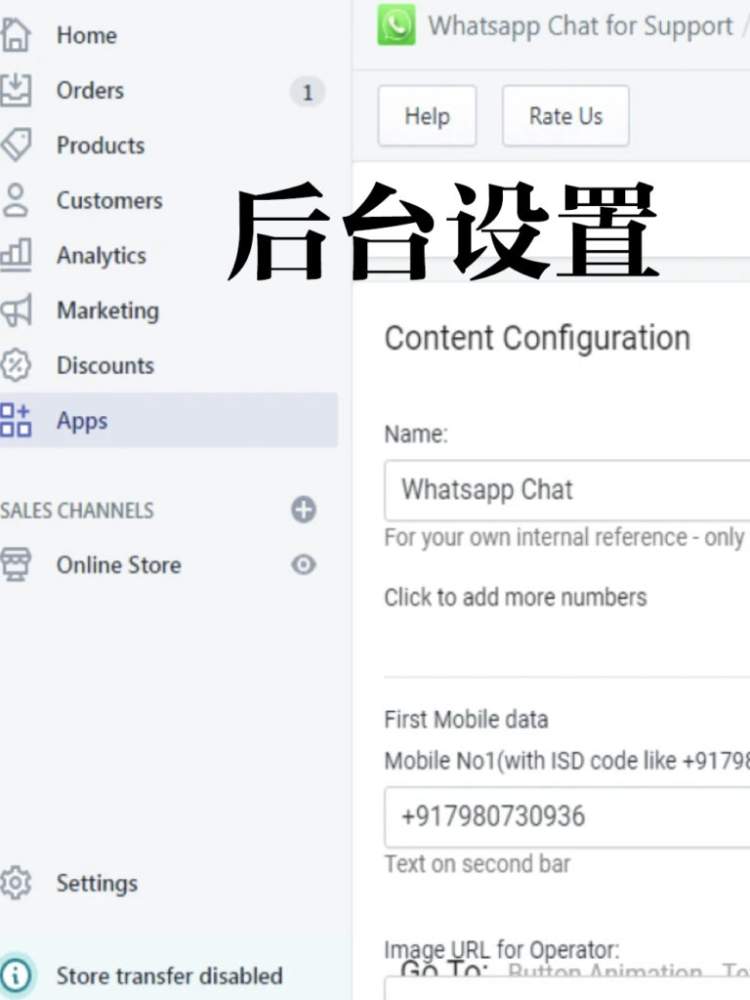

<!-- 2026年11月更新模块：直接粘贴在 YAML 头部 --- 下方 -->

  

    2026年11月最新校准
    <strong style="color: #141413; font-size: 16px;">2026 北美独立站客服升级：为什么 Gorgias AI 工作台已取代单点聊天插件？</strong>
  

  

    本文发布于 2021 年。到了 <strong>2026 年 11 月</strong>，在北美（美国与加拿大）运营 <a href="https://shopify.pxf.io/c/5878481/3323859/13624" target="_blank" rel="sponsored noopener" style="color: #8A2520; font-weight: 600;">Shopify</a> 独立站，客服工具的选择与消费者习惯发生了三大关键变化：
  

  <ul style="margin: 0 0 12px 0; padding-left: 20px;">
    <li style="margin-bottom: 6px;"><strong>1. 北美本土买家的真实沟通习惯（Live Chat + SMS 优先于 WhatsApp）：</strong>不同于欧洲、拉美或东南亚，美国与加拿大主流西人消费者在网购时极少使用 WhatsApp 联系商家，他们最习惯的是<strong>网页右下角原生在线聊天（Live Chat）、短信（SMS）与电子邮件</strong>（WhatsApp 仅建议在面向拉美/欧洲市场或特定族裔社群时作为辅助入口）。</li>
    <li style="margin-bottom: 6px;"><strong>2. 2026 电商客服标配已升级为 Gorgias AI 全渠道工作台：</strong>早年安装多个零散聊天弹窗既拖慢网页加载速度，又无法在聊天框里直接操作订单。2026 年主流卖家普遍采用 <a href="https://www.gorgias.com/" target="_blank" rel="sponsored noopener" style="color: #8A2520; font-weight: 600;">Gorgias</a>（或 Shopify 官方免费的 <strong>Shopify Inbox</strong>）——不仅将网页聊天、邮件、Instagram/Facebook 评论私信及 WhatsApp 统一收进一个后台，更能通过 <strong>AI Agent 自动读取物流轨迹，24 小时秒回 60% 以上的“我的包裹在哪（WISMO）”咨询，并在对话窗内一键完成改地址、发折扣券与部分退款</strong>。</li>
    <li style="margin-bottom: 0;"><strong>3. 弃单挽回（Abandoned Cart）的专业分工：</strong>2026 年由于 Meta 对 WhatsApp Business API 按对话类别严格计费且需客户主动 Opt-in 授权，独立站弃单挽回的主力依然是 <strong>Klaviyo 黄金 48 小时三阶邮件流</strong>（配合 Shop Pay 单页结账），可稳定追回 10%–15% 的流失订单。</li>
  </ul>
  

    💡 工具直达：前往本站 <a href="/tools/" style="color: #141413; font-weight: 600; text-decoration: underline;">《北美创业工具箱》</a> 免费体验 Gorgias 电商智能客服工作台。
  

光有价格诱人的优质产品是不够的，成功的电商网店需要好的客服。

几乎所有的客户都希望能得到最快的回应，即时通讯应用程序能做到无处不在以及随时都在，是繁忙节假日最理想的选择。

[Push Daddy 公司](https://pushdaddy.com)的 [Whatsapp Chat + Abandoned Cart](https://apps.shopify.com/whatsapp-chat-for-support)应用是一个电商网站的自动化聊天、分享及营销应用，目的是提供更及时更好的客户服务，在[Shopify 应用商店](https://apps.shopify.com) 内属于热门app。

安装这个工具很简单，一分钟就能搞定，然后你就可以回答客户提出的任何问题，同时还有一个用于自动回复的聊天机器人，这对于确认订单、跟踪包裹、收集评论、货到付款确认等非常方便。结合在你的网店内添加FAQ，就能更更快解决客户疑问。

虽然[这个工具名字是的 Whatsapp Chat + Abandoned Cart，](https://apps.shopify.com/whatsapp-chat-for-support)除了[whatsapp](https://www.whatsapp.com)，但你可以连接[微信](https://www.wechat.com)、[Facebook Messenger](https://www.messenger.com)、[Instagram messenger](https://about.instagram.com/features/direct)、[Tawk](https://www.tawk.to)、[Tidio Live Chat](https://www.tidio.com)、[Chatra](https://chatra.com)、[Line](https://line.me/en/)、[Telegram](https://telegram.org)、[Snapchat](https://www.snapchat.com)等等。

* 
* 
* 
* 
* 
* 

工具内置了7种聊天风格，自定义网店聊天按钮的风格，可以无限制添加接线客服人员。

对于那些用 [Whatsapp](https://www.whatsapp.com) 聊完天后没有购物、离开网店的客户，客服还能继续和他们交谈，通过沟通转化为销售。更好的是，工具还带有客户管理功能以及聊天数据分析功能。

该工具在电脑或移动设备上都适用，还有定期向客户发送优惠或折扣电子邮件的功能，能对特定优先级的客户进行优先支持。

这工具聊天功能免费就能使用，专业版每月要9.99美元，

请注意了，在 Shopify 应用商店内有很多 Whatsapp Chat 和 Abandoned Cart 功能类似的应用，安装前要看清楚是不是这个，这个工具看起来不是那种很酷设计很好看，但非常好用，是经过很多店家证明最好用的应用之一。
