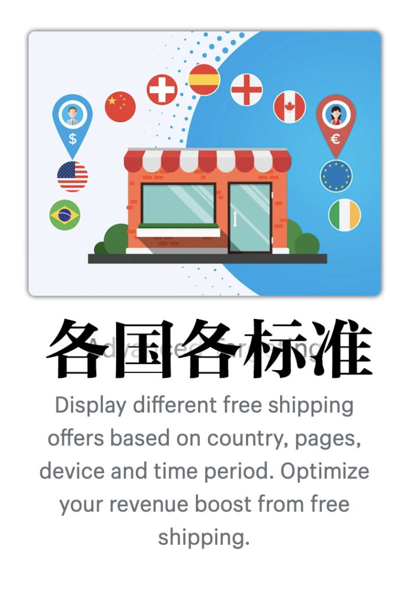
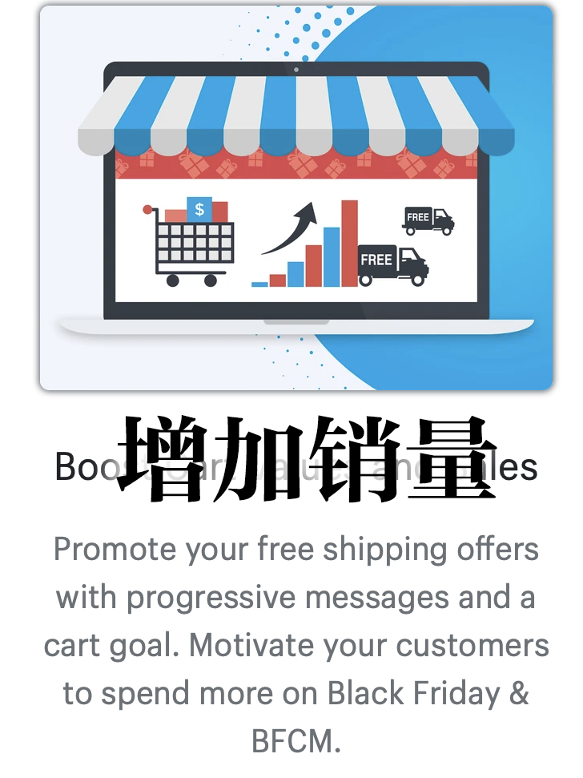
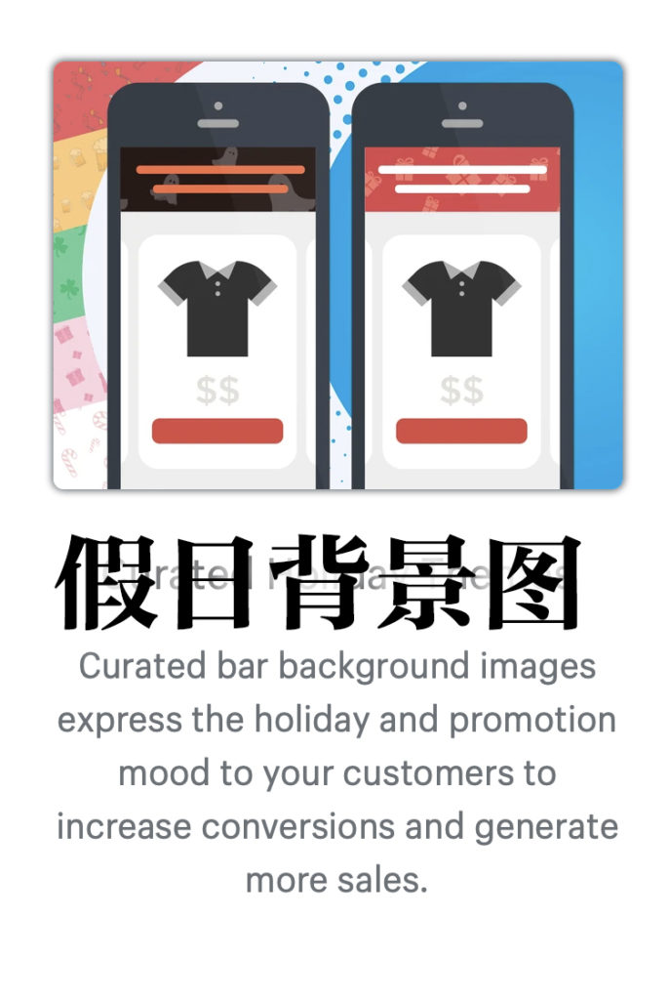
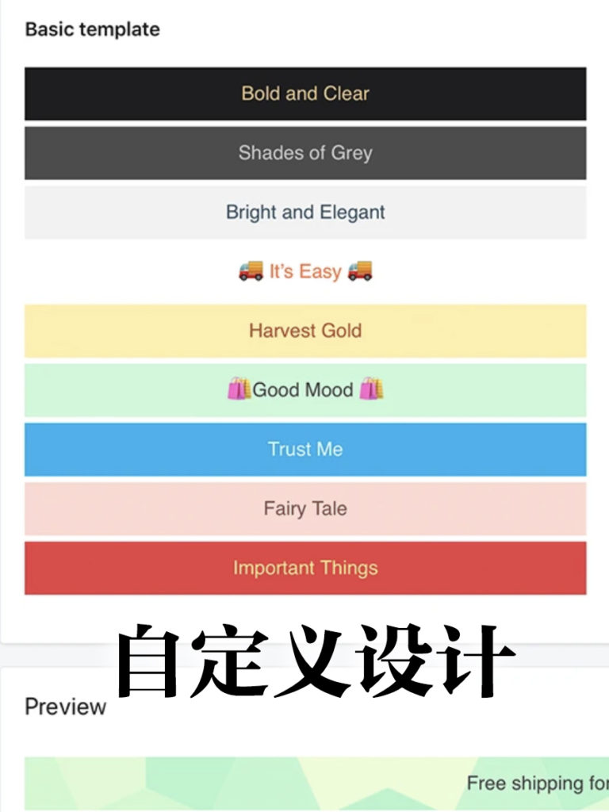
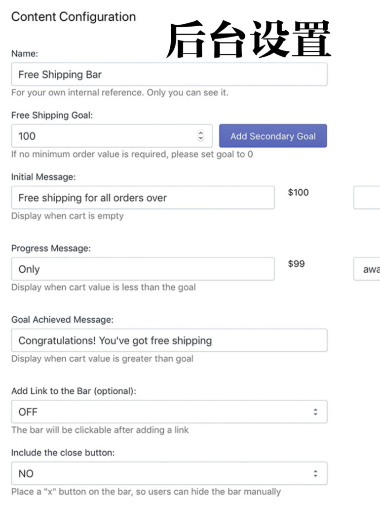
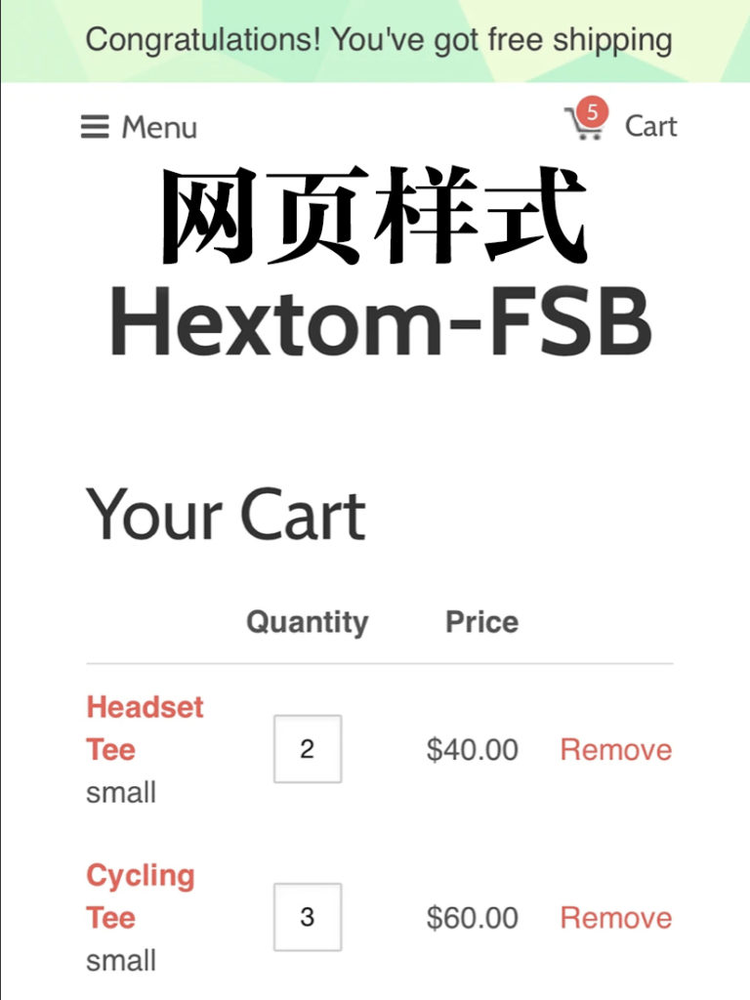

<!-- 2026年11月更新模块：直接粘贴在 YAML 头部 --- 下方 -->

  

    2026年11月最新校准
    <strong style="color: #141413; font-size: 16px;">2026 满额包邮算账铁律：如何拉升客单价（AOV）而不被跨境关税与偏远运费吃光利润？</strong>
  

  

    根据 Baymard Institute 2026 最新电商调研，<strong>“结账页突然冒出的高额运费与税费”依然是导致 40% 真实买家在最后一步放弃付款的头号杀手</strong>。下文介绍的 Hextom Free Shipping Bar 依然好用，但在 <strong>2026 年 11 月</strong>配置满额包邮策略时，必须升级以下 3 条精算规则：
  

  <ul style="margin: 0 0 12px 0; padding-left: 20px;">
    <li style="margin-bottom: 6px;"><strong>1. 满额包邮门槛的黄金公式（当前 AOV × 1.15 至 1.25）：</strong>切忌拍脑袋设一个“满 $50 包邮”！先看你 <a href="https://shopify.pxf.io/c/5878481/3323859/13624" target="_blank" rel="sponsored noopener" style="color: #8A2520; font-weight: 600;">Shopify</a> 后台过去 90 天的平均客单价（AOV），将免邮门槛设在<strong>比当前 AOV 高出 15%–25% 的位置</strong>（例如当前 AOV 为 $62，则设为<strong>“满 $75 免运费”</strong>），引导买家多加购一件高毛利凑单小件。</li>
    <li style="margin-bottom: 6px;"><strong>2. 严防加拿大偏远地区与 2026 跨境关税倒贴钱：</strong>
       • <strong>剔除偏远邮编与超大件：</strong>在加拿大境内包邮必须仅限 10 省常规地区（在 Shopify Shipping Profiles 中将育空 YT、西北地区 NT、努纳武特 NU 及偏远海岛设为不参与免邮，否则一单 Canada Post / UPS 偏远附加费高达 $40–$80 加元）；
       • <strong>美加分仓或按国别设门槛：</strong>自美国取消 $800 免税额后，若从加拿大直邮美国，务必将关税成本计入包邮门槛（如加拿大本地满 $75 CAD 包邮、发美国满 $95 USD 包邮），或使用 <a href="https://printify.com/" target="_blank" rel="sponsored noopener" style="color: #8A2520; font-weight: 600;">Printify</a> 本地路由 / 边境 3PL 分仓发货。
    </li>
    <li style="margin-bottom: 0;"><strong>3. 2026 零插件加速方案：</strong>如今大多数新版 Shopify OS 2.0 主题（及侧边购物车抽屉 Slide Cart）已原生自带动态免运费进度条功能。若你的主题已自带该组件，可直接启用原生进度条以减少第三方 JS 脚本加载、提升移动端网速。</li>
  </ul>
  

    💡 跨境成本测算：访问本站 <a href="/resources/#calc-section" style="color: #141413; font-weight: 600; text-decoration: underline;">《北美创业合规导航 · 2026 跨境关税与履约成本速算器》</a>。
  

几乎每个人都想要自己买东西时有个好deal。

如果你也认同，那么[加拿大Hextom公司](https://hextom.com/)的 F[ree Shipping Bar](https://apps.shopify.com/free-shipping-bar)就是你网店最需要的工具。

这个电商必备的好工具在[shopify应用商店](https://apps.shopify.com) 中光评价就有1万多个，评分4.9（5分满分）的应用，这是很罕见的。

这个工具来自于一个研究，就是普通顾客更愿意买100美元的免运费产品，而不是花80美元产品+20美元的运费。虽然都是100枚美元，但心里体验完全不同。

最新数据显示，如果承诺免费送货，88%消费者更可能掏钱。

[Free Shipping Bar](https://hextom.com/case_study/free-shipping-bar/)就是在后台设置客户获得免运费的最低购买金额，从而巧妙促进销售。

这个工具会在你的网店上宣传免费送货的优惠，还会在购物车显示进度条，告诉你还差多少钱就能免费送货。

[Free Shipping Bar](https://hextom.com/case_study/free-shipping-bar/) 的免费版本基本就够用，能完全自定义免运费优惠、显示进度条、宣传栏上可以加网址链接，祝贺客户获得免运费。

即便是免费版本，Free Shipping Bar也 不会把自己的logo放在上面，这还是挺仗义的。

* 
* 
* 
* 
* 
* 

付费版本功能更强大些，无限个宣传栏，月费9.99美元或全年99。

1.可以让你根据不同国家的买家设定不同的免运费标准，比如美国50美元免运费，加拿大65美元免运费之类的。

2.可设置免运费只在部分网页显示，或指定哪些网页不显示。

3.自动检测买家地理位置和当地货币，根据实时汇率转换免运费额度。

4.bar的背景图片可换

5.能够定时发布。

6.能跟踪哪些产品通过免运费获得最多销售额。

补充一句，[Hextom 公司生产好多 shopify 网店的应用工具](https://apps.shopify.com/partners/hextom)，而且评价都很高，值得都去看看。
