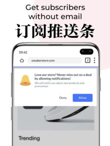
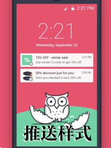
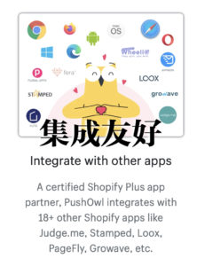
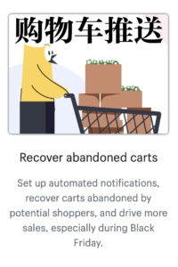
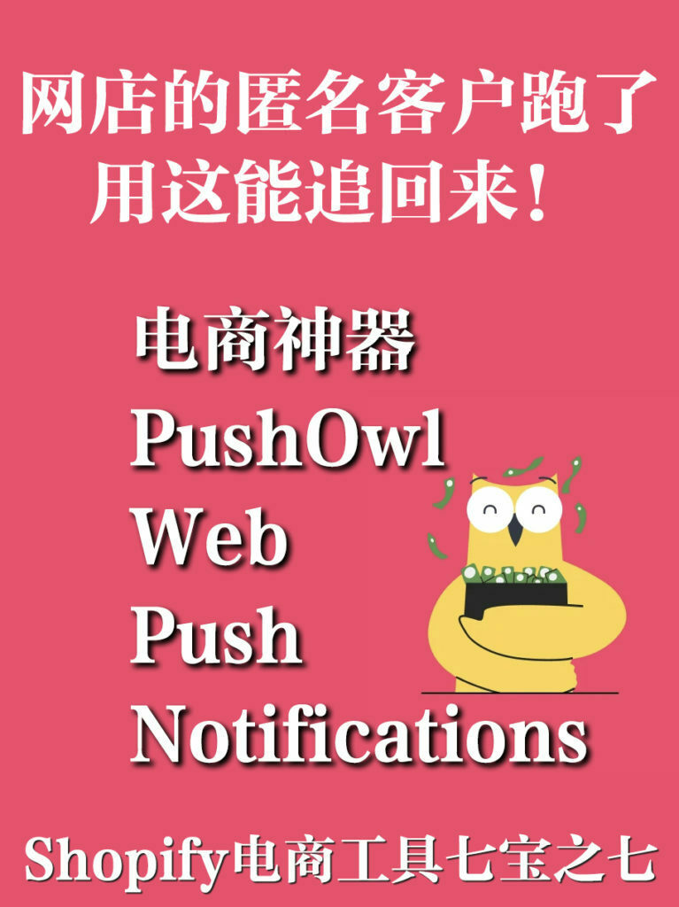
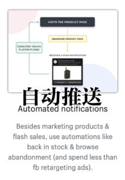
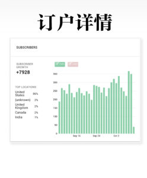
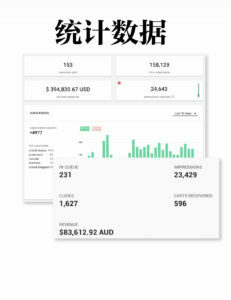
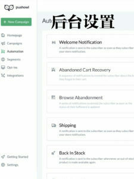

<!-- 2026年11月更新模块：直接粘贴在 YAML 头部 --- 下方 -->

  

    2026年11月最新校准
    <strong style="color: #141413; font-size: 16px;">重大更新：PushOwl 已被 Brevo 收购并升级为“网页推送 + 邮件 + 短信”三合一引擎</strong>
  

  

    本文写于 2021 年。截至 <strong>2026 年 11 月</strong>，下文介绍的 PushOwl 已被欧洲知名营销平台 <strong>Brevo（原 Sendinblue）</strong> 正式收购，并在 <a href="https://shopify.pxf.io/c/5878481/3323859/13624" target="_blank" rel="sponsored noopener" style="color: #8A2520; font-weight: 600;">Shopify</a> 应用商店全面升级为 <strong>Brevo PushOwl: Email, Push, SMS</strong>。在 2026 年使用网页推送（Web Push）挽回匿名访客时，请掌握以下 3 点最新实况：
  

  <ul style="margin: 0 0 12px 0; padding-left: 20px;">
    <li style="margin-bottom: 6px;"><strong>1. 2026 最新套餐与三合一能力：</strong>现在的 Brevo PushOwl 不仅 retains 原有的免费版（每月 500 次 Web Push + 500 封邮件，不限订阅人数）和 <strong>$19 USD/月（年付 $15/月，含每月 1 万次推送 + 弃单挽回自动化）</strong>，还直接打通了弹窗收集邮箱与 SMS 短信营销，无需再拼凑多套零散插件。</li>
    <li style="margin-bottom: 6px;"><strong>2. 客观认清 iOS（苹果手机）的推送限制：</strong>在北美市场，约 55%–60% 的移动端流量来自 iPhone。虽然 Android 手机和电脑端 Chrome/Edge/Safari 支持访客“一键点击即订阅 Web Push”，但在 <strong>苹果 iOS 系统上，移动网页推送要求用户先把你的网店“添加到主屏幕（Add to Home Screen）”后才能触发</strong>。因此，Web Push 绝不能替代邮件列表——<strong>最佳实践是“用弹窗送首单折扣收集真实 Email（主通道）+ 用 Web Push 捕捉不愿填邮箱的电脑与安卓匿名访客（增量通道）”</strong>。</li>
    <li style="margin-bottom: 0;"><strong>3. 严禁“进站第 1 秒”强弹推送请求：</strong>Chrome 与 Safari 浏览器现已对滥发推送弹窗的网站实施自动静默折叠（Quiet Permission Prompts）。务必在后台将推送邀请设为<strong>“访客浏览满 2 个页面或点击加入购物车后”</strong>再触发，转化率可提升 3 倍且不伤用户体验。</li>
  </ul>

网店店主都明白，只有在客户看你的网站时，才有一点控制权影响其购物体验和购物决心。一旦他们离开，要让其回来不是件容易的事，尤其是有商品放弃在购物车内。

这些匿名客户没有留下任何电子邮件，没有注册，怎么办呢？

这个时候，[PushOwl Web Push Notifications 应用程序](https://apps.shopify.com/pushowl)就是一个网店神器，让你随时随地联系客户，把离开了客户找回来。

这在黒五、圣诞节假期是个非常有效的电商工具，同类产品很罕见。因为这个时候大家在不同网站上浏览，挑着买东西。而 [PushOwl 公司的Web Push Notifications](https://pushowl.com)会用自动通知的方式告诉客户补货到店了、闪购、购物车内还有没买的商品等等，极大增加回来购买的机会。

这个工具通过网站推送，让访客只要轻点一下就称为订阅者，不需要提供电子邮件或电话号码等任何个人信息。这让访客订阅的可能性倍增。

于是你就可以把产品和优惠信息直接发到订阅者电子设备的屏幕上，把他们变成客户，促进销售。

工具后台设置简单，几分钟内就可以开始推动，可以跟踪网店用这个推送达到的销售业绩。

* 
* 
* 
* 
* 
* 
* 
* 
* 

[PushOwl Web Push Notifications的免费版](https://pushowl.com/pricing)订阅者数量不限，每月推送最多500次，可以设置库存、降价、推送等，有转化率数据、基本报告和聊天支持。

月费19美元每月推送就能多达1万次，增加购物车有商品未付款的推送，推送通知中可以加大图，增加发货通知，可以把订阅者详细信息和[Shopify网店](https://shopify.com)数据同步，还能导入或导出现有的订阅者（提供免费的迁移支持）。

该工具还有费用更高的定制版本，较大的电商网站可以考虑。其功能可以细分用户、推送闪购（有带截止时间的通知）、根据订阅者的活跃时间智能推送、推送给看过一个产品但没有采取行动的订阅者、电话支持、触发订阅的自定义按钮等。

工具还和[Stamped.io](http://Stamped.io)、[Judge.me](http://Judge.me)、[Loox - Photo Reviews](https://aswebuild.com/business/2021/10/28/shopify%e5%8d%81%e4%b8%87%e7%94%b5%e5%95%86%e4%b9%8b%e9%80%89%ef%bc%9aloox-product-reviews-and-photos/)、[Fera.ai](https://fera.ai)、[Flits Store Credits](https://getflits.com/pages/store-credit)、[PageFly](https://pagefly.io) 数据集成。

这是节假日促销七大电商好工具系列的最后一个。[Shopify应用程序商店](https://apps.shopify.com)很多，今后有机会我们也会陆续介绍。

数据显示，今年北美消费者中39%依赖搜索引擎找商品，另外32%直接到电商独立站网店或店家app去购买。所以花点时间去研究网店的工具是非常值得的，这些工具会帮着你完成营销，实现业务增长。
