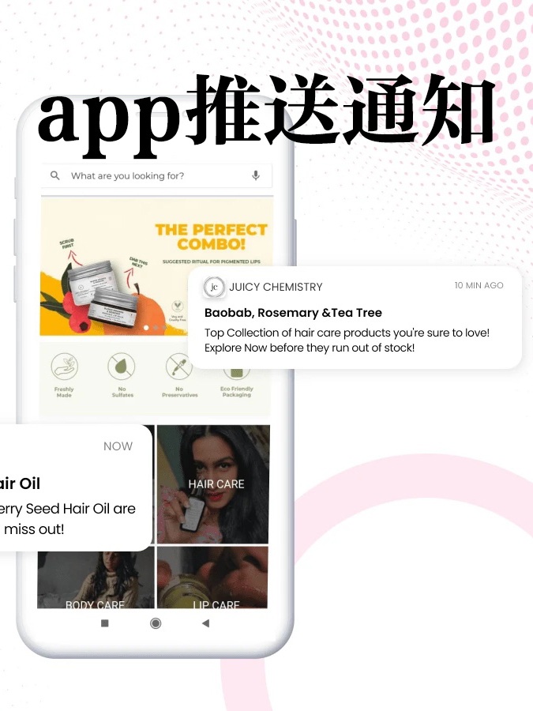
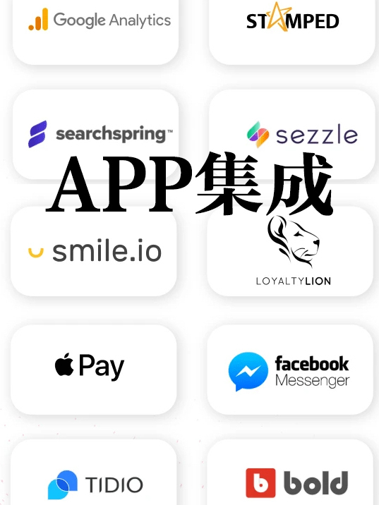
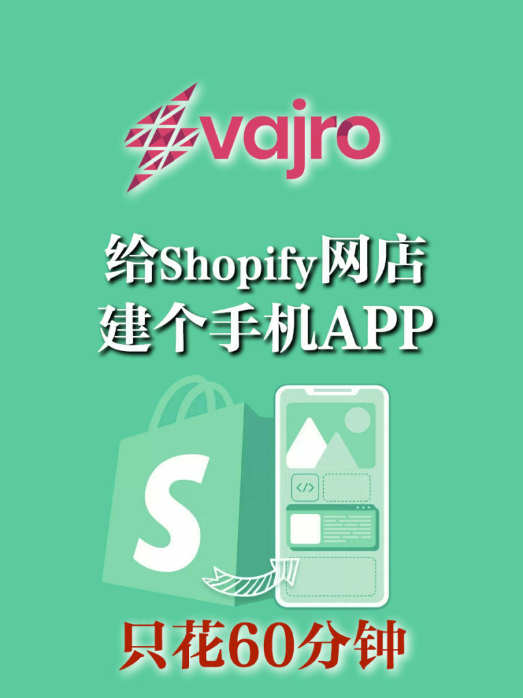
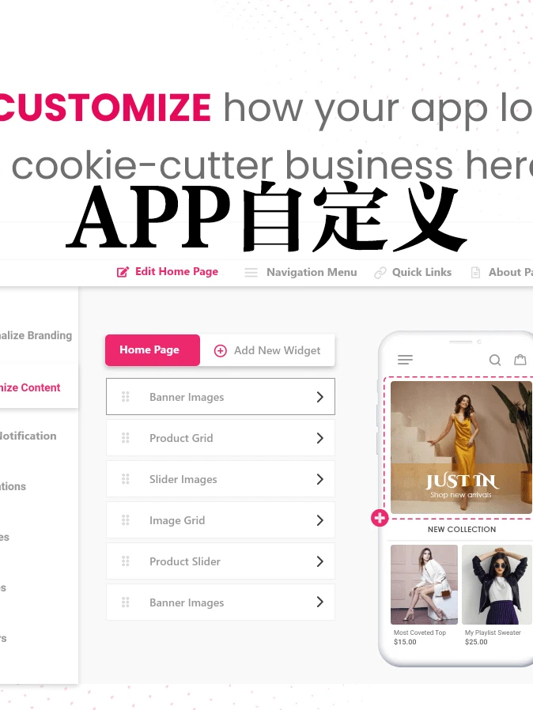

<!-- 2026年11月更新模块：直接粘贴在 YAML 头部 --- 下方 -->

  

    2026年11月最新校准
    <strong style="color: #141413; font-size: 16px;">先别急着花 $99–$999/月建独立 App！2026 年 90% 的 Shopify 卖家用这个 $0 官方神器就够了</strong>
  

  

    本文写于 2021 年 11 月。五年后的 <strong>2026 年 11 月</strong>，关于“<a href="https://shopify.pxf.io/c/5878481/3323859/13624" target="_blank" rel="sponsored noopener" style="color: #8A2520; font-weight: 600;">Shopify</a> 独立站到底要不要花钱做自己的 iOS/Android 手机 App”，成本账本与官方替代方案已发生重大变化：
  

  <ul style="margin: 0 0 12px 0; padding-left: 20px;">
    <li style="margin-bottom: 6px;"><strong>1. Vajro 2026 最新价格与隐形门槛校准：</strong>截至 2026 年，Vajro 的免费试用期已从早年的 90 天缩短为 <strong>30 天</strong>，套餐从基础版 $99 USD/月横跨至 $999 USD/月（其主打的 Superfans 社区版按营收定制定价高达 <strong>$1,000 USD/月起</strong>）。此外，你自己还必须每年向苹果缴纳 <strong>$99 USD/年（Apple Developer Program）</strong> 及向谷歌缴纳 $25 USD 开发者账号费，且苹果 App Store 现依据审核指南第 4.2 条严查纯网页套壳应用（要求必须具备直播带货、会员积分等原生交互功能才予过审）。</li>
    <li style="margin-bottom: 6px;"><strong>2. 年销未满 $50 万美金前，首选 $0 成本的官方「Shopify Shop App」：</strong>普通新网店最致命的痛点是——“就算做好了独立 App，欧美消费者根本不愿意为了买一件衣服专门去 App Store 下载一个陌生品牌的 App”！2026 年最高效的零成本解法是：直接在 Shopify 后台免费启用官方的 <strong>Shop 销售渠道（Shop Channel）</strong>。开启后，你的店铺会自动入驻北美上亿消费者手机里已安装的 <strong>Shop App</strong>——<strong>月费 $0、免交苹果 $99 年费、自带免费的补货/弃单手机锁屏 Push 推送，且支持 Shop Pay 一键极速结账</strong>！</li>
    <li style="margin-bottom: 0;"><strong>3. 什么阶段才值得上 Vajro / Tapcart / Shopney？</strong>只有当你的品牌已沉淀了数万名高频复购的死忠粉（例如高频消耗品、美妆护肤、定期做直播闪购 Live Selling 的女装潮牌），且年营收稳定在 $50 万–$100 万美金以上时，再花 $99–$399/月搭建专属品牌 App 才能跑出正向 ROI。</li>
  </ul>

越来越多的人通过手机app访问网店，几乎稍大的品牌有自己的手机app，适合苹果或安卓系统。

手机app比网店更有效联系到客户，有app的网店，事实证明客户保留率会迅速提高。

之前曾介绍了过[Wix的手机应用服务Branded App](https://aswebuild.com/business/2021/09/07/%e7%94%b5%e5%95%86%e3%80%81%e9%a4%90%e9%a5%ae%e5%b0%8f%e4%bc%81%e4%b8%9a%ef%bc%8c%e5%ae%9a%e5%88%b6%e6%89%8b%e6%9c%ba%e5%ba%94%e7%94%a8app%e6%80%8e%e4%b9%88%e7%9c%81%e9%92%b1%ef%bc%9f/)，也介绍了很多帮助建App的第三方公司，比如[**Mobiloud**](https://www.mobiloud.com/)、[**Appy Pie**](https://www.appypie.com/)、[**Shoutem**](https://shoutem.com/)、[**Swiftic**](https://www.swiftic.com/)、[**GoodBarber**](https://www.goodbarber.com/)、[**BuildFire**](https://buildfire.com/)等。但对于[Shopify网店](https://shopify.com)店主来说，有个集成度更好、更容易上手的工具，叫[Mobile App Builder ‑ Vajro](https://apps.shopify.com/vajro)。

这个工具在[Shopify应用程序](https://apps.shopify.com)中是下载最多、评价最好的手机app建造工具。很值得推荐。

优点

1⃣️  60分钟建好app

用Vajro不需要懂代码，简单拖放就能布局，自动把app中的产品和你的网店同步。

有四个app模版可选，自定义颜色和品牌形象。

2⃣️  功能很够用

有实时销售、推送通知、自动化流程，闪购、倒计时、产品视频、介绍新品、waitlists、吸引顾客评价、用特别优惠吸引购物车内没有清空的顾客等功能。

3⃣️ 无缝安全结账体验。

所有客户数据可以预先填写，客户可选择最喜欢的方式，包括“先买后付”的选项。跨国客户可以选自己喜欢的货币方式付款。

4⃣️ 详细的分析报告

能够在后台获得最详细的销售情况、畅销产品、新下载app客户名单、促销活动效果等，可以细分客户，并可以针对性制定广告转化策略。

5⃣️集成度非常高

支付方面可集成[Apple pay](https://www.apple.com/apple-pay/)、Shopify Express Checkout，以及“先买后付”的[Sezzle](https://sezzle.com)、[Clearpa](https://www.clearpaycanada.com)y、[Klarna](https://www.klarna.com/international/)和[Afterpay](https://www.afterpay.com)；客户奖励可集成[Loyalty Lion](https://loyaltylion.com)、[Rewardify](https://www.rewardify.ca)、[Marsello](https://www.marsello.com)、Flits和[Smile.io](http://Smile.io)；客服聊天可集成Tidio、WhatsApp Chat、Fb Messenger和Zendesk；寄货可集成[Zapiet](https://www.zapiet.com)、Shopify Delivery & Pickup、Local Delivery和InStore Pickup Delivery；补货通知可集成Back in Stock - Notify Us、Alert Me ! Restock Alerts、Back in Stock - Alerts和Now Back in Stock；还有Affiliate Marketing、Google Analytics、Facebook Ad SDK、[Algolia](https://www.algolia.com)等众多功能。

* 
* 
* 
* 
* 
* 

V[ajro好用但不便宜，月费99美元起](https://www.vajro.com/pricing)，每月推送30个以上就要第二档199美元了，解锁全部功能则是每月399美元。有野心想做的店主不妨可以试试。

可以90天免费试用Vajro，这家全天候客服评价算是相当不错的。

毕竟[Wix月费也要200美元，不过Wix11月20日以前还来得及终身半价](https://aswebuild.com/business/2021/09/07/%e7%94%b5%e5%95%86%e3%80%81%e9%a4%90%e9%a5%ae%e5%b0%8f%e4%bc%81%e4%b8%9a%ef%bc%8c%e5%ae%9a%e5%88%b6%e6%89%8b%e6%9c%ba%e5%ba%94%e7%94%a8app%e6%80%8e%e4%b9%88%e7%9c%81%e9%92%b1%ef%bc%9f/)。选哪个，看需要。

提醒：不管选哪种app，你都要**Apple****或****Google****的开发者账户去发布****app****。**
