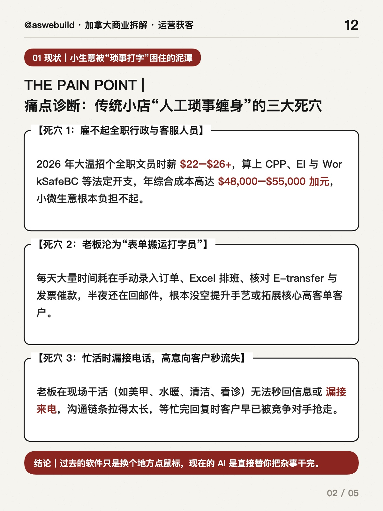
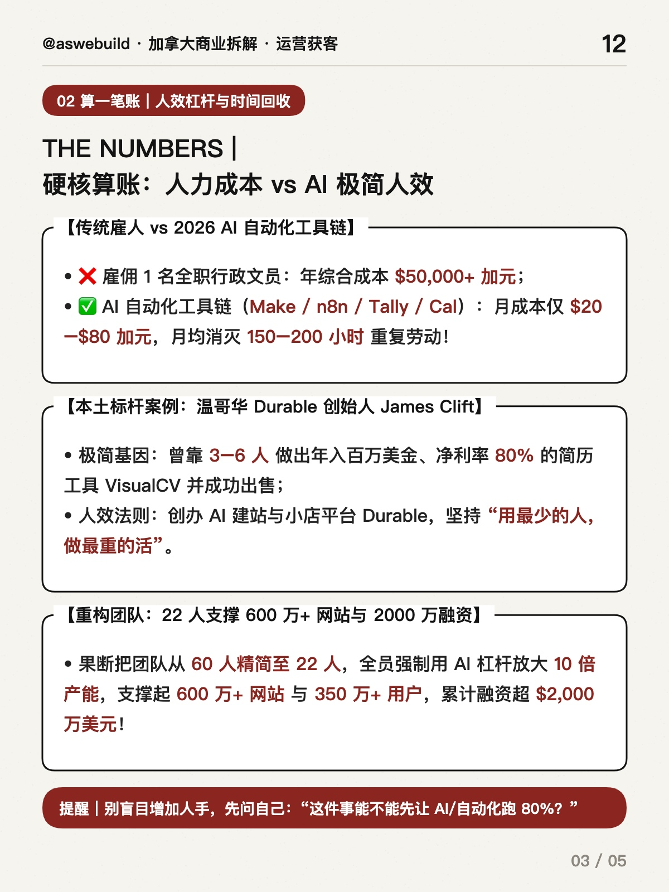
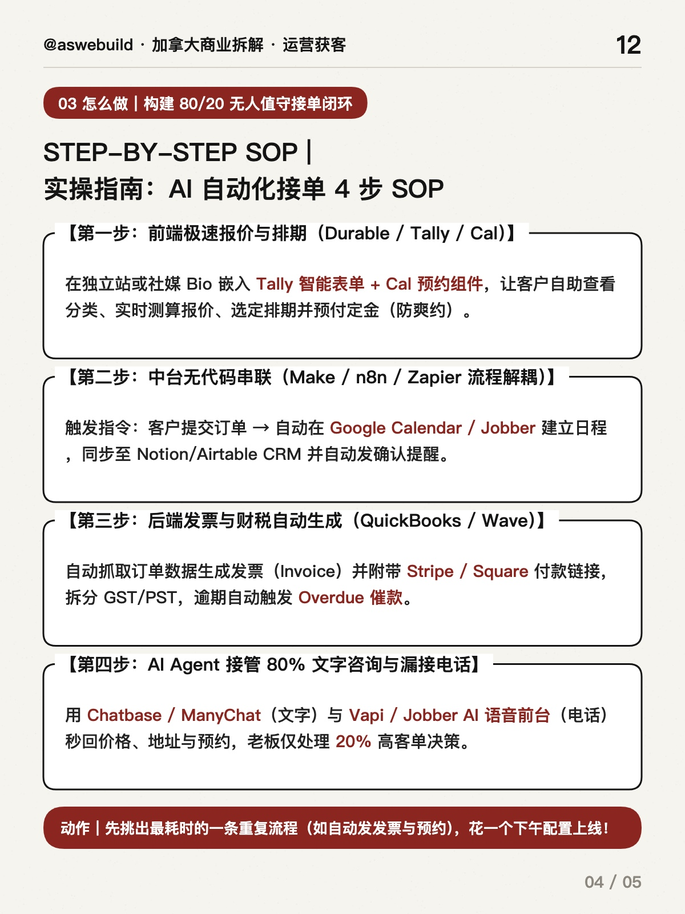
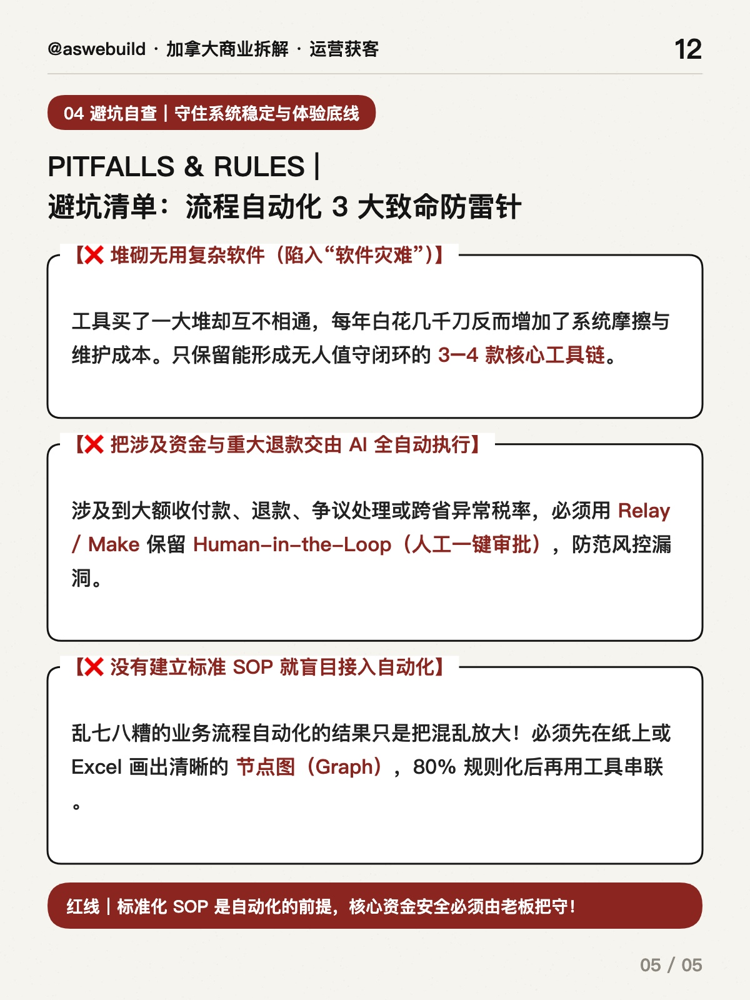

在大温做小生意（餐饮、美甲、清洁、水暖装修、诊所、咨询、教培），所有老板最头疼的共性问题： **人工太贵，招人太难！**
截至 2026 年，[BC 省法定最低时薪](https://www2.gov.bc.ca/gov/content/employment-business/employment-standards-advice/employment-standards/wages/minimum-wage) 已涨到 $18.25，而在大温招一个懂英文、能处理日常排期和账单的全职行政或客服，实际时薪少说要 **$22–$26** 。算上雇主必缴的 [CRA CPP、EI](https://www.canada.ca/en/revenue-agency/services/tax/businesses/topics/payroll.html)、[WorkSafeBC](https://www.worksafebc.com/) 和带薪假，一年下来至少要花掉 **$48,000–$55,000 加元** 。对于 1–5 人的微型小店来说，这笔开支直接把本就不厚的利润削掉了一大半；如果不雇人，老板自己就要沦为“兼职打字员”——白天干手艺活，忙起来漏接客户电话直接丢单；晚上回到家还要半夜打印账单、手动核对 E-transfer、在微信和邮件里反复跟客户确认时间。明明是因为热爱自己的手艺或业务才出来创业，最后却活成了一个被表格和杂事绑架的奴隶。

在北美，最聪明的微型创业者正在用 **“AI-First 自动化接单 + 流程解耦”** 的模式彻底解放自己。我们案例库里温哥华本地的标杆创业者 **James Clift（Durable 创始人）** 就是极其硬核的写照：他从 UBC 尚德商学院读书期间开窗户清洁公司起步（4个月净赚近 4 万美金），后来创立在线简历工具 **VisualCV** ，仅靠 3–6 个人的极简团队就做到年营收数百万美元，且净利润率高达 **70%–80%** 。在创办专为 1–6 人小微生意打造的 AI 经营平台 **Durable** 时，他始终死磕 **“用最少的人，做最重的活”** ——公司一度扩张到 60 多人，他发现人多反而沟通内耗严重、研发变慢，于是果断进行组织瘦身，将团队精简至 **22 人** ，硬性要求全员使用 AI 工具把个人产出放大 10 倍，把原本几个月的开发周期压缩到一个周末！就是这 22 人的精简团队，支撑起了 **600 万+ 网站生成与 350 万+ 小店用户** ，累计完成了超 **2,000 万美元（约 2,700 万加元）** 融资！

正如 James Clift 一针见血指出的：
> “如果你的专长是园林绿化、个人教练或看病，为什么你还要去学网页设计、营销和会计？过去的软件只是把工作换了个地方点鼠标，真正的 AI 工具应该直接替你把杂务消灭掉，让老板把心思真正放在客户身上。”

想在大温用极低成本的 2026 当红 AI 与自动化工具，打造一套“1 人抵 5 人”的无人值守接单系统？记住这 **4 步落地 SOP** ：

### 01｜树立“AI-First”运营思维：凡事先问 80/20 法则

做生意遇到一件重复杂事，先别急着亲力亲为或招人，而是问自己： **“这件事能不能先让自动化系统跑 80%，我只做最后 20% 的审阅与决策？”**
把传统的“人工录入、软件辅助”，彻底倒转为 **“系统自动流转、老板监督把关”** 。

### 02｜构建 4 步自动化接单与交付链路（2026 最新当红工具栈）

1. **前端极速响应与锁单（免人工反复拉扯）** ：在独立站或 Instagram/小红书 Bio 挂上用 **Durable** （30秒 AI 建站）、 **Tally** （高颜值免费表单）配合 **Cal.com** 搭建的智能预约页。客户点开直接查看服务分类、实时测算报价、自选排期并在线预付定金（直接消灭爽约 No-show）。
2. **中台无代码自动串联（用 Make / n8n / Zapier 解耦）** ：无需写代码！通过性价比极高的 **Make** 、2026 最火的 AI 工作流工具 **n8n** （或 **Zapier / Relay.app** ）设置触发器：一旦客户提交表单，系统自动在 **Google Calendar** 或上门服务软件 **Jobber** 生成日程，同步写入 **Notion / Airtable** 客户库，并自动发短信/WhatsApp 提醒客户。
3. **后端发票与财税自动归集（QuickBooks / Wave Pro）** ：自动将订单数据同步写入 **QuickBooks Online** 或 **Wave** （注：Wave 基础开票免费，自动同步银行流水与自动催款需开 $19/月的 Pro 版），生成包含 **Stripe / Square** 付款链接的电子发票（Invoice）并自动拆分 GST/PST。若账单逾期（Overdue），系统定时自动发送温和的催款提醒。
4. **AI Agent 接管 80% 网页咨询与漏接电话** ：文字端用 **Chatbase** 或 **ManyChat** 训练小店专属 AI 客服；电话端接入 2026 北美服务业最火的 **AI 语音前台（如 Vapi / Bland AI / Jobber AI Receptionist）** ——当你在现场干活没空接电话时，AI 全天候自然语音接听、解答营业时间与报价并直接帮客人订好时间！老板只需介入最后 20% 的大额定制单。

### 03｜避开“软件灾难”，只做极简三件套闭环

千万不要被市面上几百种 SaaS 软件迷花了眼！小生意最怕“买了十几款软件，相互打不通，每年白交几千刀智商税”。入门只需极简三件套（月总成本控制在 $20–$80 加元内）：
* **前端输入与排期** ：Durable / Tally + Cal.com（免费版即够用）；
* **中台胶水粘合** ：Make / n8n / Relay.app（免费额度或十几刀月费）；
* **后端台账与财务** ：Google Sheets / Notion + QuickBooks / Wave。

### 04｜守住合规与资金安全的 Human-in-the-Loop（人工审批节点）

自动化绝不代表“放手不管”。涉及到资金退款、大额合同报价、异常税务科目或敏感客户投诉，一定要在 **Relay.app** 或 **Make** 里设定 **Human-in-the-Loop（人工审批卡点）** ——系统自动准备好草稿或退款单，往老板手机弹一条通知，你确认无误点击“Approve（同意）”后才真正执行扣款或发送。既省去了 90% 的打字时间，又 100% 守住了资金安全底线！

**💡 实操落地建议：** 今晚花一个小时，拿出纸和笔，把你每天从早到晚做的机械琐事一条条列出来，画出一张简单的流程节点图（Graph）。挑出其中最烦人、最耗时的那一条（比如“客户填表后手动建日历并发确认信”，或者“手动开发票催款”），花一个下午用 **Tally + Make** 配置上线。把你宝贵的时间从机械的打字中解脱出来，把体力留给手艺，把精力留给家人与高利润增长。

—— 做小生意，顺序对了，慢就是快。《大温华人创业通关图文指南》第 12 篇完结。下一篇聊： **本地化文案与视觉避坑：北美英文营销 6 大语法雷区与字体/配色本地化 SOP** 。

  
  
  
  

