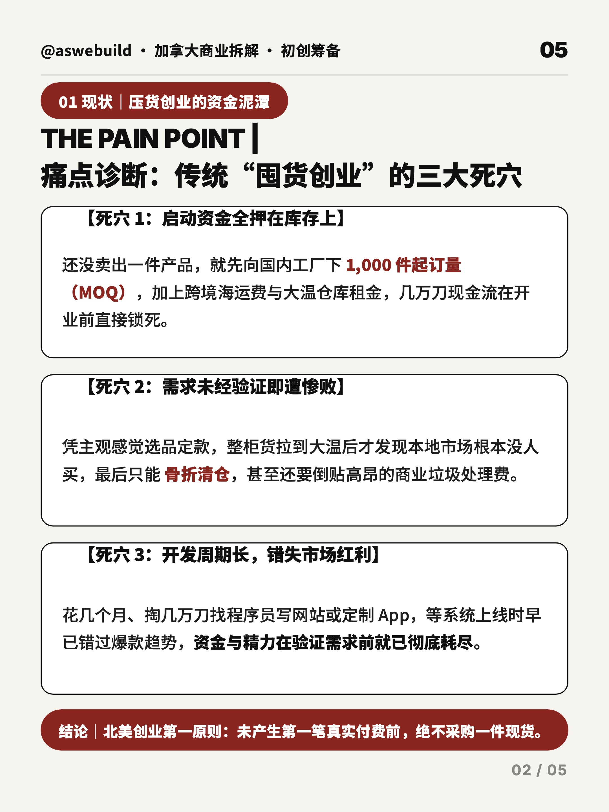
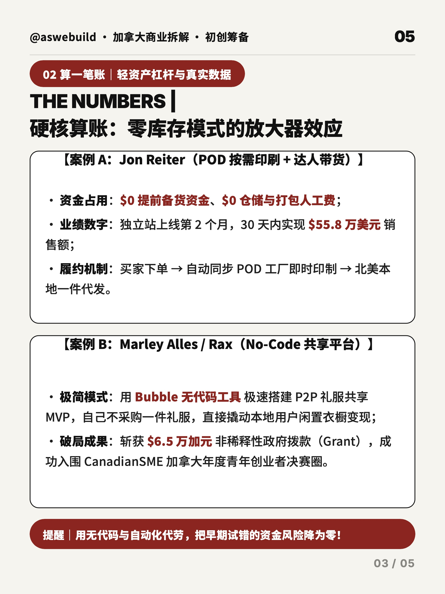
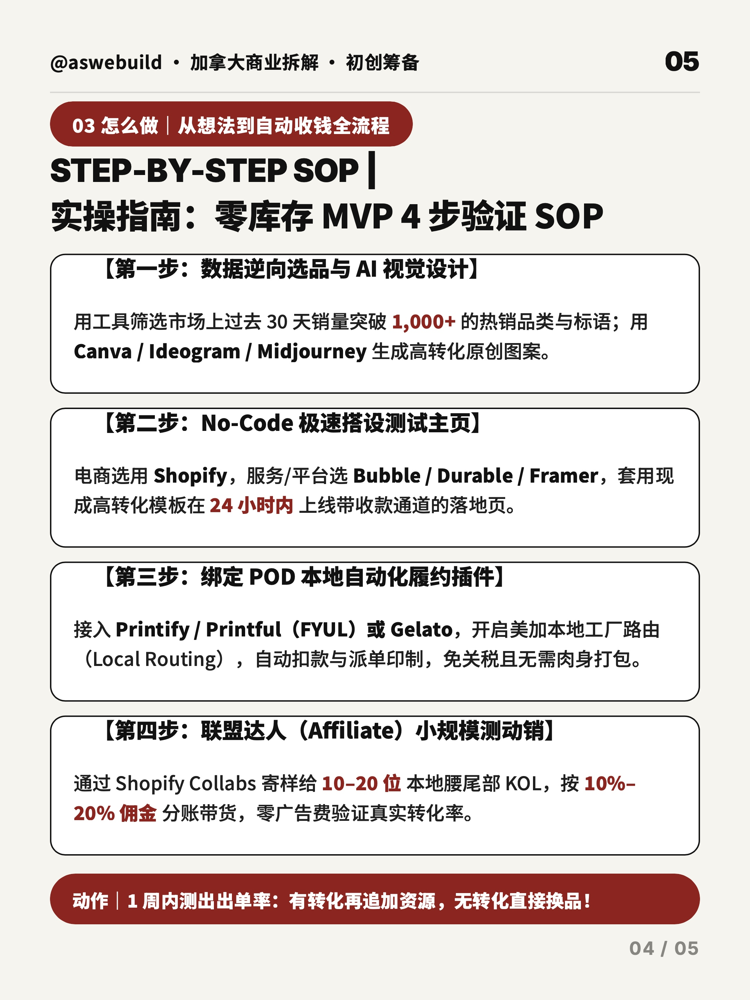
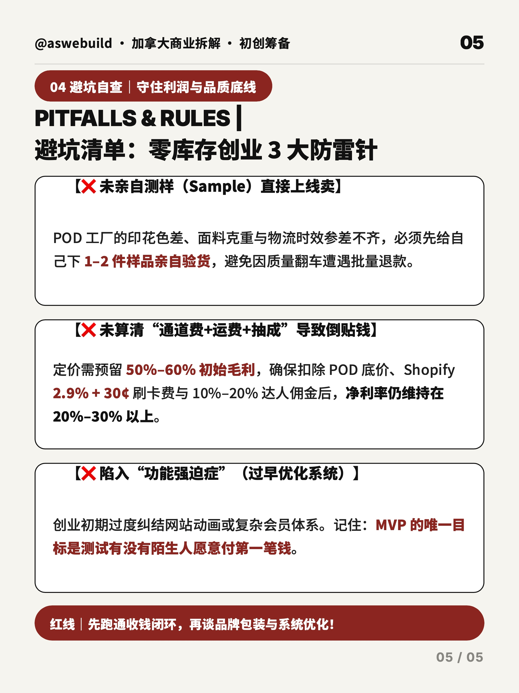

大温华人创业者最容易吃亏的一种惯性思维：
想做个品牌或者开个网店，第一反应就是先去租仓库、向国内工厂订几千件起订量（MOQ）的货，或者花几万刀找程序员开发网站和 App。
结果货运到了大温，仓库租金天天在烧，网站一个月没几个人访问，最后几万刀启动资金全部卡死在库存里，进退两难。

在北美，真正聪明的创业者都信奉 **“先卖后造（Sell First, Build Later）”** 与 **轻资产最小可行性产品（MVP）** 测试。看看我们案例库里的两个真实样本（[ISED 加拿大创新、科学与经济发展部创业资源](https://ised-isde.canada.ca/site/ised/en) 亦长期支持此类创新商业模式验证）：

1️⃣ **POD（按需印刷）零库存实测** ：
北美有大量独立设计师和副业卖家，在服装、帆布袋、咖啡杯和家居海报赛道起步时，绝不自己囤货。他们直接在 Shopify 挂上高清产品效果图，后台无缝对接 Printful 或 Printify——顾客下单付款后，美加本地合作工厂自动印制并直接贴单发货，实现真正的 0 压货、0 仓库租金。

2️⃣ **Marley Alles（多伦多 Rax 平台）** ：
25 岁在多伦多创业做礼服共享平台（被称为“时尚界 Airbnb”）。她自己不买断一件衣服，而是用 **Bubble 无代码（No-Code）工具** 极速搭建出 MVP 网站，直接撬动本地女生和博主把闲置衣橱挂牌上线，0 库存起步不仅拿下了 **6.5 万加元非稀释性政府资助（Grant）** ，还一举入围 CanadianSME 加拿大年度青年创业者决赛圈！

如果你也想用低成本、零库存的方式在北美验证创业想法，记住这 **4 步落地 SOP** ：

### 01｜No-Code 极速搭台：48 小时上线测试页

千万别找外包写代码！做实体/电商选 **Shopify** ；做双边平台或复杂应用用 **Bubble / Softr / Webflow** ；做本地服务或顾问类项目直接用 **Durable** （30 秒 AI 生成网站与开票系统）。月成本控制在 $30–$50 美元以内，两天内就能上线收款（商业主体登记可通过 [OneStop BC 商业注册一站式服务](https://www2.gov.bc.ca/gov/content/employment-business/business/managing-a-business/permits-licences/registering-a-business-with-onestop) 快速办理）。

### 02｜POD 与本地小批代工：彻底消除库存枷锁

* 做文创、服饰、包装周边，直接接入 **Printify / Printful** ，优先勾选加拿大或美国本地生产节点（Local Routing），既享受 3–5 天极速本地派送，又完美规避跨境关税；
* 做食品或美妆个护，先租用大温持牌共享厨房（Commissary Kitchen）或找北美本地小批量代工厂（Low MOQ）做 100–200 份试产，绝对不盲目订大货柜。

### 03｜“烟雾测试（Smoke Test）”与预售收款

别问亲戚朋友“你觉得我这个主意好不好”，因为客套话一分钱不值。直接在页面放上真实定价的 **“Pre-order（预售）”** 或 **“Join Waitlist（支付 $10 锁定早鸟折扣）”** 按钮，投 $100–$200 刀精准小额广告（或去大温农夫市集摆摊一天）。只有陌生人愿意掏出信用卡输入卡号，才证明需求真实存在！

### 04｜跑通单笔经济模型（Unit Economics）再放大

设置清晰止损线：如果测试 2 周，付费转化率持续低于 1% 且获客成本（CAC）高于毛利，果断砍掉重来（此时总损失仅几百刀）；一旦某款单品自然复购和点击率爆发，再拿着真实销售数据去谈大批量生产与政策融资。

—— 创业的本质是“用最小代价验证真需求”，而不是“押上全部身家赌备货”。
用 No-Code 砍掉开发成本，用 POD 消除库存风险，跑通了第一笔正向现金流，你才算真正站上了牌桌。

我们尝试用600多篇这里创作的内容，对新的政策和变化进行整理，做一个加拿大/大温华人创业拆解的图文指南，这里是 **企业初创与架构筹备篇。**

  
  
  
  

