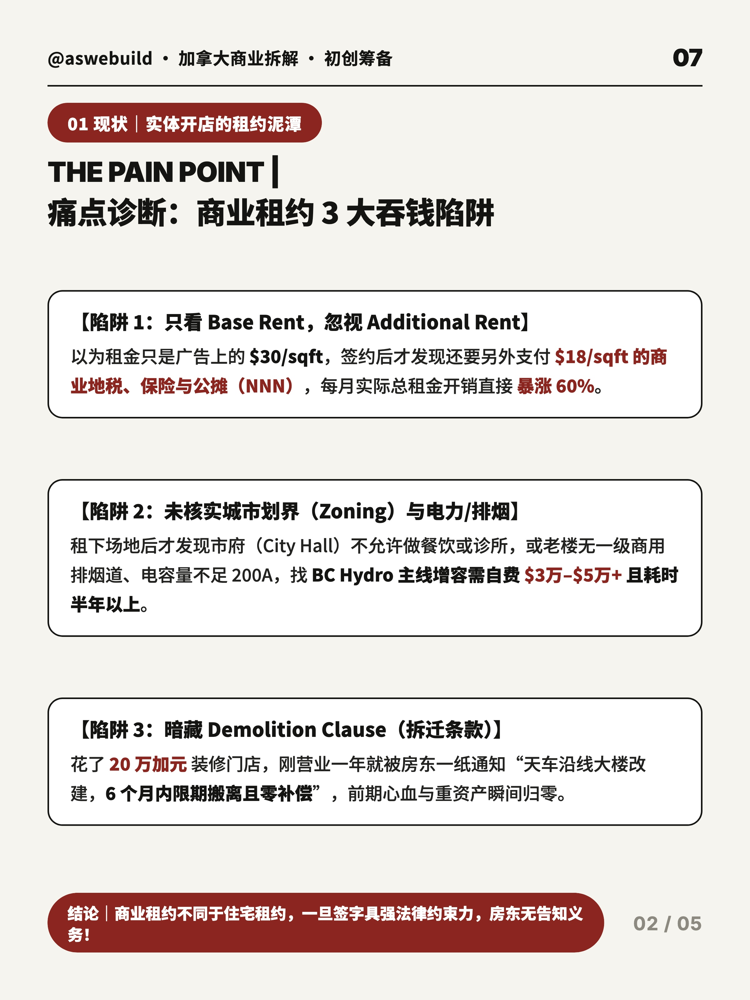
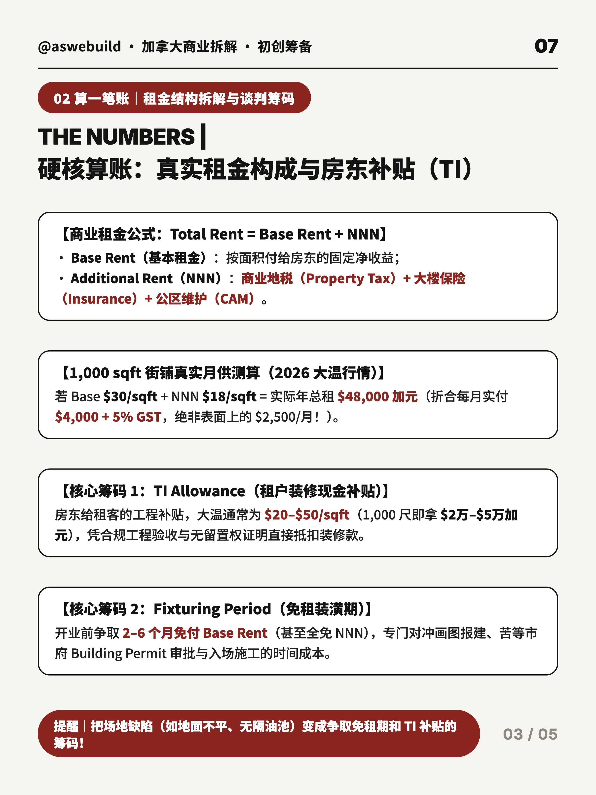
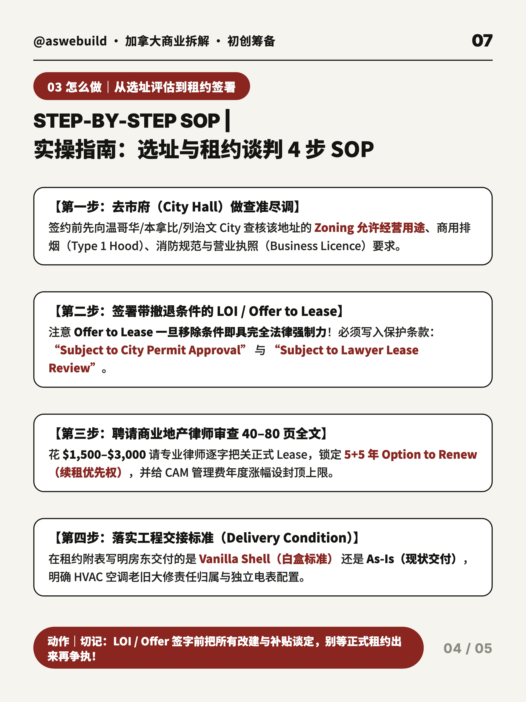
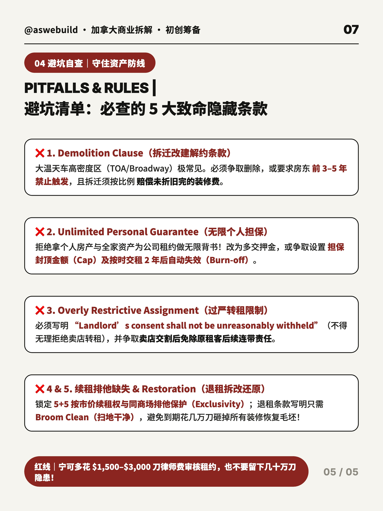

在大温做实体生意（餐饮、零售、教培、医美诊所、宠物店），最大的固定成本和隐形死穴，从来不是人工，而是 **Commercial Lease（商业租约）** 。
很多新移民创业者拿民用租房（Residential Tenancy）的逻辑去看商业租约，以为有租务局（RTB）撑腰、以为房东有义务修空调、以为租金就是广告上写的那个数字——结果一签字才发现掉进了倾家荡产的天坑。

在 BC 省，商业租约受《商业租赁法》（ *[BC Commercial Tenancy Act](https://www.bclaws.gov.bc.ca/civix/document/id/complete/statreg/96057_01)* ）及合同法管辖，基本遵循“契约自由、买者自负”，一签就是 5 年甚至 10 年。今天把 **2026年大温商业选址、真实租金算账和租约谈判的 5 大生死条款** 一次性讲透：

### 01｜算清真实总租金：别被广告上的 Base Rent 骗了

大温主流商铺、商场和工业仓库几乎全部采用 **Triple Net（NNN 净租约）** 模式：
* **广告看到的数字只是 Base Rent（基本租金）** ：例如 $45 / sq.ft / 年；
* **真实每月要掏的钱 = Base Rent + Additional Rent（NNN 附加费） + 5% GST** ；
* **什么是 Additional Rent？** 包括商业地税（Property Tax，BC 省商业物业税率通常为住宅的 2.5–3 倍以上）、大厦物业保险、公共区域维护费（CAM）和房东管理费。在大温（温哥华、列治文、本拿比），NNN 普遍高达 **$15–$25 / sq.ft / 年** （核心地段甚至超 $30）！
* **算一笔账** ：租一个 1,200 尺铺面，标价 $45/尺，加上 $20/尺的 NNN 和 5% GST，真实月租高达 **$6,825 加元** ，比你以为的贵出整整一半！签约前必须向房东索要过去 2 年的 NNN 账单明细并谈设上限。

### 02｜大温选址最常踩的 2 个官僚与工程大坑

1. **划界用途（Zoning）与排烟不匹配** ：租下铺位就想开餐馆或诊所？如果所在 City（[温哥华市府商业许可与 Zoning 门户](https://vancouver.ca/doing-business/business-licences.aspx) / 本拿比 / 列治文）的 Zoning 不允许，或做重餐饮没有预留符合 **NFPA 96 及大温都会局（Metro Vancouver）环保标准的一级排烟道（Type 1 Hood）** ，你连 Business Licence（营业执照）都拿不到。
2. **电力容量不足与漫长审批** ：大温很多老街铺（如 Broadway、Main St 或 Chinatown 沿线）电容量只有 100A–200A，而做餐饮、烘焙或光电医美往往需要 400A 三相电。如果只是店里换电箱还好，一旦涉及向 **[BC Hydro 商业电力升级门户](https://www.bchydro.com/accounts-billing/electrical-connections/commercial-connections.html) 申请升级主入户线、开挖路面或换变压器** ，不仅工程费动辄 **3–5 万加元以上** ，审批与排期更长达 **半年以上** ——如果没谈好免租条件，这半年你得白白干交几万刀房租！

### 03｜Commercial Lease 必查与必改的 5 大致命条款

* **条款 1：无限制的个人担保（Personal Guarantee）**
  房东通常会要求你用个人名义签担保。一旦生意亏钱关门，房东可以直接追讨你个人名下的房产和存款！
  * **谈判修改** ：争取取消个人担保；若新手无信用记录必须给，务必限定为 **“有限期担保”（如仅限前 12–24 个月，按时交租后自动解除）** 或设立固定金额上限（Capped Guarantee），绝不签“无限期全额连带担保”。
* **条款 2：空调（HVAC）与大件设备维修责任转嫁**
  很多标准租约把屋顶空调（HVAC）、热水炉和主排污管的维修更换全推给租客。屋顶老旧商用 HVAC 换一台动辄 **$1.5万–$3万加元** ！
  * **谈判修改** ：签约前要求房东提供 HVAC 完好检测报告；在租约中明确：租客仅负责日常换滤网等小保养， **单次超过 $1,000–$1,500 的大修及设备整体更换必须由房东承担** 。
* **条款 3：严苛的转租与转让限制（Assignment & Subletting）**
  日后想卖掉生意回本，必须把租约转给买家（Lease Assignment）。如果合同写着“房东可无理由拒绝转让”，你就永远卖不掉店！
  * **谈判修改** ：必须改为 *“Landlord's consent shall not be unreasonably withheld or delayed”* ，同时约定转让后免除原租客后续连带责任。
* **条款 4：强制恢复毛坯条款（Restoration / Make-Good Clause）**
  最隐蔽的退租炸弹！合同往往写着租期结束时，房东有权要求租客自费把所有隔断、地砖、水电拆除，把铺面恢复成最初的“水泥毛坯状态（Base Building Condition）”，拆除垃圾清理费动辄 **3–6 万加元** ！
  * **谈判修改** ：必须删掉恢复毛坯条款，明确约定退租时仅需 **“扫地干净（Broom Clean Condition）”** 即可交房。
* **条款 5：拆迁条款（Demolition Clause）与排他性条款（Exclusivity）**
  * **防突然拆迁** ：大温旧改极多，如果老商业楼有拆迁条款，必须要求房东至少提前 **12 个月书面通知** ，并按比例退还你未摊销的装修成本（Unamortized Leasehold Improvements）；
  * **防同排开竞品** ：如果你开奶茶店或牙科诊所，必须在租约加上 **Exclusivity（排他条款）** ，禁止房东把同一物业的其他铺位租给同类竞品。

**💡 实操落地建议：** 看中场地后，千万注意： **在加拿大，双方签完的 Offer to Lease（租约要约）或 Binding LOI 一旦移除条件（Subject Removal），就已经具备完整的法律强制执行力！** 一定要在签署 Offer to Lease 阶段，就写入 *"Subject to City Permit Approval"* 与 *"Subject to Lawyer's Review of Formal Lease"* ，把免租期（Fixturing Period 2–6个月）、装修补贴（TI Allowance $20–$50/sqft）和上述 5 大保护条款全部谈定，并花 **1,500–3,000 加元聘请专做 Commercial Lease 的商业律师** 逐字把关。这笔律师费，是你整个实体创业过程中性价比最高的一笔保命投资。

—— 做实体生意，选址决定流量，租约决定生死。

我们尝试用600多篇这里创作的内容，对新的政策和变化进行整理，做一个加拿大/大温华人创业拆解的图文指南，这里是 **企业初创与架构筹备篇。**

  
  
  
  

