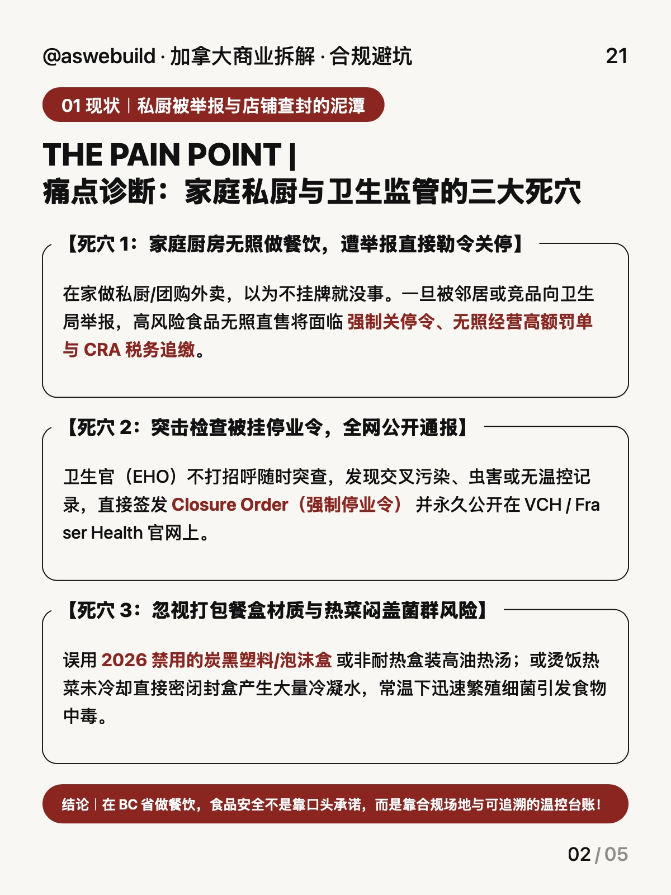
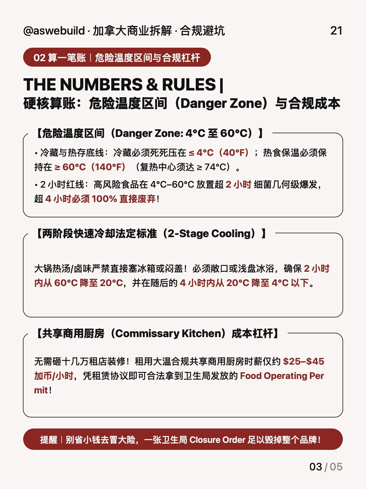
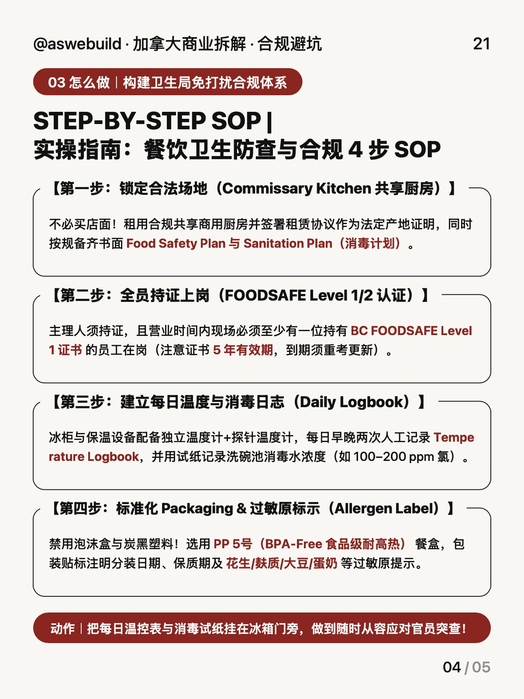
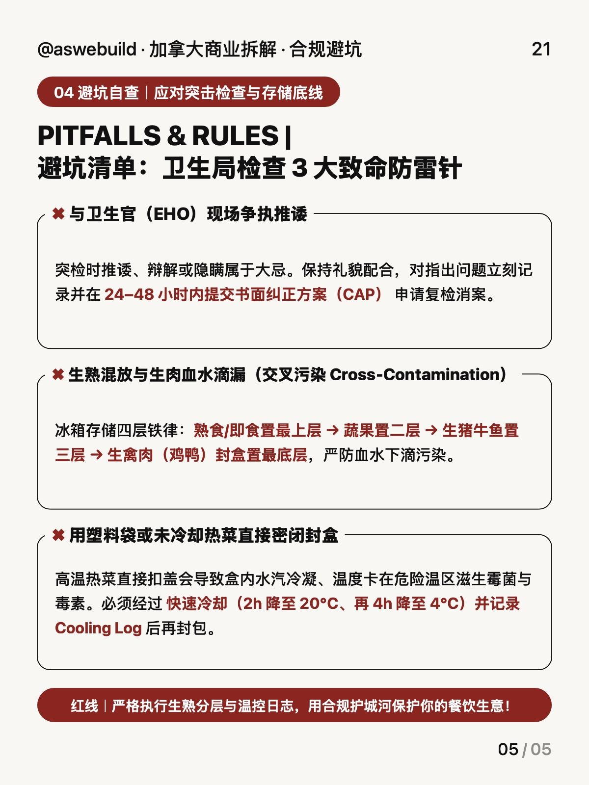

在大温做餐饮、外卖、烘焙、甜品或预制菜的华人创业者，最怕遇到的一个场景：[温哥华沿岸卫生局（VCH）](https://www.vch.ca/en/service/food-safety) 或 [菲沙卫生局（Fraser Health）](https://www.fraserhealth.ca/health-topics-a-to-z/food-safety) 的卫生官（EHO）突然推门而入，拿着红外测温枪和板夹做突击检查。
很多新手老板不懂本地法规，甚至图省钱在家庭厨房无照做私厨团购，结果：被邻居或同行举报后收到天价罚单；或者店铺被挂上 **Closure Order（强制停业令）** ，店名和违规细节被永久公示在卫生局官网上，辛苦积累的口碑一夜崩塌。
在加拿大做食品，卫生局不看所谓的“中餐烟火气”，他们只认白纸黑字的数据、交叉污染防线和温控台账。想在大温安心接单、告别提心吊胆？收好这份 **2026 餐饮卫生局合规 SOP** ：

### 01｜划清法律红线：家庭厨房严禁直售高风险食品

在 BC 省《[食品场所法规（Food Premises Regulation）](https://www.bclaws.gov.bc.ca/civix/document/id/complete/statreg/11_210_99)》下，所有向公众销售的高风险食品（含肉、禽、海鲜、蛋奶、米饭卤味等），必须在持牌商用厨房制作。
* **低成本破局：共享商用厨房（Commissary Kitchen）** ：不必砸十几万租门面，大温（列治文、本拿比、温哥华）有许多合规共享厨房按小时出租（约 **$25–$45 加币/小时** ）。签下租赁协议后，就能以此向卫生局独立申请属于你自己的 **Food Operating Permit** ，并按规备齐书面 **食品安全计划（Food Safety Plan）** 与 **清洁消毒计划（Sanitation Plan）** 。

### 02｜死守“危险温度区间”（Danger Zone: 4°C 至 60°C）

卫生官进门必测冰箱与保温台温度：
* **冷藏与热存** ：冷藏必须 ≤ 4°C（40°F），热食保温必须 ≥ 60°C（140°F），隔夜复热中心温度须达 74°C；
* **2 小时红线与两阶段冷却** ：高风险食品在 4°C–60°C 暴露超 2 小时细菌呈指数级爆发，超 4 小时必须直接丢弃！大锅热汤热菜严禁直接盖紧盒盖（冷凝水+余温极易滋生毒素），必须严格执行 **2 小时内从 60°C 降至 20°C、随后 4 小时内降至 4°C 以下** 的快速冷却法则后再封盒。

### 03｜极简合规三件套：FOODSAFE + 温控消毒日志 + 上熟下生

1. **[BC FOODSAFE Level 1 证书](https://www.foodsafe.ca/)** ：营业期间现场必须至少有 1 名持证人员在岗（注意 BC 省新规下证书 **满 5 年必须重考续期** ）；
2. **每日双日志（Temp & Sanitizer Log）** ：每个冰箱放独立温度计，早晚两次手写记录温控表，并用试纸记录洗碗池消毒水浓度（如 100–200 ppm 氯）；
3. **冰箱“上熟下生”四层铁律** ：顶层放即食熟食 → 二层放蔬果 → 三层放生猪牛鱼 → 最底层密封盒放生鸡鸭禽肉，杜绝血水滴落交叉污染。

### 04｜2026 餐盒禁塑令与突检高情商应对

* **餐盒避坑** ：2026 年联邦与 [BC 省一次性塑料禁令](https://www2.gov.bc.ca/gov/content/environment/waste-management/zero-waste/plastics) 严禁使用 **泡沫饭盒（Styrofoam）与炭黑塑料底盒（Carbon-black plastic）** ，务必选用 **PP 5号（BPA-Free 耐高温）** 或纸浆餐盒，外贴标签注明日期与常见过敏原（Peanut, Soy, Gluten, Egg, Sesame 等）；
* **高情商迎检** ：遇突检切忌争辩推诿，礼貌陪同记录，若收到改善要求，在 **24–48 小时内** 提交 **Corrective Action Plan（纠正措施方案）** 申请复查。

把合规防线焊死，餐饮生意才能走得稳、走得远。

  
  
  
  

