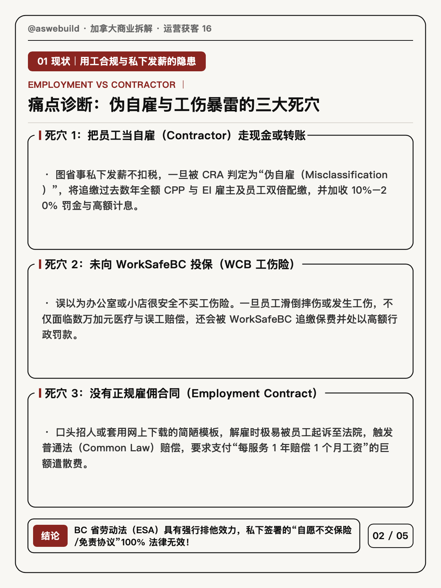
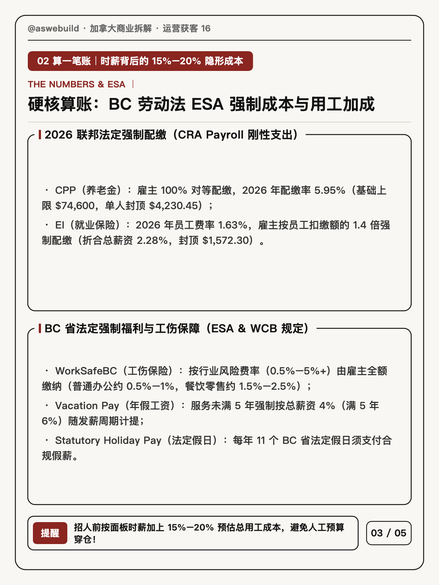
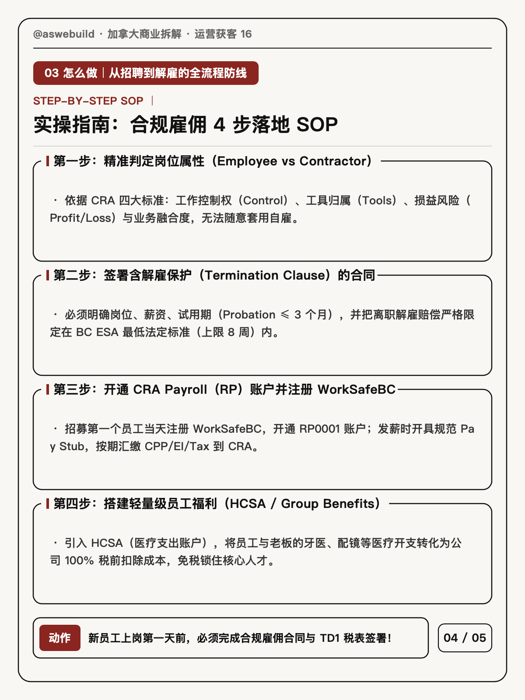
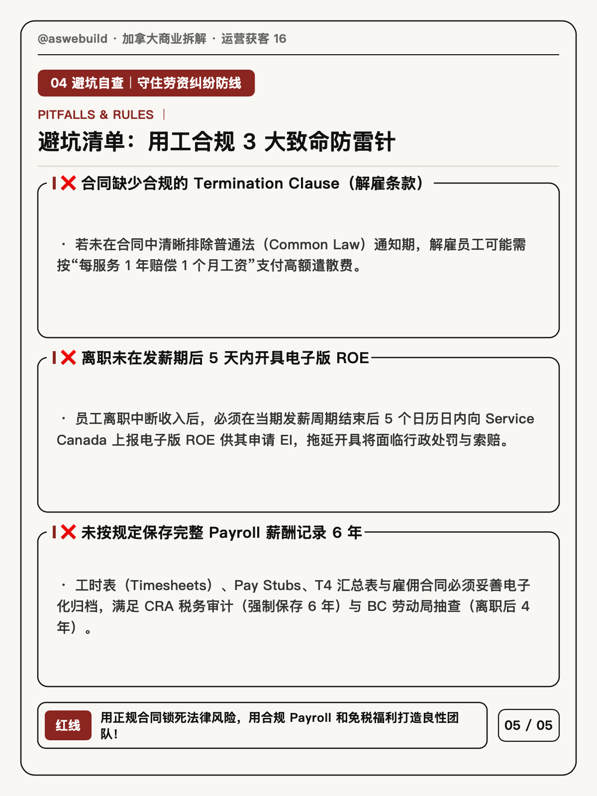

在大温做生意开小店（餐饮、零售、美业、诊所、清洁、电商），随着业务扩张，绝大多数老板都会走到的关键一步：招人。
然而，很多华人老板把国内或私下的习惯带到了加拿大：为了省事省钱，给员工发现金、私下 E-transfer，或者跟员工签一份“自雇协议（Contractor Agreement）”，双方约定不扣税、不买保险。

在 BC 省，这是极度危险的“定时炸弹”。加拿大（尤其是 BC 省）拥有非常完善且偏向劳动者的法律体系（《[BC 雇佣标准法 Employment Standards Act, ESA](https://www2.gov.bc.ca/gov/content/employment-business/employment-standards-advice/employment-standards)》及《工人补偿法 Workers Compensation Act》）。一旦发生劳资纠纷，或者员工在工作时受了伤，私下签署的“自愿免责协议”在法院和 WorkSafeBC 面前 100% 法律无效！老板不仅要补交过去数年全额的 CPP/EI 雇主与员工双倍配缴，还会面临高额追缴罚息和工伤赔偿。

想要在大温合规用工、用低成本锁死劳资法律风险？记住这份 WorkSafeBC 投保、雇佣合同与福利筹划 SOP：

### 01｜自雇（Contractor）vs 雇员（Employee）：别把“伪自雇”当省钱妙招

很多老板以为“只要合同上写了 Contractor，他就是自雇”。加拿大税务局（[CRA 雇员与自雇判定官方标准 RC4110](https://www.canada.ca/en/revenue-agency/services/forms-publications/publications/rc4110/employee-self-employed.html)）与 BC 劳动局在判定劳动关系时，看的是实际工作形态，而不是合同标题：
* 工作控制权（Control）：如果你规定了他的上班时间、工作地点、排班计划，他就是 Employee；
* 工具归属（Tools）：如果他使用的是你店铺或公司提供的设备、电脑或清洁工具，他就是 Employee；
* 财务损益（Chance of Profit/Loss）：如果他按小时或按月拿固定薪水，不承担生意的亏损风险，他就是 Employee。
一旦被 CRA 判定为“伪自雇（Misclassification）”，雇主需要补交过去所有缺缴的 CPP（5.95%）和 EI（员工扣缴额的 1.4 倍），外加高达 10%–20% 的罚款与复利计息！

### 02｜WorkSafeBC（WCB 工伤保险）：开业招人的第一道底线

* 强制投保：在 BC 省，只要你雇佣了至少 1 名全职、兼职或临时员工（包含亲朋好友帮工），都必须向 [WorkSafeBC 雇主注册门户](https://www.worksafebc.com/en/insurance/need-coverage/register-for-coverage) 注册并投保。
* 费率亲民：根据行业风险等级计算（如普通办公/电商约 0.5%–1%，餐饮/零售约 1.5%–2.5%）。即员工月薪 $3,000，每月保费仅几十刀。
* 保命作用：WorkSafeBC 不仅是给员工的保障，更是对雇主的法律保护伞。一旦完成投保，员工在工作中受伤后，法律直接豁免了雇主被员工起诉民事侵权的责任，所有医疗和误工赔偿由 WorkSafeBC 资金池承担！如果不买，工伤医疗与误工索赔将直接由老板承担。

### 03｜雇佣合同（Employment Contract）：最核心的解雇保护防线

绝大多数华人老板吃亏，都吃在“没有签正规合同”或者“使用了网上下载的简陋模板”上：
* 试用期（Probation Period）：合同中必须明确约定试用期不超过 3 个月（BC ESA 规定工作满 3 个月后才触发法定解雇代通知金）。
* 解雇条款（Termination Clause - 关键核心）：在加拿大普通法（Common Law）下，如果合同里没有清晰排除普通法赔偿，法院通常会按“每服务 1 年赔偿约 1 个月工资”来判决遣散费（Notice/Severance）！
* 破局写法：必须在员工正式上岗前，在合同中明确约定“解雇通知期与解雇金严格遵循 [BC 雇佣标准法（ESA）解雇赔偿标准](https://www2.gov.bc.ca/gov/content/employment-business/employment-standards-advice/employment-standards/termination) 的最低法定标准”（服务满 3 个月赔 1 周，满 1 年赔 2 周，满 3 年赔 3 周，最高封顶 8 周）。光是这一条合规条款，就能在未来为你省下几万加元的诉讼与赔偿费！

### 04｜开通 CRA Payroll (RP) 账户与算清 15%–20% 用工成本

招募第一个员工时，需要在 CRA 的 9 位数商业号（BN）下开通 [CRA Payroll (RP0001) 薪酬扣缴账户](https://www.canada.ca/en/revenue-agency/services/tax/businesses/topics/payroll.html)。在算用工成本时，不能只看面板时薪（如 $20/小时），必须算上 2026 年法定强制加成：
1. 雇主 CPP 配缴：5.95%（2026 年基础上限 $74,600，雇主封顶 $4,230.45）；
2. 雇主 EI 配缴：员工 EI 扣缴额（1.63%）的 1.4 倍，即实际薪资的 2.28%（雇主封顶 $1,572.30）；
3. Vacation Pay（年假工资）：服务未满 5 年强制按总薪资的 4% 计提（满 5 年为 6%）；
4. WorkSafeBC 保费：约 0.5%–2.5%；
5. 法定节日假薪（Stat Holiday Pay）：BC 省全年共 11 个法定假日。
综合加算下来，雇主的真实用工成本为面板基本工资的 115%–120%！同时切记：员工离职必须在当期发薪周期结束后 5 个日历日内向 [Service Canada ROE Web 电子离职证明系统](https://www.canada.ca/en/employment-social-development/programs/ei/ei-list/ei-roe.html) 提交电子版 ROE，所有工资单与工时记录须电子化保存至少 6 年以备 CRA 与劳动局抽查。

### 05｜员工福利筹划：用 HCSA / PHSP 锁定核心人才

想招到并留住高素质员工，光靠加薪往往税负极重：通过配置 HCSA（Health Care Spending Account 医疗支出账户）或小型企业 Group Benefits 方案，给员工与老板自己提供每年 $1,000–$2,000 的牙医、配镜、按摩理疗额度。这笔费用可以 100% 转化为公司的税前抵扣成本，而员工拿到手完全免税，是用极低成本打造大厂级团队吸引力的绝招。

—— 做生意，招人是放大器，合规是防火墙。用标准化合同和正规流程护航，团队才能稳健发展。

  
  
  
  

