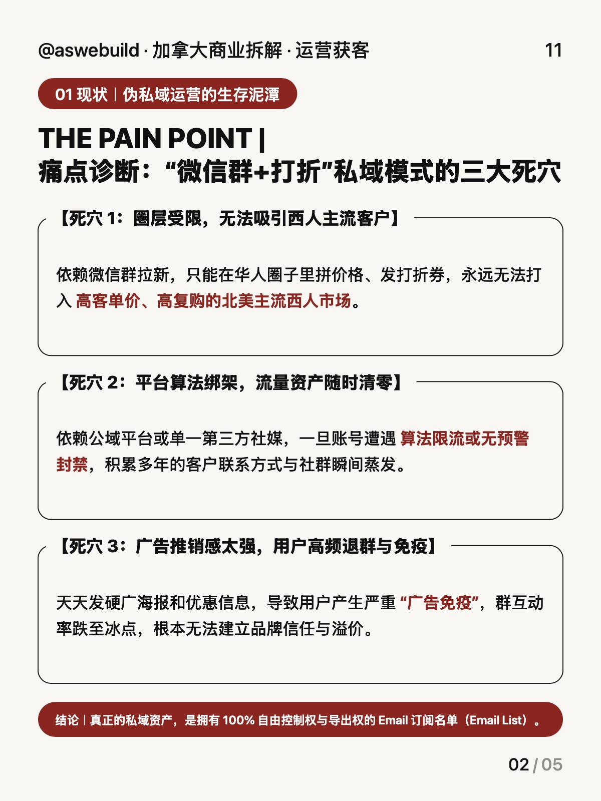
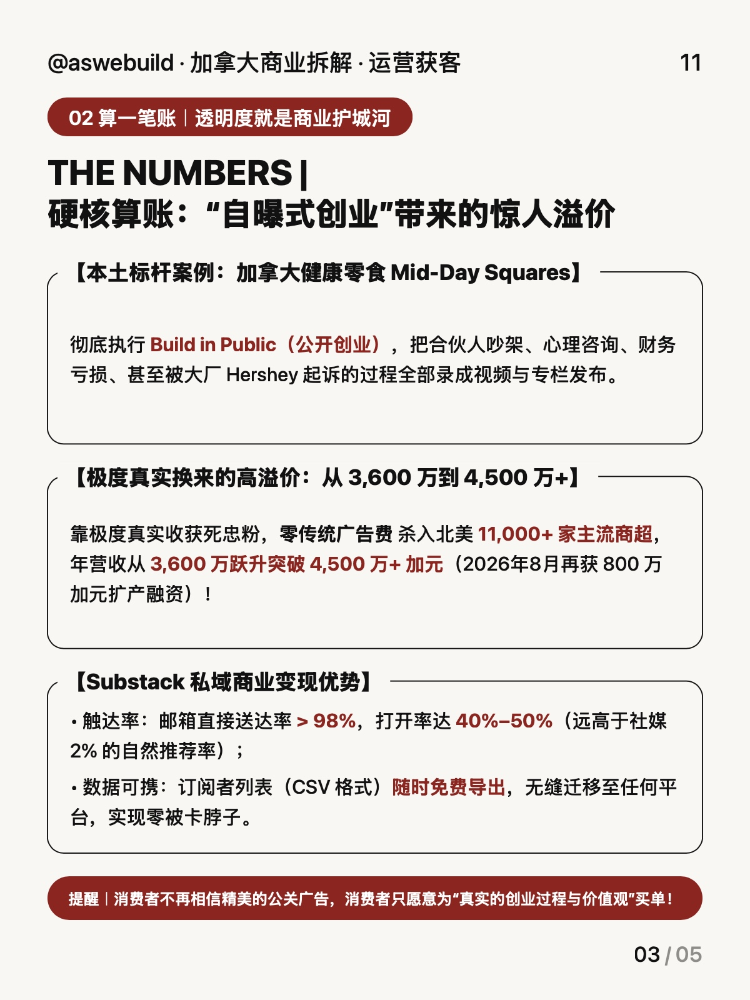
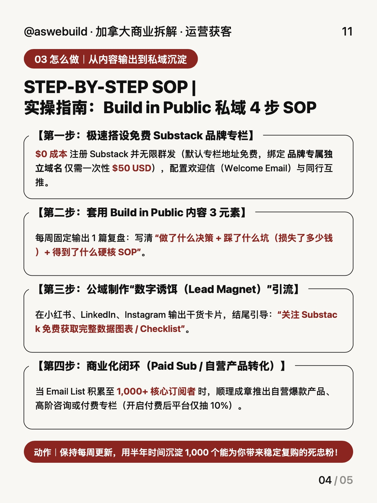
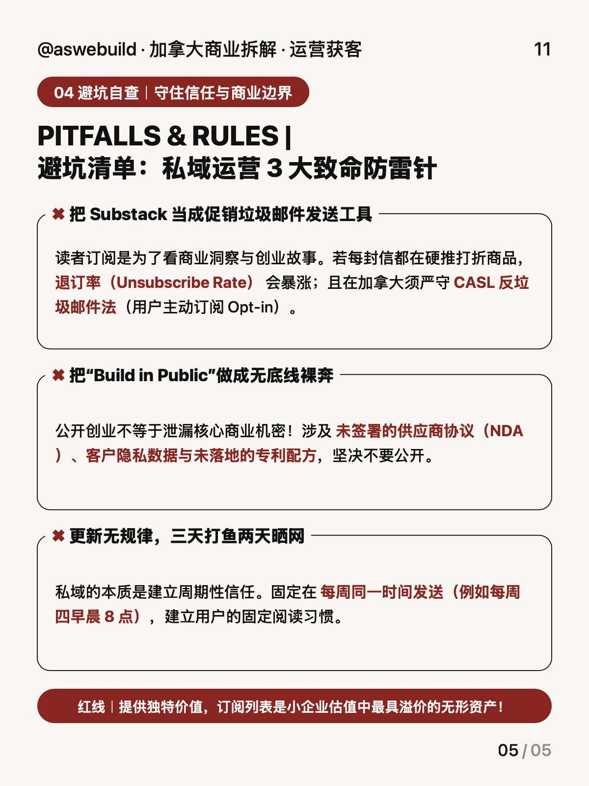

在大温做品牌或小生意的华人创业者，最常陷入的一个伪私域怪圈：建立几十个微信群，每天在群里发优惠券、刷屏打广告。结果没过几个月，群里全是潜水和退群的人，真正消费的寥寥无几；更糟的是，这种模式完全打不进西人主流市场，品牌也毫无溢价可言。
在北美，真正的品牌私域护城河，是用 **Substack** 和 **Build in Public（公开创业）** 打通的。

笔记本里加拿大非常火爆的功能性健康零食品牌 **Mid-Day Squares（蒙特利尔 90 后创始人团队）** 就是把这套玩法做到极致的典范：他们不走传统公关 PR 路线，而是把创业过程中的一切真实展现在网民面前——合伙人去做心理咨询、工厂设备坏掉损失几十万刀、甚至被食品巨头 Hershey 发律师函警告后直接拍 MV 回击的过程，全被他们拍成视频和记录文章发出来。结果这种“极度透明”不仅没有摧毁品牌，反而让几十万北美消费者成为了他们的“亲友团”和死忠粉，产品直接杀入全美及加拿大 **11,000+ 家主流超市（Target、Walmart、Costco）** ，年营收从 **3,600 万一路飙升突破 4,500 万+ 加元** ，并在 2026 年 8 月再拿 **800 万加元** 扩产融资向 2.5 亿产能冲刺！

同时，北美创业圈最火的私域平台 **Substack** ，正在成为小企业沉淀客户资产的新宠：它不依靠算法打赏或平台流量分配，而是让创业者通过 Email 直接触达读者（送达率 > 98%，优质专栏打开率高达 40%–50%）。最重要的是，你的订阅者名单（CSV 数据）100% 属于你，随时可以一键免费导出带走，永远不怕被平台卡脖子。

想在北美用 Substack 和 Build in Public 建立你自己的品牌私域？记住这 **4 步落地 SOP** ：

### 01｜放弃硬广，用 Build in Public（公开创业）建立极致信任

北美消费者对铺天盖地的公关广告早已疲倦，他们想看的是品牌背后的真实故事。你可以分享：
* 你在大温寻找本地供应商或进口清关时踩过的坑；
* 你在产品研发过程中测试了 50 次才成功的配方数据；
* 你的产品从 0 到 100 盒打入本地 Specialty Store 的真实复购率。
真实的挫折与硬核的经验，远比高大上的宣传语更有说服力。

### 02｜用免费的 Substack 建立独立私域阵地

* 去 Substack **$0 成本免费搭建专栏** 并无限量发信（使用默认域名完全免费；若绑定品牌域名，需交一次性 $50 美元设置费）；
* 编写一封有温度的欢迎信（Welcome Email），告诉新订阅者：在这里他们能看到什么不为人知的创业故事与行业干货；
* 开启 Substack 的 **Recommendations（同行互推）** 功能，与北美同领域的创业者相互推荐，零成本换量涨粉。

### 03｜公域做“数字诱饵（Lead Magnet）”，私域做资产沉淀

* 在小红书、Instagram、LinkedIn 发布高密度的干货图文卡片；
* 在文末放置钩子：“点击主页链接，免费订阅我的 Substack 专栏，获取完整 PDF 创业清单 / 行业采购数据库”；
* 把公域借来的流量，全部合规导流（符合 [加拿大 CASL 法案的主动订阅 Opt-in](https://ised-isde.canada.ca/site/canada-anti-spam-legislation/en)）并沉淀到你自己的 Email List（邮箱名单）中。

### 04｜把 Email List 转化为终极商业变现

当你拥有了 1,000 个每周定期阅读你文章的忠实订阅者时：
* 推出新产品时，他们会是第一批不计代价全价购买的种子客户；
* 你甚至可以像 Justin Welsh 或 Pieter Levels 一样，将你的创业 SOP 整理成付费数字产品、付费订阅专栏（Substack 仅在开启付费后抽成 10%）或高阶咨询服务，实现高毛利的第二增长曲线。

**💡 实操落地建议：** 私域不需要几万人，1,000 个真爱粉就足够养活一个高毛利的极简品牌。从今天开始，把你创业过程中的思考和复购数据记录下来，发在 Substack 上。把流量资产牢牢握在自己手里，这才是你在北美创业最稳固的护城河。

  
  
  
  

