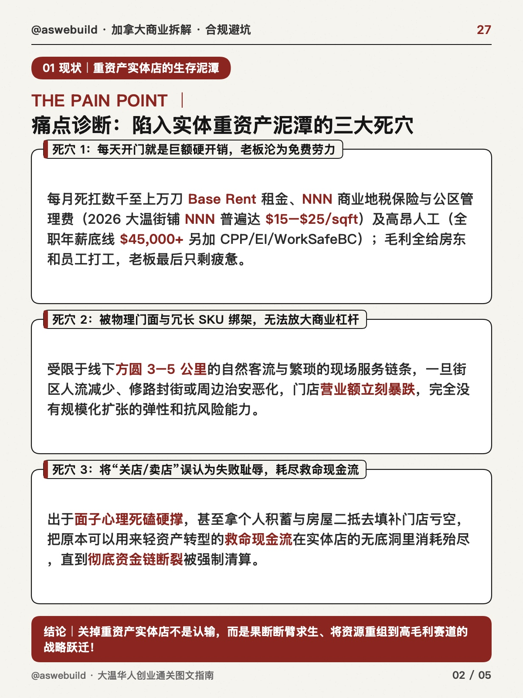
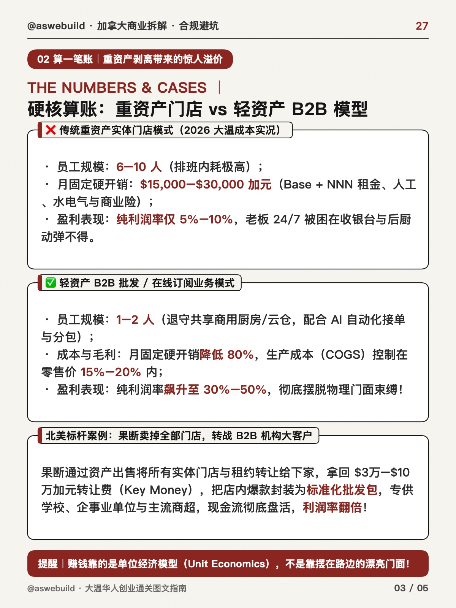
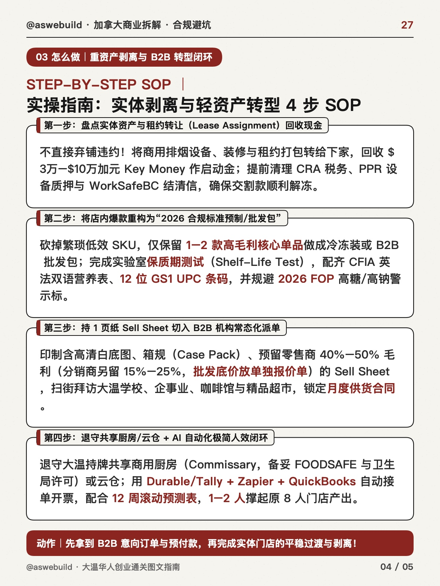
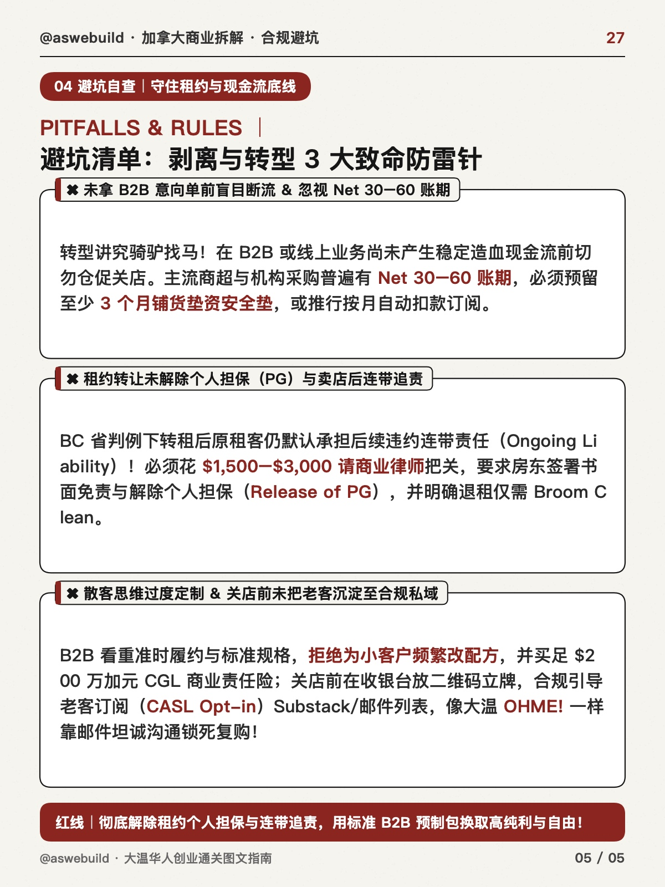

在大温做实体店（餐饮、零售、烘焙、美业）的华人老板，最容易困在“重资产泥潭”：每天一拉开卷帘门，高昂的商业租金（Base Rent + NNN 商业地税、保险与 CAM 管理费，2026 大温街铺 NNN 普遍达 $15–$25/sqft）与人工（大温全职年薪底线 $45,000+ 另加 CPP/EI/WorkSafeBC）就已经划出去了。月底一算账，月固定硬开销动辄 $1.5万–$3万加元，纯利率仅 5%–10%，老板沦为给房东和员工打工的“高危免费劳力”。

想在大温完成从重资产门店向轻资产 B2B/在线业务的蜕变？牢记这 **4 步剥离转型 SOP** ：

### 01｜资产盘点与租约转让（Lease Assignment）换现金

* **切勿直接弃铺违约** ：通过商业经纪做资产出售（Asset Sale）与租约转让，将装修、商用排烟/设备与剩余租约打包转给下家，回收 **$3万–$10万加元 Key Money** 作转型启动金，并提前清理 CRA 税务、[BC 省 PPR 设备动产质押检索](https://www2.gov.bc.ca/gov/content/employment-business/business/managing-a-business/permits-licences/personal-property-registry) 与 [WorkSafeBC 结清信](https://www.worksafebc.com/en/insurance/know-coverage-status/get-a-clearance-letter)。
* **必签连带责任与担保解除协议** ：根据 [BC 省《商业租赁法》（Commercial Tenancy Act）](https://www.bclaws.gov.bc.ca/civix/document/id/complete/statreg/96057_01) 及商业租赁判例，转租后原租客仍默认背负后续连带追偿责任（Ongoing Liability）！务必花 $1,500–$3,000 请商业律师把关，要求房东书面免除原租客后续责任并解除个人担保（Release of PG），同时明确退租仅需扫地干净（Broom Clean）。

### 02｜爆款重构为“2026 合规标准预制/批发包”

* **极简 SKU** ：砍掉繁琐堂食与低效品类，只留 1–2 款高毛利爆款（特色酱料、预制半成品、冻干/冷冻装），将生产成本（COGS）压在建议零售价（MSRP）的 15%–20% 内。
* **合规基建一步到位** ：完成实验室保质期测试（Shelf-Life Test），配齐 [CFIA 英法双语营养表](https://inspection.canada.ca/en/food-labels/labelling)、过敏原标注、官方 **12 位 GS1 UPC 条码** ，并规避 2026 强制执行的 [加拿大卫生部包装正面（FOP）高糖/高钠放大镜警示标](https://www.canada.ca/en/health-canada/services/food-labelling-changes/front-package.html)。

### 03｜切入 B2B 机构与商超常态化派单

* **制作 1 页纸 Sell Sheet** ：印上高清白底图、箱规（Case Pack）、12 位 UPC、保质期及预留给零售商的 **40%–50% 毛利空间** （若走 GFS/Sysco/UNFI 等分销商另留 15%–25% 扣点，阶梯批发底价放单独报价单）。
* **扫街锁长单** ：拜访大温学校、企事业、连锁咖啡馆及 Choices、Stong's 等独立精品超市，锁定按月派单合同。

### 04｜退守共享厨房/云仓 + AI 极简人效

* 退守持牌共享商用厨房（Commissary，备妥 FOODSAFE 与卫生局许可）或云仓，彻底甩掉高昂 NNN 租金包袱。
* 用 Durable/Tally + Zapier + QuickBooks 搭建自动接单开票链路，配合 12 周滚动预测表（Rolling Forecast），1–2 人撑起原 8 人门店产出。

### 05｜转型必守 3 条防雷红线

1. **先拿 B2B 意向单与预付款，再关停实体店** （主流渠道有 Net 30–60 账期，需留 3 个月现金流安全垫）。
2. **拒绝散客式过度定制** ，坚持标准规格交付，并买足 **$200 万加元 CGL 商业责任险** 。
3. **关店前把老客 100% 沉淀至独立私域** ：收银台放二维码立牌，合规引导老客订阅（符合 [加拿大 CASL 法案 Opt-in](https://ised-isde.canada.ca/site/canada-anti-spam-legislation/en)）Substack 或独立站邮件列表；像大温 OHME! 一样用订阅邮件坦诚分享转型进展，重开首月销量反涨 30%–40%！

—— 放下对物理门面的执念，用最轻的资产与最高的人效，赚取最安心的纯利润。

  
  
  
  

