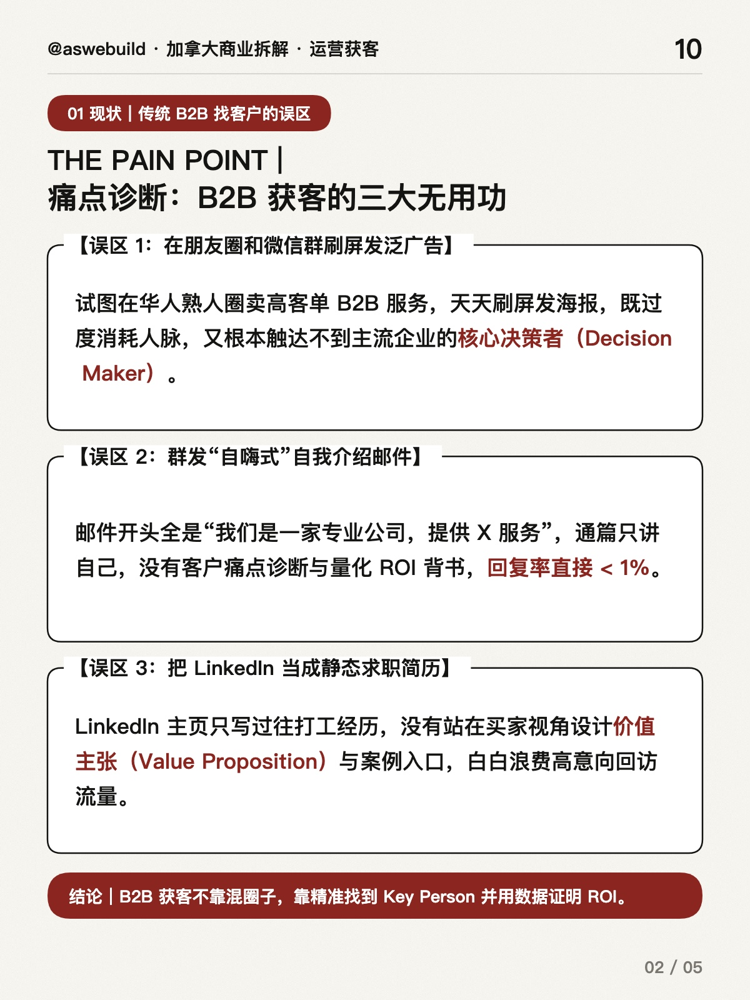
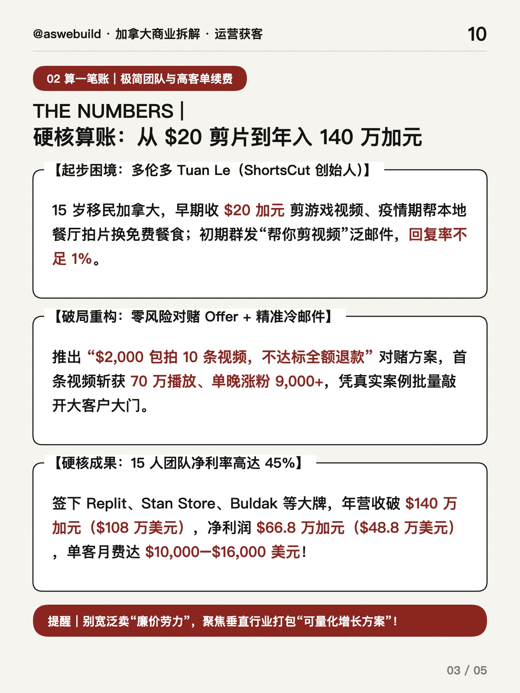
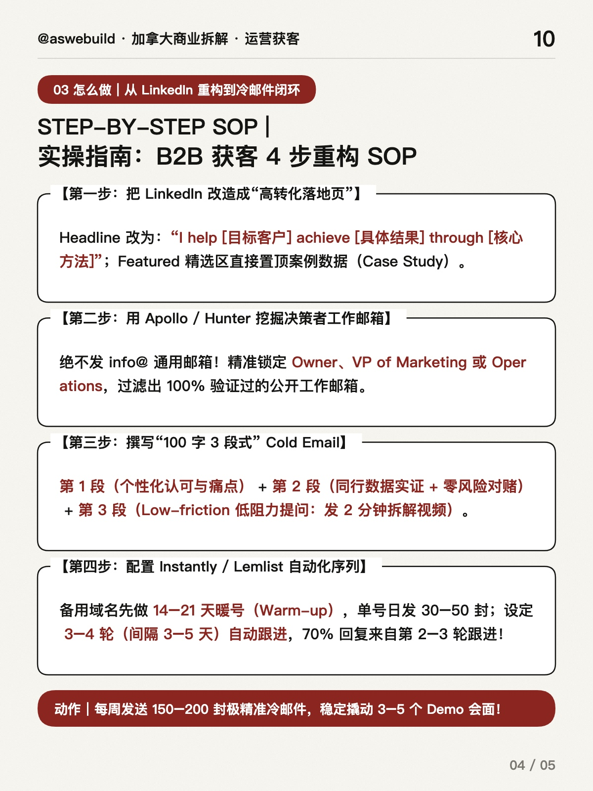
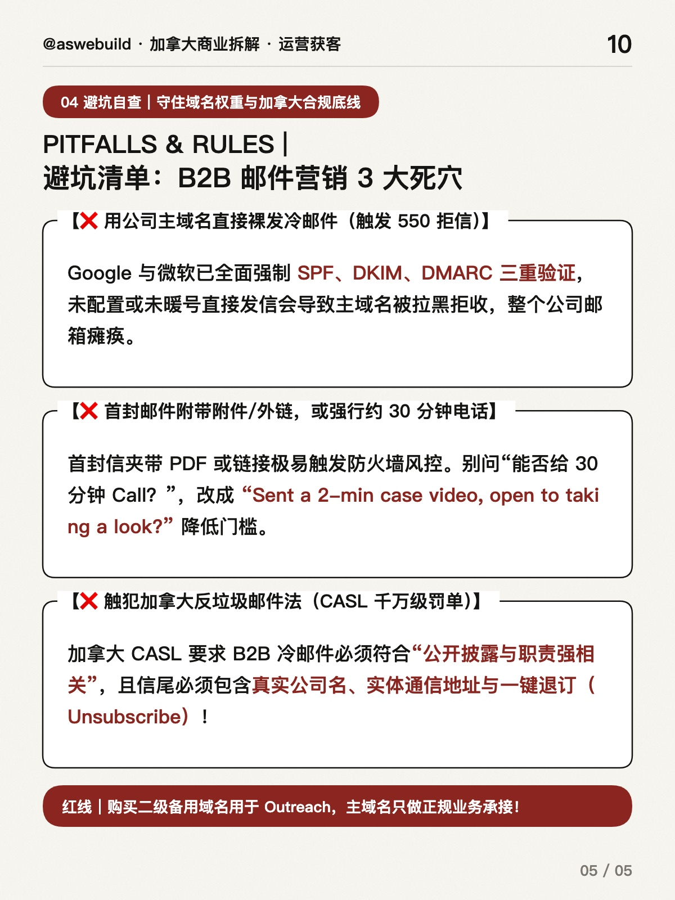

大温做 B2B 服务（软件开发、企业咨询、短视频代运营、商业清洁维修、供应链服务）的华人创业者，最常遇到的获客瓶颈：以为在朋友圈发广告、在华人群里发海报就能拿到大客户，结果折腾半天，找来的全是比价砍价的小单，客单价几百刀还累得半死。
在北美，高客单 B2B 业务（单客户月留存几千甚至上万刀）的商业世界里，真正的企业买家只在 **LinkedIn** 和 **工作邮箱** 里。

我们案例库里多伦多 25 岁创业者 **Tuan Le（短视频 B2B 机构 ShortsCut 创始人）** 的逆袭就是极佳的写照：他 15 岁从越南移民加拿大，看着父亲在赌场夜班洗碗一周暴瘦 5 磅，立誓 10 年内让父母退休。他从收 $20 加元剪游戏视频、疫情期从多伦多电影学院退学帮本地餐厅拍视频换免费午饭起步；早期给企业乱发“帮你剪视频”的泛泛邮件，回复率不到 1%。
后来他彻底重构了获客逻辑：针对北美目标企业发送精准 Cold Email，配合高承诺的对赌测试方案（ **$2,000 包拍 10 条短视频，没播放量全额退款** ）。第一条视频就跑出 70 万播放、单晚帮客户涨粉 9,000 人！拿着这个 Case Study 批量出击，他一路签下硅谷 AI 独角兽 **Replit** 、 **Stan Store** 、 **Airalo** 和 **Buldak（三养火鸡面）** 等大客户。短短几年组建 15 人团队， **年营收突破 $140 万加元，净利润超 $66.8 万加元（净利率高达 45%）** ，单个 B2B 客户包月服务费（Retainer）高达 **$10,000–$16,000 美元/月** ！

想在北美靠 Cold Email 和 LinkedIn 拿下主流高客单 B2B 订单？记住这 **4 步落地 SOP** ：

### 01｜把 LinkedIn 个人主页改造成“高转化落地页（Landing Page）”

在北美做 B2B，LinkedIn 就是你的第一信用门面。客户收到冷邮件后，第一个动作就是去 LinkedIn 搜你的名字：
* **Banner 背景图** ：放上你的核心成果数据或一句话价值主张（Value Proposition），别用默认灰底；
* **Headline（头衔）** ：别只写“Founder at XXX”，改为 **“I help [目标客户] achieve [具体结果] through [核心方法]”** （例： *I help B2B SaaS companies double their organic video pipeline in 90 days* ）；
* **Featured 精选区** ：直接置顶你最硬核的客户案例拆解（Case Study）与战绩截图。

### 02｜用工具抓取精准决策者（Key Person）工作邮箱

千万别把邮件发给 info@ 或 contact@！这种通用前台邮箱 99% 石沉大海。
* 使用 **Apollo.io** 或 **Hunter.io** ，直接锁定目标企业的核心业务负责人：如 **Owner, CEO, VP of Marketing** 或 **Operations Manager** ；
* 仅提取经过 100% 状态校验（Verified）的公开工作邮箱。

### 03｜撰写“100 字 3 段式”高转化 Cold Email 结构

第一封邮件千万别长篇大论介绍公司历史！控制在 100 字以内，严格遵循 3 段论：
1. **Personalization（个性化痛点钩子）** ：“Hi [Name]，关注到贵司最近上线的 [具体产品/动态]，发现你们在 [某个具体环节] 还有很大增长空间。”
2. **Value & Proof（同行数据实证 + 零风险对赌）** ：“我们刚帮同赛道的 [某客户] 在 30 天内拉升了 [具体数据 %] 的转化（不达预期全额退款）。”
3. **Low-Friction CTA（低阻力提问）** ：“我专门针对贵司录了一个 2 分钟的诊断视频，方便发您看一眼吗？”（切记：第一封信绝不附带 PDF/外链，也别直接约 30 分钟电话，先把回复门槛降到最低！）

### 04｜配置自动化跟进序列 + 守住 2026 域名与加拿大 CASL 合规红线

* **域名隔离与三重认证** ：Google 与微软（Outlook）现已对未认证群发执行 **550 强制拒信** ！千万别拿公司主域名直接发冷邮件。去买二级备用域名（如 trycompany），配齐 **SPF、DKIM、DMARC** 解析，并用工具做足 **14–21 天暖号（Warm-up）** ，单邮箱日发送量控制在 **30–50 封** ；
* **自动化序列（Sequence）** ：使用 **Instantly** 或 **Smartlead / Lemlist** ，设置 3–4 轮自动跟进（间隔 3–5 天）——B2B 市场 70% 的有效回复都来自第 2 至第 3 轮跟进；
* **[加拿大 CASL 反垃圾邮件法合规](https://ised-isde.canada.ca/site/canada-anti-spam-legislation/en)** ：向加拿大企业发信必须符合“公开披露与职责相关”原则，且邮件底部必须包含 **真实公司名、实体通信地址（Mailing Address）与一键退订（Unsubscribe）** ，守住最高千万加元罚单的合规红线！

**💡 实操落地建议：** 先锁定大温或北美 100 家最精准的目标客户，重构好你的 LinkedIn 主页。每周发出 150–200 封高度定制的 Cold Email。只要靠零风险 Offer 跑通第 1 个标杆客户、拿到 Case Study，你就能在北美建立起一台全天候运转的高客单 B2B 获客机器。

—— B2B 获客的精髓：少即是多，用数据和确定性结果说话。

  
  
  
  

