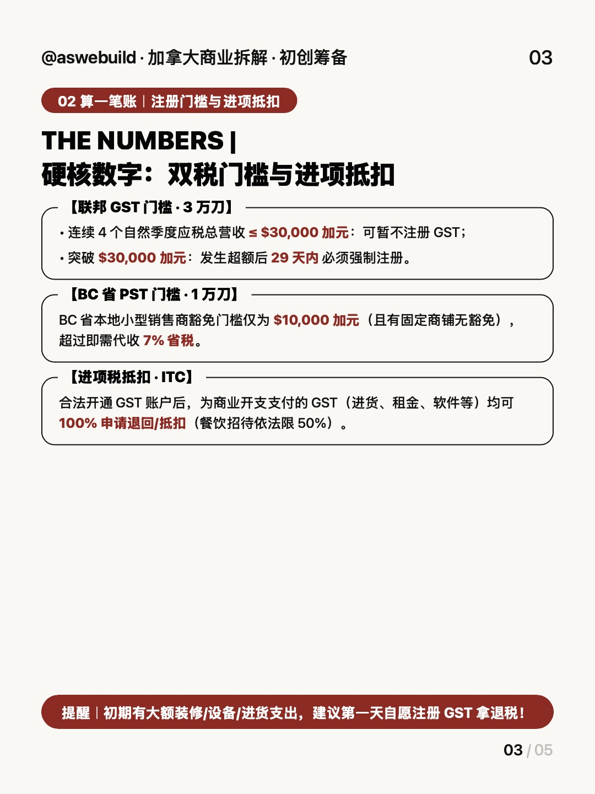
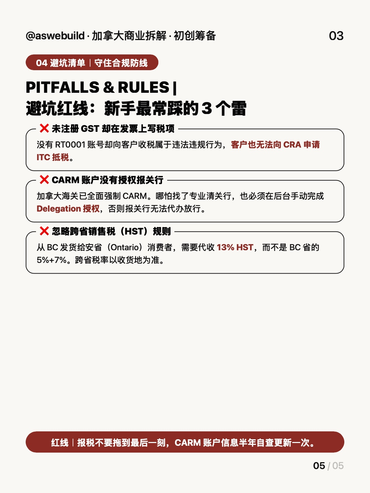

大温华人做小生意最容易掉进的两个坑：
一个是“不知道什么时候该收税”，没开税号乱收税，或者达标漏报税，被 CRA 与省财政厅追缴罚款；
另一个是“做货代/进出口，货物到了温哥华港却卡在海关清不了关”，每天付昂贵的集装箱滞港费（Demurrage）。

其实在加拿大，公司注册好之后，搞定 **BN 商业号、GST/PST 销售税与 CARM 海关系统** 只需要遵循一套清晰的逻辑。今天一次性帮大家理顺：

### 01｜BN 商业号到底是什么？

BN（Business Number）是 [加拿大税务局（CRA）商业注册官网](https://www.canada.ca/en/revenue-agency/services/tax/businesses/topics/registering-your-business/register.html) 给每个企业的 9 位数“身份证号”。
你的公司所得税（RC）、GST 销售税（RT）、雇主薪酬（RP）和进出口代码（RM）都是挂在这个 9 位数 BN 主代码下面的子账户。

### 02｜GST 与 PST 什么时候必须注册？

* **联邦 GST（3 万红线）** ：连续 4 个季度应税收入未超 30,000 加元，被界定为小规模供应商（Small Supplier），免强制注册；一旦单季或累计超标，必须在 29 天内完成注册（详见 [CRA GST/HST 注册官方指引](https://www.canada.ca/en/revenue-agency/services/tax/businesses/topics/gst-hst-businesses/when-register-charge.html)）。
* **BC 省 PST（1 万红线）** ：很多人忽略了 BC 省本地规定——小型销售商豁免门槛只有 10,000 加元，且一旦有固定物理商铺则无豁免，需在 [BC eTaxBC 省税申报系统](https://www2.gov.bc.ca/gov/content/taxes/sales-taxes/pst/register) 开通代收 7% PST。
* **为什么建议起步主动注册 GST？** 如果你创业初期有大额固定资产购置、店面装修或大批量采购，哪怕营业额为 0，只要自愿提前注册 GST，就能向 CRA 申请进项税抵扣（ITC），直接把这笔现金退回公司账户！

### 03｜做进口贸易与跨境电商必看的 CARM 系统

加拿大海关（CBSA）现已全面强制推行 [CBSA CARM 客户门户官网](https://ccp-pcc.cbsa-asfc.cloud-nuage.canada.ca/)（CBSA Assessment and Revenue Management）数字化清关平台：
1. 登录 CARM 客户门户注册公司账号并绑定 9 位数 BN 号；
2. 在 CARM 权限管理中，找到你的报关行（Customs Broker）执行 Delegation 授权；
3. 配置财务担保（Financial Security），确保海关关税与进口 GST 的合规缴纳与先放行后付款待遇。
没做这一步，货物在温哥华港/口岸直接被卡，报关行也无权替你申报！

—— 把合规流程标准化，创业才不会慌。

我们尝试用600多篇这里创作的内容，对新的政策和变化进行整理，做一个加拿大/大温华人创业拆解的图文指南，这里是 **企业初创与架构筹备篇。**

  
  
  
  

