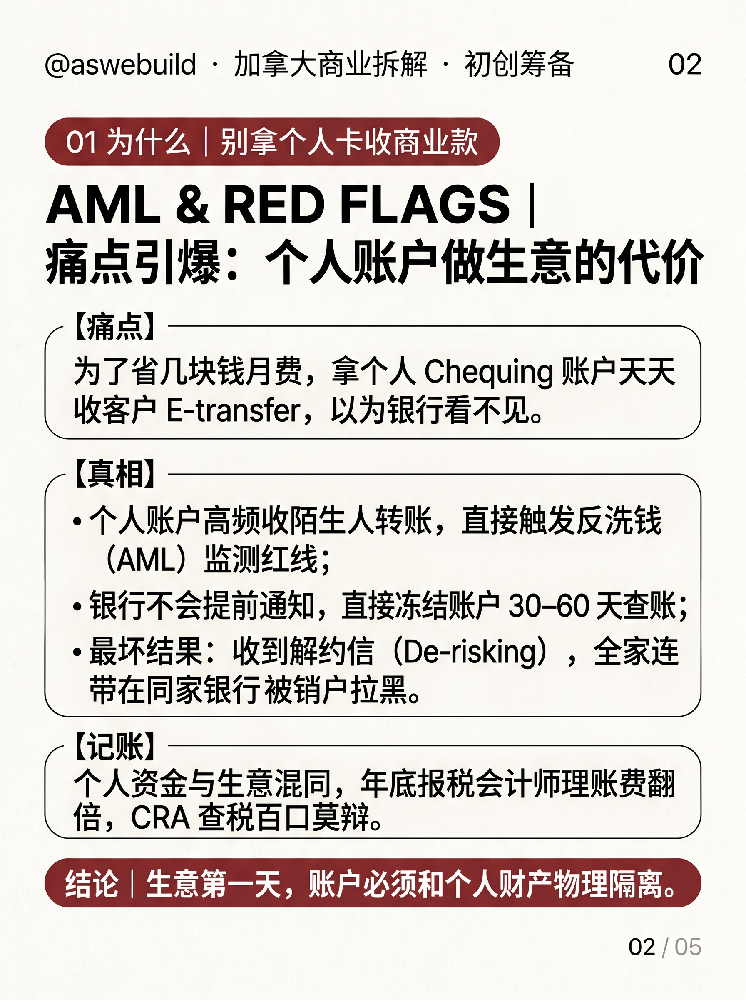
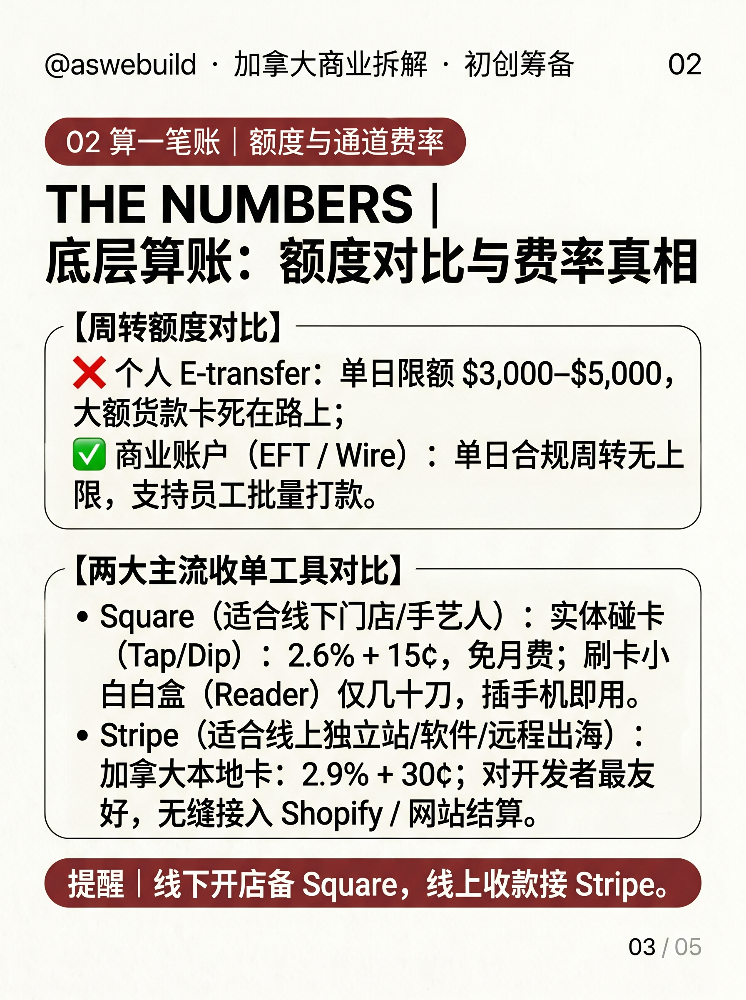
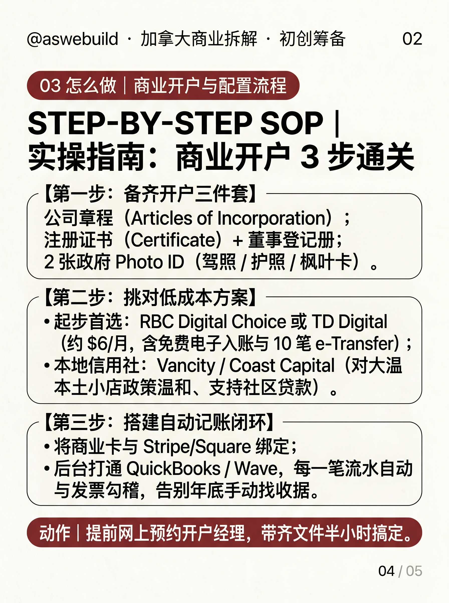
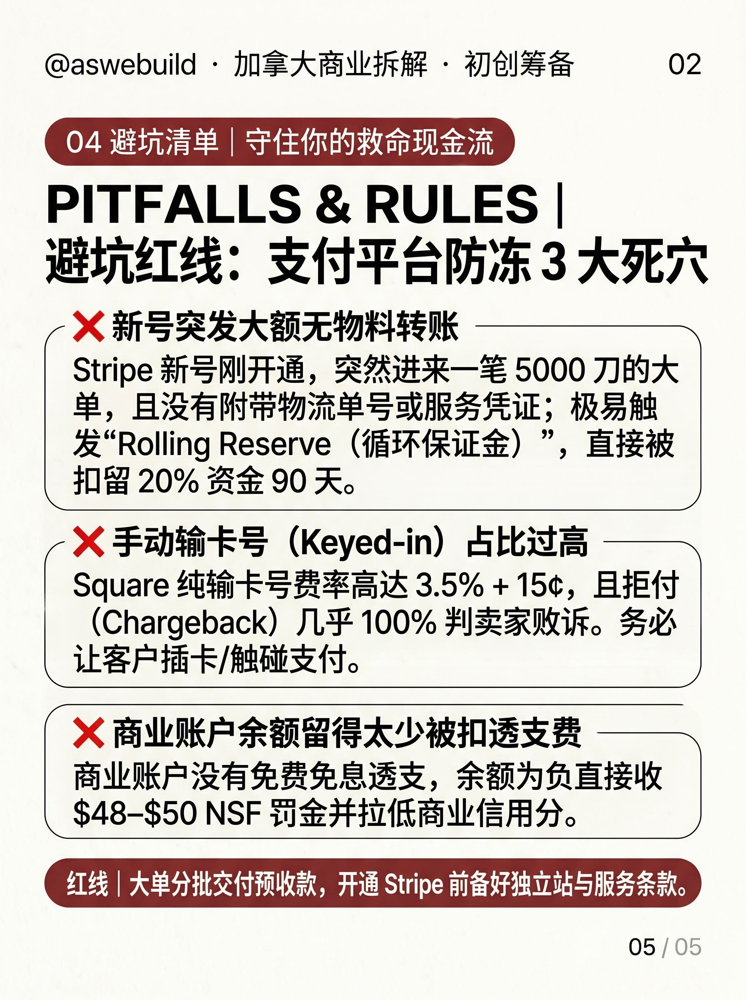

大温创业者踩过最冤的一个坑：
公司刚开业两个月，个人银行账户突然被全部冻结。
原因很简单：为了省一个月 6 块钱的商业账户月费，拿个人卡收了几十笔客户的 E-transfer。
银行的大数据算法不是摆设。今天把大温做小生意开户与资金流合规实操拆解一遍：

### 01｜为什么不能用个人卡做生意？

很多华人习惯私下 E-transfer，但在加拿大，个人账户受 [FINTRAC 加拿大金融交易与报告分析中心](https://fintrac-canafe.canada.ca/) 反洗钱与银行账户协议严格监管。个人卡高频收来自不同姓名的款项，风控算法会判定为疑似违规洗钱或无照经营，轻则冻结 30 天要你补交证明，重则直接“De-risking”强制销户且同集团全行拉黑。

### 02｜商业账户怎么挑最省钱？

不需要一上来就买大银行上百刀的高级商业套餐（可参考 [FCAC 加拿大金融消费者署商业银行账户指南](https://www.canada.ca/en/financial-consumer-agency/services/banking/business-accounts.html)）：
* **RBC Digital Choice** ：$6/月，日常电子借记免费，送 10 笔免费 E-transfer 发送；
* **TD Everyday Business Plan** ：$6/月，无限制电子入账，适合轻资产初创起步；
* **本地信用社（如 Vancity）** ：对大温本土创业极其友好，有专属的 $7.5 万初创贷款（Start-up Loan）对接通道。

### 03｜收单工具怎么选？

* **线下实体/地推/手艺人** ：用 Square。拿几十刀的刷卡盒（Reader）连手机就能刷卡，碰卡手续费仅 2.6% + 15¢，没有硬件月租；
* **线上独立站/出海/订阅制** ：接 Stripe。本地卡 2.9% + 30¢，支持一键开具规范发票与对接自动化记账。

### 04｜守住现金流的避坑提醒

Stripe 最怕“新号接大单没有履约证明”。一旦被系统识别为高风险，直接对你执行 20% 的 Rolling Reserve（90天循环冻结），很多小店就是这样现金流断裂的。

---

做生意，账目清爽是走得远的前提。
把账户做合规，把力气花在找客户上。

我们尝试用600多篇这里创作的内容，对新的政策和变化进行整理，做一个加拿大/大温华人创业拆解的图文指南，这里是 **企业初创与架构筹备篇。**

  
  
  
  

