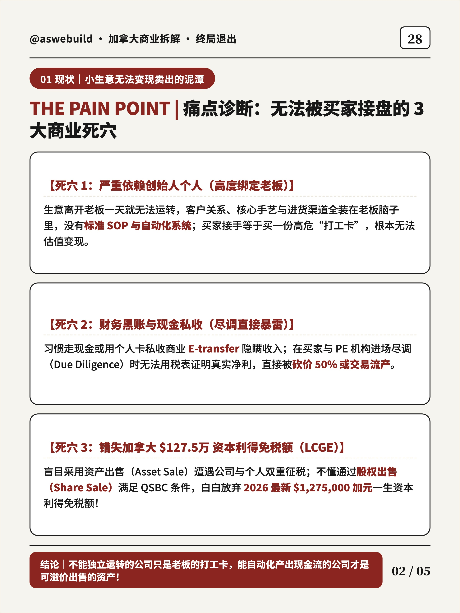
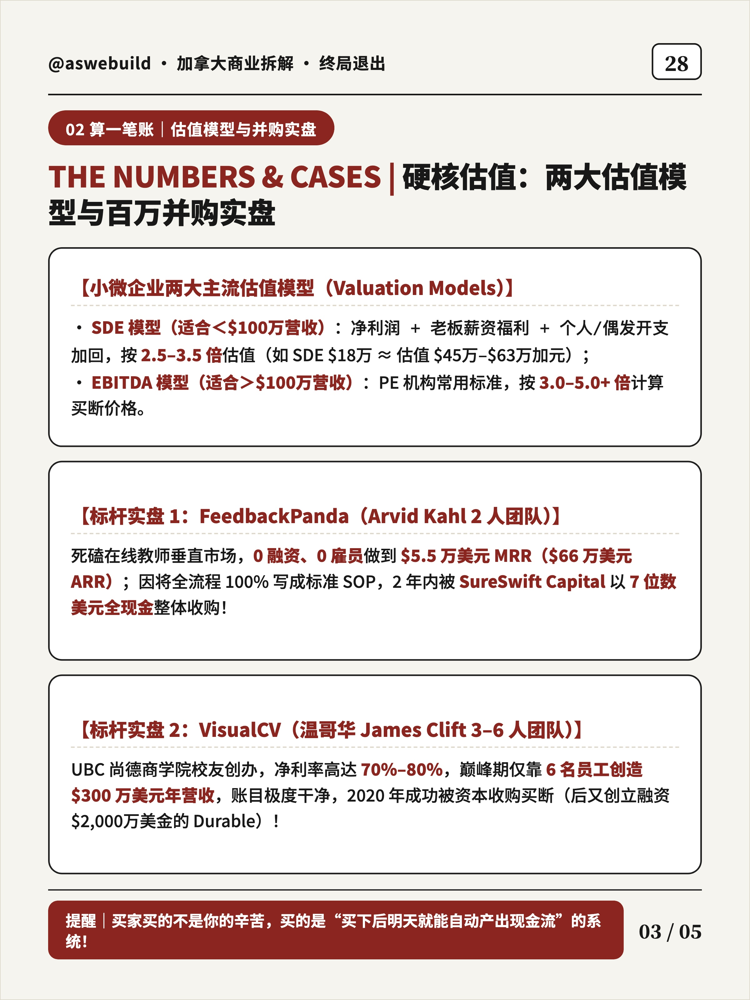
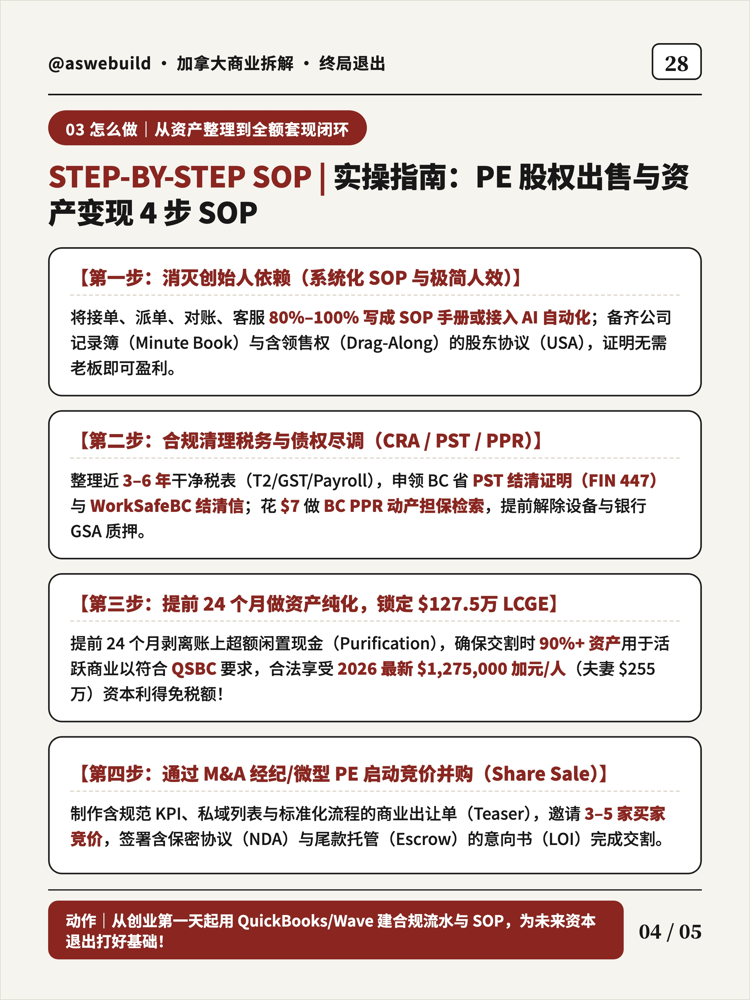
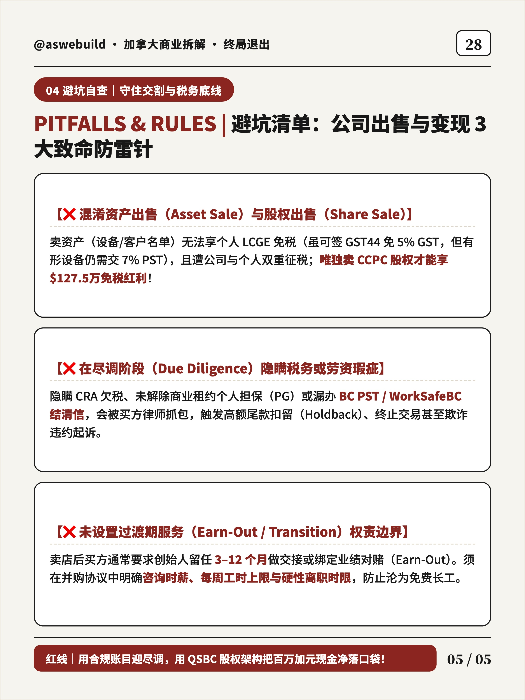

在大温做生意，华人老板最易忽略的终局问题：辛苦干了 10 年、20 年的店，想退休或开启新项目时能卖多少钱？多数小店离开老板一天就停摆，客户与技术全装在脑子里，账面充斥现金私收与模糊流水。找买家估值时直接被拒：“这不是独立运转的公司，只是张劳累的打工卡！”最终只能关门甩卖二手设备，资产归零。

想在大温把小生意做成高溢价资产并免税套现？牢记这套退出 SOP：

### 01｜搞懂两大估值模型（Valuation Models）

* **SDE 模型（＜$100 万营收）** ：SDE = 净利润 + 老板薪资福利 + 个人/偶发开支加回。大温成熟小生意通常按 **2.5–3.5 倍 SDE** 估值（如净利 $10 万 + 老板薪资 $8 万 = SDE $18 万，估值约 $45 万–$63 万加元）。
* **EBITDA 模型（＞$100 万营收）** ：PE 机构常按 **3.0–5.0+ 倍 EBITDA** 买断。净利率越高、老板依赖越低，倍数越高！

### 02｜消灭创始人依赖：全流程 SOP 化

将接单、派单、催收 80% 接入 AI 自动化；备齐公司记录簿（Minute Book）、含领售权（Drag-Along）的股东协议（USA）与岗位 SOP 手册，让普通员工按手册即可稳定运转。

### 03｜尽调（Due Diligence）合规清理

* **税务与用工结清** ：整理近 3–6 年 CRA 合规账目（T2/GST/Payroll），申领 BC 省并购必查的 **[BC 省 PST 结清证明（FIN 447）](https://www2.gov.bc.ca/gov/content/taxes/sales-taxes/pst/register/clearance-certificate)** 与 **[WorkSafeBC 结清信](https://www.worksafebc.com/en/insurance/know-coverage-status/get-a-clearance-letter)** （资产清算另备 [CRA TX19 税务结清证明](https://www.canada.ca/en/revenue-agency/services/tax/individuals/life-events/doing-taxes-someone-died/clearance-certificate.html)）；
* **PPR 债权检索** ：花 $7 做 [BC 省 PPR 动产担保检索](https://www2.gov.bc.ca/gov/content/employment-business/business/managing-a-business/permits-licences/personal-property-registry)，提前解除设备租赁、银行 GSA 与商业贷款质押，确保产权无瑕疵（Clean Title）。

### 04｜终极节税：股权出售享 $127.5 万 LCGE 免税额

* **❌ 资产出售（Asset Sale）** ：只卖设备与客户名单（虽可签 [CRA GST44 表格](https://www.canada.ca/en/revenue-agency/services/forms-publications/forms/gst44.html) 免 5% GST，但有形设备仍交 7% PST），公司与个人遭遇双重征税；
* **✅ 股权出售（Share Sale）** ：出售 CCPC 公司股份且满足 **QSBC（合规小企业股份）** 条件（交割时 90%+ 资产用于活跃商业、近 24 个月超 50% 且持股满 24 个月），可享加拿大 **[一生资本利得免税额（CRA LCGE 官方指引）](https://www.canada.ca/en/revenue-agency/services/tax/individuals/topics/about-your-tax-return/tax-return/completing-a-tax-return/deductions-credits-expenses/line-25400-capital-gains-deduction.html)**（2026 年随通胀升至 **$1,275,000 加元** ，夫妻共同持股最高免税 **$255 万加元** ），前 127.5 万加元增值额个人所得税直接为 **$0** ！

### 05｜公司出售 3 大防雷红线

1. **切勿隐瞒尽调瑕疵** ：隐瞒欠税或劳资纠纷会被扣留尾款（Holdback）、砍价 50% 甚至终止交易；
2. **锁死过渡期（Earn-Out）边界** ：协议须写明留任 3–12 个月的咨询时薪、工时上限与离职节点；
3. **提前 24 个月做资产纯化（Purification）** ：剥离账上超额闲置现金或被动投资，确保 100% 达标 QSBC。

**实操建议** ：从今天起用 QuickBooks/Wave 把每笔账记清，把日常工作写成 SOP。不只要做赚钱的生意，更要做能随时高价卖掉的资产！

—— 🎉《大温华人创业通关图文指南》全 28 篇圆满完结！从注册开户、商超进店、B2B 获客到合规退出，愿这份指南助你在加拿大稳健通关！

  
  
  
  

