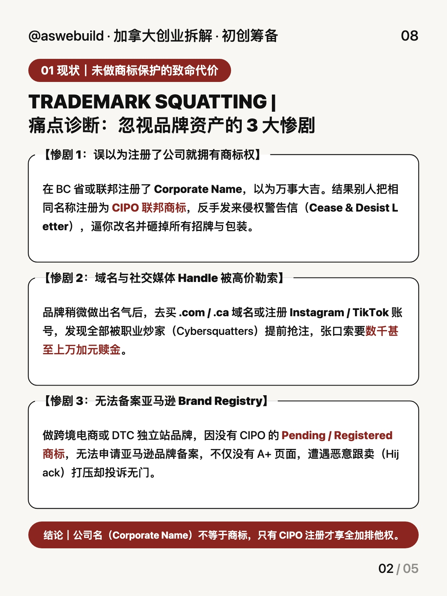
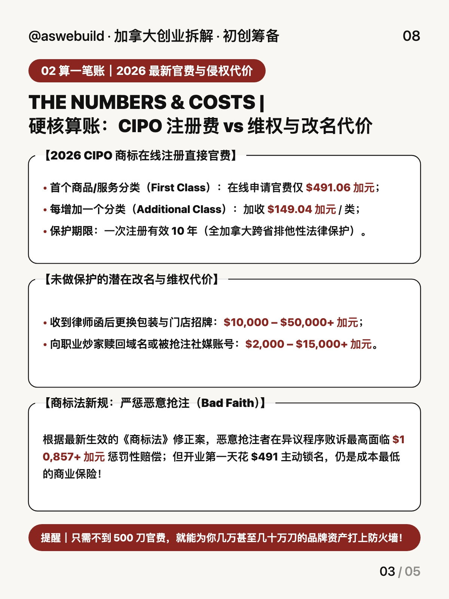
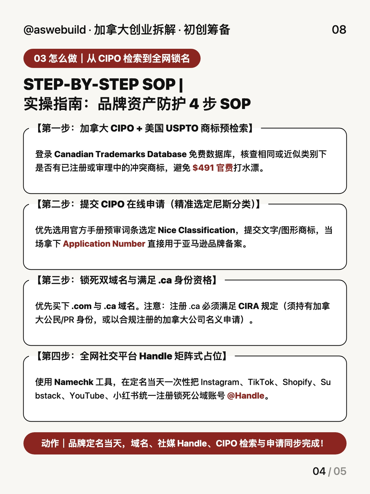
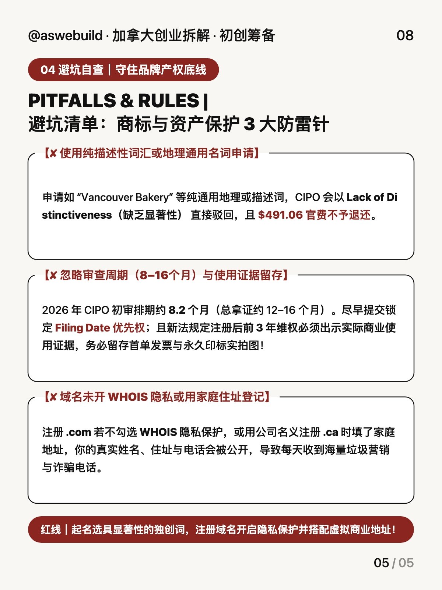

大温华人创业者最常混淆的一个致命概念：
“我在 BC 省政府或联邦注册了公司名（Corporate Name），这个名字是不是全加拿大就只有我能用了？”

**答案是：完全不是！** 在加拿大，公司注册（Incorporation）只是给了你一个合法经营与报税的商业实体名称， **根本不等于商标专用权（Trademark）** 。
如果别人在加拿大知识产权局（[CIPO 加拿大知识产权局商标官网](https://ised-isde.canada.ca/site/canadian-intellectual-property-office/en/trademarks)）把相同的名字注册成了联邦商标，就算你的公司开得更早，对方依然可以凭 CIPO 的全加排他权给你发终止侵权警告信（Cease & Desist），要求你下架产品、拆掉门头招牌、改掉品牌名！

在北美做生意，品牌就是你最核心的无形资产。今天结合 **2026 年最新官费与商标法新规** ，把 CIPO 商标注册、域名防守和全网矩阵锁名的实操闭环一次性拆透：

### 01｜CIPO 商标注册：2026 最新成本与硬核新规

* **费用极其透明** ：通过 [CIPO 在线商标申报门户](https://ised-isde.canada.ca/site/canadian-intellectual-property-office/en/trademarks/file-trademark-application) 提交，2026 年最新标准为 **首个分类（First Class）官费 $491.06 加元** ，每增加一个分类加收 **$149.04 加元** （官费不退，切勿看几年前 $358 的过时攻略）。一次核准注册，享受全加拿大 **10 年** 排他性保护。
* **审查提速与优先权** ：CIPO 清理完历史积压后，2026 年 10 月提交的新申请，预计初审排队已大幅缩短至 **8.2 个月左右** （整体拿证约 12–16 个月）。你提交申请那天的 **Filing Date（申请日）** 就是你的法律防线。
* **⚠️ 商标法新规必看（Proof of Use）** ：虽然申请获批时无需提交使用声明，但根据最新生效的《商标法》修正案（*[Trademarks Act](https://laws-lois.justice.gc.ca/eng/acts/t-13/)*）， **商标注册后的前 3 年内，如果你要起诉他人侵权，必须向法庭出示在加拿大实际商业使用（Use）的证据** ！所以第一批印有品牌 Logo 的包装、发货单和销售发票一定要妥善留存。
* **亚马逊 Brand Registry 实操** ：做跨境电商或独立站的朋友注意，只要在 CIPO 提交申请拿到 **Application Number（申请号）** ，不用等一年后下证，当天就能去亚马逊申请品牌备案、解锁 A+ 页面并防跟卖！ **避坑提醒** ：2026 年亚马逊严查产品图，必须提交品牌名 **永久印制** 在产品或包装上的真实手机实拍图（贴纸贴标或 3D 渲染图会被直接拒审）。

### 02｜域名防守：.com 与 .ca 双重锁死

在北美消费者心智里，输入网址的第一直觉永远是 `.com` （全北美信任度最高），而本地政府与消费者对 `.ca` （由 [CIRA 加拿大互联网注册局](https://www.cira.ca/) 管理）具有极强的本土亲切感。
* **核心策略** ：必须同时买下 **`brandname.com` 和 `brandname.ca`** （注册商优先选 **Cloudflare Registrar** 享批发底价零加价续费，或 **Porkbun / Namecheap** ），并把 `.ca` 自动做 301 跳转指向主站 `.com` ；
* **防抢注保护** ：如果核心词 `.com` 已被人天价占住，可以在品牌词后加上动词或品类后缀（例如把 `webuild` 升级为 `aswebuild.com`），绝不用连字符（`-`）或难拼写的谐音字母。

### 03｜全网社交媒体 Handle 矩阵锁名 SOP

在你决定启用一个品牌名（如 aswebuild）的当天，做完 [CIPO 加拿大商标数据库](https://ised-isde.canada.ca/opic-cipo/cpd/eng/introduction.html) 与美国 USPTO 数据库免费预检索后，立刻执行 3 个动作：
1. 打开 **Namechk** 工具，输入品牌名，一键扫描全网域名与 30+ 社交平台占用情况；
2. **统一锁死主流平台** ：哪怕你现在还没精力运营 TikTok 或 Substack，也立刻用公司官方邮箱把 Instagram、TikTok、YouTube、LinkedIn、Shopify、小红书和 Substack 的同名账号（如 @aswebuild）全部注册占位；
3. **采用预审词条提速** ：在 CIPO 选分类时，尽量直接选用官方《Goods and Services Manual》里的预审标准词条，避免因自定义表述模糊收到审查员意见信（Examiner's Report）而耽误半年时间。

**💡 实操落地建议：** 起名时，坚决避开 *"Vancouver Organic Bakery"* 这种纯描述性、地理性的词汇（100% 因缺乏显著性被驳回且不退官费）。选一个有独特性、显著性（Distinctive）的独创词或跨界合成词。在品牌上线的第 1 天，花 **$491.06 加元** 把 CIPO 在线申请交了，把 .com / .ca 域名和全网社媒 Handle 锁死。把知识产权的大门焊死，你辛苦打造的品牌资产才真正属于你自己。

我们尝试用600多篇这里创作的内容，对新的政策和变化进行整理，做一个加拿大/大温华人创业拆解的图文指南，前8篇**企业初创与架构筹备篇全部完结！**下部分是日常运营与高效获客篇。

  
  
  
  

