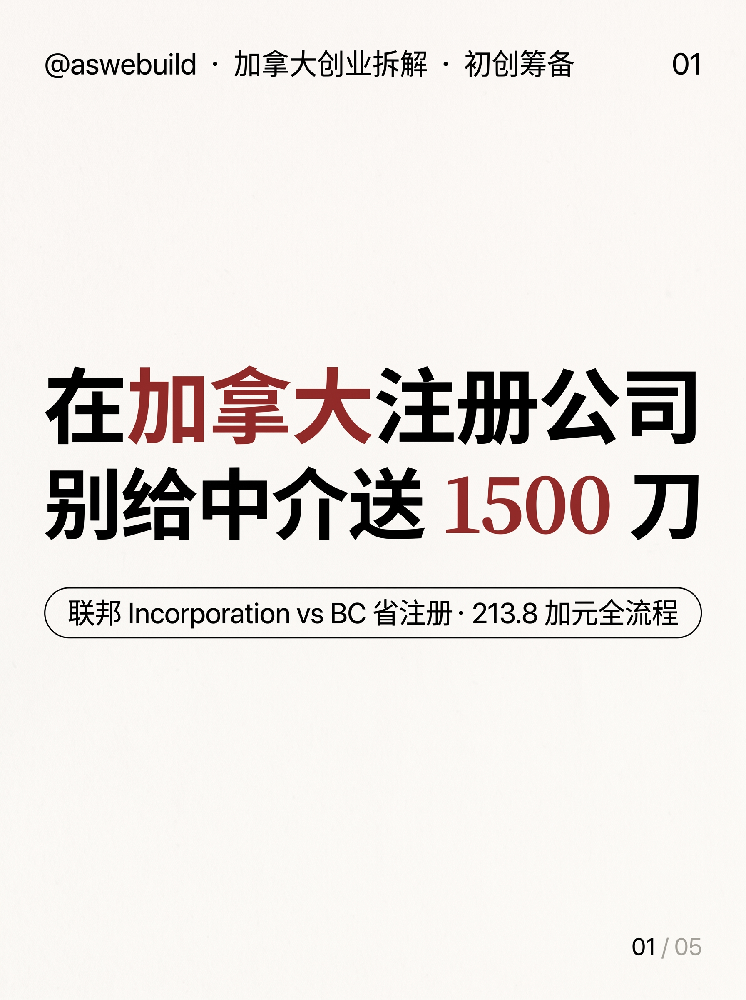
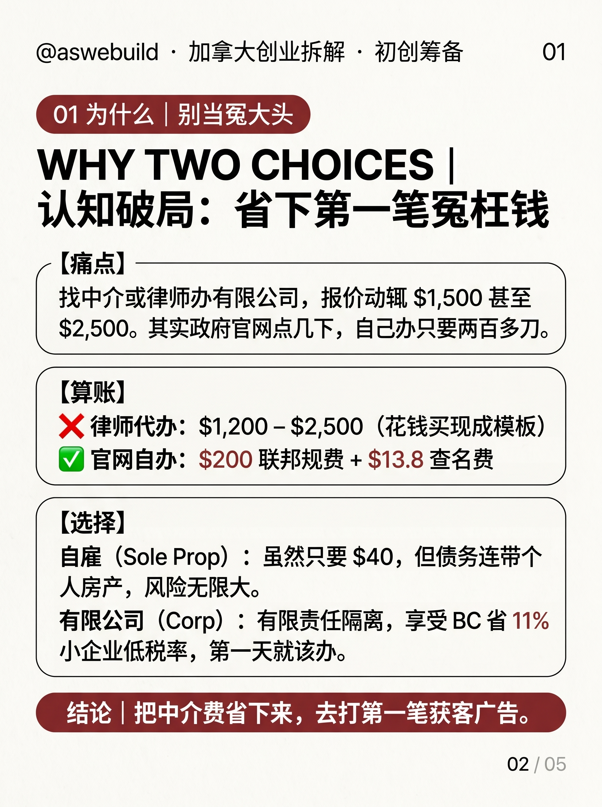
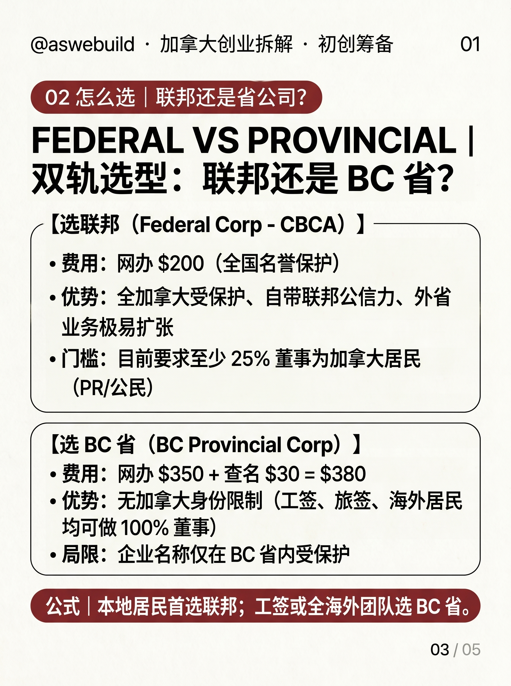
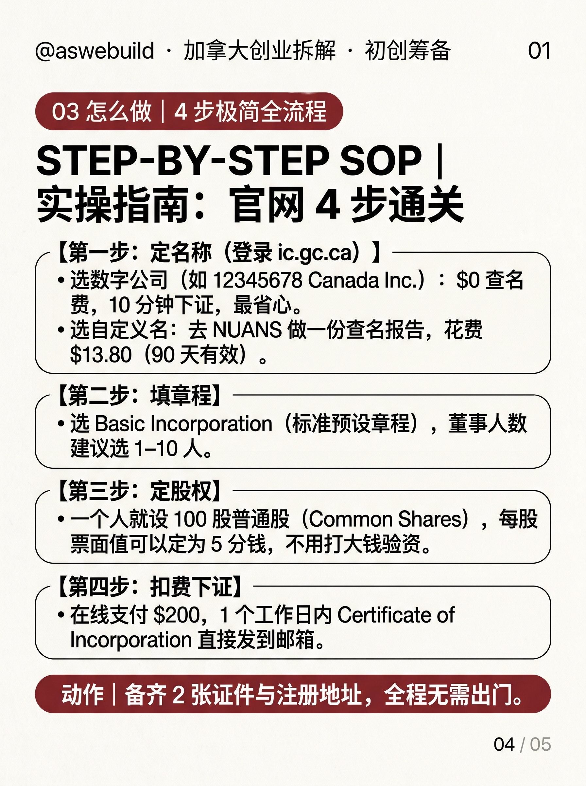
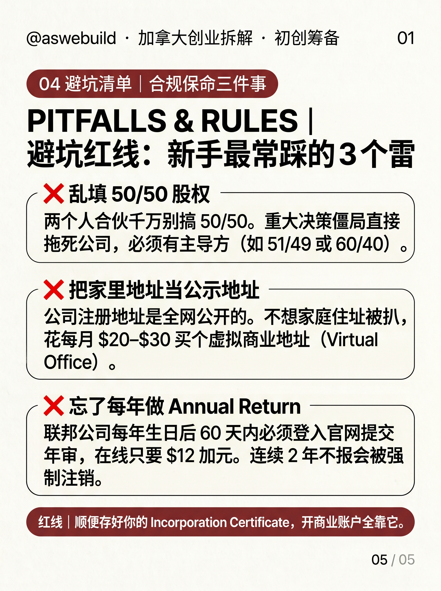

聊过的大温创业者越多，越心疼一件事：
还没开始赚到一分钱，先被中介收了 1500 刀注册费。
其实在加拿大注册一家合规的有限公司，自己点点鼠标只要 200 出头。
今天把联邦公司（Federal Corp）的极简 DIY 注册清单公开：

### 01｜自雇 vs 有限公司

刚起步做点微型副业可以自雇（Sole Prop），但一旦涉及签约、进货、雇人，无限连带责任会直接穿透到你的个人房产和账户。有限公司有独立的法人地位，还能享受 BC 省 11% 的小企业综合优惠税率，稍微正规一点的生意越早办越好。

### 02｜两百多刀怎么做到的？

登入加拿大工业部官网（[Corporations Canada 联邦企业局官网](https://ised-isde.canada.ca/site/corporations-canada/en)）：
* 联邦在线注册费：$200（顺手免费一并完成 [BC Registries and Online Services 省外跨省登记](https://www.bcregistry.gov.bc.ca/)）
* NUANS 公司查名报告：$13.80（选数字公司连这笔都省了）
* 后续每年年审（Annual Return）：官网自交只要 $12
* 不需要验资，股票面值哪怕定 5 分钱都可以，合规合法。

### 03｜三个新手千万别踩的坑

1. 别用家庭住宅做公开法律地址，防隐私泄露；
2. 两人合伙别搞 50/50 股权平分，决策僵局会拖死公司；
3. 记好成立周年日，每年 60 天内必须交一次 $12 的 Annual Return，超时会被强制注销。
*(注：联邦公司要求至少 25% 董事为加拿大居民；若无枫叶卡/公民身份，可优先选 [BC 省公司注册](https://www2.gov.bc.ca/gov/content/employment-business/business/managing-a-business/permits-licences/businesses-incorporated-companies))*

小而美不是做小生意，是把力气和每一分现金用对地方。
收藏这篇，开业前把注册流程过一遍。

我们尝试用600多篇这里创作的内容，对新的政策和变化进行整理，做一个加拿大/大温华人创业拆解的图文指南，这里是 **企业初创与架构筹备篇。**

  
  
  
  

