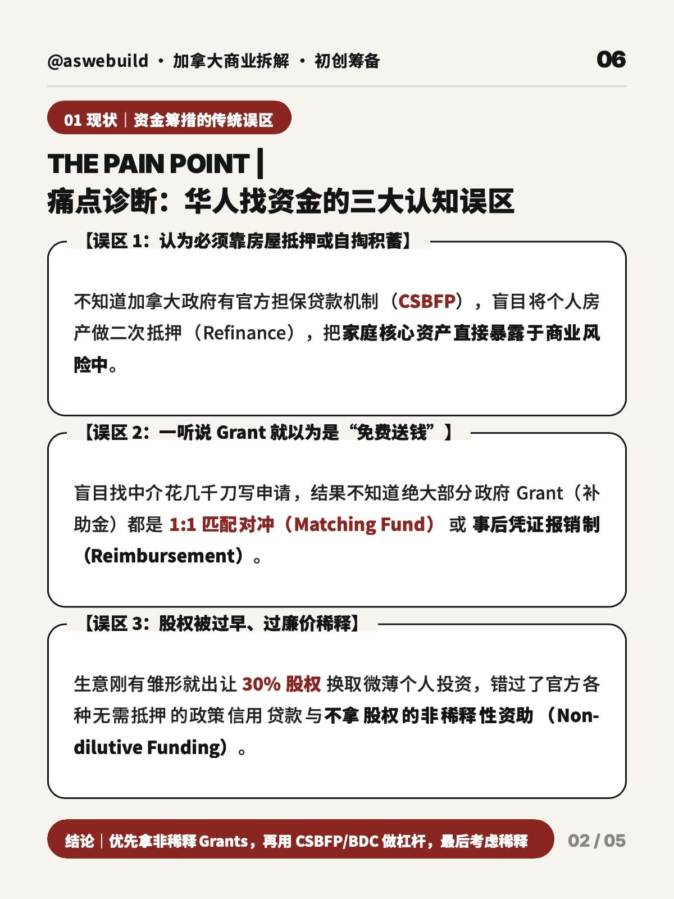
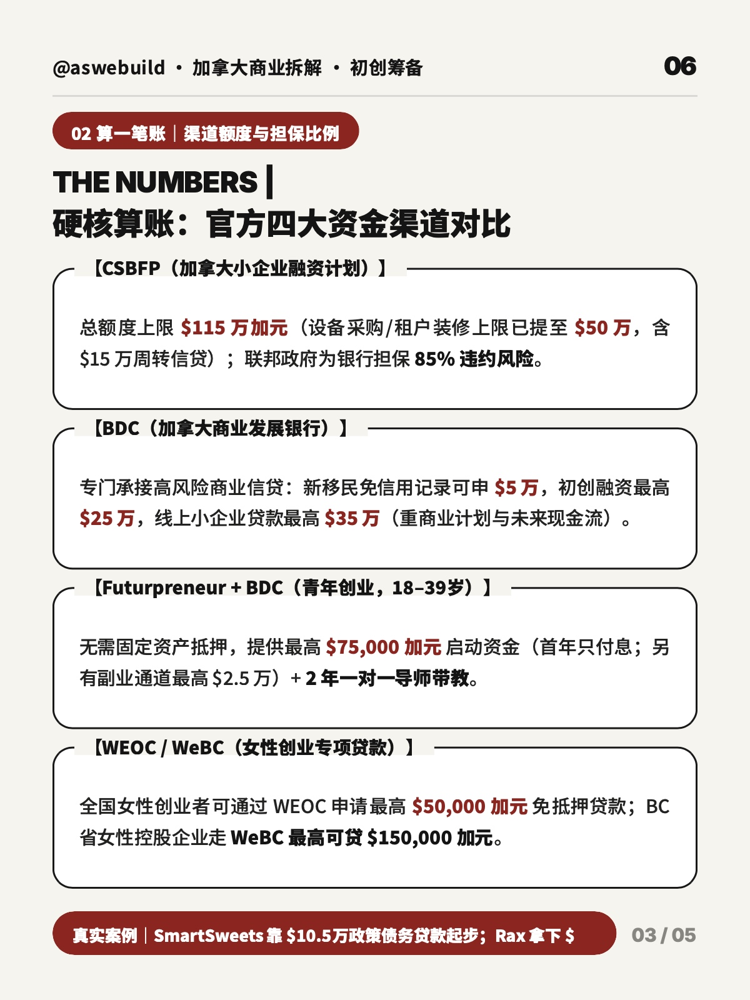
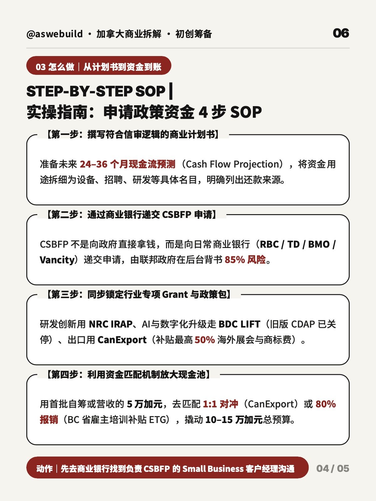
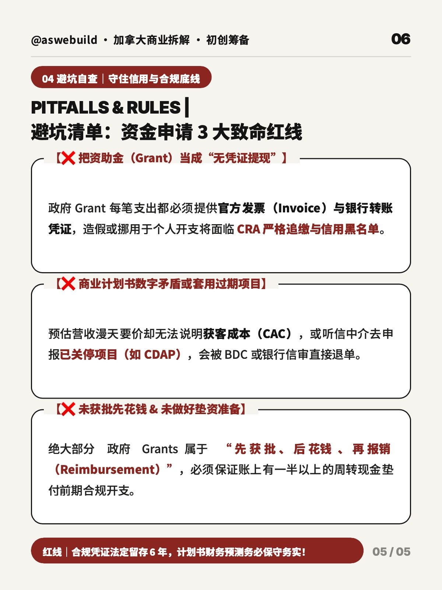

大温华人创业者最容易犯的一个资金错误：
想开个店、做个品牌或者搞个小公司，第一反应就是动用全家积蓄，甚至拿自己的自住房去二次抵押（Refinance）向银行贷款。
结果生意一旦遇到周期起伏，家庭资产与商业风险直接绑定在一起，背负巨大的心理压力。

事实上，加拿大拥有全北美最完善的小企业扶持与政策融资体系（可通过 [Innovation Canada 政府商业扶持匹配工具](https://innovation.ised-isde.canada.ca/) 一站式查询）。案例库里的三个真实标杆，就是靠政策杠杆起步的典型：

1. **SmartSweets（温哥华创始人 Tara Bosch）** ：21 岁在厨房做低糖软糖创业，最初拒绝贱卖股权，靠 **Futurpreneur 青年创业贷款等撬动 10.5 万加元债务融资** 起步，随后又拿下 **10 万美元 Thiel Fellowship 免股资助** ，一举打入北美 2.5 万+ 家主流门店，最终以 3.6 亿加元估值成功出售！
2. **Rax（多伦多创始人 Marley Alles）** ：做闲置礼服 P2P 共享平台，不卖一分股权，通过创业竞赛与非稀释性扶持，成功拿下 **6.5 万加元非稀释拨款（Non-dilutive Funding）** 注入 App 研发。
3. **温哥华家装易货平台创始人 Travis** ：通过将资金需求拆细为“系统开发、本地招聘、硬件运营”，7 申 3 中直接拿下了 **78.2 万加元** 的政府政策贷款与补助组合！

如果你也想在加拿大合法合规地撬动政策杠杆，这份 **2026年10月最新核实的资金申请全景指南** 请收好：

### 01｜加拿大小企业融资计划（CSBFP）

这是实体店与新手创业者最需要知道的联邦担保贷款工具（详见 [ISED CSBFP 加拿大小企业融资计划官网](https://ised-isde.canada.ca/site/canada-small-business-financing-program/en)）。
* **特点** ：由加拿大联邦政府向商业银行提供 **85% 的违约风险担保** ，极大降低了银行为初创公司放款的门槛（超过 70% 流向成立不满 1 年的新企业）。
* **额度（最新标准）** ：单户总额度最高可达 **115 万加元** （含最高 100 万定期贷款 + 15 万信用额度）。其中用于 **设备采购、租户装修（Leasehold Improvements）的额度上限已提高至 50 万加元** （另有最高 15 万可用于加盟费、软件与营运周转）。利率受法定上限保护（最高不超过 Prime + 3%）。
* **申请途径** ：直接找 **TD、RBC、BMO、Scotiabank 或本地信用社（如 Vancity）** 的商业客户经理申请，而不是直接找政府。

### 02｜BDC、Futurpreneur 与女性专属通道（2026最新额度）

* **BDC（加拿大商业发展银行）** ：国有政策性银行（[BDC 官网](https://www.bdc.ca/)），风险容忍度显著高于普通商行。提供针对登陆 3 年内 PR 的 **新移民贷款（$2.5万–$5万，免本地信用记录）** 、运营满 1 年的 **初创融资（最高 $25万）** 以及线上快速审批的 **小企业贷款（最高 $35万，$10万内免抵押）** 。2026年4月还新推出了专门支持数字化与 AI 转型的 **BDC LIFT 贷款计划** 。
* **Futurpreneur Canada（青年创业基金）** ：面向 **18–39 岁** 创业者（开业未满 24 个月均可申），联合 BDC 提供最高 **75,000 加元** （已从早年的 6 万上调至 7.5 万！）的 **纯信用免抵押启动贷款** （首年只付利息），并免费配备 **2 年一对一本地企业家导师** 。如果不辞职做副业，也有最高 **25,000 加元** 的 Side Hustle 通道（详见 [Futurpreneur Canada 官网](https://futurpreneur.ca/)）。
* **WEOC / WeBC（女性创业贷款）** ：联邦 WEOC 全国贷款通道提供最高 **50,000 加元** 无抵押资金；如果你在 BC 省，本地女性控股（≥51%）企业通过 **WeBC** 最高可申请 **150,000 加元** 贷款（19–39 岁女性还可走 WeBC × Futurpreneur 联合通道，最高 7 万全额免抵押，详见 [WeBC BC省女性创业官网](https://we-bc.ca/)）。

### 03｜非稀释性政府 Grant（补贴金）的真实玩法与避坑

很多人误以为 Grant 是“填个表政府就直接发钱”。首先提醒大家： **曾广为人知的 CDAP（加拿大数字采纳计划）已在 2024–2025 年彻底关停，千万别再被过时攻略忽悠去交中介费！** 目前加拿大主流活跃的 Grant 主要分为三种模式：
1. **对冲匹配制（Matching Funds）** ：比如 **CanExport SMEs（出口开拓补贴）** （[Trade Commissioner Service CanExport 官网](https://www.tradecommissioner.gc.ca/funding-financement/canexport/sme-pme/index.aspx?lang=eng)），你出 50% 预算，政府补贴 **50%（单项目最高 $5 万）** 用于海外参展、国际商标注册与海外市场推广（需盯紧每年开放的申请窗口）；
2. **研发与创新补贴** ：比如 **[NRC IRAP 加拿大国家研究委员会工业研究援助计划](https://nrc.canada.ca/en/support-technology-innovation/about-nrc-industrial-research-assistance-program)** ，针对有技术壁垒或研发属性的初创企业提供高额研发薪资补贴；
3. **员工培训补贴** ：比如 **[BC 省雇主培训补贴（B.C. Employer Training Grant, ETG）](https://www.workbc.ca/find-loans-and-grants/industry-and-employers/bc-employer-training-grant)** ，2026/27 财年持续开放，固定报销员工第三方技能培训费用的 **80%** （每人最高 **$10,000** ，每家企业每年最高 **$300,000** ）。

**实操落地建议：** 先写一份逻辑严密、带 **24–36 个月现金流预测** 的商业计划书。不要急着找中介花几千刀，先去参加本地机构（如 **WeBC 每周二中午的免费贷款说明会、Futurpreneur、Vancity 或 [PAC 联邦采购援助办公室](https://canadabuys.canada.ca/en/support)** ）的官方免费指导，找商业银行的客户经理做一次 CSBFP 初步评估。

—— 善用政策杠杆，用合规的方式放大你的资金池。

  
  
  
  

