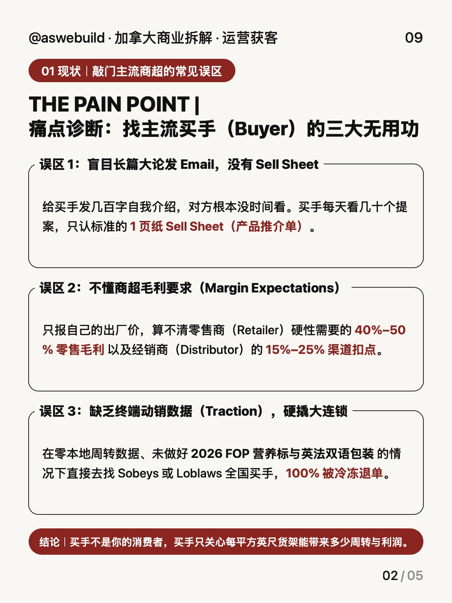
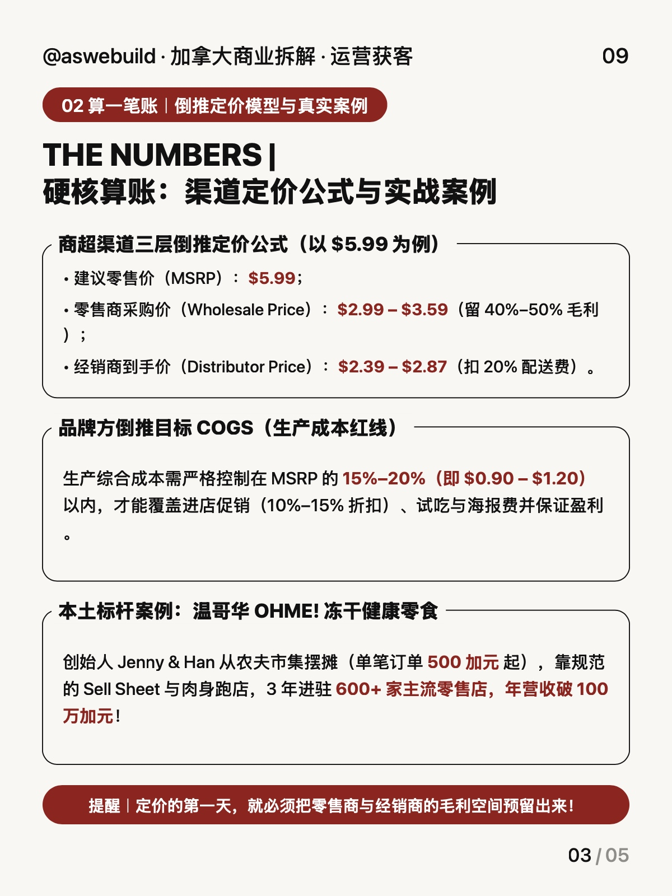
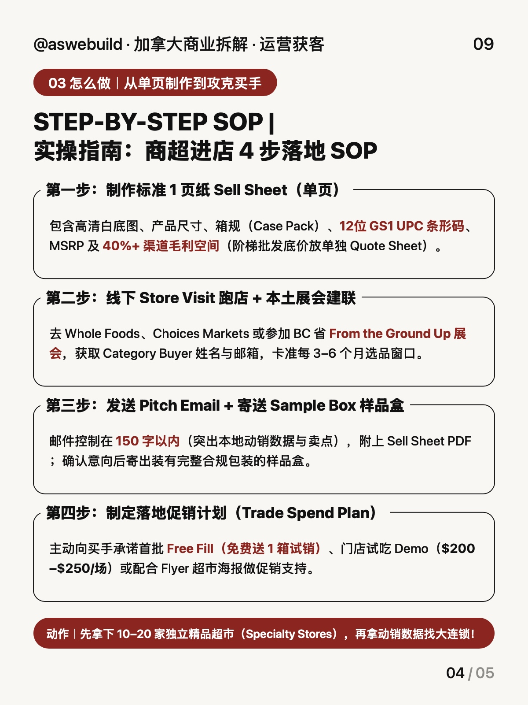
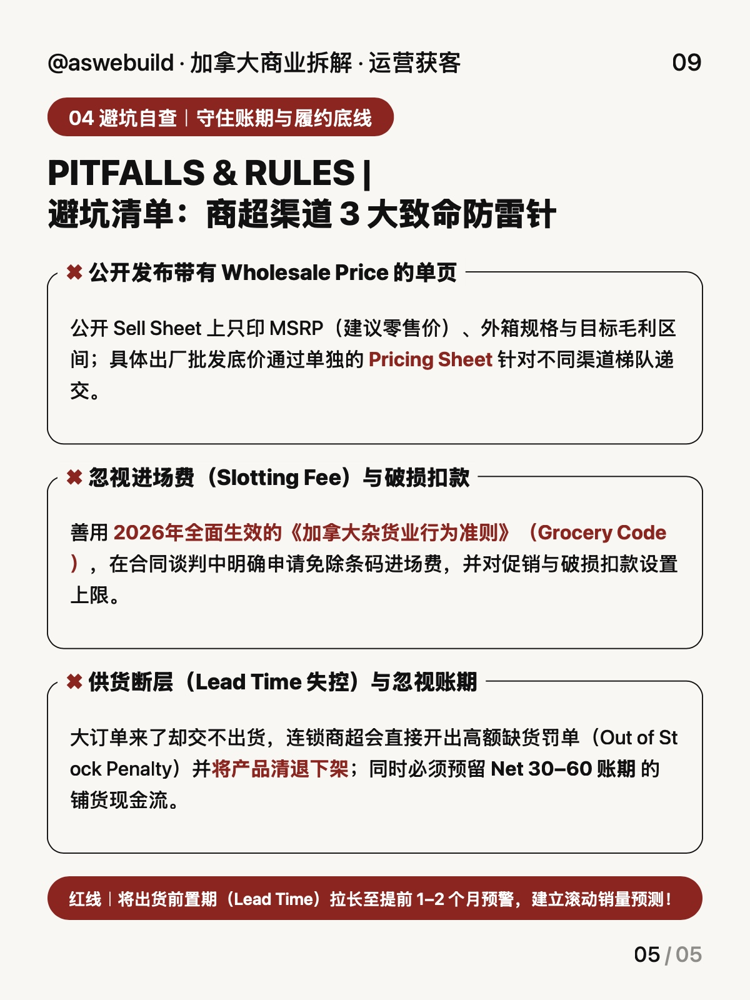

大温做消费品（食品、饮料、护肤品、宠物用品）的创业者，最梦寐以求的一件事：就是让自己的产品摆上 **Whole Foods、Save-On-Foods、London Drugs、Choices Markets 或者 Sobeys** 的货架。
但绝大多数人去尝试的时候，都撞得头破血流：
给买手发邮件像石沉大海；拿着产品去门店直接被店员婉拒；或者好不容易联系上了买手，报了一个价格，对方看了一眼直接把邮件删了。
西人主流商超买手（Category Buyer）采购产品的逻辑，和华人微信群团购完全是两个维度：跟消费者讲的是“多健康、多好吃”； **跟买手讲的，是每平方英尺货架的毛利空间，以及你怎么帮超市把货卖光** 。

大温本土品牌 **OHME! 冻干健康零食（温哥华创始人夫妻 Jenny Yue & Han Yue）** 的成长路径就是极佳的硬核教材：他们最初在农夫市集摆摊，第一笔 B2B 订单只有 **500 加元** 。但他们没有止步于摆摊，而是迅速做好合规包装与标准的单页 **Sell Sheet** ，至今 Han 还会亲自拿着 Sell Sheet 挨家挨户跑店；从 2024 年 4 月接触 London Drugs 到 2025 年 8 月正式上架，历经 16 个月死磕，短短 3 年打入全加 **600+ 家主流零售店** ，年营收突破 **100 万加元** ！
想在 2026 年把你的产品推入主流超市？这份商超进店 SOP 请收好：

### 01｜必须搞懂的商超渠道 Pricing Standard（定价倒推）

买手拒接你，90% 是因为你的定价根本不符合商超的财务模型。
在北美，从你的工厂到消费者手里，通常有三层利润分配：
* **零售商（Retailer，如 Whole Foods / Save-On-Foods）** ：要求 **40%–50%** 的零售毛利（Gross Margin）；
* **经销商（Distributor，如 UNFI Canada / Purity Life / Ecotone）** ：要求 **15%–25%** 的配送与仓储扣点；
* **品牌方（你）** ：拿到的结算价必须能够覆盖生产成本（COGS）、进店促销开支（Trade Spend）并留有利润。

💡 **算一笔硬账** ：如果你的产品在超市货架卖 **$5.99（MSRP）** ，超市采购价（Wholesale）大约是 **$2.99–$3.59** 。如果走经销商，经销商给你的结算价只有 **$2.39–$2.87** 。如果你的生产成本要 $2.50，你卖得越多亏得越惨！因此，做产品的第一天，生产综合成本（COGS）就必须死死压在 **MSRP 的 15%–20%（$0.90–$1.20）** 以内。

### 02｜敲门砖：制作标准的 1 页纸 Sell Sheet 与 2026 合规基建

去见买手，千万别带几十页的 PPT。你需要的是一张标准的 Letter 尺寸正反面 **Sell Sheet** ，上面包含：
1. **产品高清白底图与核心卖点** （如 High Protein, Zero Added Sugar, Non-GMO）；
2. **物流与包装规格** ：单件净重、外箱尺寸（Case Dimensions）、每箱数量（Case Pack）、托盘规格（Ti-Hi）；
3. **2026 强制合规基建** ：官方注册的北美通用 **12 位 GS1 UPC 条形码** 、常温保质期（Shelf Life）、[CFIA 英法双语营养表（NFT）](https://inspection.canada.ca/en/food-labels/labelling)，以及务必避开 2026 年 1 月起强制执行的 **[加拿大卫生部包装正面（FOP）高糖/高钠黑白放大镜警示标](https://www.canada.ca/en/health-canada/services/food-labelling-changes/front-package.html)** ；
4. **商业算账与报价策略** ：明确标出建议零售价（MSRP）与预留给渠道的 **40%+ 毛利空间** 。注意：公开版 Sell Sheet 上不要印出你的阶梯底牌批发价，具体 Wholesale 价格放在单独的 **Price Sheet** 中，针对单店直供或经销商体量单独报价。

### 03｜攻克买手的 4 步落地 SOP

1. **分级攻坚 + 借力本地展会** ：不要一上来就去敲 Loblaws 全国总部的门！先去大温本地的独立超市与社区精品超市（如 **Stong's Market, Choices Markets, Nesters Market, Famous Foods** ）测试。同时强烈推荐参加 BC 省专为本地 CPG 品牌办的 **From the Ground Up 展会** ——London Drugs 和 Save-On-Foods 的买手都会去现场，当面问清进店条件并拿走买手邮箱！
2. **Store Visit 搜集情报 & 卡准选品窗口** ：直接去目标门店观察竞品规格，向店长或店员打听品类买手（Category Manager）的姓名。注意大商超对不同品类有固定的 **选品评估排期（Category Review，零食通常 3–4 个月一轮，饮料 5–6 个月一轮）** ，错过窗口就要再等半年！
3. **150 字 Pitch Email + 寄送 Sample Box** ：邮件控制在 150 字内：“我们是在本地市集与 15 家精品店月销 X 件的健康零食，完全符合贵店 Clean Label 定位，附上 Sell Sheet。”买手回复感兴趣后，立刻寄出样品盒。
4. **提供动销支持（Trade Spend）护航周转率** ：“上架只是开始，一直在架才是硬仗。”商超每季度/半年会考核周转率，一旦被下架几乎没有第二次机会。主动提供首批 **Free Fill（免费送 1 箱试销）** 、承担新品进店 **10%–15% 促销折扣** 、安排周末门店 **Demo 试吃（约 $200–$250/场）** 或参与 **Flyer 海报广告（$500 起）** ，并在小红书和 IG 密集发布带具体超市门牌的探店贴，把线上粉丝精准导流进门店帮买手清库存！

### 04｜2026 合同谈判与账期防雷针

* **善用 2026 新政护身** ： **2026 年 1 月 1 日《加拿大杂货业行为准则》（[Grocery Code of Conduct](https://canadacode.org/)，详见 [加拿大农业及农业食品部 AAFC](https://agriculture.canada.ca/)）已正式全面生效** ！在与大连锁谈合同时，善用准则原则争取减免新品条码费（Listing/Slotting Fee），并严格限制未事先书面同意的促销/破损扣款（Deductions）；
* **留足垫资与产能安全垫** ：主流商超账期普遍为 **Net 30 至 Net 60** ，且对断货零容忍，务必预留 3 个月铺货现金流并提前 60 天做好滚动产能预测！

—— 突破华人圈层，不是靠运气，而是靠符合北美主流商业规则的标准化动作。

  
  
  
  

