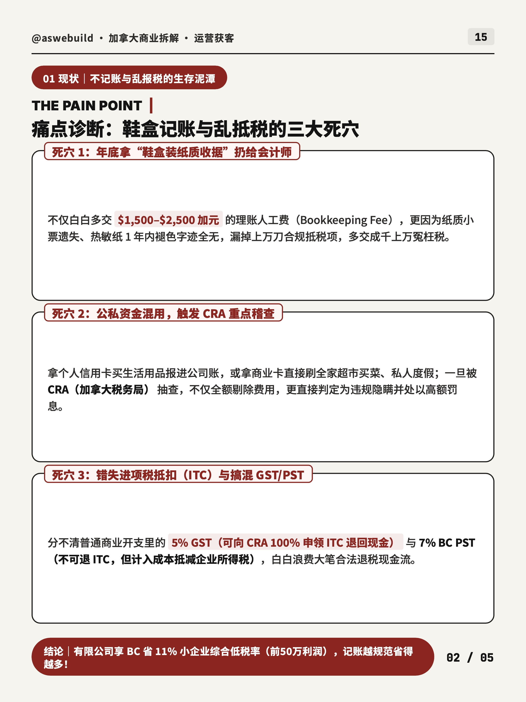
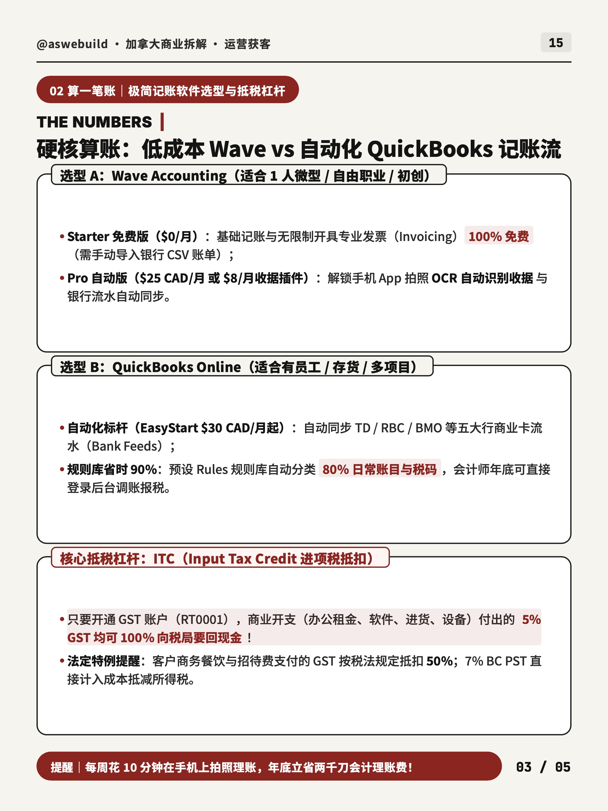
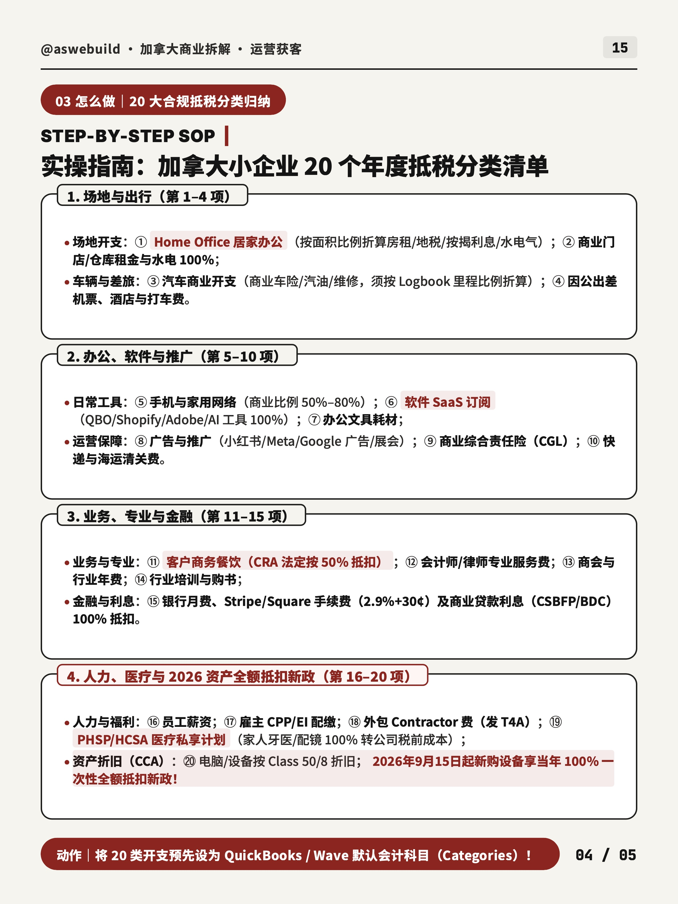
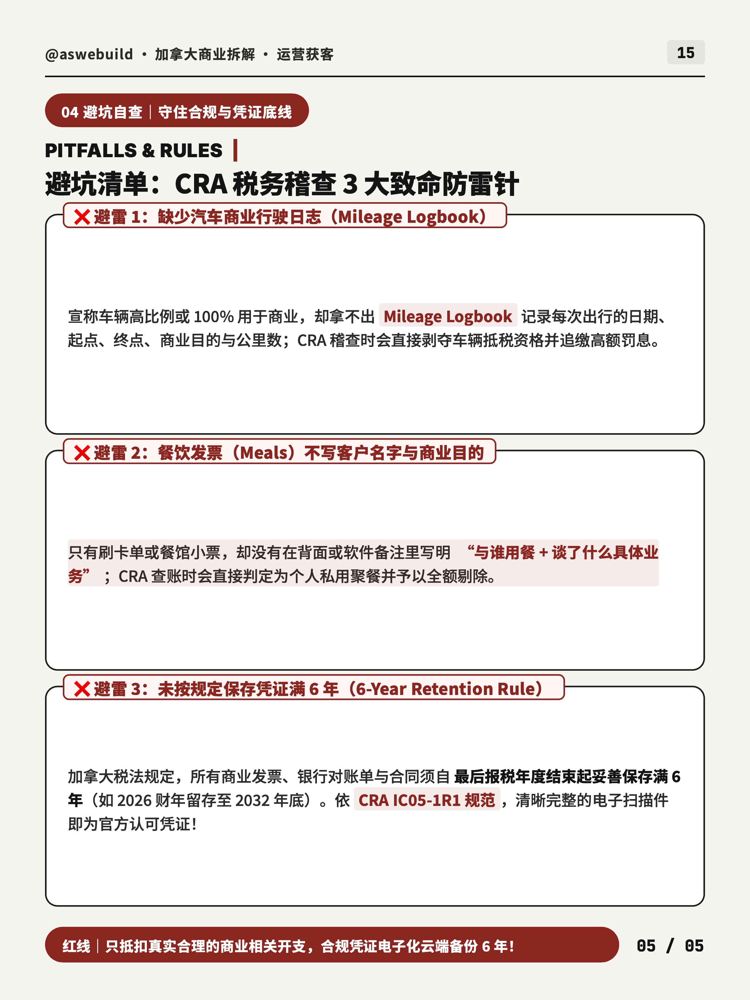

在大温做生意开公司，几乎所有华人老板在第一年都会经历的头疼时刻：年底报税季，翻箱倒柜把一整年装在鞋盒、塑料袋里的几百张纸质收据拿出来，交给会计师。
结果收到会计师的账单直接傻眼：因为账目混乱，光是帮你整理乱七八糟的收据，就收了 **$1,500–$2,500 加元** 的理账费（Bookkeeping Fee）；更糟的是，因为很多热敏纸收据在 1 年内字迹褪色、或者丢了小票，白白漏掉了上万刀的合规抵税项，多交了成千上万的冤枉税！

在加拿大做生意，懂记账、懂节税，就是直接给公司赚纯利润。加拿大针对加拿大居民控制的私营企业（CCPC），提供了极具竞争力的小企业税收优惠（[CRA Small Business Deduction 官方说明](https://www.canada.ca/en/revenue-agency/services/tax/businesses/topics/corporations/corporation-tax-rates.html)）：在 BC 省，只要你的年活跃营业利润在 **50 万加元** 以内，综合企业所得税率仅为 **11%（联邦 9% + BC 省 2%）** ！相比之下，2026 年 BC 省个人最高边际税率高达 **53.5%** 。

想要在加拿大合法合规地节税、把每一分冤枉税省下来？记住这份 **2026年10月最新校准的 QuickBooks/Wave 记账流与 20 个年度抵税分类 SOP** ：

### 01｜挑选最适合你的极简记账软件（2026 最新计费避坑）

千万不要再用 Excel 手动打字记账了！
* **Wave Accounting（适合 1 人微型小店 / 自由职业 / 零基础）** ： **Starter 基础版 $0/月** ，100% 免费支持无限制开具专业发票（Invoicing）与手动记账；若需手机拍照自动识别收据（OCR）与银行流水自动同步，可花 **$8/月** 加购收据插件或升级 **Pro 版（$25 CAD/月）** 。
* **QuickBooks Online（适合有员工 / 有进出口 / 存货管理的成长型公司）** ：基础版 **$30 CAD/月起** ，直接绑定 TD、RBC、BMO 等商业银行卡（Bank Feeds）。系统会自动抓取每一笔流水，并根据你设置的规则库（Rules）自动分类 **80% 的账目** ，把每周记账时间缩短到 10 分钟以内。

### 02｜必须掌握的硬核概念：进项税抵扣（ITC）与 GST/PST 区分

如果你注册了 GST 账号（RT0001）：
* 你为商业开支（办公租金、软件、进货、广告、设备）支付的所有 **联邦 GST（5%）** ，都可以在季度或年度申报时， **100% 向 CRA 申请抵扣或直接退还现金（[CRA Input Tax Credit 官方指南](https://www.canada.ca/en/revenue-agency/services/tax/businesses/topics/gst-hst-businesses/complete-file-input-tax-credit.html)）** ！（注：商务餐饮与招待费支付的 GST 按法定比例抵扣 50%）。
* **专业提醒** ：[BC 省的 7% PST（省销售税）](https://www2.gov.bc.ca/gov/content/taxes/sales-taxes/pst) 不能申请 ITC 退税，但可以直接计入你的商业采购成本，用来抵减公司 11% 的企业所得税！

### 03｜加拿大小企业 20 个年度合规抵税分类清单（含 2026.09 最新税改）

（完整可抵扣项标准可参考 [CRA Business Expenses 商业开支官方手册](https://www.canada.ca/en/revenue-agency/services/tax/businesses/topics/sole-proprietorships-partnerships/business-expenses.html)）

1. **Home Office 居家办公** ：若在家办公，按独立办公区占房屋总面积的比例，折算房租、地税、按揭利息（不含本金）、水电气与物业费（有限公司通过股东补贴报销入账）；
2. **商业租金与水电气** ：实体门店、仓库或办公室的租金与 Utilities，100% 税前抵扣；
3. **汽车商业开支** ：按商业行驶公里数比例，抵扣汽油费、商业车险、保养维修、洗车与租赁/折旧（必须配备 Mileage Logbook）；
4. **手机与家用网络** ：按商业使用比例（通常 50%–80%）折算手机月费与宽带网费；
5. **商务餐饮与招待（Meals & Entertainment）** ：与客户、供应商洽谈业务用餐，CRA 法定允许抵扣 **50%** （小票背面须注明客户姓名与商业目的）；
6. **软件与 SaaS 订阅** ：QuickBooks、Shopify、Adobe、Google Workspace、Zoom、AI 工具等，100% 税前扣除；
7. **广告与市场推广** ：小红书推广、Meta/Google 广告费、传单印刷、展会参展费，100% 扣除；
8. **专业服务费** ：CPA 会计师理账报税费、律师商业咨询与合同审查费，100% 扣除；
9. **办公文具与消耗品** ：打印纸、墨盒、包装材料、清洁用品等；
10. **商业保险** ：商业综合责任险（CGL）、商业财产险、高管责任险；
11. **员工薪资与法定配缴** ：发放给员工的工资，以及雇主强制配缴的 CPP（2026年为 5.95%）和 EI（员工费率的 1.4 倍）部分；
12. **外包与独立承包商（Contractors）** ：支付给外包团队或 Freelancer 的服务费（年度结账时出具 T4A）；
13. **商业出差与旅费** ：因公出差的机票、酒店住宿、Uber/出租车费；
14. **银行与刷卡手续费** ：商业账户月费、Wire 电汇费、Stripe/Square 刷卡手续费（2.9% + 30¢），100% 抵扣；
15. **商业贷款利息** ：CSBFP 政府担保贷款、BDC 贷款、商业信用额度（Line of Credit）产生的利息支出；
16. **行业协会与商会年费** ：如素里及白石商会、行业协会等会费支出；
17. **培训与专业提升** ：参加行业研讨会、商业培训课程、专业书籍费用；
18. **物流与快递费** ：Canada Post、UPS、FedEx 及跨境海运清关派送费；
19. **固定资产折旧（CCA）与 2026 全额抵扣新政** ：常规按 CRA 资产类目（如电脑 Class 50 按 55%、办公家具 Class 8 按 20%）折旧； **重磅红利：根据加拿大联邦 2026年9月14日最新生效的“生产力超级抵扣（Productivity Mega Deduction）”新政，2026年9月15日后新购入的合格商业设备与电脑，可在购入当年直接享受 100% 一次性全额抵扣！**
20. **私人医疗服务计划（PHSP / HCSA）** ：通过正规 PHSP 或医疗支出账户（HCSA）架构，把老板及家人的牙医、配镜、处方药等医疗开支，合规转化为公司的 100% 税前扣除成本，且个人无需交税！

### 04｜CRA 税务稽查 3 大防雷红线

* **不要公私混用** ：商业卡只刷生意开支，个人卡只刷个人消费，物理隔离最安全。
* **汽车 Logbook 必须要** ：用 App（如 MileIQ）或表格记录每次商业出行的日期、目的与公里数，这是 CRA 查车费的必看铁证。
* **发票凭证保存满 6 年** ：税法规定商业凭证须自报税年度结束起保存满 6 年（如 2026 财年留存至 2032 年底）。用 Wave 或 QuickBooks 随手拍照上传云端，符合 [CRA IC05-1R1 电子记录留存标准](https://www.canada.ca/en/revenue-agency/services/forms-publications/publications/ic05-1/electronic-record-keeping.html) 即可不怕热敏纸褪色！

做生意，不仅要学会抬头赚钱，更要学会低头记账。合规把税省下来，就是落进自己口袋的纯利润。

  
  
  
  

