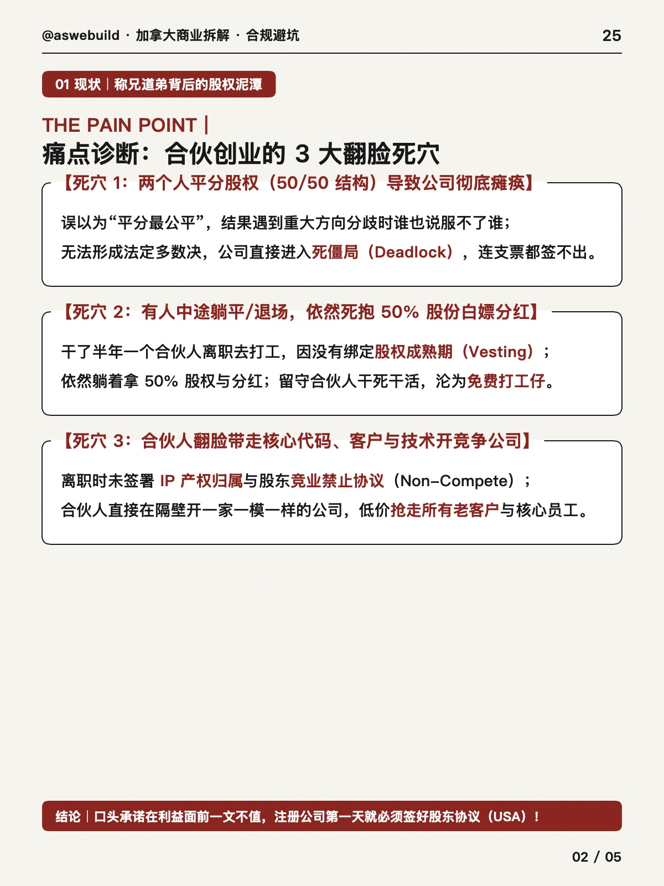
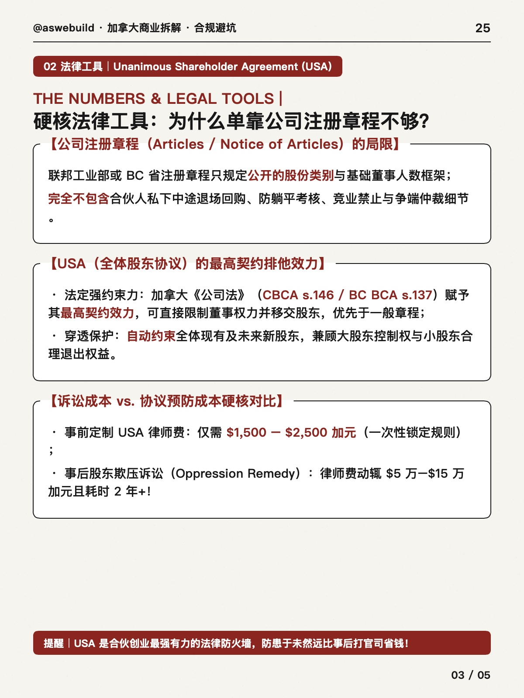
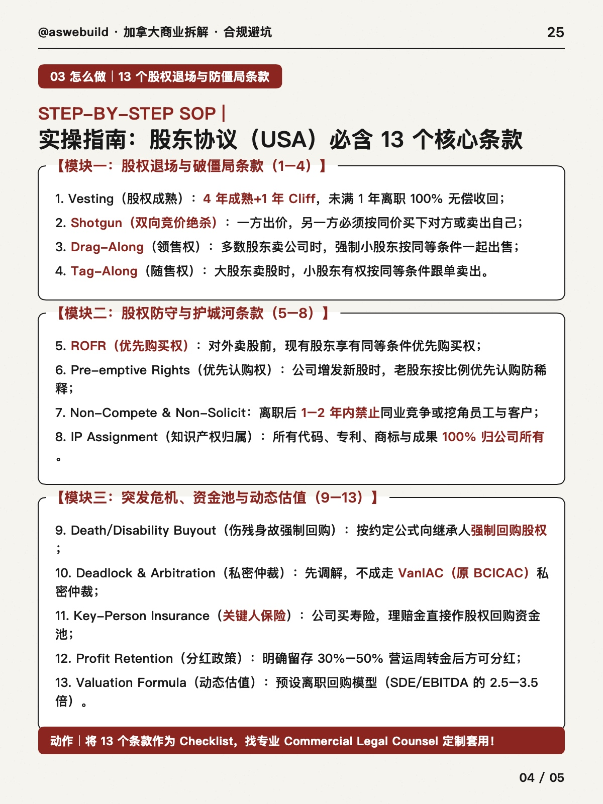
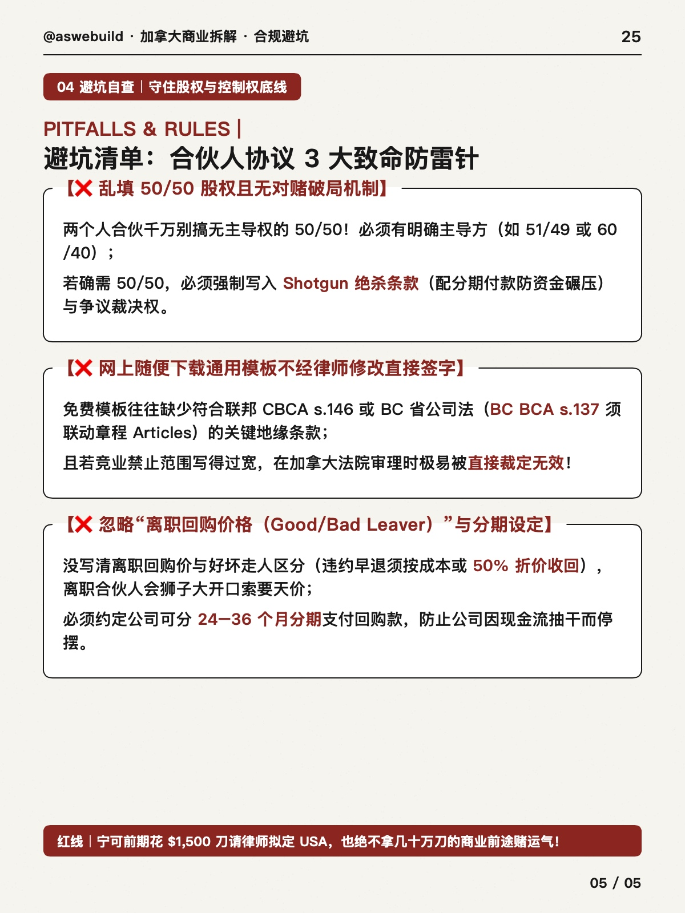

在大温合伙开公司，最痛心的死法往往不是没客户，而是合伙人翻脸扯皮，把赚钱的生意耗死在内耗里。
很多华人跟朋友合伙碍于“面子”不好意思谈退场，注册表直接填 50/50 平分。结果干了半年，一人嫌累跑去打工，留守的人熬夜把公司做盈利了，离职的人却回来要求分走 50% 利润，甚至卡死增资和签字权。你干死干活，别人躺着白嫖；找他协商，他拿法定股东身份卡死你。

在加拿大（无论联邦法 [CBCA 加拿大商业公司法](https://laws-lois.justice.gc.ca/eng/acts/c-44/) 还是 BC 省法 [BC BCA 商业公司法](https://www.bclaws.gov.bc.ca/civix/document/id/complete/statreg/02057_00)），普通注册章程（Articles）只管公开框架，完全不管中途退场、防躺平与竞业细节。想要守住底线，成立第一天就必须签好“商业婚前协议”—— **Unanimous Shareholder Agreement (USA / 全体股东协议)** 。

今天把股东协议（USA）必含的 **13 个保命条款** 一次性讲透：

### 01｜防“白嫖”与破僵局条款（1–4）

1. **Vesting Clause（股权动态成熟期）** ：绝不第一天就给满全部实股！设 **4 年成熟期 + 1 年 Cliff（崖山期）** 。干满 1 年才拿首个 25%，随后按月成熟 1/48；未满 1 年离职，股权 100% 无偿或按原价强制收回！
2. **Shotgun Clause（散弹枪双向竞价绝杀）** ：破解 50/50 僵局的核武器。A 出价买断 B 时，B 只有两个选择： **要么按此价把股卖给 A，要么按完全相同的单价买断 A** ！逼迫出价方给出公道价（建议配套 24 个月分期付款，防资金少的一方被恶意逼退）。
3. **Drag-Along（领售权）** ：大股东（如持股 ≥60%）决定整体卖公司时，强制小股东按同等价格条件跟售，防少数人卡死并购大单。
4. **Tag-Along（随售权）** ：大股东卖股套现时，小股东有权按比例同价“跟单”卖出，防被抛下。

### 02｜股权防守与优先权条款（5–8）

5. **Right of First Refusal (ROFR, 优先购买权)** ：股东对外转股前，老股东享同等条件优先购买权，防陌生人挤入公司。
6. **Pre-emptive Rights（优先认购权）** ：增发新股时老股东有权按比例优先认购，防恶意低价增发稀释。
7. **Non-Compete & Non-Solicitation（竞业与禁止招揽）** ：退股后 1–2 年内，禁止在大温等约定区域经营同类竞争业务，严禁挖角核心员工与老客户。
8. **IP Assignment（知识产权归属）** ：创业期间所有代码、配方、商标、域名与商业机密 100% 归公司所有，离职必须交出全部权限。

### 03｜危机预防与争议仲裁条款（9–13）

9. **Death / Disability Buyout（身故与伤残强制回购）** ：合伙人不幸身故或丧失劳动能力（以及离婚财产分割）时，公司按约定公式回购其股权，避免不懂业务的继承人或配偶强行介入。
10. **Key-Person Insurance（关键人寿险）** ：公司出资为合伙人买定期寿险，理赔金直接作股权回购资金池。
11. **Confidential Arbitration（僵局调解与秘密仲裁）** ：分歧先经 30 天内部调解；不成则直接交由 **[温哥华国际仲裁中心（VanIAC，原 BCICAC）](https://vaniac.org/)** 私密仲裁，一裁终局且 100% 保密，避免法庭公开诉讼毁掉商誉。
12. **Dividend & Profit Retention（分红与留存收益）** ：明确每年净利优先留存 30%–50% 作营运周转金（Working Capital），余钱方可分红。
13. **Valuation Formula（好坏走人动态估值）** ：预设回购公式（如 SDE 或 EBITDA 的 2.5–3.5 倍），并区分 **Good Leaver（公允价分期）** 与 **Bad Leaver（违约/早退按成本折价收回）** 。

### 04｜大温合伙防雷 3 条铁律

* **别搞裸 50/50 平分** ：必须设主导方（51/49 或 60/40），或强制绑定 Shotgun 条款。
* **别套免费模板** ：联邦公司靠 CBCA s.146 设 USA，而 BC 省公司必须依 BC BCA s.137 将协议与章程（Articles）联动修改才有效！
* **找 Corporate Lawyer 把关** ：花 $1,500–$2,500 加元请商业律师定制 USA，是合伙创业最划算的保命投资。

—— 先小人后君子，用严密的法律锁死最坏的可能，才能放手去赢最好的结果。

  
  
  
  

