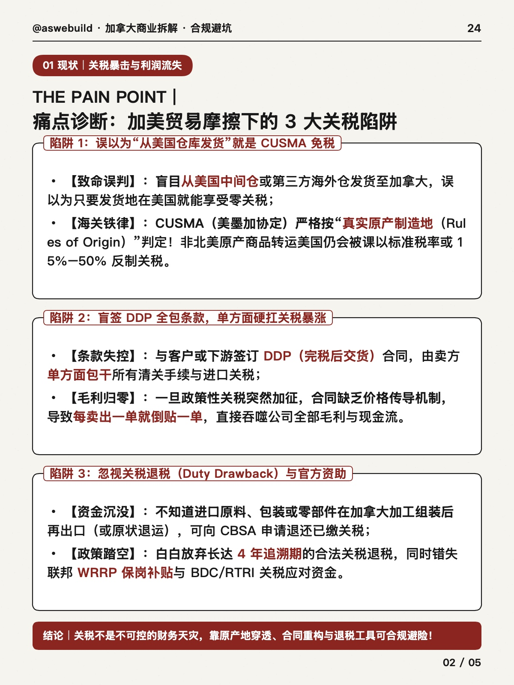
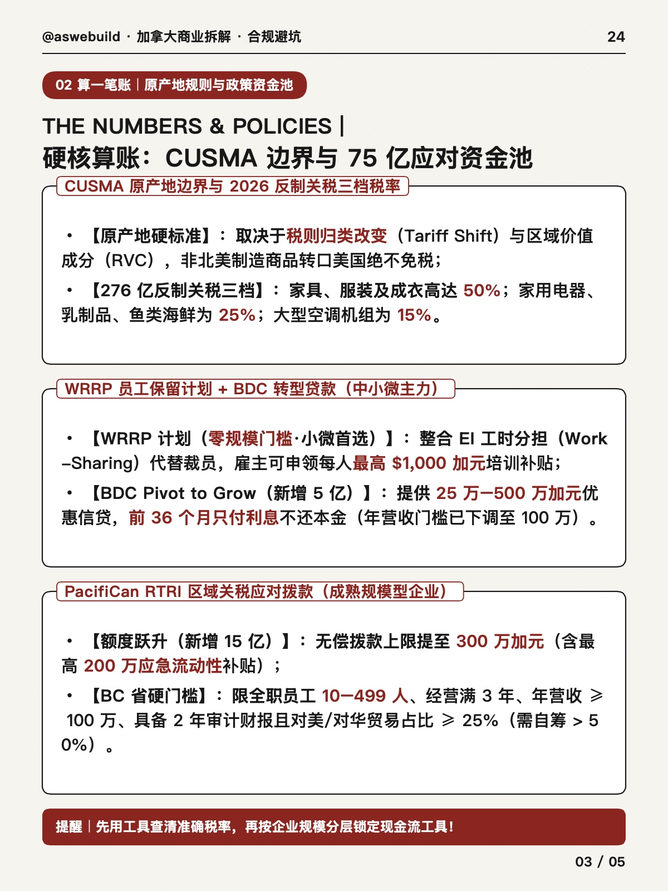
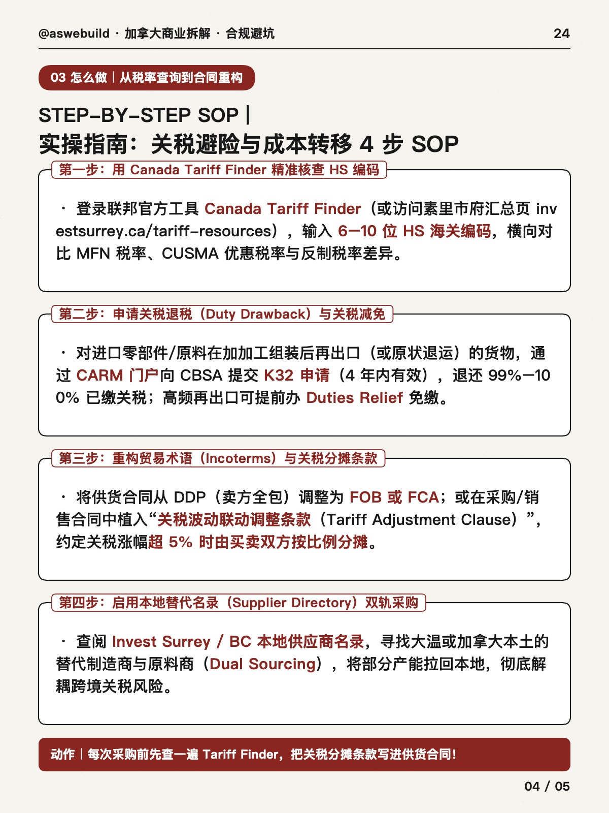
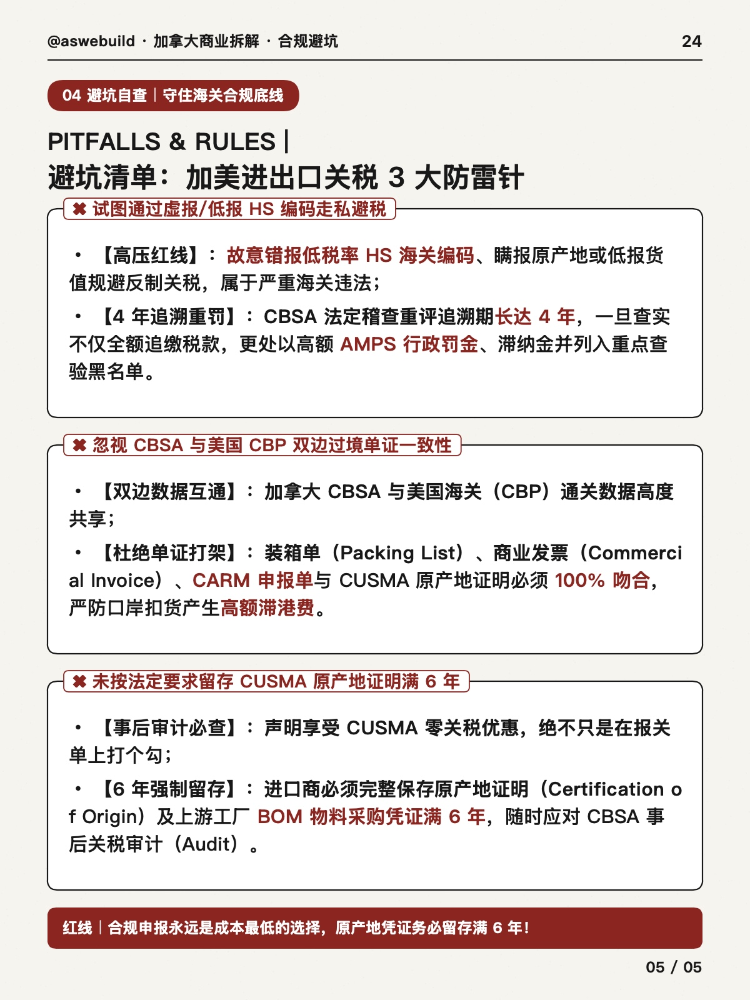

在加美贸易摩擦与反制关税频繁落地的当下，大温从事加美进出口、跨境电商、DTC 品牌或供应链采购的小生意老板，正面临严峻挑战：昨天还在正常盈利的产品，今天突然收到海关通知，被课以 **15%、25% 甚至高达 50%** 的反制关税（如家具、服装成衣达 50%，家电、海鲜乳制品达 25%）！微薄毛利瞬间被吃光，甚至每卖一单倒贴一单。

很多创业者遇到关税突袭，要么硬扛损耗，要么试图靠“错报编码”灰色避税，结果被 [CBSA（加拿大边境服务局）](https://www.cbsa-asfc.gc.ca/menu-eng.html) 稽查重罚。结合素里和白石商会（SWRBOT）联合报关机构 PCB Global 的合规实操与联邦政策，今天把 **Canada Tariff Finder 工具、4 步避险 SOP 与 75 亿救济包** 一次性拆透：

### 01｜破除误区：“从美国仓库发货”绝不等于免关税！

很多跨境卖家误以为“货从美国海外仓寄出就免关税”。真相是： **CUSMA（美墨加协定）严格按“真实原产制造地（Rules of Origin）”判定** ，而非发货地！中国或第三国制造的商品，若仅在美国仓库中转而未发生实质性税则改变（Tariff Shift）或达到区域价值成分（RVC），入境加拿大依然适用标准税率或高额反制关税。

### 02｜关税避险与成本转移 4 步实操 SOP

1. **用 [Canada Tariff Finder 官方工具](https://www.tariffinder.ca/) 精准核查 HS 编码** ：别轻信货代口头报价！登录联邦官方工具 Canada Tariff Finder（或访问素里市府汇总页 [investsurrey.ca/tariff-resources](https://investsurrey.ca/tariff-resources)），输入产品 HS 编码，横向比对 MFN 与 CUSMA 税率。海关编码哪怕只差最后两位，税率可能就是 0% 与 25% 的天壤之别！
2. **申请 [CBSA 关税退税（Duty Drawback）与减免（Duties Relief）](https://www.cbsa-asfc.gc.ca/import/ddr-red/menu-eng.html)** ：若你从国外进口原料/零件，在加拿大加工包装后再出口至美国或海外（或原状退运），可通过 [CARM 客户门户](https://ccp-pcc.cbsa-asfc.cloud-nuage.canada.ca/) 向 CBSA 申请 Duty Drawback（追溯期长达 **4 年** ），退还高达 **99%–100%** 已缴关税，直接释放现金流！
3. **重构贸易术语（Incoterms）与合同条款** ：切忌盲签 **DDP（卖方全包完税）** 合同一力承担关税暴涨风险！改签 **FOB / FCA** 条款；或在供货合同中植入 **“关税波动联动条款（Tariff Adjustment Clause）”** ，约定政策关税涨幅超 5% 时由买卖双方按比例分摊。
4. **启用本地供应商名录做双轨采购（Dual Sourcing）** ：查阅 [investsurrey.ca](https://investsurrey.ca/) 本地供应商名录，寻找大温或加拿大本土替代代工厂与原料商，把部分产能拉回本地，彻底解耦跨境关税风险。

### 03｜善用联邦 75 亿关税应对资金池（对号入座）

* **WRRP（员工保留与重训计划·小微首选）** ：唯一不限营业额与雇员规模！用 [Service Canada EI 工时分担（Work-Sharing）](https://www.canada.ca/en/employment-social-development/services/work-sharing.html) 代替裁员，每名员工还可申领最高 **$1,000** 培训补贴；
* **[BDC Pivot to Grow（+5亿贷款）](https://www.bdc.ca/)** ：提供 **25 万–500 万加元** 优惠信贷，前 **36 个月只付利息** （年营收门槛已下调至 100 万加元）；
* **[PacifiCan RTRI（+15亿拨款）](https://www.canada.ca/en/pacific-economic-development.html)** ：面向 BC 省受冲击企业（限 10–499 人、经营满 3 年、年入百万以上），最高提供 **300 万加元无偿拨款** （含最高 200 万流动性支持）。

**💡 合规红线与落地建议：** 今晚拿你销量最大的三款产品去 **Canada Tariff Finder** 核对一遍编码与税率，并在采购合同中补上关税调整条款。切记：CBSA 稽查追溯期长达 **4 年** ，所有 CUSMA 原产地证明与报关凭证必须完整留存 **6 年** ！

  
  
  
  

