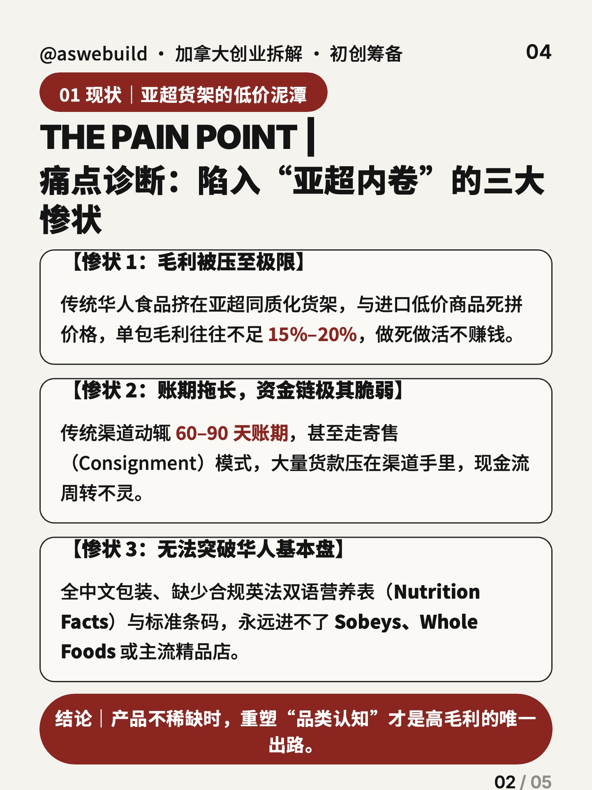
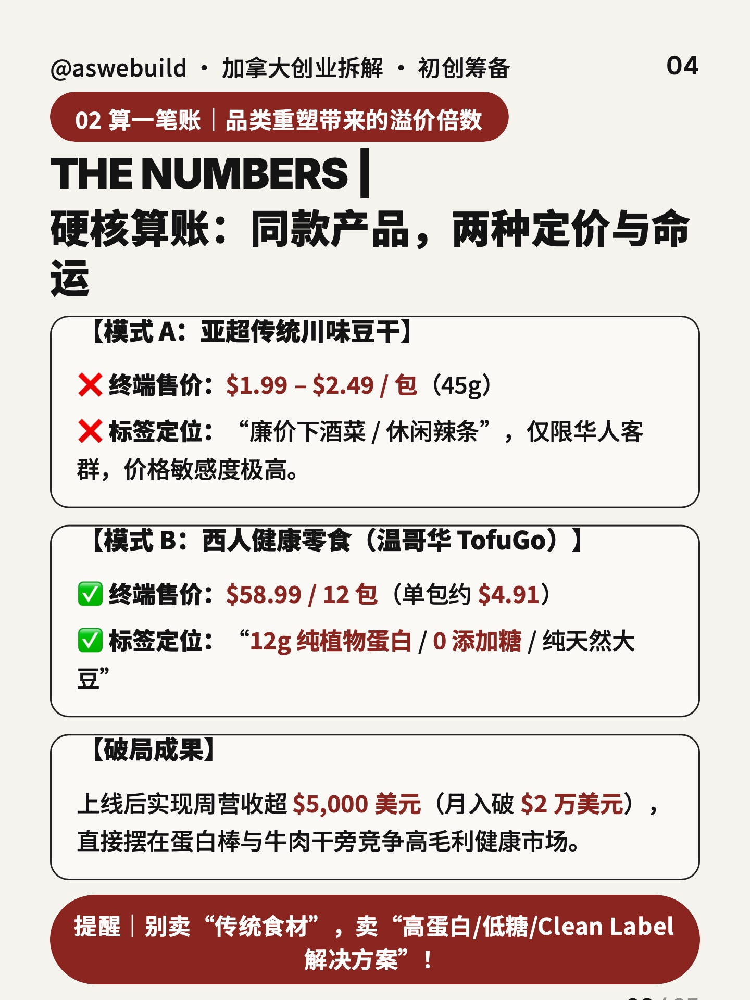
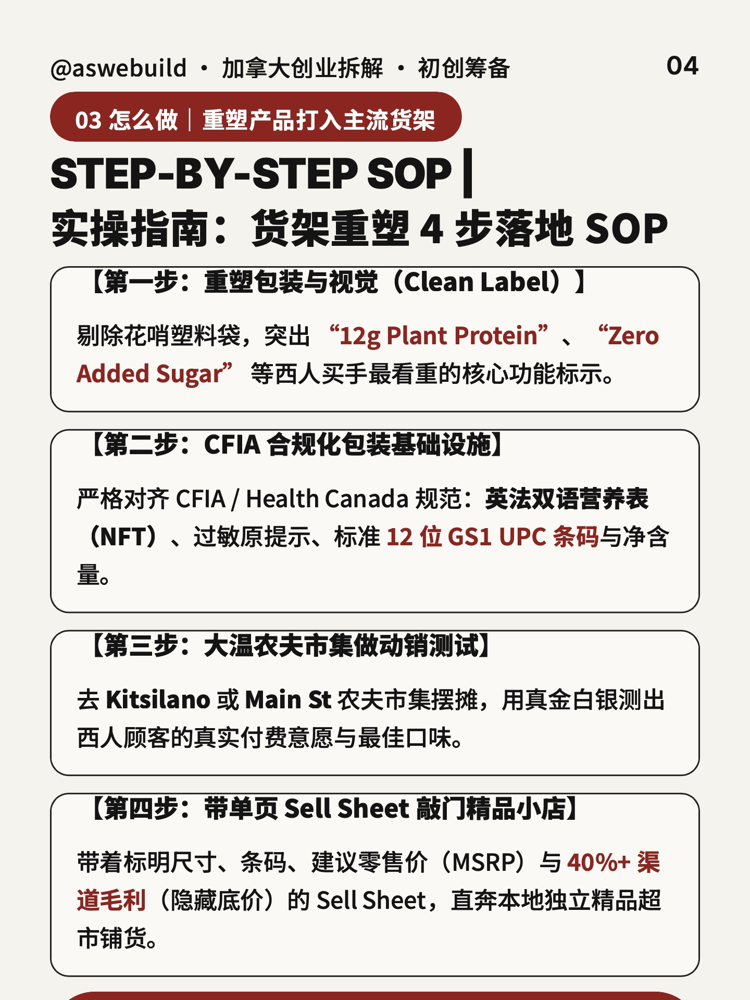
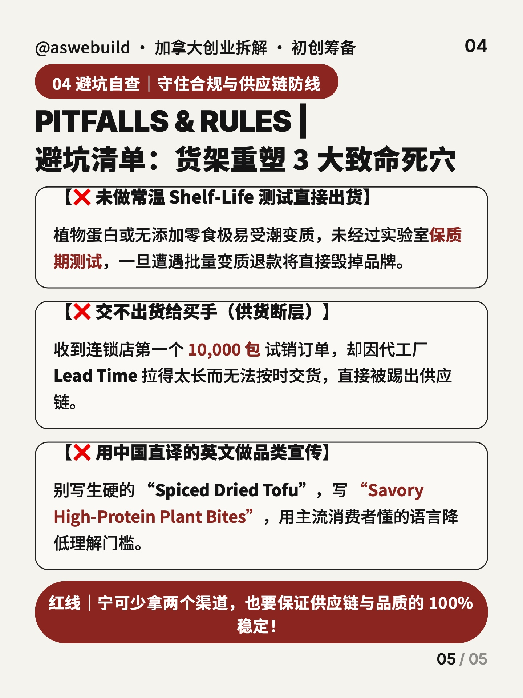

大温华人做食品创业，最容易走入的一个死胡同：
做了一款好吃的豆腐干、糕点或者特色小吃，第一反应就是拿到列治文或本拿比的亚超去寄售（Consignment）。
结果发现：同类竞品十几样，大家都在拼 $1.99 打折；商家账期动辄拖上 60–90 天；算下来扣除人工和货损，单包毛利不到 15%，不仅不赚钱，还累得半死。

为什么同一种东西，换个货架和包装，就能卖出 2–3 倍的溢价？

### 01｜跳出“传统华人口味”，重塑西人健康品类认知

我们案例库里两个大温本土食品品牌就是绝佳教材：
* **TofuGo（温哥华豆干品牌）** ：本质就是传统中式豆干，但它彻底去掉了中式“下酒菜/辣条”的廉价标签，包装上醒目主打 **“12g 纯植物蛋白（Plant Protein）/ 低糖 / 无添加”** ，直接摆进健身健康零食货架，12 盒装定价高达 $58.99 美元，周营收突破 $5,000 美元；
* **SmartSweets（温哥华创始人 Tara Bosch）** ：把传统糖果重构为“低糖高纤维健康糖果（Kick Sugar）”，最终以 3.6 亿加元估值被收购。

### 02｜合规基础设施一次性到位

别用简易手写贴纸！想进主流渠道，必须严格对齐 [加拿大食品检验局（CFIA）食品标签官方标准](https://inspection.canada.ca/en/food-labels/labelling) 与 [加拿大卫生部（Health Canada）营养标签法规](https://www.canada.ca/en/health-canada/services/food-nutrition/food-labelling/nutrition-labelling.html)：
* 规范的 **英法双语 Nutrition Facts 营养成分表** （含每日摄入百分比 % DV）与双语配料表；
* 醒目的过敏原单独标注（Allergen Alert，如大豆 Soy、坚果、麸质等）；
* 官方 GS1 注册的北美通用 **12 位 UPC 条形码** 与公制净含量；
* 出货前务必完成实验室 **常温保质期测试（Shelf-Life Test）** ，守住品质红线。

### 03｜去大温 Farmers Market 做真实动销测试

别光听亲戚朋友客套说“好吃”。先去 Kitsilano、Main Street 或 Trout Lake 的农夫市集摆摊。看陌生西人愿不愿意掏 $5–$8 块钱真金白银买一包，现场观察他们第一眼看到包装的反应，顺便扫码沉淀第一批铁粉 Email 与 Ins 名单。

### 04｜带着有数据支撑的 Sell Sheet 去跑店

制作一页正反面的专业 **Sell Sheet（产品推介单）** ：列明产品卖点、外箱物理尺寸、单箱规格（Case Pack）、12 位 UPC 条码、常温保质期、建议零售价（MSRP）以及预留给渠道的 **40%+ 毛利空间** （注意：隐藏工厂底价，具体批发折扣视门店体量单独谈）。先去温哥华本地 20 家独立精品超市（Specialty Stores）试销，跑出漂亮的终端售罄率（Sell-through Rate）和复购数据，再拿着真实账本去敲 Whole Foods、Sobeys 或 London Drugs 大买手的门！

—— 同样一块豆干，放在亚超冷柜里和放在主流超市的蛋白棒旁边，是两门完全不同的生意。

我们尝试用600多篇这里创作的内容，对新的政策和变化进行整理，做一个加拿大/大温华人创业拆解的图文指南，这里是 **企业初创与架构筹备篇。**

  
  
  
  

