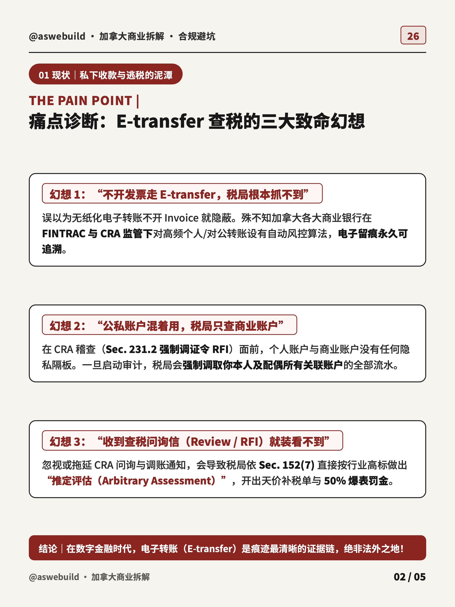
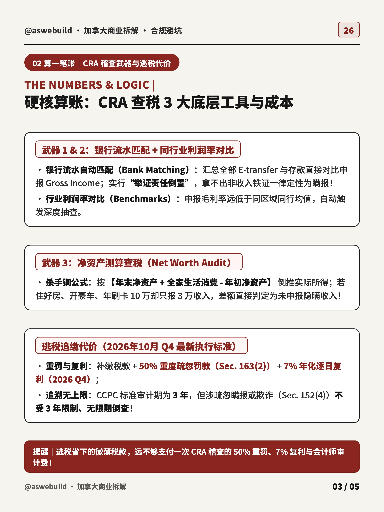
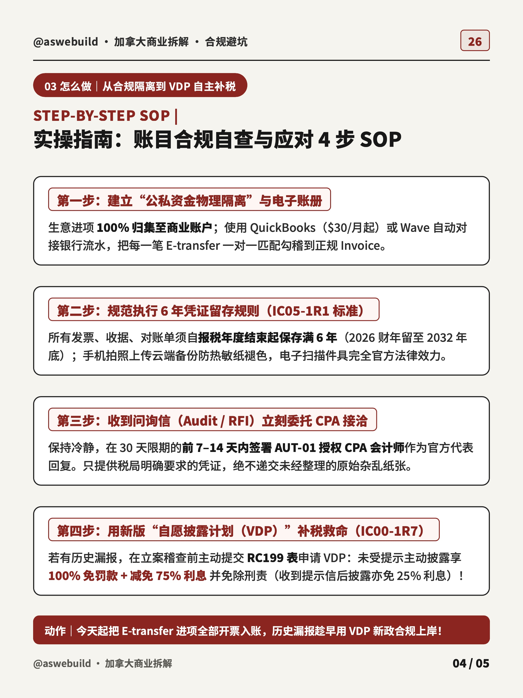
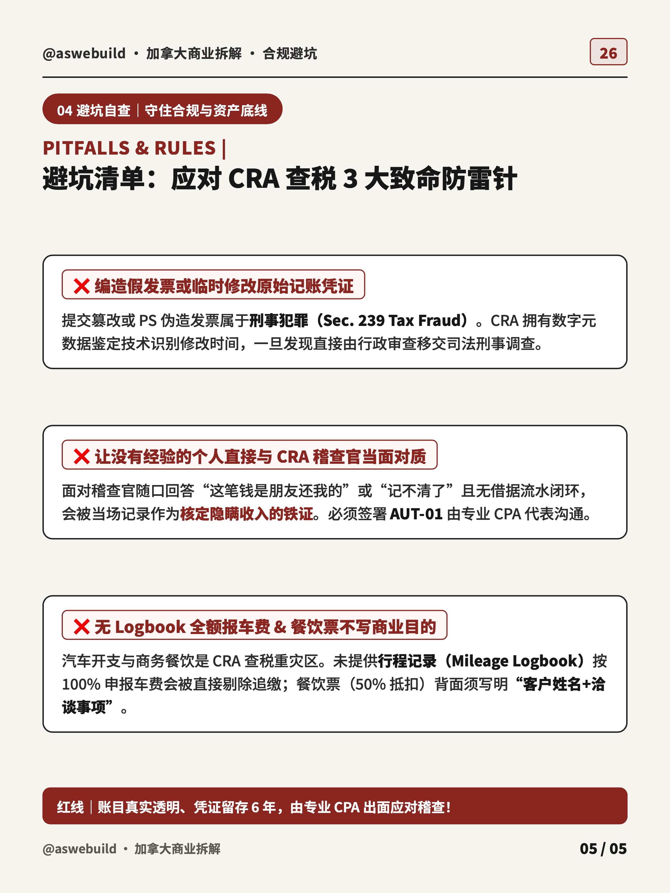

在大温做生意开小店（无论是餐饮外卖、美业、清洁装修，还是 B2B 贸易与私域卖货），很多华人老板心里都有一个极其危险的误区：“只要不开 Invoice，让客户走 Interac E-transfer 转到我个人卡里，加拿大税务局（CRA）就绝对查不到！”

如果你还抱着这种心态，你正坐在一颗随时引爆的“税务地雷”上。在大数据与反洗钱（[FINTRAC 加拿大金融交易与报告分析中心](https://fintrac-canafe.canada.ca/)）联网监管的今天， **E-transfer 是痕迹最清晰、证据最确凿的电子资金链，绝非避税天堂！** 一旦个人卡高频收到不同姓名转账，或公司申报营收与银行流水严重背离，风控系统会直接触发合规警报。

今天结合 **2026年10月 [CRA 商业税务稽查官方规则](https://www.canada.ca/en/revenue-agency/services/tax/businesses/topics/changes-your-business/business-audits.html) 与 VDP 新政** ，把查税底层逻辑与自查 SOP 一次性讲透：

### 01｜拆解 CRA 查税的三大核武器

1. **银行流水直接匹配（Bank Matching）** ：一旦开启审计，CRA 会依《所得税法》第 231.2 条发出强制调证令（RFI），调取你、商业实体甚至配偶名下所有银行对账单，汇总全部 E-transfer 与存款对比 T1/T2 申报营收。因为税务稽查实行“举证责任倒置”，多出的每一笔转账若拿不出非收入铁证（如正规借据与还款闭环），一律定性为隐瞒收入！
2. **行业毛利率异常比对（Industry Benchmarks）** ：CRA 握有各行业各邮编区域的平均毛利率与费用率数据库。若大温同行平均毛利率 35%，你只报 10%，系统会自动标记并触发深度抽查。
3. **净资产测算查税（Net Worth Audit）** ：针对现金与电子转账密集行业的杀手锏。哪怕你报税年入仅 3 万加元，却住大温好房、开豪车、全家信用卡年刷 10 万，CRA 无需查单笔交易，直接用 **【年末净资产 + 全家生活消费 - 年初净资产】** 倒推真实所得，差额直接按推定评估（Sec. 152(7)）开出天价税单！

### 02｜逃税的代价：50% 重罚 + 7% 复利 + 无限期倒查

* **爆表罚息** ：除补缴全额所得税与 GST/PST 外，加收 **50% 重度疏忽罚款（Sec. 163(2)）** ，外加按 **[CRA 2026年 Q4 最新法定利率](https://www.canada.ca/en/revenue-agency/services/tax/prescribed-interest-rates.html) 7% 逐日计算复利** ！
* **无限期追溯** ：小企业（CCPC）标准审计窗口虽为 **3 年** ，但凡涉及疏忽瞒报或欺诈（Sec. 152(4)），CRA 不受 3 年限制，可随时倒查 6 至 10 年！

### 03｜账目合规自查与稽查应对 4 步 SOP

1. **公私物理隔离** ：生意第一天起绝不用个人卡收商业款！全部进项归集至商业户（如 RBC/TD $6/月基础户），用 QuickBooks 或 Wave 将每笔 E-transfer 与 Invoice 一对一勾稽。
2. **凭证电子化留存 6 年（[CRA IC05-1R1 电子记录留存指南](https://www.canada.ca/en/revenue-agency/services/forms-publications/publications/ic05-1/electronic-record-keeping.html)）** ：所有发票、小票、对账单须自报税年度结束起保存满 **6 年** （2026 财年须留至 2032 年底），用手机拍照上传云端防热敏纸褪色，具备完全法律效力。
3. **收到查税信（Audit / RFI）立刻找 CPA** ：切勿装看不见或自行致电乱解释！在 30 天回复期的前 7–14 天内，签署 **AUT-01** 授权 CPA 会计师全权接洽，只交要求文件，绝不交未整理的杂乱原件。
4. **善用 [CRA VDP 自愿披露计划（IC00-1R7）](https://www.canada.ca/en/revenue-agency/programs/about-canada-revenue-agency-cra/compliance/voluntary-disclosures-program.html) 补税救命** ：若有历史漏报且尚未被立案 Audit，主动提交 **RC199 表** 申请 VDP。按现行新规，主动披露可获 **100% 免除罚款 + 减免 75% 欠税利息** 并免除刑责（即便收到 CRA 提示信后披露，亦可免罚并减免 25% 利息）！

### 04｜3 大防雷红线

* **严禁伪造发票** ：提交篡改凭证属刑事欺诈（Sec. 239），直接升级刑事调查；
* **车费必配 Logbook** ：无里程记录（如 MileIQ）的汽车费用会被 100% 剔除；
* **餐饮票背面写备注** ：商务餐饮（50% 抵扣）小票随手注明“客户姓名+洽谈事项”。

—— 做生意，账目清爽是走得远的前提。坦坦荡荡赚有尊严的利润，合规守住资产。

  
  
  
  

