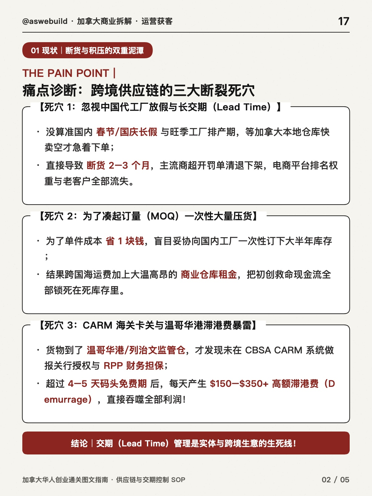
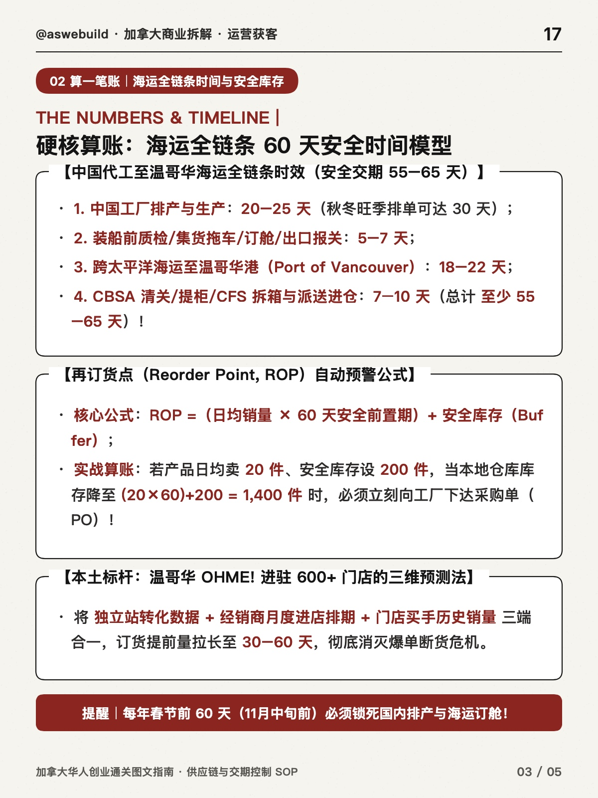
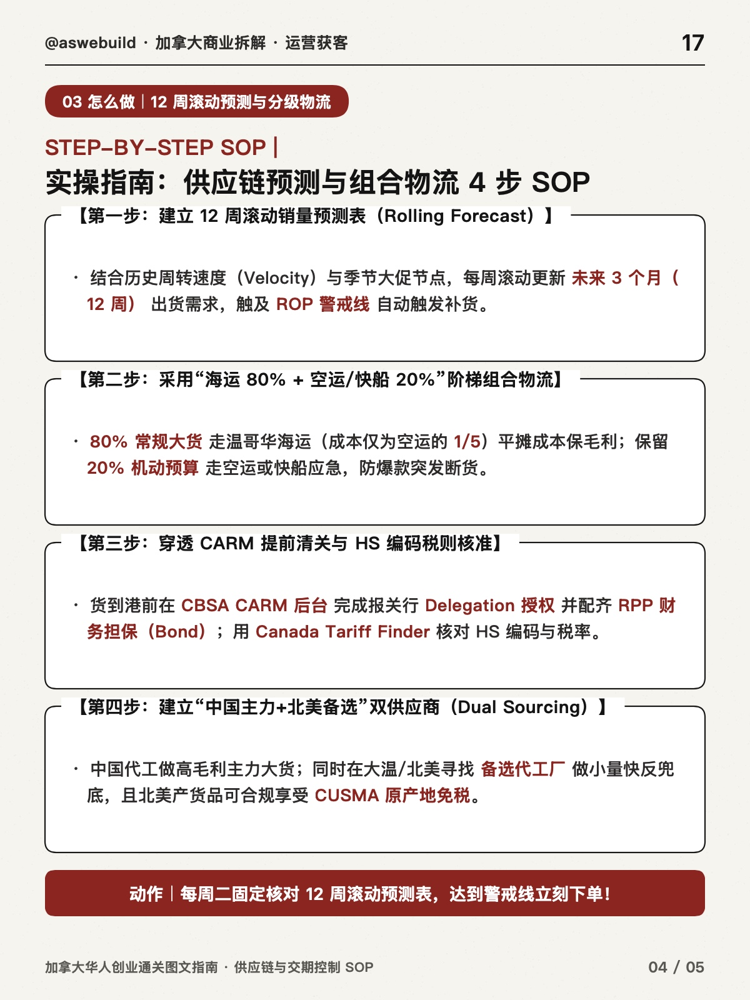
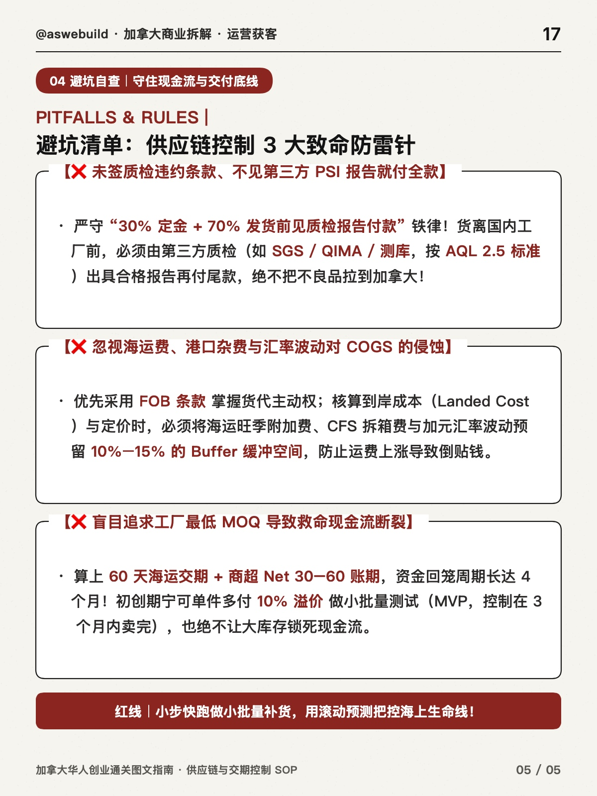

在大温做消费品、品牌 DTC、实体零售或亚马逊跨境的华人创业者，最怕遇到的两个极端惨剧：
一个是 **“货在海上漂，店里断了货”** ——爆款卖爆了，或者好不容易接到了主流商超的试销大单，结果中国代工厂放长假、或者货柜卡在温哥华港清不了关，断货整整两个月，商超直接开罚单下架，电商权重和老客户全部流失；
另一个是 **“货全堆在列治文仓库里，资金链直接断裂”** ——为了凑国内工厂的最低起订量（MOQ），贪图单件便宜 1 块钱订了几千件现货，结果运到温哥华后周转不动，昂贵的仓库租金天天在烧，救命钱全部卡死在死库存里。

对于实体和跨境生意来说， **供应链的交期管理（Lead Time Control）就是决定生死的生命线** 。在加拿大做进出口，从中国代工厂备料生产，到货物最终送进温哥华/列治文的仓库，远不是“寄个国际快递”那么简单。

今天结合大温本土进驻 600+ 门店的品牌实战经验与 2026 加拿大海关最新规，把 **中国代工+加拿大海运清关全链条 60 天时间模型与 12 周滚动预测 SOP** 一次性讲透：

### 01｜必须搞懂的海运全链条 60 天安全时间模型

很多新手算交期只算海运在海上漂的十几天，结果每次都严重延误。在真实的跨境物流中，完整的安全前置期（Lead Time）包含 4 个刚性阶段：
1. **中国工厂备料与排产** ：20–25 天（若遇秋冬季旺季或包材定制，常拉长至 30–35 天）；
2. **装船前质检 / 集货拖车 / 订舱 / 中国出口报关** ：5–7 天；
3. **跨太平洋海运至温哥华港（Port of Vancouver）** ：直航船约 14–18 天，加上装卸靠泊总计 18–22 天；
4. **[加拿大海关（CBSA）](https://www.cbsa-asfc.gc.ca/menu-eng.html) 清关 / 提柜 / CFS 监管仓拆箱派送** ：7–10 天（若走 LCL 海运拼箱，拆箱排队耗时更需留足余量）。
加起来，从你给工厂下达 PO（采购单）到货物真正入库上架， **安全交货前置期至少需要 55–65 天！**

**⚠️ 春节锁仓特别预警** ：以即将到来的 2027 年春节（2月6日）为例，国内工厂普遍在 1 月中下旬就会提前停工，且节前海运舱位暴涨。如果你不在 **11 月中下旬（春节前 60–75 天）** 锁死排产和船期，你的货至少要拖到来年 3 月底才能在温哥华上架！

### 02｜再订货点（ROP）计算：用公式消灭断货

千万不要等仓库只剩最后几箱货了才去联系工厂！你需要建立一个自动触发的 **再订货点（Reorder Point, ROP）** 预警机制：
> **ROP =（日均销量 × 60 天安全交期）+ 安全库存（Buffer）**

**举个例子** ：如果你的核心单品每天卖 20 件，安全缓冲库存设为 200 件，那么当本地仓库库存降到 `(20 × 60) + 200 = 1,400 件` 时，你的表格必须立刻亮红灯，自动触发向工厂下达下一批补货单的指令！

### 03｜掌控跨境供应链的 4 步落地 SOP

* **第一步：建立 12 周滚动销量预测表（12-Week Rolling Forecast）**
  借鉴大温本土品牌 OHME! 进驻 600+ 门店的预测打法——把预测拆成三块： **独立站靠订阅与促销增幅推算、经销商每月开会对齐进店计划、实体店直接找买手核对品类历史数据** 。在 Excel 或 Airtable 建表，每周二滚动更新未来 12 周出货量，动态调整订货节奏。
* **第二步：配置“80% 海运 + 20% 空运/快船”阶梯物流**
  80% 的常规主力大货提前 60 天走温哥华海运（海运成本仅为空运的 1/5 左右），死守产品毛利率；同时预留 20% 的机动预算走空运或美西快船。一旦前端出现超预期爆单，立刻发 20% 空运先顶住 2 周货架不断货，后续海运大货无缝接棒。
* **第三步：穿透 2026 加拿大 CARM 清关与 RPP 担保新规**
  加拿大海关已全面强制执行 [CBSA CARM Client Portal 系统](https://ccp-pcc.cbsa-asfc.cloud-nuage.canada.ca/)，且 RPP（先放行后付税）宽限期早已结束！货物离港前，务必确认已在 CARM Client Portal 绑定 RM0001 进口号、给报关行完成 **Delegation 授权** ，并配齐 **RPP 财务担保（购买最低 $5,000 海关 Bond 或充值保证金）** 。同时用官方 **[Canada Tariff Finder 加拿大关税查询工具](https://www.tariffinder.ca/)** 核准 HS 编码。切记：温哥华港免费堆存期仅 4–5 天，一旦卡关每天将产生 **$150–$350+ 加元的滞港费（Demurrage）** ！
* **第四步：建立“中国主力 + 北美备选”双供应商机制（Dual Sourcing）**
  关键单品不要 100% 绑死在单一工厂。主力高毛利大货走中国代工降低 COGS；同时利用本地商会名录（如 [Invest Surrey 素里市府商业资源库](https://investsurrey.ca/)）在加拿大或北美寻找备选代工厂，既能在国际物流中断时做小批量快反兜底，还能合规享受 CUSMA（美墨加协定）原产地免税。

### 04｜质检付款与现金流避坑红线

* **70% 尾款必须见第三方质检报告（PSI）再付** ：坚持 **30% 定金 + 70% 发货前见质检报告付款** 。货离工厂前，花 $200–$300 刀请第三方机构（如 SGS / QIMA / 测库）按国际 **AQL 2.5 标准** 到厂抽检。把瑕疵品消灭在国内出厂前，绝不要等运到加拿大再退换！
* **定价预留 10%–15% 运费汇率缓冲垫，拒绝盲目大 MOQ** ：海运附加费与汇率随时波动，核算 Landed Cost（到岸成本）时务必预留 10%–15% Buffer。初创期算上海运 60 天和商超 Net 30–60 账期，资金周转长达 4 个月，宁可单件多付 10% 做小批量（MVP），也绝不让大库存拖垮现金流。

**💡 今晚实操落地建议：** 今晚打开你的库存表，算一下你的前三大主力单品按 **60 天全链条交期** 反推，现在的库存还能撑几天？把 ROP 警戒线公式填进表格里，把供应链的生死主动权牢牢抓在自己手里。

—— 做实体生意，控得住供应链，才守得住现金流。

  
  
  
  

