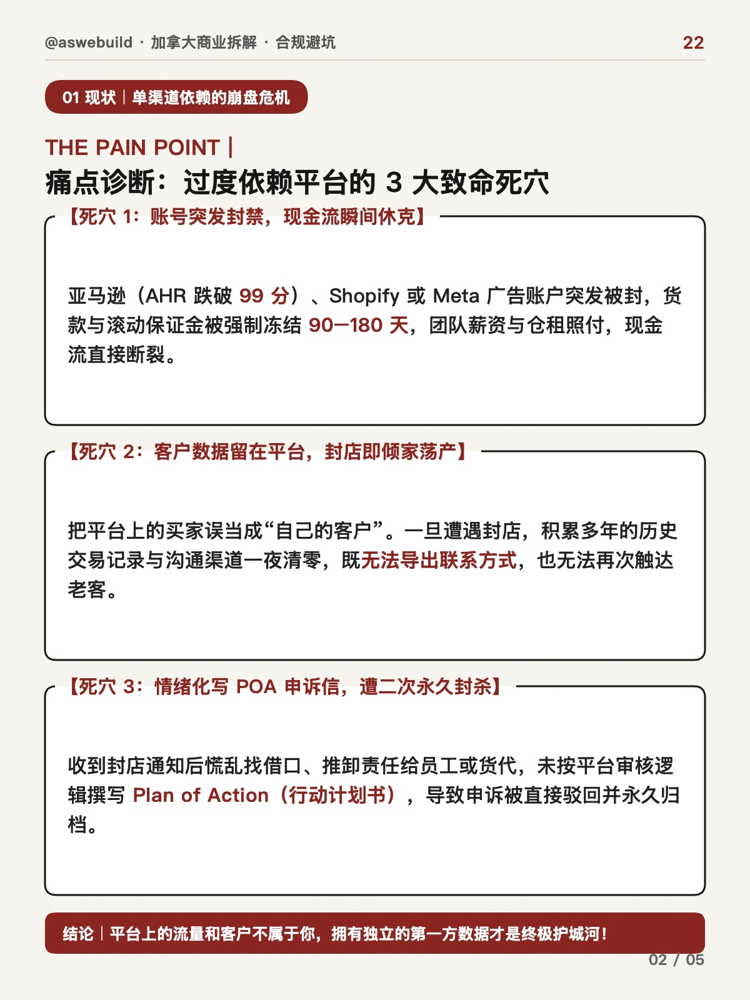
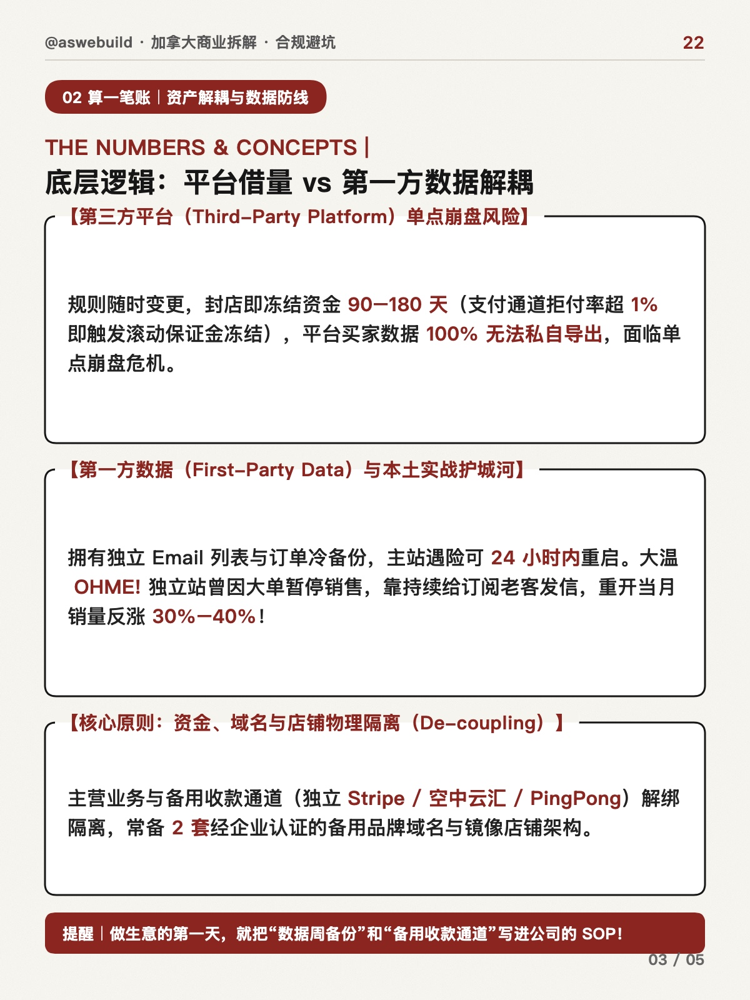
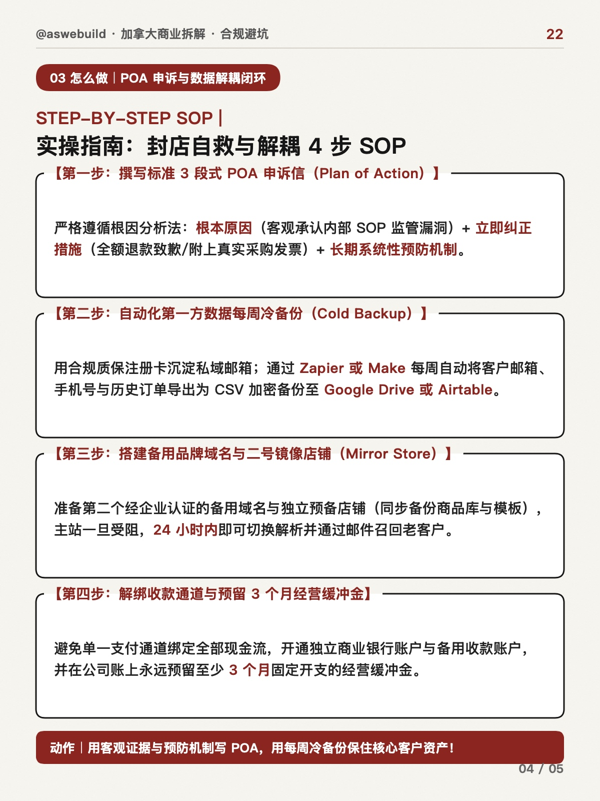
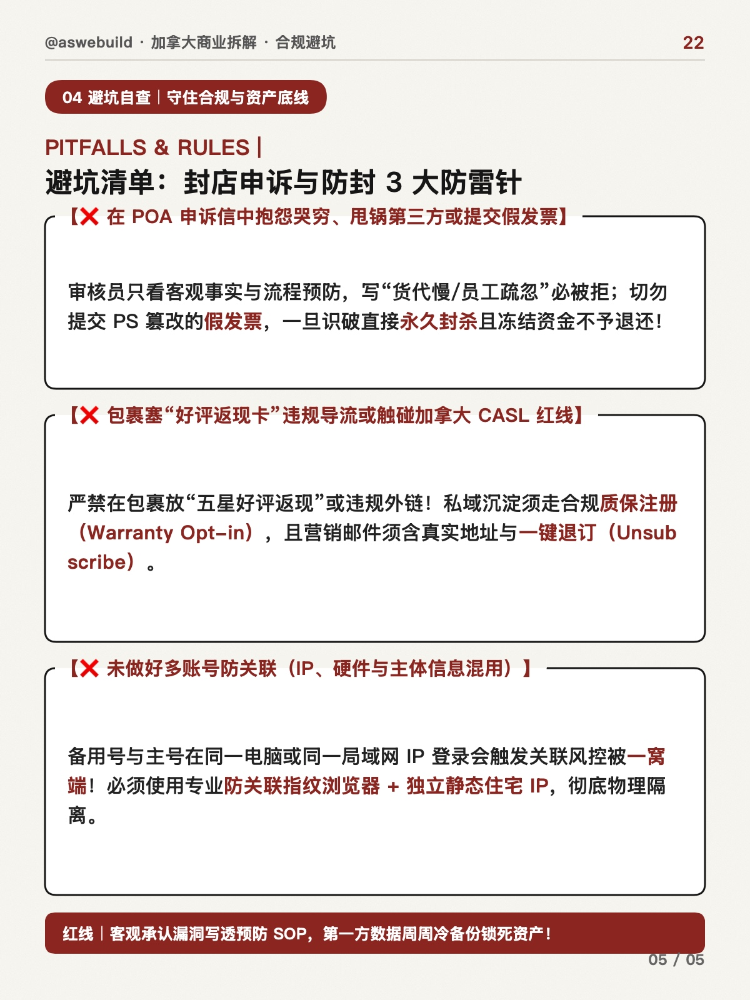

在大温做跨境电商、亚马逊、Shopify 独立站或 Meta 广告投流的华人创业者，最噩梦的场景莫过于：早上打开电脑，收到一封封店通知邮件。主账号被停用、广告户被封，最要命的是，几万甚至十几万刀货款被平台强制冻结 90 到 180 天！团队薪资要发、仓库租金要交、工厂货款要结，现金流瞬间休克。

在北美做电商，最大的隐形风险，就是把所有资产和客户 100% 押在第三方平台上。只要客户联系方式还在平台数据库里、没有沉淀为你自己的 **第一方数据（First-Party Data）** ，这些客户就永远不属于你。我们案例库里大温本土品牌 **OHME! 冻干零食** ，曾因赶制 12 万大单被迫暂停官方独立站销售，但创始人通过订阅邮件持续与老客保持沟通，网店重开当月不仅没流失客户，销量反而暴涨 30%–40%！

想在平台高压风控下建立安全网并快速自救？收好这套 **POA 申诉与资产解耦 SOP** ：

### 01｜撰写能过审的标准 3 段式 POA（Plan of Action）

当亚马逊账户状况评级（AHR）跌破 99 分或突发被封时，千万别写几千字抱怨信哭穷或甩锅！绩效审核团队只认符合根因分析法（Root Cause Analysis）的 3 段式结构：
1. **根本原因（Root Cause）** ：客观承认内部漏洞，别甩锅货代或员工！例如写：“因内部订单追踪 SOP 缺失，导致未能在发货后 24 小时内上传有效单号”；
2. **立即纠正措施（Immediate Action）** ：说明已完成的补救（如：已对受影响的 12 位客户全额退款致歉、已下架问题批次并附上真实采购发票与授权链路）；
3. **长期系统性预防机制（Systemic Prevention）** ：给出量化升级方案（如：已接入 ERP API 自动同步物流单号、建立双人核对机制，确保 100% 不再复发）。

### 02｜建立第一方数据每周自动冷备份

* **合规导流沉淀** ：切勿在亚马逊包裹塞“好评返现卡”！改用合规的延长质保注册卡（Warranty Registration）或品牌私域专栏订阅，并严格遵守 [加拿大 CASL 反垃圾邮件法](https://ised-isde.canada.ca/site/canada-anti-spam-legislation/en)（取得用户 Opt-in 同意并保留一键退订）及 [PIPEDA 联邦隐私保护法](https://www.priv.gc.ca/en/privacy-topics/privacy-laws-in-canada/the-personal-information-protection-and-electronic-documents-act-pipeda/)；
* **每周自动化冷备份** ：用 Zapier 或 Make，每周自动将独立站客户邮箱、电话与订单导出为 CSV 加密备份至 Google Drive 或 Airtable。只要手握 Email 列表，哪怕主店关停，也能在 24 小时内发信唤醒老客重启炉灶！

### 03｜实现资金、域名与店铺的“物理隔离（De-coupling）”

* **备用域名与镜像店（Mirror Store）** ：常备第二个经企业认证的品牌域名与预备店铺，定期备份商品库与模板，随时承接私域流量；
* **收款通道解绑与缓冲金** ：拒绝把所有流水绑在单一通道上（防范拒付率超 1% 触发 20% 滚动保证金冻结）。保持主通道与备用通道（独立 Stripe / 空中云汇 / PingPong）解绑，账上常备 **3 个月经营缓冲金** 。

### 04｜严守多账号防关联（Anti-Association）红线

备用账号绝不能与主号在同一电脑或同一 Wi-Fi 登录！必须使用专业防关联指纹浏览器搭配 **独立静态住宅代理 IP** ，做到网络、信用卡、公司主体与收款账户的彻底隔离。

**💡 实操落地建议：** 今天下午花半小时，把你的客户邮箱列表导出冷备份一次。学会解耦与备份，把命运牢牢握在自己手里！

  
  
  
  

