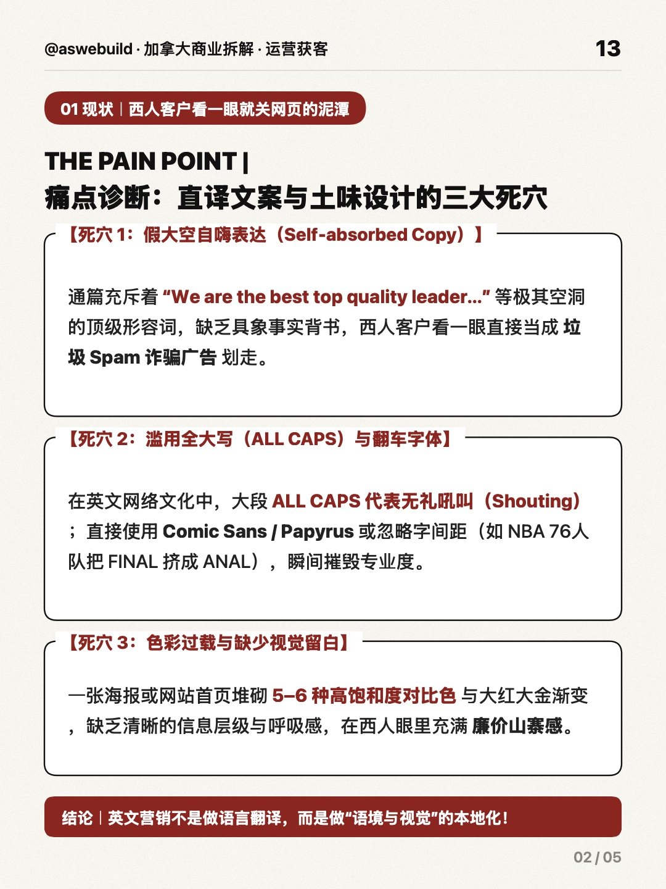
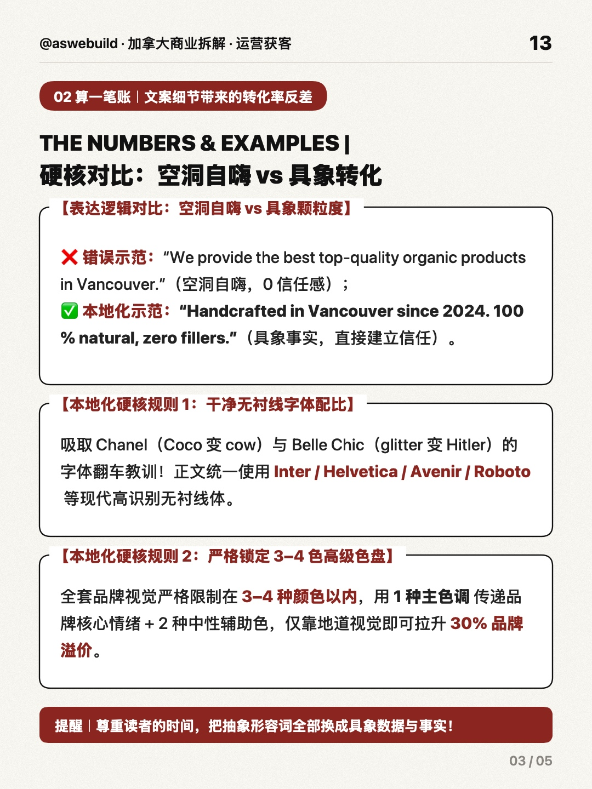
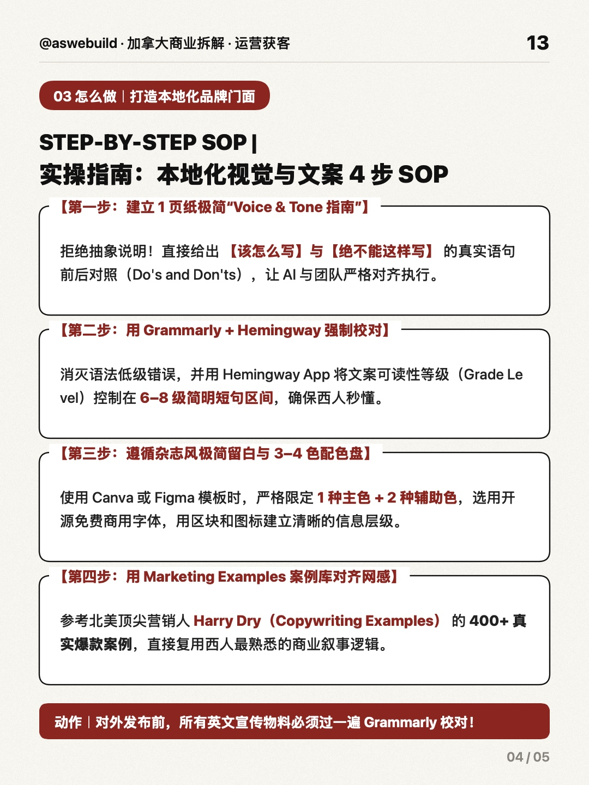
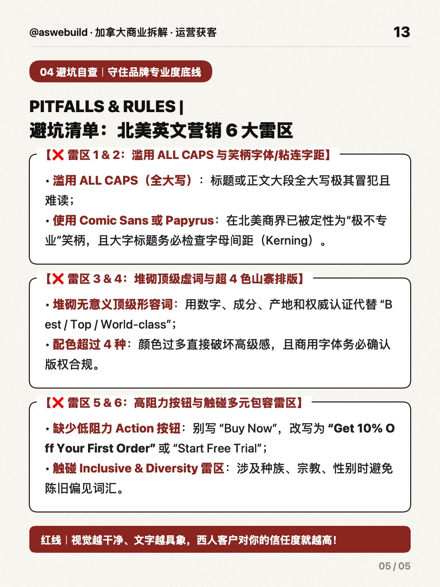

大温做品牌、开小店或做 DTC 跨境出海的华人创业者，最常踩的一个隐形大坑：明明自己的产品和质量非常好，但写出来的英文网页、发出去的 Newsletter 或者做出来的促销海报，在北美西人客户眼里，却充斥着一种“中式机翻味”或“山寨诈骗广告感”。西人客户看一眼，觉得极不专业，直接关掉网页，你的广告费和流量全部打水漂。

英文营销不是做单纯的语言翻译，而是做 **文化语境（Context）、视觉心理学与写作逻辑的本地化** 。很多人以为只要英文语法没错就行，但实际上，北美商业世界里有一套非常严密的“视觉与文案潜规则”——在北美，连大牌选错字体都会酿成惨烈公关事故：比如 **Chanel** 曾因海报字体连字不当，把 *"I love Coco"* 印成了 *"I love cow（我爱母牛）"* ；线上零售商 **Belle Chic** 因选用过于花哨的手写体，把帆布包上的 *"glitter（闪粉）"* 印得极像 *"Hitler"* 引发全网哗然；甚至 **NBA 费城 76 人队** 社媒发战报时因为没调好字母间距（Kerning），导致字母 F 和 I 粘连，把终场比分 **“FINAL”** 直接拼成了粗俗单词 **“ANAL”** 沦为全网笑柄！

想让你的品牌英文宣传显得像本地成熟大厂一样专业、高级且有说服力？记住这 **4 步落地 SOP** ：

### 01｜摒弃自嗨，把抽象形容词全部换成“具象事实”

北美消费者对公关辞令极其敏感（同时在加拿大发布商业宣传须遵守 [加拿大竞争局（Competition Bureau）反误导广告法规](https://competition-bureau.canada.ca/en/deceptive-marketing-practices)）。
* ❌ 别写： *"We are the leading top-quality provider of organic snacks."* （极度自嗨、空洞，西人直接划走）；
* ✅ 改写为： *"Handcrafted in Vancouver since 2024. 100% natural, zero added sugar, zero fillers."*

用具象的数字、原料、产地和权威认证说话，远比堆砌 10 个“Best / World-class”更有力量。同时，把独立站上的行动按钮从生硬的 *"Buy Now"* 换成低阻力的 *"Get 10% Off Your First Order"* 。

### 02｜建立 1 页纸极简“Voice & Tone 指南”

不要以为品牌调性是几万人大公司才需要的东西。把你的品牌说话方式写成 1 页纸，最核心的是列出 **正反案例对比（Do's and Don'ts）** ：
* 明确告诉团队或代笔：不要写“我们的产品非常划算”，要写“为你每月节省 $50 加元”；严禁大段使用 **ALL CAPS（全大写）** ，因为在英文语境里全大写等于无礼咆哮（Shouting），且涉及人群描述时严守北美 Inclusive（多元包容）表达规范；
* 在日常写文案的 Prompt 里，直接把这份 1 页纸指南喂给 AI 强制执行。

### 03｜极简视觉与字体防雷：不超 4 色 + 干净无衬线体

用 Canva 或 Figma 做宣传物料时，克制就是最高级的审美：
* **字体选择与版权** ：严禁使用 **Comic Sans、Papyrus** 等在北美早已被定性为“极其不专业”的笑柄字体（当年《阿凡达》用 Papyrus 做字幕都被 SNL 拍小品全网群嘲）。正文统一使用 **Inter、Helvetica、Roboto、Avenir** 等现代干净无衬线体；大字标题务必做“远看模糊测试”检查字母间距，且商用务必确认拥有 **Commercial License（商业授权）** （版权合规详见 [CIPO 加拿大知识产权局版权指引](https://ised-isde.canada.ca/site/canadian-intellectual-property-office/en/copyright)），优先用 Google Fonts 开源字体规避侵权索赔；
* **色彩与留白** ：全图严格限制在 **3–4 种颜色以内** （1 种主色调传递品牌情绪 + 1–2 个中性辅助色）。剔除高饱和度贴纸与大红大金渐变，宁可少放两句废话也要留出呼吸感。

### 04｜工具硬核校对与本地爆款网感对齐

* **校对双保险** ：所有英文网页和宣传信发出去之前，强制过一遍 **Grammarly** 和 **Hemingway Editor** 。消灭语法低级错误，并把可读性等级（Grade Level）压在 **6–8 年级** 平易近人的简明短句区间；
* **借鉴本土爆款库** ：去搜北美营销人 Harry Dry 创办的 **Marketing Examples（还有 Copywriting Examples）** 宝藏库。那里沉淀了 **400+ 个** 北美顶尖品牌的真实营销与文案拆解，直接对齐西人最接地气的商业叙事逻辑。

**💡 实操落地建议：** 今晚把你公司网站的 Homepage 首页或者宣传单拿出来，对照卡片第 5 页的 **6 大雷区** 自查一遍。把无意义的自夸大话删掉，把字体调成干净的 Inter / Helvetica，把颜色删到 3 种以内。有时候，仅仅是把“语境和视觉”做地道，你的品牌溢价就能直接提升 30%！

  
  
  
  

