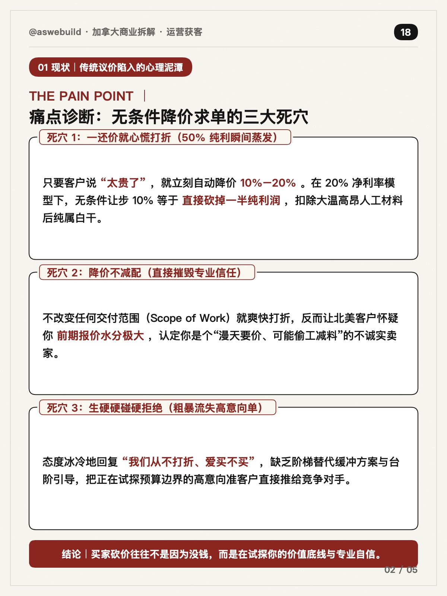
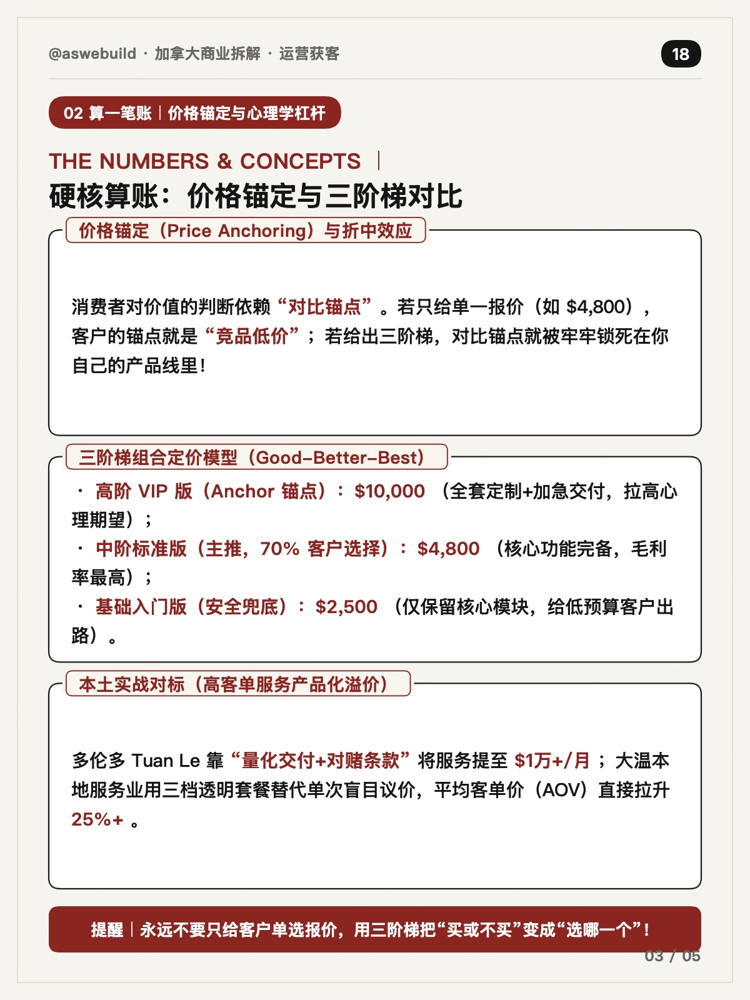
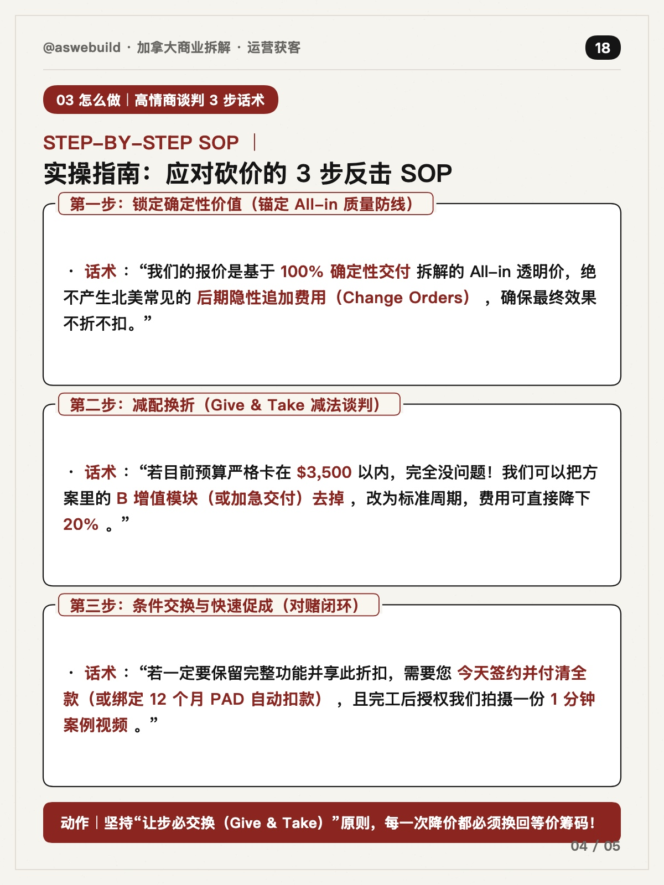
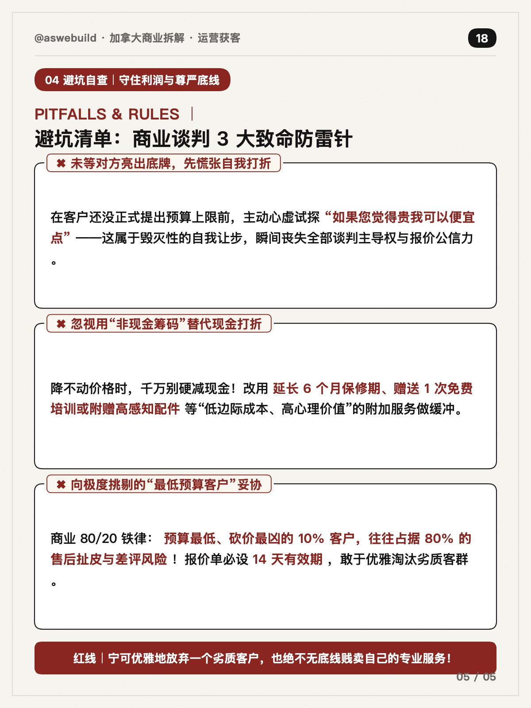

在大温做生意（无论是装修、清洁、设计、财税咨询等 B2B/本地服务，还是高客单定制），几乎所有华人老板都经历过这个窒息时刻：精心做好报价单发过去，对方看都不看细节，直接丢来一句：“太贵了，能不能打 8 折？”或者“别家比你便宜一半，你能 Match 价格吗？”
很多老板遇到这情况瞬间心慌：答应吧，扣除大温高昂的人工和材料费，纯属白干；拒绝吧，又怕丢单便宜了同行。其实在北美商业谈判里， **买家砍价绝不代表没钱，90% 只是在习惯性试探你的底线。**

财务模型显示：如果你的净利率是 20%，无条件打 9 折就会直接吞掉你 **50% 的纯利润** ！更致命的是，如果你不改任何交付内容就爽快降价，西人客户不仅不感激，反而会起疑：“原来前期报价水分这么大？交付会不会偷工减料？”

想在大温守住利润率、同时让客户心服口服？请收好这份 **价格锚定与高情商谈判 SOP** （若涉及 BC 省个人消费类合同报价与取消规则，亦可参考 [Consumer Protection BC 消费者保护局合约指引](https://www.consumerprotectionbc.ca/)）：

### 01｜谈判第一铁律：降价不减配 = 承认报价注水

永远不要在交付范围（Scope of Work）不变的前提下无条件打折。商业心理学中，每一次价格让步都必须伴随条件交换（Give & Take），让客户明白你的价格对应的是精准工时与确定性品质。

### 02｜用“价格锚定（Price Anchoring）”重构三阶梯报价

发报价单时，绝对不要只给一个单选价格！只报一个 $4,800，客户的对比锚点就是竞品的低价。正如多伦多创业者 Tuan Le 靠“标准化阶梯套餐+结果对赌”把短视频服务卖到月费上万刀，正确的做法是给出 **三阶梯组合定价（Good-Better-Best）** ：
1. **高阶 VIP 版（Anchor 锚点）：$10,000** （全套顶配+加急交付，拉高心理预期）；
2. **中阶标准版（主推款）：$4,800** （满足 80% 核心需求，70% 客户会受“折中效应”影响自动选这档）；
3. **基础入门版（安全兜底）：$2,500** （仅保留基础模块，给预算有限客户留台阶）。
有了三阶梯，客户的思考逻辑会瞬间从“买不买你”，变成“在你家的三个方案里选哪一个”。

### 03｜应对砍价的 3 步反击话术（直接套用）

* **第 1 步：锚定确定性价值（消除隐性加价顾虑）**
  话术： *"非常理解您的预算考量。我们的报价是基于 100% 确定性交付核算的 All-in 透明价，绝无北美常见的后期隐性追加开支（Change Orders），帮您彻底规避返工风险。"*
* **第 2 步：减配换折（用“减法谈判”降价）**
  话术： *"若目前预算严格卡在 $3,500 内，完全没问题！我们可以把非核心的 B 模块（或加急服务）先拿掉，改为标准周期交付，正好帮您把总价压进 $3,500。"*
* **第 3 步：条件交换（锁死现金流与案例背书）**
  话术： *"若您希望保留全套功能并享 9 折特惠，我需向合伙人特别申请。条件是：需在今日完成签约并预付全款（或绑定 12 个月 PAD 自动扣款长约），并在完工后授权我们录一段 1 分钟的真实客户案例视频（附 Media Release 授权）。"*

### 04｜北美谈判 3 大避坑防雷针

1. **用“非现金筹码”替代现金让步** ：优先赠送低边际成本、高感知的附加值（如延长半年保修、送一次免费维护）。
2. **报价单必设有效期** ：底部注明 *"Quote valid for 14 days"* ，制造合理紧迫感并防范上游材料涨价（同时定价宣传应遵守 [加拿大竞争局（Competition Bureau）价格透明法规](https://competition-bureau.canada.ca/en/deceptive-marketing-practices)）。
3. **敢于淘汰“最低预算、最高要求”的劣质客** ：砍价最狠的 10% 客户往往消耗 80% 的售后精力。守住价格底线，才能把精力留给尊重专业的优质客户！

—— 掌握价格锚定，你才能在北美的商业谈判桌上，赚到有尊严的纯利润。

  
  
  
  

