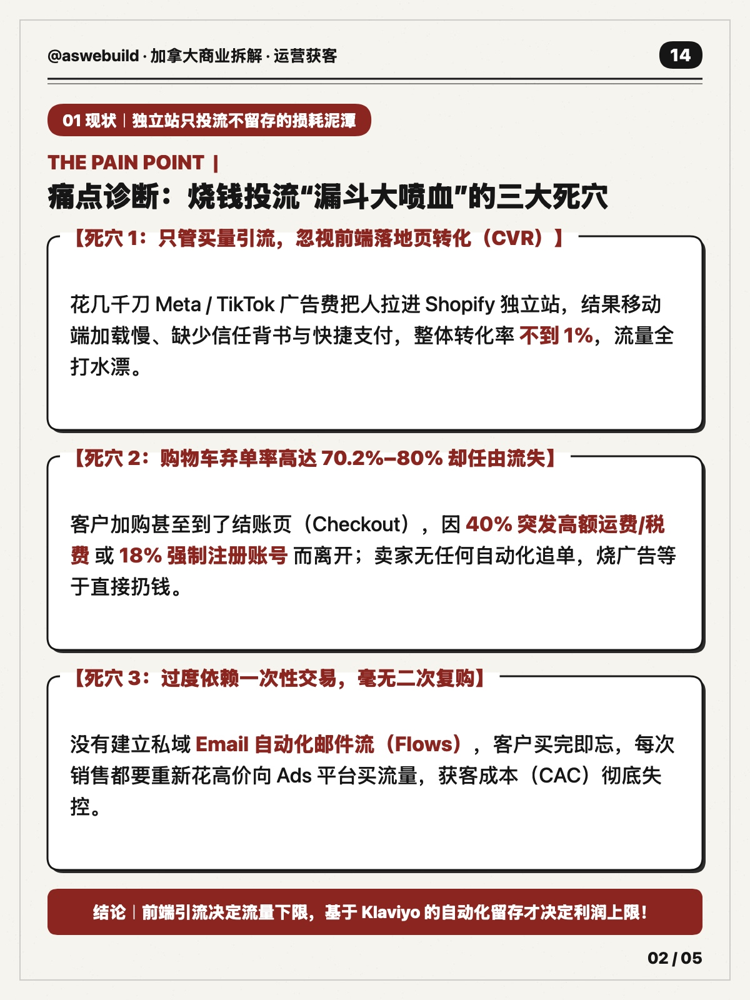
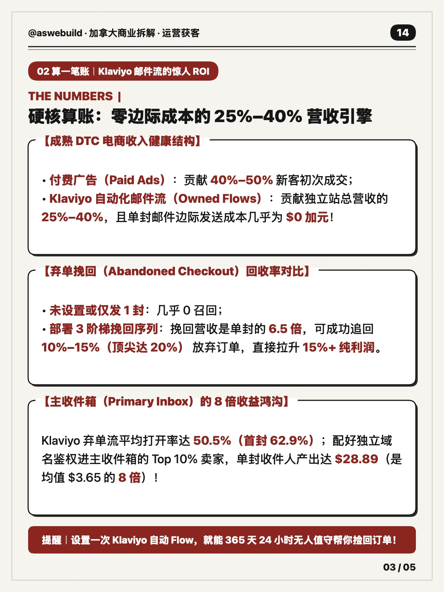
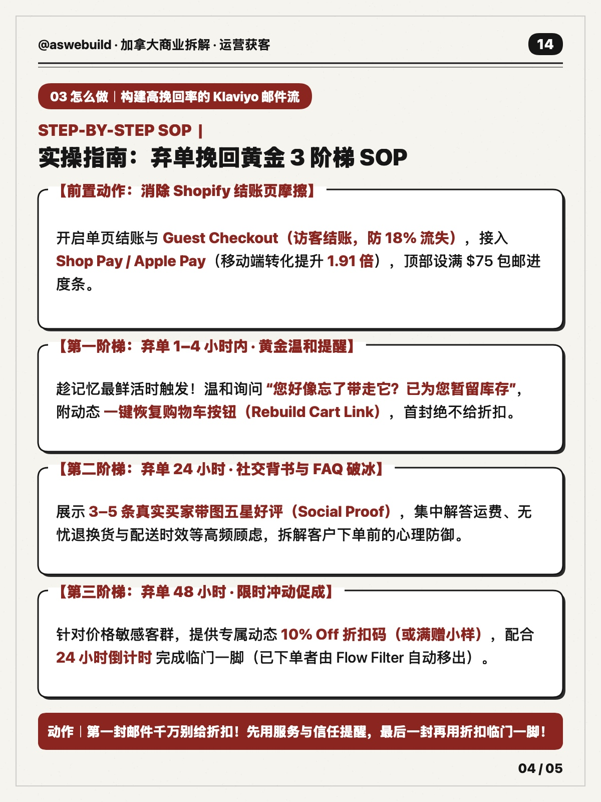
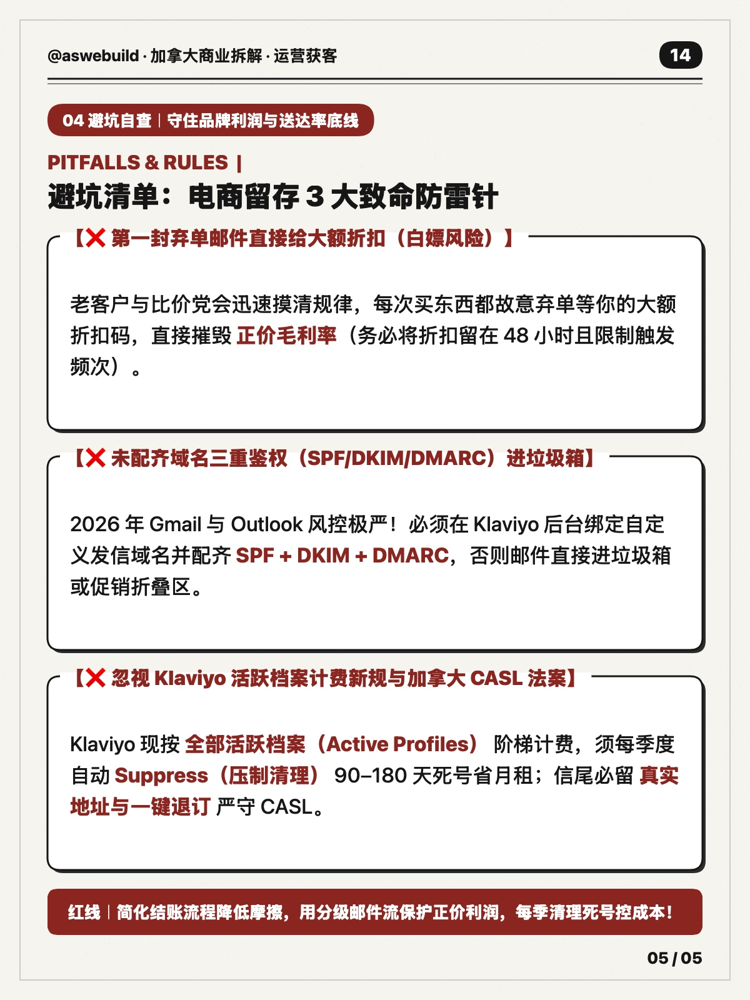

大温做 DTC 电商、Shopify 独立站或跨境出海的华人创业者，最痛心疾首的一个场景：在 Meta 或 TikTok 上砸了几百上千刀广告费，好不容易吸引客户把产品选好放进了购物车，甚至填到了结账最后一步，客户却突然关掉网页走人了！
Baymard Institute 涵盖 50 项研究的 2026 最新基准数据显示： **全球电商的平均购物车弃单率（Cart Abandonment Rate）高达 70.22%，而在手机移动端，弃单率更是高达 80%！** 如果你没有在独立站搭建一套自动化的留存与挽回系统，就意味着你辛苦花钱买来的流量，有七八成直接白白流干了。你每天熬夜投广告，本质上是在给马克·扎克伯格打工。

在成熟的北美 DTC 电商体系里，真正产生高毛利与复购的地方，是 **Shopify + Klaviyo 自动化邮件流（Flows）** 。在健康的独立站财报中，Klaviyo 邮件系统贡献的营收往往占到公司总销售额的 **25%–40%** ！最关键的是，一旦把自动化 Sequence 配置好，它就会 365 天 24 小时无人值守地自动运行，每发出一封挽回邮件的边际成本几乎为 **$0 加元** 。

想要把那些走到门口又犹豫离开的客户重新拉回来？记住这 **4 步 Shopify 高转化结账与 Klaviyo 弃单挽回 SOP** ：

### 01｜降低前端结账摩擦：优化 Shopify Checkout（堵住 58% 人为流失）

调查显示，除了随便逛逛的访客，真实买家弃单的第一大原因（占 **40%** ）是“结账页突然跳出的运费和税费”，第二大原因（占 **18%** ）是“强制要求注册账号”：
* **必须开启 Guest Checkout（访客结账）** ：千万不要强迫新客户花 3 分钟注册账号才能买东西！允许直接以访客身份填邮箱结账。
* **一键开启 Shop Pay / Apple Pay / Google Pay** ：Shopify 官方数据显示，接入 Shop Pay 可让结账转化率提升最高 **50%（手机端转化率更是提升 1.91 倍）** ，客户按一下指纹 3 秒就能付完款。
* **顶部设置包邮进度条** ：不要到了最后一页才跳出高额运费！在网页顶部和侧边栏购物车明确声明 *"全加满 $75 包邮（还差 $15 即可免邮）"* ，既消除运费惊吓，又能顺手拉高客单价（AOV）。

### 02｜部署 Klaviyo 黄金弃单挽回三部曲（Abandoned Checkout & Cart Flow）

Klaviyo 数据表明，部署 **3 封递进邮件序列** 挽回的营收是单封邮件的 **6.5 倍** ，能直接追回 **10%–15%（顶尖卖家达 20%）** 的流失订单：
* **第一阶梯（弃单 1–4 小时内 · 黄金温和提醒）**
  * **心理学** ：客户可能只是接了个电话、带娃或切出去比价被打断了，此时购买记忆最鲜活（首封平均打开率高达 **62.9%** ）。
  * **核心动作** ：温和询问 *"Hi [Name]，您好像忘了带走购物车里的商品？我们已为您暂时保留了库存。"* 附带动态 **一键还原购物车按钮（Rebuild Cart Link）** 。 **切记：第一封千万别给折扣！**
* **第二阶梯（弃单 24 小时后 · 社交证明与疑虑消除）**
  * **心理学** ：客户在犹豫“这东西到底好不好用？退换货麻不麻烦？”。
  * **核心动作** ：展示 **3–5 条带图的真实买家五星好评（Social Proof）** ，并清晰列出无忧退换货承诺与本地发货时效 FAQ。
* **第三阶梯（弃单 48 小时后 · 限时冲动促成临门一脚）**
  * **心理学** ：针对价格敏感型客户，给出最后的下单理由。
  * **核心动作** ： *"我们为您申请了专属 10% Off 限时优惠码（动态生成唯一码），24 小时内有效！"* （注：在 Klaviyo 中设置流过滤器 Flow Filter——一旦客户在任一环节完成下单，自动移出后续邮件序列，绝不骚扰）。

### 03｜搭建高转化 Welcome Flow（新客欢迎自动化序列）

除了弃单挽回，新客首次在弹窗输入邮箱领 10% 首单券时，立刻触发 **3 封 Welcome Series** （欢迎流产生的营收比普通促销邮件高出 **320%** ）：
* **第 1 封（实时触发）** ：秒发首单优惠码，并用 3 句话讲清品牌创始人的初心与核心差异化；
* **第 2 封（第 2 天）** ：展示品牌的爆款单品榜单（Best Sellers）与权威媒体/达人评测；
* **第 3 封（第 4 天）** ：引导关注社交媒体或品牌私域专栏，建立长期复购连接。

### 04｜守住 2026 域名鉴权、Klaviyo 计费新规与加拿大 CASL 合规红线

* **域名三重鉴权（决定 8 倍收益差）** ：Klaviyo 上平均每封弃单邮件产出 $3.65，而进主收件箱的 Top 10% 卖家高达 **$28.89** ！务必在后台绑定品牌自定义发信域名，配齐 **SPF + DKIM + DMARC** 解析，确保邮件进 Gmail 主收件箱而非垃圾箱。
* **防范 Klaviyo 活跃档案（Active Profiles）账单刺客** ：自 2025 年起，Klaviyo 改为按后台 **所有活跃档案总数** 强制计费（免费版仅限 250 人）。务必每季度配置自动清理规则，将 **90–180 天从未打开邮件的僵尸号一键 Suppress（压制归档）** ，立省大笔月租！
* **严守 [加拿大 CASL 反垃圾邮件法](https://ised-isde.canada.ca/site/canada-anti-spam-legislation/en) 与 [PIPEDA 联邦隐私保护法](https://www.priv.gc.ca/en/privacy-topics/privacy-laws-in-canada/the-personal-information-protection-and-electronic-documents-act-pipeda/)** ：每封邮件底部必须保留清晰的 **Unsubscribe（一键退订）** 链接与真实公司通信地址。

**💡 实操落地建议：** 今晚登录你的 Shopify 和 Klaviyo 后台，检查一下你的 **Abandoned Checkout Flow** 是不是只设了系统默认的 1 封简陋提醒？花一个小时把这 **3 封递进式邮件模板** 配置上线，并开启 Shop Pay。把跑到门口的客户挽回来，你的独立站纯利润率就能立刻提升 15% 以上！

  
  
  
  

