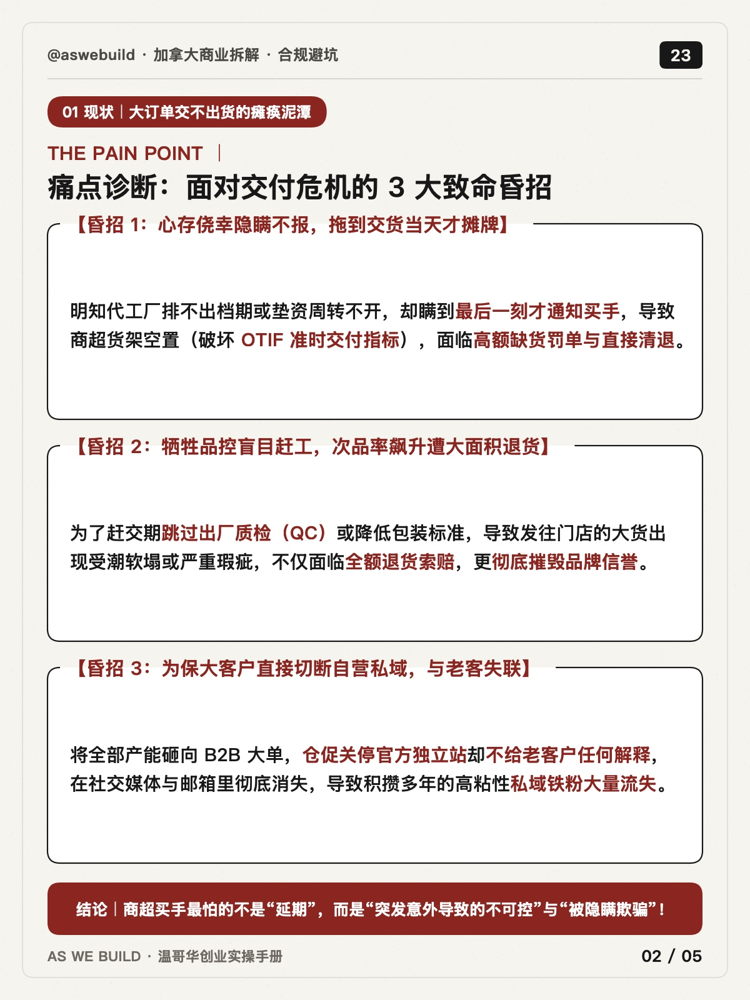
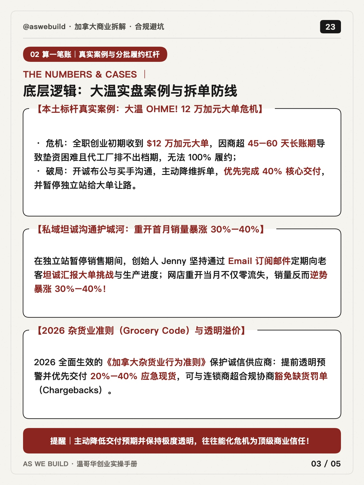
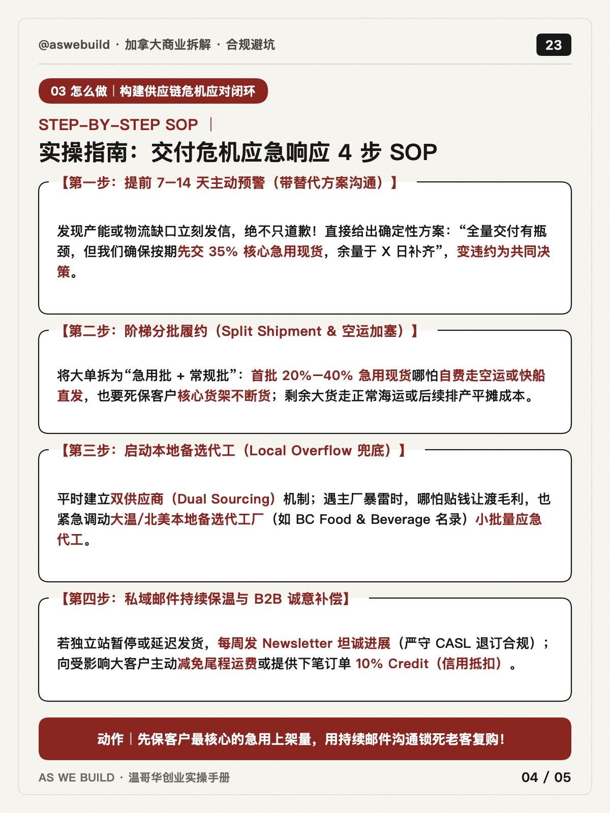
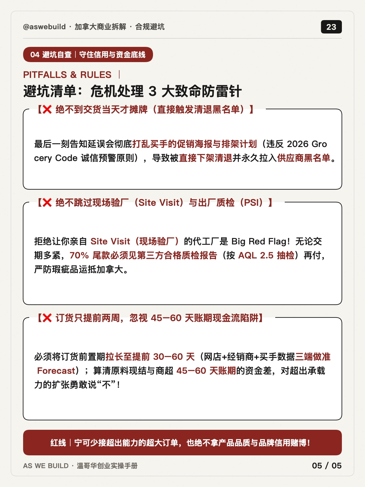

在大温做消费品、DTC 品牌或 B2B 贸易的华人创业者，最梦寐以求、却也最容易踩坑的时刻：终于接到了爆款大订单！
很多创业者第一反应是欣喜若狂，紧接着就被现实泼了冷水：代工厂排不出档期、跨国海运延误，或者因为零售商普遍有 **45–60 天账期** ，手头现金根本垫不起大货的预付款。
眼看交货期逼近，仓库里却只有一小半货。大订单交不出货，处理不好就是彻底毁掉品牌的灭顶之灾；但处理得当，反而能成为建立顶级信任的试金石！

想在 2026 年应对大单交付危机并锁死客户信任？记住这套 **4 步危机响应 SOP** ：

### 01｜提前 7–14 天主动透明沟通（善用 2026 新规）

商超买手最怕的不是延期，而是“被隐瞒到最后一刻”。一旦发现产能缺口，提前 7–14 天发邮件预警并给出替代方案： *"因排产瓶颈，10月1日全量交付有难度，但我们可确保按期优先交付 35% 核心急用现货，余量于 10月20日补齐。"* 结合 **2026 年全面生效的《[加拿大杂货业行为准则（Grocery Code）](https://canadacode.org/)》（详见 [加拿大农业及农业食品部 AAFC](https://agriculture.canada.ca/)）** ，提前透明预警可合规协商免除高额缺货罚单（Chargebacks）！

### 02｜阶梯分批履约（Split Shipment & 空运加塞）

把大单拆成两批：首批 20%–40% 急用现货哪怕自费走空运或快船直发，也要保住客户核心货架不断货（守住 OTIF 指标）；剩余大货走正常海运或后续排产跟进。

### 03｜启动本地备选代工（Dual Sourcing 兜底）

平时在大温或北美物色 1–2 家备选代工厂（可查 BC Food & Beverage 协会或 [Invest Surrey 素里市府商业名录](https://investsurrey.ca/)， **切记：不让你亲自 Site Visit 现场验厂的坚决不碰！** ）。主厂暴雷时，哪怕贴点利润也用本地小批量代工应急兜底。

### 04｜私域邮件持续保温 + 后置诚意补偿

若零售端延迟发货，像 OHME! 和加拿大品牌 Mid-Day Squares 一样，用每周 Newsletter 坦诚沟通进度；对 B2B 大客户则主动减免运费或提供下笔订单 **10% Credit（信用抵扣）** 。

### 05｜从源头规避：订货前置 30–60 天与三端 Forecast

把订货节奏从提前两周拉长至 **提前 30–60 天** ；将 **网店订阅数据、经销商月度排期与买手品类历史数据** 三端合一做准 Forecast。

**💡 实操落地建议：** 永远不要为了赶交期跳过第三方出厂质检（PSI），更不要用次品去赌运气。开诚布公拆单履约，学会对超出资金承载力的盲目扩张说“不”，才能在北美商业牌桌上长久赢下去！

  
  
  
  

