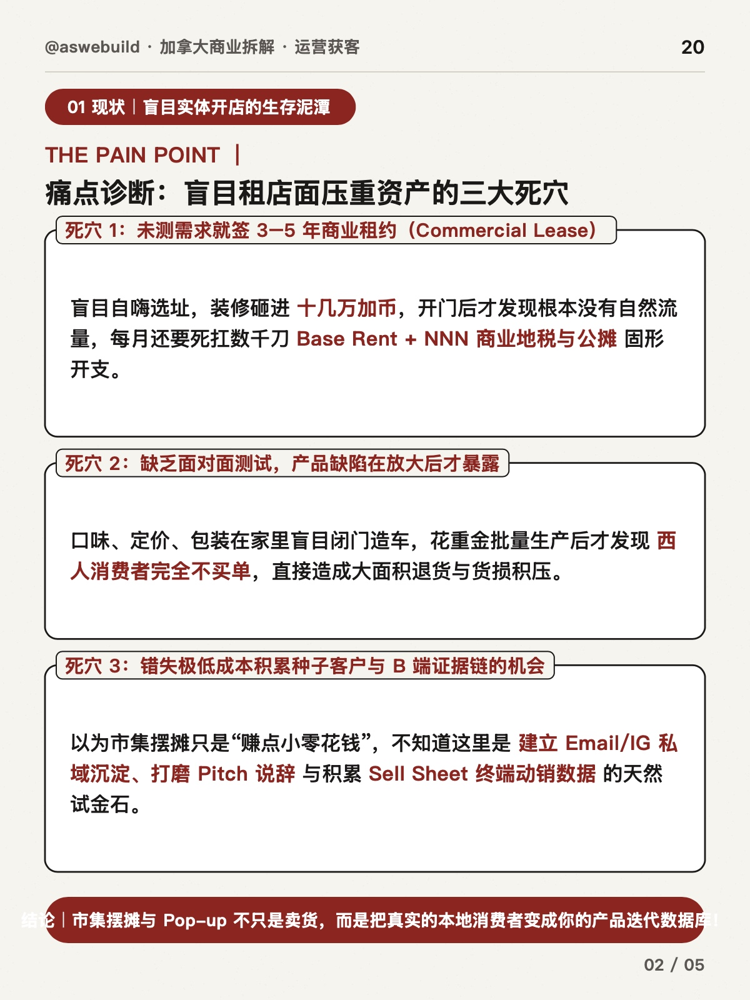
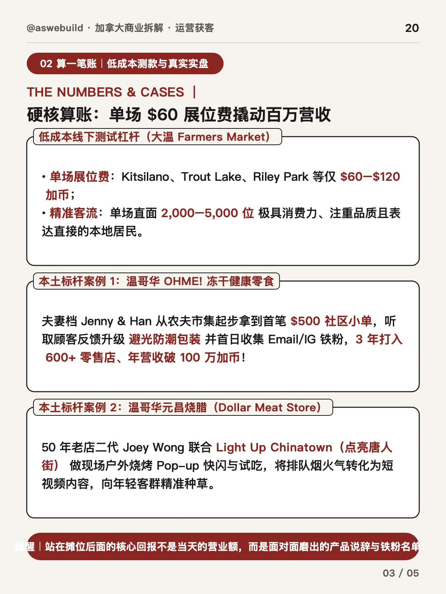
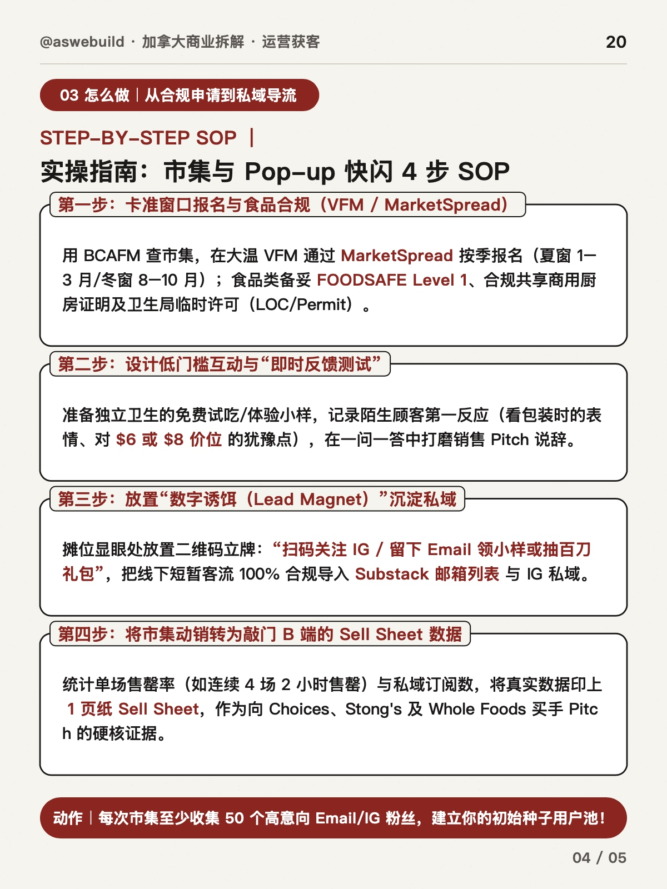
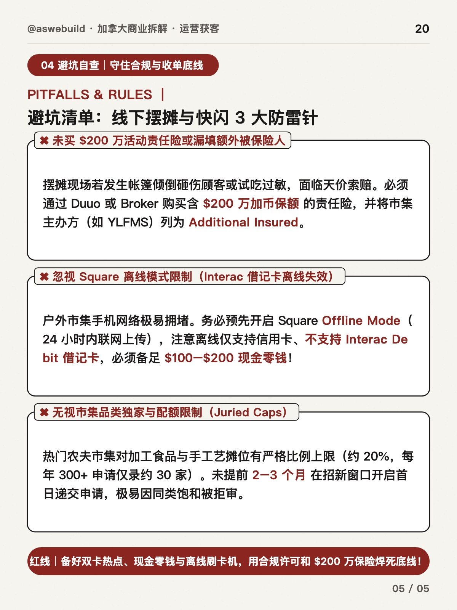

在大温做实体零售、特色食品、烘焙零食或手工艺品牌的创业者，最容易冲动犯的一个大错：还在想法阶段，就急着找商业地产经纪看店，砸下十几万加币装修，签下 3–5 年强法律约束力的 Commercial Lease 商业租约。结果开张后发现根本没有预期客流，产品定价和包装西人不买单，每月还要死扛几千刀 Base Rent 加 NNN 地税公摊，进退两难。

在北美，聪明的创业者在租店面之前，都会先去 **Farmers Market（农夫市集）** 或借场地做 **Pop-up（快闪店）** 完成极低成本的 MVP 压力测试。在温哥华，Kitsilano、Trout Lake、Mount Pleasant、Riley Park 等热门市集单场展位费仅 **$60–$120 加币** ，却能让你一天直面数千位极具消费力且表达直接的本地居民！

我们写过的大温本土品牌实盘案例，就是这一打法的最佳写照：
1️⃣ **OHME! Foods（温哥华创始人 Jenny & Han）** ：早期从农夫市集摸爬滚打起步，不仅拿到第一笔 $500 社区小单，更在与上千位陌生人面对面交流中拿到一手反馈——有顾客提醒透明包装下冻干水果见光易受潮软塌，他们立刻升级避光防潮包装；首日便扫码沉淀 Email 和 IG 铁粉。随后他们将市集动销数据印上 Sell Sheet 肉身跑店，3 年打入全加 600+ 主流超市，年营收破 100 万加币！
2️⃣ **元昌烧腊（Dollar Meat Store 二代 Joey Wong）** ：50 年老店积极参与社区 **Light Up Chinatown（点亮唐人街）** 节庆，户外搭建烧烤 Pop-up 快闪摊位，把档口切肉烟火气内容化，联合本地主厨社媒种草，成功引流大批年轻人重回实体店。

想在大温低成本跑通摆摊与快闪？记住这 **4 步落地 SOP** ：

### 01｜合规准入与保险（VFM & 2026 食品新规）

* **卡准窗口报名** ：通过 [BC Association of Farmers' Markets (BCAFM)](https://bcfarmersmarket.org/) 官网查全省市集名录，大温核心市集去 **[Vancouver Farmers Markets (eatlocal.org)](https://eatlocal.org/)** 通过 **MarketSpread** 系统在招新窗口（夏窗 1–3 月/冬窗 8–10 月）提前 2–3 个月递交申请；
* **食品合规三件套** ：备妥主理人 **[BC FOODSAFE Level 1 认证](https://www.foodsafe.ca/)** 证书、合规共享商用厨房（Commissary Kitchen）租用证明，并提前 14 天向卫生局（[温哥华沿岸卫生局 VCH 临时食品许可](https://www.vch.ca/en/service/temporary-food-markets) 或 [菲沙卫生局 Fraser Health 临时食品许可](https://www.fraserhealth.ca/health-topics-a-to-z/food-safety/temporary-food-markets)）申领临时市集许可（LOC / Temporary Food Permit）；
* **$200 万责任险** ：通过 Duuo 或 Broker 购买 **$200 万加币保额** 临时活动责任险，务必将市集主办方（如 YLFMS）列为额外被保险人（Additional Insured）。

### 02｜把摊位变成“产品与价格测试场”

准备独立卫生的免费试吃小样，观察西人看到包装的第一反应，测试 $6 还是 $8 的价格敏感度；一天跟 200 个陌生人开口，你的 Pitch 说辞会被顾客一句句“问”出来。

### 03｜用“数字诱饵”把公域客流转入私域

别只说“下周六还在这”！摊位显眼处放二维码立牌，把现场买家沉淀到 Substack 邮箱列表与 IG 中。

### 04｜把市集数据印上 Sell Sheet + 守住离线收单红线

* **敲门商超** ：将“连续 4 场 2 小时售罄、500+ 本地订阅”印上 1 页纸 Sell Sheet，敲门 Choices、Stong's 或 Whole Foods 买手时说服力拉满！
* **防跑单铁律** ：户外网络极易拥堵，提前开启 Square **Offline Mode（离线模式）** 并注意 24 小时内联网上传；切记加拿大离线模式仅支持信用卡、 **不支持 Interac Debit 借记卡** ，务必备足 **$100–$200 现金零钱（Float）** 与双卡热点！

先花一百块去摆一次摊，让陌生消费者用钱包为你投票，才是北美创业性价比最高的保命符。

🎉《大温华人创业通关图文指南》第二部分【日常运营与高效获客篇】（第 9–20 篇）全部完结！下一篇正式开启 **第三部分：突发危机与合规避坑篇** ！

  
  
  
  

