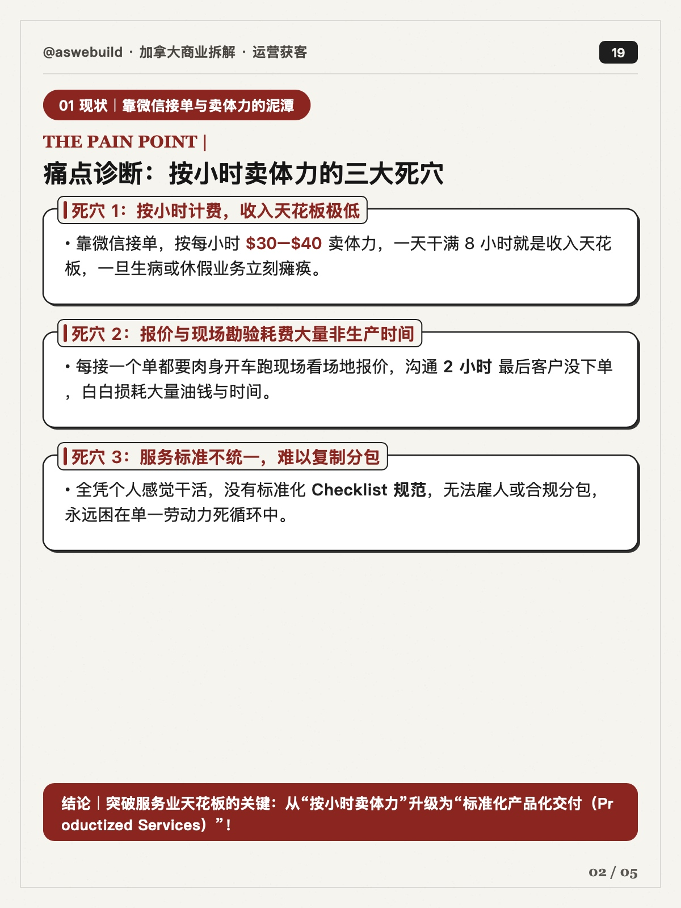
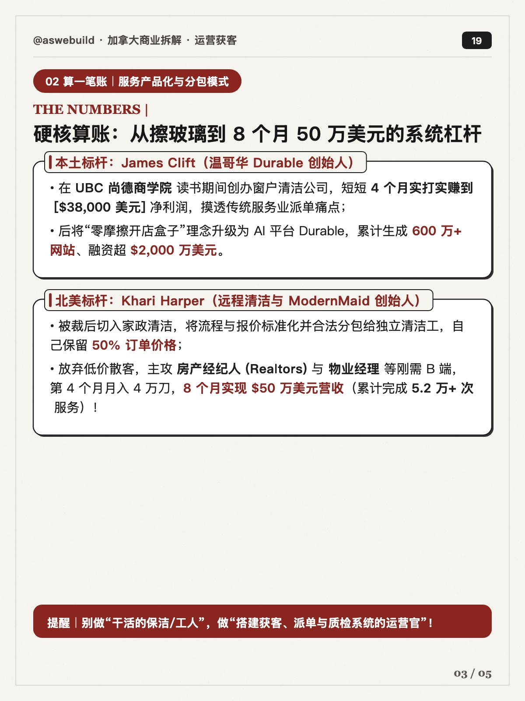
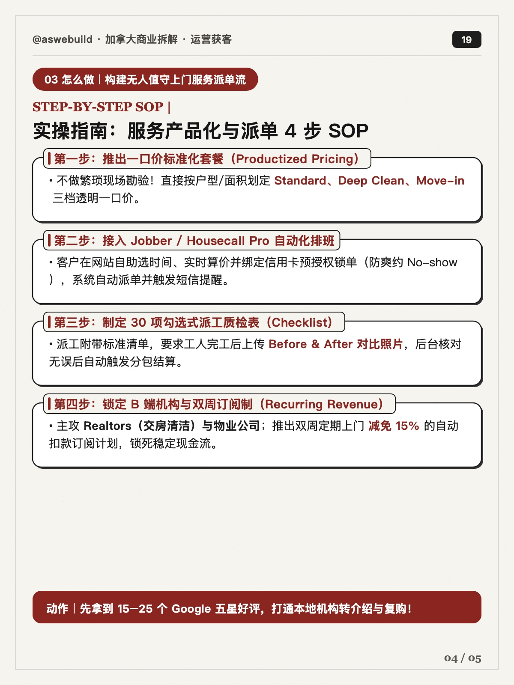
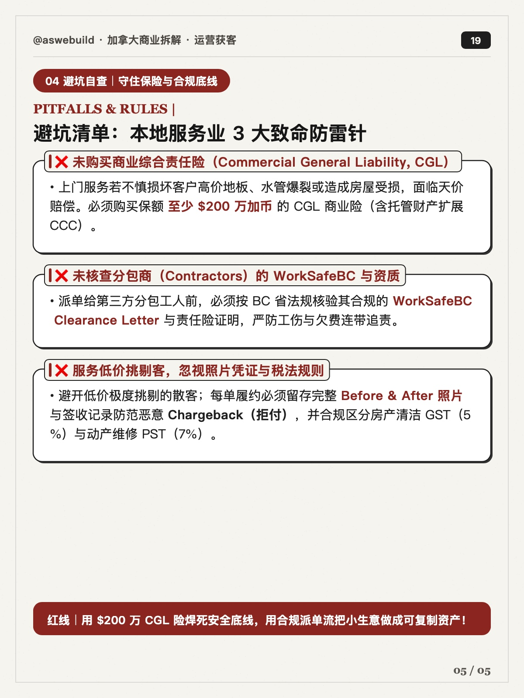

在大温做本地上门服务（家政清洁、房屋维修、洗地毯、除草洗屋顶、水暖搬家），多数华人手艺人最常卡在同一个瓶颈：靠微信接单，按 **$30–$40/小时** 卖体力。每天从早干到晚，累死累活月入几千刀；一旦生病或休假，收入立刻归零！

在北美，靠本地服务业年入几十万甚至上百万刀的人，绝不是“亲自去干活”，而是把服务做成标准化产品，搭建全自动派单系统。两个真实标杆案例就是最佳证明：
1. **James Clift（温哥华 Durable 创始人）** ：在 UBC 尚德商学院读书期间创办窗户清洁公司，短短 **4 个月净赚 $38,000 美元** ，摸透传统服务业派单痛点，后来做出了服务 600 万+ 小微企业的 AI 建站平台。
2. **Khari Harper（ModernMaid 创始人）** ：2022 年被裁后切入家政清洁，将报价与流程标准化，研究外包合同法律结构，把订单合法分包给本地独立清洁工， **自己保留 50% 订单毛利** 。他放弃低价散客，主攻房产经纪人（Realtors）与物业经理等刚需 B 端， **第 4 个月月入 4 万美元，8 个月累计营收破 $50 万美元（累计完成 5.2 万+ 次服务）** ，并将内部系统做成 SaaS 软件 ModernMaid（$27/月起）！

想在大温把上门服务升级为“无人值守的自动派单生意”？记住这 **4 步 SOP** ：

### 01｜服务产品化（Productized Services）：一口价消灭现场勘验

别每次询价都开车半小时去现场看房！按户型（Condo/Townhouse/House）、面积与卫浴数，直接划定 **Standard（日常）、Deep Clean（深度）、Move-in/out（交房退租）** 三档透明一口价套餐。客户在网页勾选规格即可实时算出价格，消灭 90% 无效询价与扯皮。

### 02｜自动化排班与锁单（Jobber / Housecall Pro / ModernMaid）

别在微信里来回发十几条消息对时间！在独立站或社媒 Bio 挂上 **Jobber** （2026 单人版年付 $29 USD/月起，支持 AI 语音接听）或 **ModernMaid / Cal.com** 预约流：客户自助选时间、填地址并绑定信用卡预授权锁单（防爽约 No-show），系统自动派单并在上门前 24 小时发短信提醒。

### 03｜30 项勾选式质检表（Checklist）+ 照片留存结算

把每次上门拆解为 20–30 项勾选清单（如擦踢脚线、烤箱去油、龙头除垢）。要求分包人员完工后通过 App 上传 **Before & After 对比照片** ，后台核对无误才触发分包佣金结算，用机制杜绝外包质量失控。

### 04｜锁定 B 端刚需机构 + 双周定期订阅制（Recurring Revenue）

扫街对接大温 **Realtors 与 Property Managers** ——交房与招租清洁是刚性支出，合作稳定就会持续派单；对 C 端家庭推出“双周/每月定期上门享 15% 折扣”的自动扣款订阅计划，锁死长期现金流。

### 05｜必须守住的 3 条大温合规底线

1. **买足 $200 万加币商业险** ：必须投保至少 **$200 万 CAD 的商业综合责任险（CGL，含托管财产扩展 CCC）** ，严防损坏客户名贵地板或水管爆裂导致倾家荡产。
2. **严查 WorkSafeBC Clearance Letter** ：依据 BC 省法规，派单给外包 Contractor 前必须在线核验其 **[WorkSafeBC 清结信（Clearance Letter）](https://www.worksafebc.com/en/insurance/know-coverage-status/get-a-clearance-letter)** 与自备保险，并在合同中明确独立承包关系（自带工具、自主接单），规避工伤与保费连带追责。
3. **死磕前 25 个 Google 好评与税务合规** ：冷启动期先靠扎实交付攒够 **15–25 个 Google 五星好评** 打通自然流量；注意依据 [BC 省财政厅 PST 房产服务豁免指引](https://www2.gov.bc.ca/gov/content/taxes/sales-taxes/pst/publications)，BC 省不动产常规清洁/除草免收 7% PST（仅收 5% GST），切勿乱收税被罚！

今晚就把“按小时收费”改成三档一口价套餐，用系统把小生意变成可复制的商业资产！

  
  
  
  

